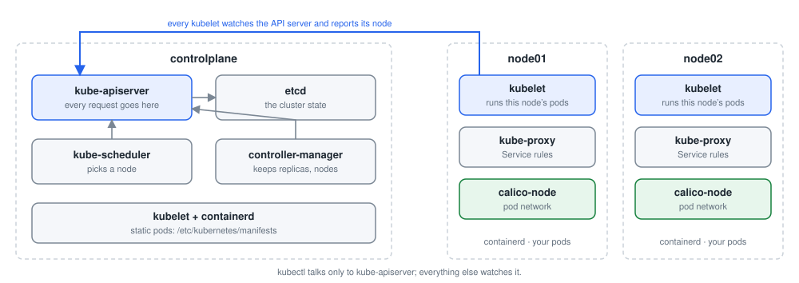
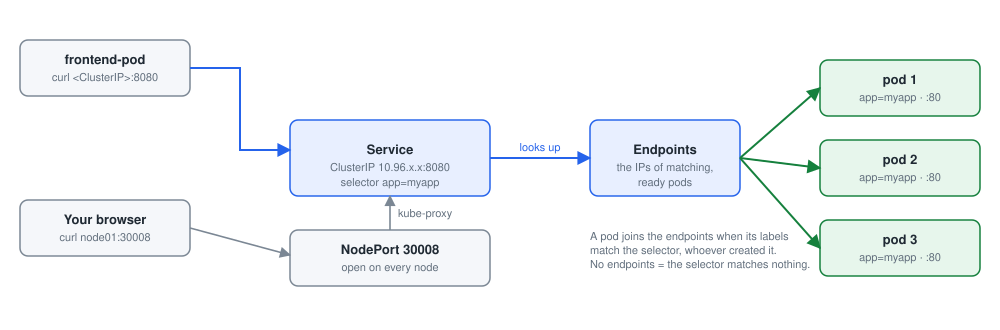

# Module 2: Core concepts

Each lab below is a practical from this repository, step by step: the command, what it does, and what it printed on the practice cluster. Names with random endings (pod names such as `nginx-7d9c…`), IP addresses and ages will differ on yours. Lab numbers are those of the labs in Desired Labs.

- [Lab 1.1: Your first pod](#lab-11-your-first-pod)
- [Lab 1.2: A pod from a YAML file](#lab-12-a-pod-from-a-yaml-file)
- [Lab 1.3: Pods from the command line](#lab-13-pods-from-the-command-line)
- [Lab 1.4: Commands and arguments](#lab-14-commands-and-arguments)
- [Lab 1.5: Expose a container port](#lab-15-expose-a-container-port)
- [Lab 1.6: ReplicationController and ReplicaSet](#lab-16-replicationcontroller-and-replicaset)
- [Lab 1.7: Deployments](#lab-17-deployments)
- [Lab 1.8: NodePort service](#lab-18-nodeport-service)
- [Lab 1.9: ClusterIP service](#lab-19-clusterip-service)
- [Lab 1.10: Namespaces and a resource quota](#lab-110-namespaces-and-a-resource-quota)

## Before you start

Start the practice cluster on your Ubuntu server, as in the [README](../README.md#the-practice-cluster):

```bash
git clone https://github.com/kumbulanit/CKA.git && cd CKA
sudo ./setup.sh          # minikube with three nodes, Kubernetes v1.36 (about 10 minutes the first time)
kubectl get nodes         # minikube, minikube-m02, minikube-m03
```

The steps use those node names, and `minikube ssh -n <node>` for commands on a node. Run `kubectl` as your own user on the server; commands on the control plane's files (`/etc/kubernetes/manifests`, the kubelet) go through `minikube ssh` with `sudo`. The outputs were recorded in Desired Labs, where the terminal is already root on `minikube` and the API server answers on port 6443 (8443 on minikube): addresses, ports and ages on yours will differ.

## Lab 1.1: Your first pod



*A kubeadm cluster: what runs where, and who talks to whom*

### What you will do

Follow [02-basic-pods.md](https://github.com/kumbulanit/CKA/blob/main/02-core-concepts/02-basic-pods.md):

1. List the nodes of the cluster.
2. Create a pod called **mywebserver** from the `nginx` image.
3. List the pods until it is `Running`.
4. Connect inside the pod with `bash` (leave with Ctrl+D), then list its root folder with `ls -l /`.
5. Delete the pod.

### Step by step

**Step 1.** Lists the nodes.

```bash
kubectl get nodes
```

You should see something like:

```text
NAME           STATUS   ROLES           AGE   VERSION
minikube       Ready    control-plane   46s   v1.36.4
minikube-m02   Ready    <none>          35s   v1.36.4
minikube-m03   Ready    <none>          35s   v1.36.4
```

**Step 2.** Starts the pod `mywebserver` from the image `nginx`.

```bash
kubectl run mywebserver --image=nginx
```

You should see something like:

```text
pod/mywebserver created
```

**Step 3.** Waits until the pod `mywebserver` is Ready. Wait until it is Running.

```bash
kubectl wait --for=condition=Ready pod/mywebserver --timeout=120s
```

You should see something like:

```text
pod/mywebserver condition met
```

**Step 4.** Lists the pods.

```bash
kubectl get pods
```

You should see something like:

```text
NAME          READY   STATUS    RESTARTS   AGE
mywebserver   1/1     Running   0          16s
```

**Step 5.** Runs a command inside the pod `mywebserver`.

```bash
kubectl exec -it mywebserver -- ls -l /
```

You should see something like:

```text
Unable to use a TTY - input is not a terminal or the right kind of file
total 20
lrwxrwxrwx   1 root root    7 Jul 17 17:05 bin -> usr/bin
drwxr-xr-x   1 root root    0 Jul 17 17:05 boot
drwxr-xr-x   5 root root  340 Oct 27 22:50 dev
drwxr-xr-x   1 root root   54 Oct 21 22:17 docker-entrypoint.d
-rwxr-xr-x   1 root root 1620 Oct 21 22:16 docker-entrypoint.sh
drwxr-xr-x   1 root root   20 Oct 27 22:50 etc
drwxr-xr-x   1 root root    0 Jul 17 17:05 home
lrwxrwxrwx   1 root root    7 Jul 17 17:05 lib -> usr/lib
drwxr-xr-x   1 root root    0 Oct 20 21:32 media
drwxr-xr-x   1 root root    0 Oct 20 21:32 mnt
drwxr-xr-x   1 root root    0 Oct 20 21:32 opt
dr-xr-xr-x 319 root root    0 Oct 27 22:50 proc
-rw-r--r--   1 root root   37 Oct 27 22:50 product_uuid
drwx------   1 root root   30 Oct 20 21:32 root
drwxr-xr-x   1 root root   32 Oct 27 22:50 run
lrwxrwxrwx   1 root root    8 Jul 17 17:05 sbin -> usr/sbin
… (5 more lines)
```

**Step 6.** Deletes the pod `mywebserver`.

```bash
kubectl delete pod mywebserver
```

You should see something like:

```text
pod "mywebserver" deleted from default namespace
```

### If you see something else

- The check says: _No pod called mywebserver has run yet. Create it with `kubectl run`._
- The check says: _mywebserver should run the `nginx` image._
- The check says: _mywebserver is still there. The last step deletes it._
- `kubectl run <name> --image=<image>` creates a pod; `kubectl get pods` lists them.
- `kubectl exec -it mywebserver -- ls -l /` runs a command inside the pod; `kubectl delete pod mywebserver` removes it.
- Try `kubectl exec -it mywebserver -- bash` before deleting the pod; getting a shell inside a container is a skill you use all the time.
- `kubectl run` needs an image: `kubectl run mywebserver --image=nginx`.

### Why it works

**Why it works.** `kubectl run` creates a single pod; Kubernetes never runs a container on its own, only inside a pod. The scheduler picks a node (minikube-m02 or minikube-m03), that node's kubelet pulls the image and starts the container. `kubectl exec` opens a process inside the running container, which is how you look around in it. Deleting a pod that no controller owns removes it for good: nothing recreates it.

**In the exam:** `kubectl run` is the fastest way to get a test pod, for example `kubectl run tmp --image=busybox --rm -it --restart=Never -- sh`.

---

## Lab 1.2: A pod from a YAML file

### What you will do

Follow [03-first-pod-yaml.md](https://github.com/kumbulanit/CKA/blob/main/02-core-concepts/03-first-pod-yaml.md):

1. Write the manifest **newpod.yaml** in your home folder: a pod called **nginxwebserver** with one
   container called **democontainer** from the `nginx` image.
2. Create it with `kubectl apply -f newpod.yaml` and list the pods.
3. Delete what the file created with `kubectl delete -f newpod.yaml`.

### Step by step

**Step 1.** Writes the file `newpod.yaml`.

```bash
cat > newpod.yaml <<'EOF'
apiVersion: v1
kind: Pod
metadata:
  name: nginxwebserver
spec:
  containers:
  -  image: nginx
     name: democontainer
EOF
```

It prints nothing when it works.

**Step 2.** Creates the objects in `newpod.yaml`, or updates them if they exist.

```bash
kubectl apply -f newpod.yaml
```

You should see something like:

```text
pod/nginxwebserver created
```

**Step 3.** Waits until the pod `nginxwebserver` is Ready. Wait until it is Running.

```bash
kubectl wait --for=condition=Ready pod/nginxwebserver --timeout=120s
```

You should see something like:

```text
pod/nginxwebserver condition met
```

**Step 4.** Lists the pods.

```bash
kubectl get pods
```

You should see something like:

```text
NAME             READY   STATUS    RESTARTS   AGE
nginxwebserver   1/1     Running   0          15s
```

**Step 5.** Deletes the objects in `newpod.yaml`.

```bash
kubectl delete -f newpod.yaml
```

You should see something like:

```text
pod "nginxwebserver" deleted from default namespace
```

### If you see something else

- The check says: _/root/newpod.yaml is missing, or does not name the pod nginxwebserver and the container democontainer._
- The check says: _The pod nginxwebserver with container democontainer has not run yet. Apply the file._
- The check says: _nginxwebserver is still there. Delete it with `kubectl delete -f newpod.yaml`._
- A pod manifest has four top-level keys: `apiVersion: v1`, `kind: Pod`, `metadata` (with `name`) and `spec` (with `containers`).
- Each item under `containers` needs `name` and `image`. Indent with spaces, never tabs.
- `kubectl delete pod nginxwebserver` works too, but `kubectl delete -f newpod.yaml` deletes everything the file created, however many objects it holds.

### Why it works

**Why it works.** A manifest describes the object you want: `apiVersion` and `kind` say what it is, `metadata.name` names it, `spec` describes it. `kubectl apply -f` sends it to the API server, which stores it and lets the scheduler and kubelet make it real. `kubectl delete -f` deletes exactly the objects the file describes.

**In the exam:** keep your manifests in files. You can fix a mistake and apply again, and `kubectl delete -f` cleans up.

---

## Lab 1.3: Pods from the command line

### What you will do

Follow [04-pod-manifest-cli.md](https://github.com/kumbulanit/CKA/blob/main/02-core-concepts/04-pod-manifest-cli.md):

1. Create a pod **nginx** from the `nginx` image and list the pods.
2. Create a pod **nginx-port** from `nginx` that exposes port **80**, and describe it.
3. Print the manifest `kubectl` would create for `nginx` with port 80, without creating anything
   (`--dry-run=client -o yaml`).
4. Delete the pod `nginx`, then delete all pods in the namespace.

### Step by step

**Step 1.** Starts the pod `nginx` from the image `nginx`.

```bash
kubectl run nginx --image=nginx
```

You should see something like:

```text
pod/nginx created
```

**Step 2.** Lists the pods.

```bash
kubectl get pods
```

You should see something like:

```text
NAME    READY   STATUS              RESTARTS   AGE
nginx   0/1     ContainerCreating   0          0s
```

**Step 3.** Starts the pod `nginx-port` from the image `nginx`.

```bash
kubectl run nginx-port --image=nginx --port=80
```

You should see something like:

```text
pod/nginx-port created
```

**Step 4.** Waits until the pods `nginx`, `nginx-port` are Ready. Wait until they run.

```bash
kubectl wait --for=condition=Ready pod/nginx pod/nginx-port --timeout=120s
```

You should see something like:

```text
pod/nginx condition met
pod/nginx-port condition met
```

**Step 5.** Shows the details of the pod `nginx-port`, with its recent events at the bottom.

```bash
kubectl describe pod nginx-port
```

You should see something like:

```text
Name:             nginx-port
Namespace:        default
Priority:         0
Service Account:  default
Node:             minikube-m03/192.168.147.4
Start Time:       Tue, 27 Oct 2026 22:50:22 +0000
Labels:           run=nginx-port
Annotations:      <none>
Status:           Running
IP:               10.244.1.3
IPs:
  IP:  10.244.1.3
Containers:
  nginx-port:
    Container ID:   containerd://4ba557ec82dba4ae346e8ec8815dc6830ce3170eba0f65b0db7f493da4ede244
    Image:          nginx
    Image ID:       docker.io/library/nginx@sha256:4c41e2d0a3a55b325ed572cd0200bdb72af1433c3daa2bca6ef8eea68ce504a2
    Port:           80/TCP
… (34 more lines)
```

**Step 6.** Writes the manifest of the pod `nginx` without creating it.

```bash
kubectl run nginx --image=nginx --port=80 --dry-run=client -o yaml
```

You should see something like:

```text
apiVersion: v1
kind: Pod
metadata:
  labels:
    run: nginx
  name: nginx
spec:
  containers:
  - image: nginx
    name: nginx
    ports:
    - containerPort: 80
    resources: {}
  dnsPolicy: ClusterFirst
  restartPolicy: Always
status: {}
```

**Step 7.** Deletes the pod `nginx`.

```bash
kubectl delete pod nginx
```

You should see something like:

```text
pod "nginx" deleted from default namespace
```

**Step 8.** Deletes the pod.

```bash
kubectl delete pod --all
```

You should see something like:

```text
pod "nginx-port" deleted from default namespace
```

### If you see something else

- The check says: _The pods nginx and nginx-port have not both run yet._
- The check says: _The pods nginx and nginx-port are still there. The last steps delete them (`kubectl delete pod --all`)._
- `--port=80` on `kubectl run` adds `containerPort: 80` to the container.
- `kubectl run nginx --image=nginx --port=80 --dry-run=client -o yaml` prints the YAML without creating the pod.
- Step 3 is the most useful one for the exam. Run `kubectl run nginx --image=nginx --port=80 --dry-run=client -o yaml` and look at the YAML it prints.
- Write `--dry-run=client`; plain `--dry-run` is no longer accepted.

### Why it works

**Why it works.** `--port=80` adds `containerPort: 80` to the container; `kubectl describe pod` shows it under the container. `--dry-run=client -o yaml` builds the object locally and prints it instead of sending it: the quickest way to get a correct manifest to edit. `kubectl delete pod --all` deletes every pod in the current namespace, so use it with care.

**In the exam:** generate YAML with `--dry-run=client -o yaml > file.yaml`, edit it, then apply it, instead of writing YAML from memory.

---

## Lab 1.4: Commands and arguments

### What you will do

Follow [05-commands-and-arguments.md](https://github.com/kumbulanit/CKA/blob/main/02-core-concepts/05-commands-and-arguments.md).
Edit **commands.yaml** each time and apply it, so that you end up with four pods from the
`busybox` image, each with one container called **count**:

| Pod | `command` | `args` |
| --- | --- | --- |
| **command** | none | none |
| **command2** | `["sleep","3600"]` | none |
| **command3** | `["sleep"]` | `["3600"]` |
| **command4** | none | `["sleep","3600"]` |

Look at what happens to `command`, and open a shell in `command2` with `kubectl exec -it command2 -- sh`.

### Step by step

**Step 1.** Writes the file `commands.yaml`.

```bash
cat > commands.yaml <<'EOF'
apiVersion: v1
kind: Pod
metadata:
  name: command
spec:
  containers:
  -  image: busybox
     name: count
EOF
```

It prints nothing when it works.

**Step 2.** Creates the objects in `commands.yaml`, or updates them if they exist.

```bash
kubectl apply -f commands.yaml
```

You should see something like:

```text
pod/command created
```

**Step 3.** Lists the pods.

```bash
kubectl get pods
```

You should see something like:

```text
NAME      READY   STATUS              RESTARTS   AGE
command   0/1     ContainerCreating   0          0s
```

**Step 4.** Shows the details of the pod `command`, with its recent events at the bottom.

```bash
kubectl describe pod command
```

You should see something like:

```text
Name:             command
Namespace:        default
Priority:         0
Service Account:  default
Node:             minikube-m02/192.168.147.2
Start Time:       Tue, 27 Oct 2026 22:50:28 +0000
Labels:           <none>
Annotations:      <none>
Status:           Pending
IP:               
IPs:              <none>
Containers:
  count:
    Container ID:   
    Image:          busybox
    Image ID:       
    Port:           <none>
    Host Port:      <none>
… (29 more lines)
```

**Step 5.** Writes the file `commands.yaml`.

```bash
cat > commands.yaml <<'EOF'
apiVersion: v1
kind: Pod
metadata:
  name: command2
spec:
  containers:
  -  image: busybox
     name: count
     command: ["sleep","3600"]
EOF
```

It prints nothing when it works.

**Step 6.** Creates the objects in `commands.yaml`, or updates them if they exist.

```bash
kubectl apply -f commands.yaml
```

You should see something like:

```text
pod/command2 created
```

**Step 7.** Writes the file `commands.yaml`.

```bash
cat > commands.yaml <<'EOF'
apiVersion: v1
kind: Pod
metadata:
  name: command3
spec:
  containers:
  -  image: busybox
     name: count
     command: ["sleep"]
     args: ["3600"]
EOF
```

It prints nothing when it works.

**Step 8.** Creates the objects in `commands.yaml`, or updates them if they exist.

```bash
kubectl apply -f commands.yaml
```

You should see something like:

```text
pod/command3 created
```

**Step 9.** Writes the file `commands.yaml`.

```bash
cat > commands.yaml <<'EOF'
apiVersion: v1
kind: Pod
metadata:
  name: command4
spec:
  containers:
  -  image: busybox
     name: count
     args: ["sleep","3600"]
EOF
```

It prints nothing when it works.

**Step 10.** Creates the objects in `commands.yaml`, or updates them if they exist.

```bash
kubectl apply -f commands.yaml
```

You should see something like:

```text
pod/command4 created
```

**Step 11.** Waits until the pods `command2`, `command3`, `command4` are Ready. Wait until they run.

```bash
kubectl wait --for=condition=Ready pod/command2 pod/command3 pod/command4 --timeout=120s
```

You should see something like:

```text
pod/command2 condition met
pod/command3 condition met
pod/command4 condition met
```

**Step 12.** Lists the pods.

```bash
kubectl get pods
```

You should see something like:

```text
NAME       READY   STATUS      RESTARTS   AGE
command    0/1     Completed   0          7s
command2   1/1     Running     0          7s
command3   1/1     Running     0          7s
command4   1/1     Running     0          7s
```

**Step 13.** Runs a command inside the pod `command4`.

```bash
kubectl exec -it command4 -- sh -c 'ps'
```

You should see something like:

```text
Unable to use a TTY - input is not a terminal or the right kind of file
PID   USER     TIME  COMMAND
    1 root      0:00 sleep 3600
   11 root      0:00 ps
```

### If you see something else

- The check says: _The four pods command, command2, command3 and command4 must exist, each running busybox in a container called count._
- The check says: _One of the pods has the wrong command or args. Compare each pod's spec with the table._
- `command` replaces the image's ENTRYPOINT and `args` replaces its CMD. busybox's default command is `sh`, which exits at once without a terminal.
- Change only `metadata.name` and the `command`/`args` lines between applies; each name creates a new pod.
- The pod `command` never stays up (busybox's `sh` exits straight away), so you cannot exec into it. That is the point of the first step.
- Check each pod with `kubectl get pods` and `kubectl describe pod <name>` after applying it.

### Why it works

**Why it works.** A container image has an ENTRYPOINT and a CMD. In a pod, `command` replaces the ENTRYPOINT and `args` replaces the CMD. busybox's default is `sh`, which exits as soon as it has no terminal, so the pod `command` keeps restarting (`CrashLoopBackOff`). `command2` and `command3` run `sleep 3600` through `command` (with or without `args`); `command4` gets the same result through `args` alone, because busybox has no ENTRYPOINT, so the CMD (`args`) is the whole command.

**In the exam:** `kubectl run name --image=busybox --command -- sleep 3600` sets `command`; without `--command`, the words after `--` become `args`.

---

## Lab 1.5: Expose a container port

### What you will do

Follow [06-expose-pods.md](https://github.com/kumbulanit/CKA/blob/main/02-core-concepts/06-expose-pods.md):

1. Write **pod-expose-port.yaml**: a pod **nginx-pod** with a container **democontainer** from
   `nginx` that declares `containerPort: 8080`.
2. Apply it, then look at the port with `kubectl describe pod nginx-pod`.
3. Read the documentation of the field with `kubectl explain pod.spec.containers.ports`.

### Step by step

**Step 1.** Writes the file `pod-expose-port.yaml`.

```bash
cat > pod-expose-port.yaml <<'EOF'
apiVersion: v1
kind: Pod
metadata:
  name: nginx-pod
spec:
  containers:
  -  image: nginx
     name: democontainer
     ports:
       - containerPort: 8080
EOF
```

It prints nothing when it works.

**Step 2.** Creates the objects in `pod-expose-port.yaml`, or updates them if they exist.

```bash
kubectl apply -f pod-expose-port.yaml
```

You should see something like:

```text
pod/nginx-pod created
```

**Step 3.** Waits until the pod `nginx-pod` is Ready. Wait until it runs.

```bash
kubectl wait --for=condition=Ready pod/nginx-pod --timeout=120s
```

You should see something like:

```text
pod/nginx-pod condition met
```

**Step 4.** Lists the pods.

```bash
kubectl get pods
```

You should see something like:

```text
NAME        READY   STATUS      RESTARTS     AGE
command     0/1     Completed   1 (5s ago)   10s
command2    1/1     Running     0            10s
command3    1/1     Running     0            10s
command4    1/1     Running     0            10s
nginx-pod   1/1     Running     0            2s
```

**Step 5.** Shows the details of the pod `nginx-pod`, with its recent events at the bottom.

```bash
kubectl describe pod nginx-pod
```

You should see something like:

```text
Name:             nginx-pod
Namespace:        default
Priority:         0
Service Account:  default
Node:             minikube-m03/192.168.147.4
Start Time:       Tue, 27 Oct 2026 22:50:36 +0000
Labels:           <none>
Annotations:      <none>
Status:           Running
IP:               10.244.1.6
IPs:
  IP:  10.244.1.6
Containers:
  democontainer:
    Container ID:   containerd://972da982283f9dc5c45de601167b032d3824b6888ae7480885e6e265544660aa
    Image:          nginx
    Image ID:       docker.io/library/nginx@sha256:4c41e2d0a3a55b325ed572cd0200bdb72af1433c3daa2bca6ef8eea68ce504a2
    Port:           8080/TCP
… (34 more lines)
```

**Step 6.** Shows the documentation of the field `pod.spec.containers.ports`.

```bash
kubectl explain pod.spec.containers.ports
```

You should see something like:

```text
KIND:       Pod
VERSION:    v1

FIELD: ports <[]ContainerPort>


DESCRIPTION:
    List of ports to expose from the container. Not specifying a port here DOES
    NOT prevent that port from being exposed. Any port which is listening on the
    default "0.0.0.0" address inside a container will be accessible from the
    network. Modifying this array with strategic merge patch may corrupt the
    data. For more information See
    https://github.com/kubernetes/kubernetes/issues/108255. Cannot be updated.
    ContainerPort represents a network port in a single container.
    
FIELDS:
  containerPort    <integer> -required-
    Number of port to expose on the pod's IP address. This must be a valid port
… (23 more lines)
```

### If you see something else

- The check says: _/root/pod-expose-port.yaml does not exist._
- The check says: _There is no pod nginx-pod with a container called democontainer._
- The check says: _nginx-pod's container should declare containerPort 8080._
- `ports` is a list under the container: `ports:` then `- containerPort: 8080`.
- `containerPort` is information only: nginx still listens on 80. `kubectl explain` says so.
- `kubectl explain pod.spec.containers.ports` documents every field offline. In the exam it is often quicker than the website.

### Why it works

**Why it works.** `containerPort` documents which port the container listens on. It does not open or change anything: nginx still listens on 80, whatever the manifest says. Services and named ports can refer to it, which is why it is worth getting right. `kubectl explain pod.spec.containers.ports` prints the documentation of each field from the API server itself.

**In the exam:** `kubectl explain <resource>.<field> --recursive` shows every field below a path, which helps when you cannot remember the exact spelling.

---

## Lab 1.6: ReplicationController and ReplicaSet

### What you will do

Follow [10-replicasets.md](https://github.com/kumbulanit/CKA/blob/main/02-core-concepts/10-replicasets.md):

1. Create the ReplicationController **myapp-rc** (3 replicas of `nginx`, labels `app: myapp`,
   `type: front-end`) from **rc-definition.yaml**.
2. Create the ReplicaSet **myapp-replicaset** (3 replicas, same labels, selector `type: front-end`)
   from **replicaset-definition.yaml**.
3. Scale **myapp-replicaset** to **6** replicas, with any of the three ways the document shows.

### Step by step

**Step 1.** Writes the file `rc-definition.yaml`.

```bash
cat > rc-definition.yaml <<'EOF'
apiVersion: v1
kind: ReplicationController
metadata:
  name: myapp-rc
  labels:
    app: myapp
    type: front-end
spec:
  template:
    metadata:
      name: myapp-pod
      labels:
        app: myapp
        type: front-end
    spec:
      containers:
      - name: nginx-container
        image: nginx
  replicas: 3
EOF
```

It prints nothing when it works.

**Step 2.** Creates the objects in `rc-definition.yaml`.

```bash
kubectl create -f rc-definition.yaml
```

You should see something like:

```text
replicationcontroller/myapp-rc created
```

**Step 3.** Lists the replicationcontrollers.

```bash
kubectl get replicationcontroller
```

You should see something like:

```text
NAME       DESIRED   CURRENT   READY   AGE
myapp-rc   3         0         0       0s
```

**Step 4.** Writes the file `replicaset-definition.yaml`.

```bash
cat > replicaset-definition.yaml <<'EOF'
apiVersion: apps/v1
kind: ReplicaSet
metadata:
  name: myapp-replicaset
  labels:
    app: myapp
    type: front-end
spec:
  template:
    metadata:
      name: myapp-pod
      labels:
        app: myapp
        type: front-end
    spec:
      containers:
      - name: nginx-container
        image: nginx
  replicas: 3
  selector:
    matchLabels:
      type: front-end
EOF
```

It prints nothing when it works.

**Step 5.** Creates the objects in `replicaset-definition.yaml`.

```bash
kubectl create -f replicaset-definition.yaml
```

You should see something like:

```text
replicaset.apps/myapp-replicaset created
```

**Step 6.** Lists the ReplicaSets.

```bash
kubectl get replicaset
```

You should see something like:

```text
NAME               DESIRED   CURRENT   READY   AGE
myapp-replicaset   3         0         0       0s
```

**Step 7.** Sets the ReplicaSet `myapp-replicaset` to 6 replicas.

```bash
kubectl scale --replicas=6 replicaset myapp-replicaset
```

You should see something like:

```text
replicaset.apps/myapp-replicaset scaled
```

**Step 8.** Lists the pods.

```bash
kubectl get pods
```

You should see something like:

```text
NAME                     READY   STATUS              RESTARTS     AGE
command                  0/1     Completed           1 (6s ago)   11s
command2                 1/1     Running             0            11s
command3                 1/1     Running             0            11s
command4                 1/1     Running             0            11s
myapp-rc-8n2cx           0/1     ContainerCreating   0            0s
myapp-rc-jtnjx           0/1     ContainerCreating   0            0s
myapp-rc-p22sn           0/1     ContainerCreating   0            0s
myapp-replicaset-2q8ff   0/1     ContainerCreating   0            0s
myapp-replicaset-47c6t   0/1     ContainerCreating   0            0s
myapp-replicaset-db4kq   0/1     ContainerCreating   0            0s
myapp-replicaset-fmz4l   0/1     ContainerCreating   0            0s
myapp-replicaset-hrx5d   0/1     ContainerCreating   0            0s
myapp-replicaset-jj8hx   0/1     ContainerCreating   0            0s
nginx-pod                1/1     Running             0            3s
```

### If you see something else

- The check says: _There is no ReplicationController myapp-rc with 3 replicas._
- The check says: _The ReplicaSet myapp-replicaset does not exist or is not scaled to 6._
- The check says: _Not all pods are ready yet (6 for the ReplicaSet, 3 for the ReplicationController). Check `kubectl get pods`._
- A ReplicaSet needs `selector.matchLabels`, and the template's labels must match it. A ReplicationController does not.
- `kubectl scale --replicas=6 replicaset myapp-replicaset`, or change `replicas` in the file and `kubectl apply -f replicaset-definition.yaml`.
- `kubectl scale -f` changes the cluster but not the file: the file still says 3, so applying it again scales back down.

### Why it works

**Why it works.** Both controllers keep a number of pods running: delete one and they create a replacement. The ReplicationController is the older object; the ReplicaSet adds `selector.matchLabels`, so it decides which pods it manages by label. Each controller only counts the pods it owns (`metadata.ownerReferences`), so the ReplicaSet does not take over the ReplicationController's pods even though their labels match.

**In the exam:** you will rarely create either directly; Deployments create ReplicaSets for you. Scaling with `kubectl scale` is the same for all three.

---

## Lab 1.7: Deployments


*A Deployment manages ReplicaSets; a rollout moves pods from the old one to the new one*

### What you will do

Follow [09-deployments.md](https://github.com/kumbulanit/CKA/blob/main/02-core-concepts/09-deployments.md):

1. Create the Deployment **myapp-deployment** (3 replicas of `nginx`, labels `app: myapp`,
   `type: front-end`, selector `type: front-end`) from **deployment-definition.yaml**.
2. Look at the deployment, the ReplicaSet it created, its pods, and everything at once with `kubectl get all`.

### Step by step

**Step 1.** Writes the file `deployment-definition.yaml`.

```bash
cat > deployment-definition.yaml <<'EOF'
apiVersion: apps/v1
kind: Deployment
metadata:
  name: myapp-deployment
  labels:
    app: myapp
    type: front-end
spec:
  template:
    metadata:
      name: myapp-pod
      labels:
        app: myapp
        type: front-end
    spec:
      containers:
      - name: nginx-container
        image: nginx
  replicas: 3
  selector:
    matchLabels:
      type: front-end
EOF
```

It prints nothing when it works.

**Step 2.** Creates the objects in `deployment-definition.yaml`.

```bash
kubectl create -f deployment-definition.yaml
```

You should see something like:

```text
deployment.apps/myapp-deployment created
```

**Step 3.** Waits until the rollout of the Deployment `myapp-deployment` has finished. Wait until it is ready.

```bash
kubectl rollout status deployment/myapp-deployment --timeout=120s
```

You should see something like:

```text
Waiting for deployment spec update to be observed...
deployment "myapp-deployment" successfully rolled out
```

**Step 4.** Lists the Deployments.

```bash
kubectl get deployment
```

You should see something like:

```text
NAME               READY   UP-TO-DATE   AVAILABLE   AGE
myapp-deployment   3/3     3            3           0s
```

**Step 5.** Lists the ReplicaSets.

```bash
kubectl get replicaset
```

You should see something like:

```text
NAME               DESIRED   CURRENT   READY   AGE
myapp-replicaset   3         3         3       12s
```

**Step 6.** Lists the pods.

```bash
kubectl get pods
```

You should see something like:

```text
NAME                     READY   STATUS        RESTARTS      AGE
command                  0/1     Completed     2 (15s ago)   23s
command2                 1/1     Running       0             23s
command3                 1/1     Running       0             23s
command4                 1/1     Running       0             23s
myapp-rc-8n2cx           1/1     Running       0             12s
myapp-rc-jtnjx           1/1     Running       0             12s
myapp-rc-p22sn           1/1     Running       0             12s
myapp-replicaset-2q8ff   1/1     Terminating   0             12s
myapp-replicaset-47c6t   1/1     Running       0             12s
myapp-replicaset-db4kq   1/1     Terminating   0             12s
myapp-replicaset-fmz4l   1/1     Running       0             12s
myapp-replicaset-hrx5d   1/1     Terminating   0             12s
myapp-replicaset-jj8hx   1/1     Running       0             12s
nginx-pod                1/1     Running       0             15s
```

**Step 7.** Lists the main objects.

```bash
kubectl get all
```

You should see something like:

```text
NAME                         READY   STATUS      RESTARTS      AGE
pod/command                  0/1     Completed   2 (15s ago)   23s
pod/command2                 1/1     Running     0             23s
pod/command3                 1/1     Running     0             23s
pod/command4                 1/1     Running     0             23s
pod/myapp-rc-8n2cx           1/1     Running     0             12s
pod/myapp-rc-jtnjx           1/1     Running     0             12s
pod/myapp-rc-p22sn           1/1     Running     0             12s
pod/myapp-replicaset-2q8ff   0/1     Completed   0             12s
pod/myapp-replicaset-47c6t   1/1     Running     0             12s
pod/myapp-replicaset-db4kq   0/1     Completed   0             12s
pod/myapp-replicaset-fmz4l   1/1     Running     0             12s
pod/myapp-replicaset-hrx5d   0/1     Completed   0             12s
pod/myapp-replicaset-jj8hx   1/1     Running     0             12s
pod/nginx-pod                1/1     Running     0             15s

NAME                             DESIRED   CURRENT   READY   AGE
replicationcontroller/myapp-rc   3         3         3       12s
… (9 more lines)
```

### If you see something else

- The check says: _There is no Deployment myapp-deployment with 3 replicas._
- The check says: _myapp-deployment's pods are not all ready yet._
- The check says: _No ReplicaSet belongs to myapp-deployment._
- A Deployment's YAML is the ReplicaSet's YAML with `kind: Deployment`.
- `kubectl get all` lists deployments, replicasets, pods and services together.

### Why it works

**Why it works.** A Deployment manages ReplicaSets, which manage pods. When you change the pod template (for example the image), the Deployment creates a new ReplicaSet and moves the pods across step by step: a rolling update you can undo with `kubectl rollout undo`. `kubectl get all` shows the three layers together.

**In the exam:** `kubectl create deployment myapp --image=nginx --replicas=3 --dry-run=client -o yaml` gives you the manifest to start from.

---

## Lab 1.8: NodePort service



*How traffic reaches a pod: a Service selects pods by label; NodePort opens a port on every node*

### What you will do

Follow the NodePort part of [11-services-nodeport.md](https://github.com/kumbulanit/CKA/blob/main/02-core-concepts/11-services-nodeport.md):

1. Create the service **myapp-service** of type **NodePort** from **service-definition.yaml**:
   port 80, targetPort 80, nodePort **30008**, selecting the pods with `app: myapp` and `type: front-end`.
2. List the services, then open the application from the command line on a node's IP address:
   `curl http://<NodeIP>:30008` (`kubectl get nodes -o wide` shows the IPs).

### Step by step

**Step 1.** Writes the file `service-definition.yaml`.

```bash
cat > service-definition.yaml <<'EOF'
apiVersion: v1
kind: Service
metadata:
 name: myapp-service
spec:
 type: NodePort
 ports:
 - targetPort: 80
   port: 80
   nodePort: 30008
 selector:
   app: myapp
   type: front-end
EOF
```

It prints nothing when it works.

**Step 2.** Creates the objects in `service-definition.yaml`.

```bash
kubectl create -f service-definition.yaml
```

You should see something like:

```text
service/myapp-service created
```

**Step 3.** Lists the Services.

```bash
kubectl get services
```

You should see something like:

```text
NAME            TYPE        CLUSTER-IP    EXTERNAL-IP   PORT(S)        AGE
kubernetes      ClusterIP   10.96.0.1     <none>        443/TCP        113s
myapp-service   NodePort    10.96.45.45   <none>        80:30008/TCP   0s
```

**Step 4.** Lists the nodes, with IP addresses and versions.

```bash
kubectl get nodes -o wide
```

You should see something like:

```text
NAME           STATUS   ROLES           AGE    VERSION   INTERNAL-IP     EXTERNAL-IP   OS-IMAGE                       KERNEL-VERSION                               CONTAINER-RUNTIME
minikube       Ready    control-plane   114s   v1.36.4   192.168.147.3   <none>        Debian GNU/Linux 13 (trixie)   7.2.9-orbstack-00391-g2b298d05fbd4 (arm64)   containerd://2.3.4
minikube-m02   Ready    <none>          103s   v1.36.4   192.168.147.2   <none>        Debian GNU/Linux 13 (trixie)   7.2.9-orbstack-00391-g2b298d05fbd4 (arm64)   containerd://2.3.4
minikube-m03   Ready    <none>          103s   v1.36.4   192.168.147.4   <none>        Debian GNU/Linux 13 (trixie)   7.2.9-orbstack-00391-g2b298d05fbd4 (arm64)   containerd://2.3.4
```

**Step 5.** Sends an HTTP request to `http://…:30008` and prints the answer.

```bash
curl -s http://$(kubectl get node minikube-m02 -o jsonpath='{.status.addresses[0].address}'):30008 | grep title
```

It prints nothing when it works.

### If you see something else

- The check says: _There is no NodePort service called myapp-service._
- The check says: _myapp-service should use nodePort 30008._
- The check says: _Check the selector (app myapp, type front-end) and the ports (port 80, targetPort 80)._
- The check says: _http://minikube-m02:30008 does not answer yet. Are the myapp pods from tasks 1.6 and 1.7 running?_
- The field is `type: NodePort` (not `types:`).
- nodePort must be between 30000 and 32767. From the control plane node, `curl http://minikube-m02:30008` works too.
- The service answers on the node port, 30008, of any node.

### Why it works

**Why it works.** A service selects pods by label and gives them one stable address. A NodePort service also opens the same port (30000–32767) on every node, so `http://<any node IP>:30008` reaches the pods. Here the selector `app: myapp, type: front-end` matches the pods of the ReplicationController, the ReplicaSet and the Deployment from the previous tasks; `kubectl get endpointslices -l kubernetes.io/service-name=myapp-service` lists them all.

**In the exam:** `kubectl expose deployment myapp-deployment --type=NodePort --port=80` creates such a service; edit the nodePort afterwards if the task asks for a specific one.

---

## Lab 1.9: ClusterIP service

### What you will do

Follow [12-services-clusterip.md](https://github.com/kumbulanit/CKA/blob/main/02-core-concepts/12-services-clusterip.md):

Create the service **back-end** of type **ClusterIP**: port 80, targetPort 80, selecting the pods
with `app: myapp` and `type: back-end`. List the services.

### Step by step

**Step 1.** Writes the file `service-definition.yaml`.

```bash
cat > service-definition.yaml <<'EOF'
apiVersion: v1
kind: Service
metadata:
 name: back-end
spec:
 type: ClusterIP
 ports:
 - targetPort: 80
   port: 80
 selector:
   app: myapp
   type: back-end
EOF
```

It prints nothing when it works.

**Step 2.** Creates the objects in `service-definition.yaml`.

```bash
kubectl create -f service-definition.yaml
```

You should see something like:

```text
service/back-end created
```

**Step 3.** Lists the Services.

```bash
kubectl get services
```

You should see something like:

```text
NAME            TYPE        CLUSTER-IP     EXTERNAL-IP   PORT(S)        AGE
back-end        ClusterIP   10.96.91.171   <none>        80/TCP         0s
kubernetes      ClusterIP   10.96.0.1      <none>        443/TCP        117s
myapp-service   NodePort    10.96.45.45    <none>        80:30008/TCP   4s
```

### If you see something else

- The check says: _There is no ClusterIP service called back-end._
- The check says: _Check the selector (app myapp, type back-end) and the ports (port 80, targetPort 80)._
- ClusterIP is the default service type, reachable only inside the cluster.
- No pods have `type: back-end` yet, so the service has no endpoints. That is expected.

### Why it works

**Why it works.** A ClusterIP service gets a virtual IP that only works inside the cluster, plus a DNS name (`back-end.default.svc.cluster.local`). It is how one tier reaches another, for example web pods calling a back end. With no pod labelled `type: back-end`, the service exists but has no endpoints, so connections to it fail until such pods appear.

**In the exam:** an empty endpoint list (`kubectl describe svc back-end`) almost always means the selector does not match the pods' labels.

---

## Lab 1.10: Namespaces and a resource quota

### What you will do

Follow [08-namespaces.md](https://github.com/kumbulanit/CKA/blob/main/02-core-concepts/08-namespaces.md):

1. List the pods in the `kube-system` namespace.
2. Create the namespace **dev**.
3. Create the pod **myapp-pod** (`nginx`, labels `app: myapp`, `type: front-end`) in **dev**.
4. Make **dev** your current namespace, and list the pods in all namespaces.
5. Create the ResourceQuota **compute-quota** in **dev**: pods 10, requests.cpu 4,
   requests.memory 5Gi, limits.cpu 10, limits.memory 10Gi.

### Step by step

**Step 1.** Lists the pods in the namespace `kube-system`.

```bash
kubectl get pods --namespace=kube-system
```

You should see something like:

```text
NAME                               READY   STATUS    RESTARTS   AGE
coredns-589f44dc88-b7hwb           1/1     Running   0          109s
coredns-589f44dc88-vbq9s           1/1     Running   0          109s
etcd-minikube                      1/1     Running   0          116s
kindnet-r7xvf                      1/1     Running   0          92s
kindnet-tb7m7                      1/1     Running   0          93s
kindnet-zck5k                      1/1     Running   0          91s
kube-apiserver-minikube            1/1     Running   0          116s
kube-controller-manager-minikube   1/1     Running   0          116s
kube-proxy-5npph                   1/1     Running   0          107s
kube-proxy-7hk5g                   1/1     Running   0          107s
kube-proxy-t8jnq                   1/1     Running   0          110s
kube-scheduler-minikube            1/1     Running   0          116s
```

**Step 2.** Writes the file `namespace-dev.yaml`.

```bash
cat > namespace-dev.yaml <<'EOF'
apiVersion: v1
kind: Namespace
metadata:
  name: dev
EOF
```

It prints nothing when it works.

**Step 3.** Creates the objects in `namespace-dev.yaml`.

```bash
kubectl create -f namespace-dev.yaml
```

You should see something like:

```text
namespace/dev created
```

**Step 4.** Writes the file `pod-definition.yaml`.

```bash
cat > pod-definition.yaml <<'EOF'
apiVersion: v1
kind: Pod
metadata:
  name: myapp-pod
  namespace: dev
  labels:
     app: myapp
     type: front-end
spec:
  containers:
  - name: nginx-container
    image: nginx
EOF
```

It prints nothing when it works.

**Step 5.** Creates the objects in `pod-definition.yaml`.

```bash
kubectl create -f pod-definition.yaml
```

You should see something like:

```text
pod/myapp-pod created
```

**Step 6.** Makes `dev` the default namespace of the current context.

```bash
kubectl config set-context $(kubectl config current-context) --namespace=dev
```

You should see something like:

```text
Context "kubernetes-admin@minikube" modified.
```

**Step 7.** Lists the pods in every namespace.

```bash
kubectl get pods --all-namespaces
```

You should see something like:

```text
NAMESPACE            NAME                                      READY   STATUS              RESTARTS      AGE
default              command                                   0/1     Completed           2 (20s ago)   28s
default              command2                                  1/1     Running             0             28s
default              command3                                  1/1     Running             0             28s
default              command4                                  1/1     Running             0             28s
default              myapp-rc-8n2cx                            1/1     Running             0             17s
default              myapp-rc-jtnjx                            1/1     Running             0             17s
default              myapp-rc-p22sn                            1/1     Running             0             17s
default              myapp-replicaset-47c6t                    1/1     Running             0             17s
default              myapp-replicaset-fmz4l                    1/1     Running             0             17s
default              myapp-replicaset-jj8hx                    1/1     Running             0             17s
default              nginx-pod                                 1/1     Running             0             20s
dev                  myapp-pod                                 0/1     ContainerCreating   0             0s
kube-system          coredns-589f44dc88-b7hwb                  1/1     Running             0             109s
kube-system          coredns-589f44dc88-vbq9s                  1/1     Running             0             109s
kube-system          etcd-minikube                             1/1     Running             0             116s
kube-system          kindnet-r7xvf                             1/1     Running             0             92s
kube-system          kindnet-tb7m7                             1/1     Running             0             93s
… (8 more lines)
```

**Step 8.** Writes the file `compute-quota.yaml`.

```bash
cat > compute-quota.yaml <<'EOF'
apiVersion: v1
kind: ResourceQuota
metadata:
  name: compute-quota
  namespace: dev
spec:
  hard:
    pods: "10"
    requests.cpu: "4"
    requests.memory: 5Gi
    limits.cpu: "10"
    limits.memory: 10Gi
EOF
```

It prints nothing when it works.

**Step 9.** Creates the objects in `compute-quota.yaml`.

```bash
kubectl create -f compute-quota.yaml
```

You should see something like:

```text
resourcequota/compute-quota created
```

**Step 10.** Waits until the pod `myapp-pod` is Ready in the namespace `dev`. Wait until it runs.

```bash
kubectl wait -n dev --for=condition=Ready pod/myapp-pod --timeout=120s
```

You should see something like:

```text
pod/myapp-pod condition met
```

### If you see something else

- The check says: _The namespace dev does not exist._
- The check says: _There is no running pod myapp-pod in the namespace dev._
- The check says: _The ResourceQuota compute-quota in dev is missing or its limits differ from the task._
- The check says: _Your current namespace is not dev. Use `kubectl config set-context`._
- `kubectl create -f pod-definition.yaml --namespace=dev`, or put `namespace: dev` under `metadata` in the file.
- `kubectl config set-context $(kubectl config current-context) --namespace=dev` changes the default namespace of your current context.
- Your commands now go to dev by default. Run `kubectl config set-context --current --namespace=default` to switch back before the next module.

### Why it works

**Why it works.** Namespaces separate objects: names only need to be unique inside a namespace, and quotas and permissions apply per namespace. `metadata.namespace` in a file (or `--namespace`) decides where an object goes. `kubectl config set-context ... --namespace=dev` changes the default namespace of your kubeconfig context, so plain `kubectl get pods` now looks in dev. A ResourceQuota caps what the namespace may use; because it limits CPU and memory, every new pod in dev must now declare requests and limits, or it is rejected.

**In the exam:** each question says which context and namespace to use. Read it, and add `-n <namespace>` to your commands rather than relying on the default.

---
