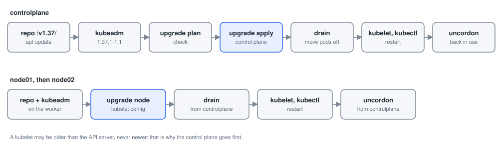

# Module 2: Installation, upgrades and backups

Each lab below is a practical from this repository, step by step: the command, what it does, and what it printed on the practice cluster. Names with random endings (pod names such as `nginx-7d9c…`), IP addresses and ages will differ on yours.

- [Lab 2.1: Prepare the machines](#lab-21-prepare-the-machines)
- [Lab 2.2: Install containerd](#lab-22-install-containerd)
- [Lab 2.3: Install kubeadm, kubelet and kubectl](#lab-23-install-kubeadm-kubelet-and-kubectl)
- [Lab 2.4: Initialise the control plane](#lab-24-initialise-the-control-plane)
- [Lab 2.5: Install the network plugin](#lab-25-install-the-network-plugin)
- [Lab 2.6: Join the workers](#lab-26-join-the-workers)
- [Lab 2.7: Grow the cluster](#lab-27-grow-the-cluster)
- [Lab 2.8: Cordon and drain a node](#lab-28-cordon-and-drain-a-node)
- [Lab 2.9: Upgrade the control plane](#lab-29-upgrade-the-control-plane)
- [Lab 2.10: Upgrade the workers](#lab-210-upgrade-the-workers)
- [Lab 2.11: Back up etcd](#lab-211-back-up-etcd)

## Before you start

You need the three machines of the course, `controlplane`, `node01` and `node02`. On one Ubuntu server (a VM is fine: 4 CPUs, 8 GB RAM, 40 GB disk), [scripts/one-server.sh](../scripts/one-server.sh) runs them as containers, each a full Ubuntu 24.04 machine:

```bash
git clone https://github.com/kumbulanit/CKA.git && cd CKA
sudo ./scripts/one-server.sh create    # three bare machines: you install Kubernetes in these labs
sudo ./scripts/one-server.sh shell     # you are now root@controlplane; the repository is in /root/CKA
```

Their IP addresses are `172.30.56.10` (controlplane), `.11` (node01) and `.12` (node02); `sudo ./scripts/one-server.sh status` shows them. The outputs below were recorded in the Patchbay lab, where the addresses differ: use yours. `sudo ./scripts/one-server.sh shell node01` opens node01, and `sudo ./scripts/one-server.sh delete` removes the machines so you can start again. In Patchbay, starting the lab gives you the same machines.

## Lab 2.1: Prepare the machines

### What you will do

Follow **Step 1** of [Kubernetes installation using kubeadm.md](https://github.com/kumbulanit/CKA/blob/main/Domain%201%20-Installation,%20Configuration%20%26%20Validation%20/Kubernetes%20installation%20using%20kubeadm.md)
on **controlplane, node01 and node02**. Your terminal is root on controlplane; reach the workers
with `ssh node01` and `ssh node02` (and `exit` to come back).

1. Set each host name with `hostnamectl`.
2. Add all three machines to `/etc/hosts` on every one of them. `ip -4 addr` on each machine shows
   its address (the one on `eth0`).
3. Update the system and install `apt-transport-https ca-certificates curl gpg`.
4. Disable swap.
5. Load the `overlay` and `br_netfilter` modules, and write the sysctl settings in
   `/etc/sysctl.d/k8s.conf`, then `sysctl --system`.

### Step by step

**Step 1.** Saves `$CP_IP`: looks up an address. The addresses of the three machines (ip -4 addr on each shows the same).

```bash
CP_IP=$(getent hosts controlplane | awk '{print $1}')
```

It prints nothing when it works.

**Step 2.** Saves `$NODE01_IP`: looks up an address.

```bash
NODE01_IP=$(getent hosts node01 | awk '{print $1}')
```

It prints nothing when it works.

**Step 3.** Saves `$NODE02_IP`: looks up an address.

```bash
NODE02_IP=$(getent hosts node02 | awk '{print $1}')
```

It prints nothing when it works.

**Step 4.** Repeats the command for each of `controlplane`, `node01`, `node02`. The same steps on each machine.

```bash
for n in controlplane node01 node02; do
  ssh $n "sudo hostnamectl set-hostname $n"
  ssh $n "cat <<EOF | sudo tee -a /etc/hosts
$CP_IP controlplane
$NODE01_IP node01
$NODE02_IP node02
EOF"
  ssh $n 'bash -s' <<'STEP1'
sudo apt update && sudo apt upgrade -y
sudo apt install -y apt-transport-https ca-certificates curl gpg
sudo swapoff -a
sudo sed -i '/ swap / s/^\(.*\)$/#\1/g' /etc/fstab
cat <<EOF | sudo tee /etc/modules-load.d/k8s.conf
overlay
br_netfilter
EOF
sudo modprobe overlay
sudo modprobe br_netfilter
cat <<EOF | sudo tee /etc/sysctl.d/k8s.conf
net.bridge.bridge-nf-call-iptables  = 1
net.bridge.bridge-nf-call-ip6tables = 1
net.ipv4.ip_forward                 = 1
EOF
sudo sysctl --system
STEP1
done
```

You should see something like:

```text
172.30.77.10 controlplane
172.30.77.11 node01
172.30.77.12 node02

WARNING: apt does not have a stable CLI interface. Use with caution in scripts.

Hit:1 http://ports.ubuntu.com/ubuntu-ports noble InRelease
Get:2 http://ports.ubuntu.com/ubuntu-ports noble-updates InRelease [126 kB]
Get:3 http://ports.ubuntu.com/ubuntu-ports noble-backports InRelease [126 kB]
Get:4 http://ports.ubuntu.com/ubuntu-ports noble-security InRelease [126 kB]
Get:5 http://ports.ubuntu.com/ubuntu-ports noble-updates/universe arm64 Packages [2216 kB]
Get:6 http://ports.ubuntu.com/ubuntu-ports noble-updates/main arm64 Packages [1790 kB]
Get:7 http://ports.ubuntu.com/ubuntu-ports noble-security/main arm64 Packages [1476 kB]
Get:8 http://ports.ubuntu.com/ubuntu-ports noble-security/universe arm64 Packages [1638 kB]
Fetched 7500 kB in 7s (1020 kB/s)
Reading package lists...
Building dependency tree...
Reading state information...
… (342 more lines)
```

### If you see something else

- The check says: _/etc/hosts does not list all three machines on every machine._
- The check says: _The kernel module and sysctl settings are not on every machine._
- The check says: _The packages from step 3 are not installed on every machine._
- Run each command on all three machines: on controlplane first, then `ssh node01`, run them again, `exit`, and the same for node02.
- `cat <<EOF | sudo tee -a /etc/hosts` appends the three lines; use the real addresses from `ip -4 addr`, not the 192.168.56.x examples.

### Why it works

**Why it works.** Kubernetes nodes find each other by name, so every machine needs the same names (here in /etc/hosts; in production, DNS). The kubelet refuses to run with swap on by default, because memory limits and scheduling assume pods cannot be swapped out. `br_netfilter` makes bridged pod traffic pass through iptables, where kube-proxy's Service rules live, and `ip_forward` lets the node route packets between pods and other nodes. The files in /etc/modules-load.d and /etc/sysctl.d make all of it survive a reboot.

**In this lab:** the machines are containers. Swap is hidden from them, so `swapoff -a` has nothing to turn off, and the kernel modules are built into the host's kernel, so `modprobe` succeeds without loading anything.

---

## Lab 2.2: Install containerd

### What you will do

Follow **Step 2** of the installation guide on **controlplane, node01 and node02**: install
`containerd`, write its default configuration to `/etc/containerd/config.toml`, switch it to the
systemd cgroup driver (`SystemdCgroup = true`), and restart and enable it.

### Step by step

**Step 1.** Repeats the command for each of `controlplane`, `node01`, `node02`.

```bash
for n in controlplane node01 node02; do
  ssh $n 'bash -s' <<'STEP2'
sudo apt install -y containerd
sudo mkdir -p /etc/containerd
containerd config default | sudo tee /etc/containerd/config.toml > /dev/null
sudo sed -i 's/SystemdCgroup = false/SystemdCgroup = true/' /etc/containerd/config.toml
sudo systemctl restart containerd
sudo systemctl enable containerd
STEP2
done
```

You should see something like:

```text

WARNING: apt does not have a stable CLI interface. Use with caution in scripts.

Reading package lists...
Building dependency tree...
Reading state information...
The following additional packages will be installed:
  runc
The following NEW packages will be installed:
  containerd runc
0 upgraded, 2 newly installed, 0 to remove and 0 not upgraded.
Need to get 33.7 MB of archives.
After this operation, 134 MB of additional disk space will be used.
Get:1 http://ports.ubuntu.com/ubuntu-ports noble-updates/main arm64 runc arm64 1.3.4-0ubuntu1~24.04.1 [8578 kB]
Get:2 http://ports.ubuntu.com/ubuntu-ports noble-updates/main arm64 containerd arm64 2.2.1-0ubuntu1~24.04.4 [25.2 MB]
debconf: unable to initialize frontend: Dialog
debconf: (Dialog frontend will not work on a dumb terminal, an emacs shell buffer, or without a controlling terminal.)
debconf: falling back to frontend: Readline
… (84 more lines)
```

### If you see something else

- The check says: _containerd is not running on every machine._
- The check says: _containerd is not set to the systemd cgroup driver on every machine._
- `containerd config default | sudo tee /etc/containerd/config.toml > /dev/null` writes the defaults; then `sed` flips `SystemdCgroup = false` to `true`.
- Restart containerd after changing the file, or it keeps the old settings.

### Why it works

**Why it works.** The kubelet does not run containers itself; it talks to a CRI runtime over a socket, here containerd. Both must use the same cgroup driver: kubeadm configures the kubelet for `systemd`, and containerd's default is `cgroupfs`, so `SystemdCgroup = true` lines them up. With mismatched drivers, pods restart for no obvious reason.

**Note:** Docker Engine stopped being a Kubernetes runtime in v1.24 (dockershim was removed); containerd is what Docker itself uses underneath.

---

## Lab 2.3: Install kubeadm, kubelet and kubectl

### What you will do

Follow **Step 3** of the installation guide on **controlplane, node01 and node02**: add the
`pkgs.k8s.io` repository for **v1.36**, install `kubeadm`, `kubelet` and `kubectl`, hold them
(`apt-mark hold`), and enable the kubelet. The kubelet restarts every few seconds until
`kubeadm init` or `join` configures it; that is expected.

### Step by step

**Step 1.** Repeats the command for each of `controlplane`, `node01`, `node02`.

```bash
for n in controlplane node01 node02; do
  ssh $n 'bash -s' <<'STEP3'
sudo mkdir -p -m 755 /etc/apt/keyrings
curl -fsSL https://pkgs.k8s.io/core:/stable:/v1.36/deb/Release.key | sudo gpg --dearmor -o /etc/apt/keyrings/kubernetes-apt-keyring.gpg
echo 'deb [signed-by=/etc/apt/keyrings/kubernetes-apt-keyring.gpg] https://pkgs.k8s.io/core:/stable:/v1.36/deb/ /' | sudo tee /etc/apt/sources.list.d/kubernetes.list
sudo apt update
sudo apt install -y kubeadm kubelet kubectl
sudo apt-mark hold kubeadm kubelet kubectl
sudo systemctl enable --now kubelet
STEP3
done
```

You should see something like:

```text
deb [signed-by=/etc/apt/keyrings/kubernetes-apt-keyring.gpg] https://pkgs.k8s.io/core:/stable:/v1.36/deb/ /

WARNING: apt does not have a stable CLI interface. Use with caution in scripts.

Hit:1 http://ports.ubuntu.com/ubuntu-ports noble InRelease
Hit:2 http://ports.ubuntu.com/ubuntu-ports noble-updates InRelease
Hit:3 http://ports.ubuntu.com/ubuntu-ports noble-backports InRelease
Hit:5 http://ports.ubuntu.com/ubuntu-ports noble-security InRelease
Get:4 https://prod-cdn.packages.k8s.io/repositories/isv:/kubernetes:/core:/stable:/v1.36/deb  InRelease [1227 B]
Get:6 https://prod-cdn.packages.k8s.io/repositories/isv:/kubernetes:/core:/stable:/v1.36/deb  Packages [9460 B]
Fetched 10.7 kB in 2s (4641 B/s)
Reading package lists...
Building dependency tree...
Reading state information...
All packages are up to date.

WARNING: apt does not have a stable CLI interface. Use with caution in scripts.

… (162 more lines)
```

### If you see something else

- The check says: _kubeadm v1.36 is not installed on every machine._
- The check says: _The Kubernetes packages are not on hold on every machine._
- The check says: _The kubelet is not enabled on every machine._
- The repository line and the key both name the minor version: `.../core:/stable:/v1.36/deb/`.
- `apt-mark hold` stops `apt upgrade` from upgrading Kubernetes by accident; you unhold them on purpose when you upgrade.

### Why it works

**Why it works.** `kubeadm` bootstraps the cluster, `kubelet` runs pods on every node, and `kubectl` is the client. pkgs.k8s.io has one repository per minor version, so the version you install is chosen by the repository line. Holding the packages stops a routine `apt upgrade` from upgrading Kubernetes behind your back. Until kubeadm writes /var/lib/kubelet/config.yaml, the kubelet exits and systemd restarts it every few seconds.

---

## Lab 2.4: Initialise the control plane


*What kubeadm init and join build: the control plane on controlplane, a kubelet on every node*

### What you will do

Follow **Step 4** of the installation guide on **controlplane**:

1. Run `kubeadm init --pod-network-cidr=192.168.0.0/16` and read its output: keep the
   `kubeadm join` line.
2. Configure kubectl for root: copy `/etc/kubernetes/admin.conf` to `$HOME/.kube/config`.
3. Run `kubectl get nodes`: controlplane is `NotReady` until a network plugin runs.

### Step by step

**Step 1.** Creates the control plane: certificates, etcd, the API server, the scheduler and the controller manager.

```bash
sudo kubeadm init --pod-network-cidr=192.168.0.0/16
```

You should see something like:

```text
I1027 15:59:45.212728    1505 version.go:260] remote version is much newer: v1.37.1; falling back to: stable-1.36
[init] Using Kubernetes version: v1.36.5
[preflight] Running pre-flight checks
    [WARNING SystemVerification]: missing optional cgroups: hugetlb
[preflight] Pulling images required for setting up a Kubernetes cluster
[preflight] This might take a minute or two, depending on the speed of your internet connection
[preflight] You can also perform this action beforehand using 'kubeadm config images pull'
[certs] Using certificateDir folder "/etc/kubernetes/pki"
[certs] Generating "ca" certificate and key
[certs] Generating "apiserver" certificate and key
[certs] apiserver serving cert is signed for DNS names [controlplane kubernetes kubernetes.default kubernetes.default.svc kubernetes.default.svc.cluster.local] and IPs [10.96.0.1 172.30.201.10]
[certs] Generating "apiserver-kubelet-client" certificate and key
[certs] Generating "front-proxy-ca" certificate and key
[certs] Generating "front-proxy-client" certificate and key
[certs] Generating "etcd/ca" certificate and key
[certs] Generating "etcd/server" certificate and key
[certs] etcd/server serving cert is signed for DNS names [controlplane localhost] and IPs [172.30.201.10 127.0.0.1 ::1]
[certs] Generating "etcd/peer" certificate and key
… (67 more lines)
```

**Step 2.** Creates the folder `$HOME/.kube`.

```bash
mkdir -p $HOME/.kube
```

It prints nothing when it works.

**Step 3.** Copies `/etc/kubernetes/admin.conf` to `$HOME/.kube/config`.

```bash
sudo cp -i /etc/kubernetes/admin.conf $HOME/.kube/config
```

It prints nothing when it works.

**Step 4.** Makes you the owner of the file, so kubectl can read it without sudo.

```bash
sudo chown $(id -u):$(id -g) $HOME/.kube/config
```

It prints nothing when it works.

**Step 5.** Lists the nodes.

```bash
kubectl get nodes
```

You should see something like:

```text
NAME           STATUS     ROLES           AGE   VERSION
controlplane   NotReady   control-plane   1s    v1.36.5
```

### If you see something else

- The check says: _kubeadm init has not run on controlplane yet._
- The check says: _kubectl is not configured for root. Copy /etc/kubernetes/admin.conf to /root/.kube/config._
- The check says: _The cluster was not initialised with --pod-network-cidr=192.168.0.0/16 (Calico's default)._
- `kubeadm init` prints the three commands that configure kubectl; as root, `mkdir -p $HOME/.kube` and the `cp` are enough.
- If init fails half way, `sudo kubeadm reset -f` cleans up so you can run it again.

### Why it works

**Why it works.** `kubeadm init` runs preflight checks, creates the cluster CA and certificates (/etc/kubernetes/pki), writes kubeconfig files for the admin and each component, and writes static pod manifests for etcd, the API server, the controller manager and the scheduler into /etc/kubernetes/manifests, which the kubelet starts. It then installs CoreDNS and kube-proxy and prints a join command. `--pod-network-cidr` reserves the range pod IPs come from; Calico uses 192.168.0.0/16 by default.

**In this lab:** the warning about the optional `hugetlb` cgroup is harmless.

---

## Lab 2.5: Install the network plugin

### What you will do

Follow **Step 5** of the installation guide on **controlplane**: apply the Calico v3.33.0 manifest,
and watch the pods in `kube-system` until Calico and CoreDNS are `Running` and controlplane is
`Ready`.

### Step by step

**Step 1.** Creates the objects in `https://raw.githubusercontent.com/projectcalico/calico/v3.33.0/manifests/calico.yaml`, or updates them if they exist.

```bash
kubectl apply -f https://raw.githubusercontent.com/projectcalico/calico/v3.33.0/manifests/calico.yaml
```

You should see something like:

```text
poddisruptionbudget.policy/calico-kube-controllers created
serviceaccount/calico-kube-controllers created
serviceaccount/calico-node created
serviceaccount/calico-cni-plugin created
configmap/calico-config created
customresourcedefinition.apiextensions.k8s.io/bgpconfigurations.crd.projectcalico.org created
customresourcedefinition.apiextensions.k8s.io/bgpfilters.crd.projectcalico.org created
customresourcedefinition.apiextensions.k8s.io/bgppeers.crd.projectcalico.org created
customresourcedefinition.apiextensions.k8s.io/blockaffinities.crd.projectcalico.org created
customresourcedefinition.apiextensions.k8s.io/caliconodestatuses.crd.projectcalico.org created
customresourcedefinition.apiextensions.k8s.io/clusterinformations.crd.projectcalico.org created
customresourcedefinition.apiextensions.k8s.io/felixconfigurations.crd.projectcalico.org created
customresourcedefinition.apiextensions.k8s.io/globalnetworkpolicies.crd.projectcalico.org created
customresourcedefinition.apiextensions.k8s.io/globalnetworksets.crd.projectcalico.org created
customresourcedefinition.apiextensions.k8s.io/hostendpoints.crd.projectcalico.org created
customresourcedefinition.apiextensions.k8s.io/ipamblocks.crd.projectcalico.org created
customresourcedefinition.apiextensions.k8s.io/ipamconfigs.crd.projectcalico.org created
customresourcedefinition.apiextensions.k8s.io/ipamhandles.crd.projectcalico.org created
… (20 more lines)
```

**Step 2.** Waits until the rollout of the DaemonSet `calico-node` has finished. Instead of watching with -w.

```bash
kubectl -n kube-system rollout status ds/calico-node --timeout=300s
```

You should see something like:

```text
Waiting for daemon set spec update to be observed...
Waiting for daemon set "calico-node" rollout to finish: 0 out of 1 new pods have been updated...
Waiting for daemon set "calico-node" rollout to finish: 0 of 1 updated pods are available...
daemon set "calico-node" successfully rolled out
```

**Step 3.** Waits until the rollout of the Deployment `coredns` has finished.

```bash
kubectl -n kube-system rollout status deployment/coredns --timeout=120s
```

You should see something like:

```text
Waiting for deployment "coredns" rollout to finish: 0 of 2 updated replicas are available...
Waiting for deployment "coredns" rollout to finish: 1 of 2 updated replicas are available...
deployment "coredns" successfully rolled out
```

**Step 4.** Lists the pods in the namespace `kube-system`.

```bash
kubectl get pods -n kube-system
```

You should see something like:

```text
NAME                                       READY   STATUS              RESTARTS   AGE
calico-kube-controllers-6ffffbccff-l496v   0/1     ContainerCreating   0          2m3s
calico-node-cg9t4                          1/1     Running             0          2m3s
coredns-589f44dc88-ktfk2                   1/1     Running             0          2m3s
coredns-589f44dc88-qhxkh                   1/1     Running             0          2m3s
etcd-controlplane                          1/1     Running             0          2m7s
kube-apiserver-controlplane                1/1     Running             0          2m7s
kube-controller-manager-controlplane       1/1     Running             0          2m7s
kube-proxy-gnk2z                           1/1     Running             0          2m2s
kube-scheduler-controlplane                1/1     Running             0          2m7s
```

**Step 5.** Lists the nodes.

```bash
kubectl get nodes
```

You should see something like:

```text
NAME           STATUS   ROLES           AGE    VERSION
controlplane   Ready    control-plane   2m8s   v1.36.5
```

### If you see something else

- The check says: _Calico is not running yet. Apply the manifest from Step 5 (it takes a minute or two to start)._
- The check says: _controlplane is not Ready yet._
- The check says: _CoreDNS is not running yet. It starts once the network plugin is up._
- `kubectl get pods -n kube-system -w` watches the pods; Ctrl+C stops watching.
- The pod network CIDR you gave kubeadm (192.168.0.0/16) is the one Calico uses by default.

### Why it works

**Why it works.** Kubernetes requires a network plugin but does not ship one. Until a CNI plugin is installed, the node reports `NetworkReady=false` (`NotReady`) and pods that need a pod IP, such as CoreDNS, stay Pending. Calico runs `calico-node` on every node as a DaemonSet, writes the CNI configuration to /etc/cni/net.d, assigns pod IPs from 192.168.0.0/16 and routes between nodes.

**In this lab:** containers cannot change the kernel's conntrack limit, which kube-proxy tries to do; Patchbay sets kube-proxy's `conntrack.maxPerCore: 0` for you (as kind does). On real machines nothing is needed.

---

## Lab 2.6: Join the workers

### What you will do

Follow **Steps 6 and 7** of the installation guide:

1. On controlplane, print a join command with `kubeadm token create --print-join-command`.
2. Run it on **node01** and **node02**.
3. Check that all three nodes are `Ready`, and list the pods in all namespaces.

### Step by step

**Step 1.** Saves `$JOIN`: prints a new join command for workers.

```bash
JOIN=$(kubeadm token create --print-join-command)
```

It prints nothing when it works.

**Step 2.** Prints a value.

```bash
echo "$JOIN"
```

You should see something like:

```text
kubeadm join 172.30.201.10:6443 --token v9udpx.x6dh6x6nsealjqvo --discovery-token-ca-cert-hash sha256:8aeaa19bb92f5d831f2b9a4c32547bec7d7a4aa2fc7310ef930f3a2823f8f82b
```

**Step 3.** On `node01`: joins this machine to the cluster with the join command saved above.

```bash
ssh node01 "sudo $JOIN"
```

You should see something like:

```text
[preflight] Running pre-flight checks
    [WARNING SystemVerification]: missing optional cgroups: hugetlb
[preflight] Reading configuration from the "kubeadm-config" ConfigMap in namespace "kube-system"...
[preflight] Use 'kubeadm init phase upload-config kubeadm --config your-config-file' to re-upload it.
W1027 16:05:35.940621    1648 utils.go:69] The recommended value for "bindAddress" in "KubeProxyConfiguration" is: ::; the provided value is: 0.0.0.0
[kubelet-start] Writing kubelet configuration to file "/var/lib/kubelet/instance-config.yaml"
[patches] Applied patch of type "application/strategic-merge-patch+json" to target "kubeletconfiguration"
[kubelet-start] Writing kubelet configuration to file "/var/lib/kubelet/config.yaml"
[kubelet-start] Writing kubelet environment file with flags to file "/var/lib/kubelet/kubeadm-flags.env"
[kubelet-start] Starting the kubelet
[kubelet-check] Waiting for a healthy kubelet at http://127.0.0.1:10248/healthz. This can take up to 4m0s
[kubelet-check] The kubelet is healthy after 504.923267ms
[kubelet-start] Waiting for the kubelet to perform the TLS Bootstrap

This node has joined the cluster:
* Certificate signing request was sent to apiserver and a response was received.
* The Kubelet was informed of the new secure connection details.

Run 'kubectl get nodes' on the control-plane to see this node join the cluster.
```

**Step 4.** On `node02`: joins this machine to the cluster with the join command saved above.

```bash
ssh node02 "sudo $JOIN"
```

You should see something like:

```text
[preflight] Running pre-flight checks
    [WARNING SystemVerification]: missing optional cgroups: hugetlb
[preflight] Reading configuration from the "kubeadm-config" ConfigMap in namespace "kube-system"...
[preflight] Use 'kubeadm init phase upload-config kubeadm --config your-config-file' to re-upload it.
W1027 16:05:38.402481    1616 utils.go:69] The recommended value for "bindAddress" in "KubeProxyConfiguration" is: ::; the provided value is: 0.0.0.0
[kubelet-start] Writing kubelet configuration to file "/var/lib/kubelet/instance-config.yaml"
[patches] Applied patch of type "application/strategic-merge-patch+json" to target "kubeletconfiguration"
[kubelet-start] Writing kubelet configuration to file "/var/lib/kubelet/config.yaml"
[kubelet-start] Writing kubelet environment file with flags to file "/var/lib/kubelet/kubeadm-flags.env"
[kubelet-start] Starting the kubelet
[kubelet-check] Waiting for a healthy kubelet at http://127.0.0.1:10248/healthz. This can take up to 4m0s
[kubelet-check] The kubelet is healthy after 503.933242ms
[kubelet-start] Waiting for the kubelet to perform the TLS Bootstrap

This node has joined the cluster:
* Certificate signing request was sent to apiserver and a response was received.
* The Kubelet was informed of the new secure connection details.

Run 'kubectl get nodes' on the control-plane to see this node join the cluster.
```

**Step 5.** Waits until the nodes `node01`, `node02` are Ready.

```bash
kubectl wait --for=condition=Ready node/node01 node/node02 --timeout=180s
```

You should see something like:

```text
node/node01 condition met
node/node02 condition met
```

**Step 6.** Lists the nodes.

```bash
kubectl get nodes
```

You should see something like:

```text
NAME           STATUS   ROLES           AGE     VERSION
controlplane   Ready    control-plane   4m29s   v1.36.5
node01         Ready    <none>          2m18s   v1.36.5
node02         Ready    <none>          2m15s   v1.36.5
```

**Step 7.** Lists the pods in every namespace.

```bash
kubectl get pods --all-namespaces
```

You should see something like:

```text
NAMESPACE     NAME                                       READY   STATUS     RESTARTS   AGE
kube-system   calico-kube-controllers-6ffffbccff-l496v   1/1     Running    0          4m25s
kube-system   calico-node-4rx7q                          0/1     Init:3/4   0          2m18s
kube-system   calico-node-cg9t4                          1/1     Running    0          4m25s
kube-system   calico-node-zdl5n                          0/1     Init:2/4   0          2m15s
kube-system   coredns-589f44dc88-ktfk2                   1/1     Running    0          4m25s
kube-system   coredns-589f44dc88-qhxkh                   1/1     Running    0          4m25s
kube-system   etcd-controlplane                          1/1     Running    0          4m29s
kube-system   kube-apiserver-controlplane                1/1     Running    0          4m29s
kube-system   kube-controller-manager-controlplane       1/1     Running    0          4m29s
kube-system   kube-proxy-2fj2r                           1/1     Running    0          2m15s
kube-system   kube-proxy-gnk2z                           1/1     Running    0          4m24s
kube-system   kube-proxy-qclz4                           1/1     Running    0          2m18s
kube-system   kube-scheduler-controlplane                1/1     Running    0          4m29s
```

### If you see something else

- The check says: _node01 and node02 are not both Ready members of the cluster._
- The join command holds a token (valid 24 hours) and the CA certificate hash, so the worker can trust the control plane.
- `ssh node01`, paste the join command with `sudo` in front, `exit`, and the same on node02.

### Why it works

**Why it works.** `kubeadm join` uses a bootstrap token to authenticate to the API server, checks the server's identity with the CA certificate hash, and then gets the kubelet a client certificate of its own (TLS bootstrapping). Once the kubelet registers the node, the DaemonSets (kube-proxy, calico-node) start a pod on it, and it turns Ready when its network is up.

**In the exam:** `kubeadm token create --print-join-command` is the reliable way to get a working join command.

---

## Lab 2.7: Grow the cluster

### What you will do

Follow [growing the cluster.md](https://github.com/kumbulanit/CKA/blob/main/Domain%201%20-Installation,%20Configuration%20%26%20Validation%20/growing%20the%20cluster.md)
to add **node03**:

1. Set node03's host name, add node03 to `/etc/hosts` on controlplane, node01 and node02, and add
   the existing machines to `/etc/hosts` on node03.
2. Run steps 1–3 of the installation guide on node03 (with the same minor version, v1.36).
3. Join it with a fresh join command, and check that it is `Ready`.

### Step by step

**Step 1.** Saves `$NODE03_IP`: looks up an address.

```bash
NODE03_IP=$(getent hosts node03 | awk '{print $1}')
```

**Step 2.** On `node03`: sets the machine's name to `node03`.

```bash
ssh node03 "sudo hostnamectl set-hostname node03"
```

**Step 3.** Repeats the command for each of `controlplane`, `node01`, `node02`.

```bash
for n in controlplane node01 node02; do ssh $n "echo '$NODE03_IP node03' | sudo tee -a /etc/hosts"; done
```

**Step 4.** Adds these lines to `/etc/hosts` on `node03`.

```bash
grep -E ' (controlplane|node01|node02)$' /etc/hosts | ssh node03 'sudo tee -a /etc/hosts'
```

**Step 5.** Runs the commands below on `node03`. Steps 1-3 of the installation guide on node03.

```bash
ssh node03 'bash -s' <<'STEPS'
sudo apt update && sudo apt upgrade -y
sudo apt install -y apt-transport-https ca-certificates curl gpg
sudo swapoff -a
sudo sed -i '/ swap / s/^\(.*\)$/#\1/g' /etc/fstab
cat <<EOF | sudo tee /etc/modules-load.d/k8s.conf
overlay
br_netfilter
EOF
sudo modprobe overlay
sudo modprobe br_netfilter
cat <<EOF | sudo tee /etc/sysctl.d/k8s.conf
net.bridge.bridge-nf-call-iptables  = 1
net.bridge.bridge-nf-call-ip6tables = 1
net.ipv4.ip_forward                 = 1
EOF
sudo sysctl --system
sudo apt install -y containerd
sudo mkdir -p /etc/containerd
containerd config default | sudo tee /etc/containerd/config.toml > /dev/null
sudo sed -i 's/SystemdCgroup = false/SystemdCgroup = true/' /etc/containerd/config.toml
sudo systemctl restart containerd
sudo systemctl enable containerd
sudo mkdir -p -m 755 /etc/apt/keyrings
curl -fsSL https://pkgs.k8s.io/core:/stable:/v1.36/deb/Release.key | sudo gpg --dearmor -o /etc/apt/keyrings/kubernetes-apt-keyring.gpg
echo 'deb [signed-by=/etc/apt/keyrings/kubernetes-apt-keyring.gpg] https://pkgs.k8s.io/core:/stable:/v1.36/deb/ /' | sudo tee /etc/apt/sources.list.d/kubernetes.list
sudo apt update
sudo apt install -y kubeadm kubelet kubectl
sudo apt-mark hold kubeadm kubelet kubectl
sudo systemctl enable --now kubelet
STEPS
```

**Step 6.** Saves `$JOIN`: prints a new join command for workers.

```bash
JOIN=$(kubeadm token create --print-join-command)
```

**Step 7.** On `node03`: joins this machine to the cluster with the join command saved above.

```bash
ssh node03 "sudo $JOIN"
```

**Step 8.** Waits until the node `node03` is Ready.

```bash
kubectl wait --for=condition=Ready node/node03 --timeout=180s
```

**Step 9.** Lists the nodes.

```bash
kubectl get nodes
```

**Step 10.** Lists the pods in every namespace.

```bash
kubectl get pods --all-namespaces
```

### If you see something else

- The check says: _node03 and the other machines are not all in each other's /etc/hosts._
- The check says: _node03 has not joined the cluster, or is not Ready yet._
- The check says: _node03 should run the same minor version as the cluster, v1.36._
- Steps 1–3 are exactly what you did for the first three machines in tasks 2.1 to 2.3, now on node03 only.
- Join tokens expire after 24 hours; `kubeadm token create --print-join-command` always gives you a fresh one.

### Why it works

**Why it works.** A new node goes through the same preparation as the first ones, then joins with a fresh token. Its packages must match the cluster's minor version: a kubelet must not be newer than the API server. Once it joins, the scheduler starts using it; existing pods stay where they are until they are rescheduled.

**In practice:** adding capacity is this simple because all the cluster's state lives in the control plane; a worker only needs a runtime, a kubelet and a token.

---

## Lab 2.8: Cordon and drain a node

### What you will do

Follow the example scenario in [condoning and drainning nodes.md](https://github.com/kumbulanit/CKA/blob/main/Domain%201%20-Installation,%20Configuration%20%26%20Validation%20/condoning%20and%20drainning%20nodes.md):

1. Cordon **node01** and check its status (`SchedulingDisabled`).
2. Drain it with `--ignore-daemonsets --delete-emptydir-data`.
3. Reboot it (`ssh node01`, then `sudo reboot`) and wait until it is `Ready` again.
4. Uncordon it and check the nodes.

### Step by step

**Step 1.** Marks the node `node01` unschedulable; its pods keep running.

```bash
kubectl cordon node01
```

**Step 2.** Lists the nodes.

```bash
kubectl get nodes
```

**Step 3.** Evicts the pods from `node01` and marks it unschedulable, ready for maintenance.

```bash
kubectl drain node01 --ignore-daemonsets --delete-emptydir-data
```

**Step 4.** Restarts the machine (a moment later, so this command can finish first). Sudo reboot, without cutting off this script.

```bash
ssh node01 'sudo systemd-run --on-active=2 systemctl reboot'
```

**Step 5.** Waits 20 seconds.

```bash
sleep 20
```

**Step 6.** Waits until the node `node01` is Ready.

```bash
kubectl wait --for=condition=Ready node/node01 --timeout=180s
```

**Step 7.** Lets the scheduler place pods on `node01` again.

```bash
kubectl uncordon node01
```

**Step 8.** Lists the nodes.

```bash
kubectl get nodes
```

### If you see something else

- The check says: _node01 has not been cordoned yet._
- The check says: _node01 is still cordoned. Uncordon it with `kubectl uncordon node01`._
- The check says: _node01 is not Ready._
- `kubectl drain` cordons the node itself before evicting pods; DaemonSet pods (calico-node, kube-proxy) stay, which is why it needs `--ignore-daemonsets`.
- After the reboot the kubelet starts by itself (it is enabled), so the node comes back on its own.

### Why it works

**Why it works.** `kubectl cordon` marks the node unschedulable (`spec.unschedulable: true`), so no new pods land on it. `kubectl drain` cordons it and evicts its pods, respecting PodDisruptionBudgets; controllers recreate them elsewhere. DaemonSet pods are left alone (`--ignore-daemonsets`), and pods with emptyDir data are only evicted with `--delete-emptydir-data`, because that data is lost. After maintenance, `kubectl uncordon` makes the node schedulable again.

**In this lab:** the machine is a container, so a reboot restarts the container; systemd, containerd and the kubelet come back as on a VM.

---

## Lab 2.9: Upgrade the control plane



*A kubeadm upgrade, one minor version: control plane first, then each worker in turn*

### What you will do

Follow section 1, step 2 of [cluster maintanance.md](https://github.com/kumbulanit/CKA/blob/main/Domain%201%20-Installation,%20Configuration%20%26%20Validation%20/cluster%20maintanance.md)
on **controlplane**, to upgrade it from v1.36 to **v1.37.1**:

1. Point the Kubernetes apt repository at v1.37, update, and list the kubeadm versions.
2. Upgrade kubeadm to `1.37.1-1.1`, run `kubeadm upgrade plan`, then `kubeadm upgrade apply v1.37.1`.
3. Drain controlplane, upgrade kubelet and kubectl to `1.37.1-1.1`, restart the kubelet, and
   uncordon controlplane.

### Step by step

**Step 1.** Edits `/etc/apt/sources.list.d/kubernetes.list`: `/v1.36/` becomes `/v1.37/`.

```bash
sudo sed -i 's|/v1.36/|/v1.37/|' /etc/apt/sources.list.d/kubernetes.list
```

**Step 2.** Refreshes the list of packages.

```bash
sudo apt update
```

**Step 3.** Lists the versions of `kubeadm` you can install.

```bash
apt-cache madison kubeadm
```

**Step 4.** Releases the hold so these packages can be upgraded, then installs `kubeadm=1.37.1-1.1`, then holds these packages at their version so a routine upgrade does not change them.

```bash
sudo apt-mark unhold kubeadm && sudo apt install -y kubeadm='1.37.1-1.1' && sudo apt-mark hold kubeadm
```

**Step 5.** Checks which versions this cluster can be upgraded to.

```bash
sudo kubeadm upgrade plan
```

**Step 6.** Upgrades the control plane components to that version.

```bash
sudo kubeadm upgrade apply v1.37.1 -y   # -y answers kubeadm's "Are you sure?"
```

**Step 7.** Evicts the pods from `controlplane` and marks it unschedulable, ready for maintenance.

```bash
kubectl drain controlplane --ignore-daemonsets
```

**Step 8.** Releases the hold so these packages can be upgraded, then installs `kubelet=1.37.1-1.1`, `kubectl=1.37.1-1.1`, then holds these packages at their version so a routine upgrade does not change them.

```bash
sudo apt-mark unhold kubelet kubectl && sudo apt install -y kubelet='1.37.1-1.1' kubectl='1.37.1-1.1' && sudo apt-mark hold kubelet kubectl
```

**Step 9.** Makes systemd read the changed unit files, then restarts kubelet.

```bash
sudo systemctl daemon-reload && sudo systemctl restart kubelet
```

**Step 10.** Lets the scheduler place pods on `controlplane` again.

```bash
kubectl uncordon controlplane
```

**Step 11.** Waits until the node `controlplane` is Ready.

```bash
kubectl wait --for=condition=Ready node/controlplane --timeout=120s
```

**Step 12.** Lists the nodes.

```bash
kubectl get nodes
```

### If you see something else

- The check says: _The control plane is not running v1.37.1 yet (`kubeadm upgrade apply v1.37.1`)._
- The check says: _The kubelet on controlplane is not v1.37.1 yet. Upgrade the kubelet package and restart it._
- The check says: _controlplane is cordoned or not Ready. Uncordon it._
- `pkgs.k8s.io` has one repository per minor version, so the repository line has to change from `/v1.36/` to `/v1.37/` before apt sees the new packages.
- Order matters: kubeadm first, then `kubeadm upgrade apply`, then the kubelet. kubeadm asks you to confirm with `y`.

### Why it works

**Why it works.** You upgrade one minor version at a time, control plane first. Upgrading the kubeadm package gives you the tool for the new version; `kubeadm upgrade plan` checks the cluster and shows the target versions; `kubeadm upgrade apply` replaces the static pod manifests (new images for the API server, controller manager, scheduler and etcd), renews certificates, and upgrades CoreDNS and kube-proxy. The kubelet is a separate package and is upgraded last, after draining the node.

**In the exam:** the order is the whole skill: repository, kubeadm, `upgrade apply` (or `upgrade node`), drain, kubelet and kubectl, restart, uncordon.

---

## Lab 2.10: Upgrade the workers

### What you will do

Follow section 1, step 3 of the cluster maintenance document for **node01**, then repeat for
**node02**, one at a time:

1. On the worker, point the repository at v1.37, upgrade kubeadm to `1.37.1-1.1`, and run
   `kubeadm upgrade node`.
2. From controlplane, drain the worker.
3. On the worker, upgrade kubelet and kubectl to `1.37.1-1.1` and restart the kubelet.
4. From controlplane, uncordon it.

node03 can stay on v1.36: a kubelet may be older than the control plane.

### Step by step

**Step 1.** Repeats the command for each of `node01`, `node02`.

```bash
for n in node01 node02; do
  ssh $n 'bash -s' <<'KUBEADM'
sudo sed -i 's|/v1.36/|/v1.37/|' /etc/apt/sources.list.d/kubernetes.list
sudo apt update
sudo apt-mark unhold kubeadm && sudo apt install -y kubeadm='1.37.1-1.1' && sudo apt-mark hold kubeadm
sudo kubeadm upgrade node
KUBEADM
  kubectl drain $n --ignore-daemonsets --delete-emptydir-data
  ssh $n 'bash -s' <<'KUBELET'
sudo apt-mark unhold kubelet kubectl && sudo apt install -y kubelet='1.37.1-1.1' kubectl='1.37.1-1.1' && sudo apt-mark hold kubelet kubectl
sudo systemctl daemon-reload && sudo systemctl restart kubelet
KUBELET
  kubectl uncordon $n
done
```

**Step 2.** Waits until the nodes `node01`, `node02` are Ready.

```bash
kubectl wait --for=condition=Ready node/node01 node/node02 --timeout=120s
```

**Step 3.** Lists the nodes.

```bash
kubectl get nodes
```

**Step 4.** Lists the pods in every namespace.

```bash
kubectl get pods --all-namespaces
```

### If you see something else

- The check says: _node01 and node02 are not both on v1.37.1._
- The check says: _node01 or node02 is cordoned or not Ready._
- On a worker, `kubeadm upgrade node` updates the kubelet's configuration; it does not touch the control plane.
- Drain and uncordon run on controlplane (where kubectl has the admin kubeconfig); the apt steps run on the worker.

### Why it works

**Why it works.** On a worker, `kubeadm upgrade node` only updates the kubelet's configuration for the new version; there are no control plane components to replace. The kubelet package does the real upgrade, so the node is drained first and uncordoned after. Upgrading one worker at a time keeps the applications running on the others.

**Version skew:** a kubelet may be up to three minor versions older than the API server, but never newer, which is why node03 can stay on v1.36 for now.

---

## Lab 2.11: Back up etcd

### What you will do

Follow section 4, step 1 of the cluster maintenance document on **controlplane**:

1. Install the etcd client (`apt install -y etcd-client`).
2. Save a snapshot of etcd to **/opt/etcd-backup.db** with `etcdctl snapshot save`, using the
   endpoint `https://127.0.0.1:2379` and the certificates in `/etc/kubernetes/pki/etcd/`.
3. Check the snapshot with `snapshot status --write-out=table`.

### Step by step

**Step 1.** Installs `etcd-client`.

```bash
sudo apt install -y etcd-client
```

**Step 2.** Saves a snapshot of etcd, the whole cluster state, to a file.

```bash
sudo ETCDCTL_API=3 etcdctl --endpoints=https://127.0.0.1:2379 \
  --cacert=/etc/kubernetes/pki/etcd/ca.crt \
  --cert=/etc/kubernetes/pki/etcd/server.crt \
  --key=/etc/kubernetes/pki/etcd/server.key \
  snapshot save /opt/etcd-backup.db
```

**Step 3.** Checks the snapshot: its hash, revision, keys and size.

```bash
sudo etcdutl snapshot status /opt/etcd-backup.db --write-out=table || sudo ETCDCTL_API=3 etcdctl snapshot status /opt/etcd-backup.db --write-out=table
```

### If you see something else

- The check says: _The etcd client is not installed (`sudo apt install -y etcd-client`)._
- The check says: _/opt/etcd-backup.db does not exist yet._
- The check says: _/opt/etcd-backup.db is not a valid etcd snapshot._
- etcd only accepts clients with a certificate: `--cacert`, `--cert` and `--key` point at files in /etc/kubernetes/pki/etcd/.
- `cat /etc/kubernetes/manifests/etcd.yaml` shows the endpoint and certificate paths etcd itself uses.

### Why it works

**Why it works.** etcd holds the whole cluster state, so a snapshot of it is a backup of every object. `etcdctl snapshot save` asks the running etcd for a consistent copy over its client port (2379), which only accepts clients with a certificate signed by the etcd CA. `snapshot status` reads the file and reports its revision, key count and size.

**Restoring:** `etcdutl snapshot restore` writes a new data directory; you then point etcd's static pod manifest (`--data-dir` and its hostPath volume) at it.

---
