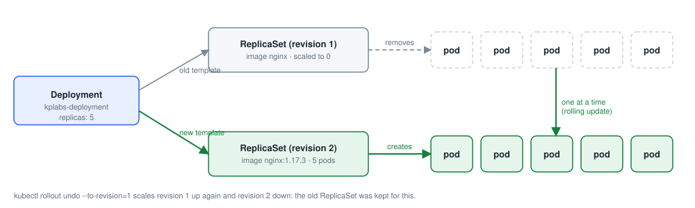
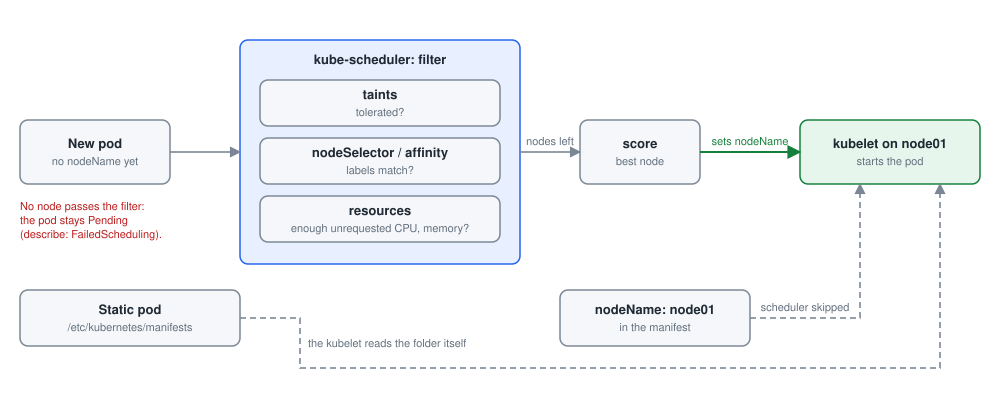

# Module 3: Workloads and scheduling

Each lab below is a practical from this repository, step by step: the command, what it does, and what it printed on the practice cluster. Names with random endings (pod names such as `nginx-7d9c…`), IP addresses and ages will differ on yours.

- [Lab 3.1: Labels and selectors](#lab-31-labels-and-selectors)
- [Lab 3.2: A ReplicaSet](#lab-32-a-replicaset)
- [Lab 3.3: Deployments and rollbacks](#lab-33-deployments-and-rollbacks)
- [Lab 3.4: Day-to-day deployment commands](#lab-34-day-to-day-deployment-commands)
- [Lab 3.5: Deployment manifests from the command line](#lab-35-deployment-manifests-from-the-command-line)
- [Lab 3.6: A DaemonSet](#lab-36-a-daemonset)
- [Lab 3.7: NodeSelector](#lab-37-nodeselector)
- [Lab 3.8: Node and pod affinity](#lab-38-node-and-pod-affinity)
- [Lab 3.9: Requests and limits](#lab-39-requests-and-limits)
- [Lab 3.10: Pods without the scheduler](#lab-310-pods-without-the-scheduler)
- [Lab 3.11: Taints and tolerations](#lab-311-taints-and-tolerations)
- [Lab 3.12: The adapter pattern](#lab-312-the-adapter-pattern)
- [Lab 3.13: Jobs and CronJobs](#lab-313-jobs-and-cronjobs)
- [Lab 3.14: Liveness and readiness probes](#lab-314-liveness-and-readiness-probes)

## Lab 3.1: Labels and selectors

### What you will do

Follow [labels.md](https://github.com/kumbulanit/CKA/blob/main/Scheduling/%20Workloads%20%26%20Scheduling/labels.md):

1. Create the pods **pod-1**, **pod-2** and **pod-3** from `nginx` and show their labels.
2. Label them `env=dev`, `env=stage` and `env=prod`, then list the pods with `-l env=dev` and `-l env!=dev`.
3. Remove the `env` label from pod-1.
4. Save the manifest of a pod **nginx** to **label-pod.yaml** with `--dry-run=client -o yaml`, add the
   label `env: dev` under `metadata.labels`, and apply it.
5. Label all pods `status=running`, then delete all the pods.

### Step by step

**Step 1.** Starts the pod `pod-1` from the image `nginx`.

```bash
kubectl run pod-1 --image=nginx
```

**Step 2.** Starts the pod `pod-2` from the image `nginx`.

```bash
kubectl run pod-2 --image=nginx
```

**Step 3.** Starts the pod `pod-3` from the image `nginx`.

```bash
kubectl run pod-3 --image=nginx
```

**Step 4.** Lists the pods with their labels.

```bash
kubectl get pods --show-labels
```

**Step 5.** Adds the label `env=dev` to the pod `pod-1`, `env=dev`.

```bash
kubectl label pod pod-1 env=dev
```

**Step 6.** Adds the label `env=stage` to the pod `pod-2`, `env=stage`.

```bash
kubectl label pod pod-2 env=stage
```

**Step 7.** Adds the label `env=prod` to the pod `pod-3`, `env=prod`.

```bash
kubectl label pod pod-3 env=prod
```

**Step 8.** Lists the pods with their labels.

```bash
kubectl get pods --show-labels
```

**Step 9.** Lists the pods that match the label selector `env=dev`.

```bash
kubectl get pods -l env=dev
```

**Step 10.** Lists the pods that match the label selector `env!=dev`.

```bash
kubectl get pods -l env!=dev
```

**Step 11.** Removes a label from the pod `pod-1`, `env-`.

```bash
kubectl label pod pod-1 env-
```

**Step 12.** Lists the pods with their labels.

```bash
kubectl get pods --show-labels
```

**Step 13.** Writes the manifest of the pod `nginx` without creating it.

```bash
kubectl run nginx --image=nginx --dry-run=client -o yaml > label-pod.yaml
```

**Step 14.** Edits `label-pod.yaml`: `run: nginx` becomes `run: nginx     env: dev`. The edit: add env: dev under labels.

```bash
sed -i 's/^    run: nginx$/    run: nginx\n    env: dev/' label-pod.yaml
```

**Step 15.** Creates the objects in `label-pod.yaml`, or updates them if they exist.

```bash
kubectl apply -f label-pod.yaml
```

**Step 16.** Lists the pods with their labels.

```bash
kubectl get pods --show-labels
```

**Step 17.** Adds the label `status=running` to the pods `status=running`.

```bash
kubectl label pods --all status=running
```

**Step 18.** Lists the pods with their labels.

```bash
kubectl get pods --show-labels
```

**Step 19.** Waits until the pods `pod-1`, `pod-2`, `pod-3`, `nginx` are Ready. Let them start before deleting.

```bash
kubectl wait --for=condition=Ready pod/pod-1 pod/pod-2 pod/pod-3 pod/nginx --timeout=120s
```

**Step 20.** Deletes the pods.

```bash
kubectl delete pods --all
```

### If you see something else

- The check says: _/root/label-pod.yaml is missing, or has no `env: dev` label for the pod nginx._
- The check says: _The pods pod-1, pod-2, pod-3 and nginx have not all run yet._
- The check says: _Some of the pods are still there. The last step deletes them._
- `kubectl label pod pod-1 env=dev` adds a label; `kubectl label pod pod-1 env-` removes it. `--show-labels` lists them.
- `kubectl run nginx --image=nginx --dry-run=client -o yaml > label-pod.yaml` writes the manifest; add `env: dev` next to `run: nginx`.
- Try the selectors from step 2, `kubectl get pods -l env=dev` and `-l env!=dev`; selectors are how Services and Deployments find their pods.

### Why it works

**Why it works.** Labels are key/value pairs on any object; selectors filter by them. `-l env=dev` matches pods with that label, `-l env!=dev` matches every pod without it, including pods with no `env` label at all. In a manifest, labels sit under `metadata.labels`.

**In the exam:** Services, Deployments and ReplicaSets all find their pods with selectors, so a wrong label is one of the most common reasons a Service has no endpoints. `kubectl get pods --show-labels` is the quickest way to check.

---

## Lab 3.2: A ReplicaSet

### What you will do

Follow [replicaset.md](https://github.com/kumbulanit/CKA/blob/main/Scheduling/%20Workloads%20%26%20Scheduling/replicaset.md):

1. Write **replicaset.yaml**: a ReplicaSet **kplabs-replicaset** with **5** replicas, selector
   `tier: frontend`, and a container `php-redis` from `nginx`. Apply it.
2. List the ReplicaSet and its pods.
3. Delete one of its pods and watch the ReplicaSet replace it.
4. Delete the ReplicaSet with `kubectl delete -f replicaset.yaml`.

### Step by step

**Step 1.** Writes the file `replicaset.yaml`.

```bash
cat > replicaset.yaml <<'EOF'
apiVersion: apps/v1
kind: ReplicaSet
metadata:
  name: kplabs-replicaset
spec:
  replicas: 5
  selector:
    matchLabels:
      tier: frontend
  template:
    metadata:
      labels:
        tier: frontend
    spec:
      containers:
      - name: php-redis
        image: nginx
EOF
```

**Step 2.** Creates the objects in `replicaset.yaml`, or updates them if they exist.

```bash
kubectl apply -f replicaset.yaml
```

**Step 3.** Lists the ReplicaSets.

```bash
kubectl get replicaset
```

**Step 4.** Lists the pods.

```bash
kubectl get pods
```

**Step 5.** Deletes the pod that the inner command finds. One pod of the ReplicaSet.

```bash
kubectl delete pod $(kubectl get pods -l tier=frontend -o jsonpath='{.items[0].metadata.name}')
```

**Step 6.** Lists the pods with their labels.

```bash
kubectl get pods --show-labels
```

**Step 7.** Deletes the objects in `replicaset.yaml`.

```bash
kubectl delete -f replicaset.yaml
```

### If you see something else

- The check says: _/root/replicaset.yaml is missing, or is not a ReplicaSet with 5 replicas and the label tier=frontend._
- The check says: _kplabs-replicaset has not replaced a deleted pod yet (it should have created 6 pods in all). Delete one of its pods._
- The check says: _kplabs-replicaset is still there. The last step deletes it._
- A ReplicaSet needs `spec.selector.matchLabels`, and the same labels under `spec.template.metadata.labels`.
- `kubectl get pods` shows the pod names; `kubectl delete pod <one of them>` removes one.

### Why it works

**Why it works.** A ReplicaSet keeps `replicas` pods running that match `spec.selector`. Deleting a pod drops the count to 4, so the ReplicaSet creates a new one straight away: that is the 6th `Created pod` event the check looks for. `kubectl delete -f replicaset.yaml` deletes the ReplicaSet, and its pods go with it.

**In the exam:** you rarely create ReplicaSets yourself; a Deployment creates and manages them for you.

---

## Lab 3.3: Deployments and rollbacks



*A Deployment manages ReplicaSets; a rollout moves pods from the old one to the new one*

### What you will do

Follow [deployment.md](https://github.com/kumbulanit/CKA/blob/main/Scheduling/%20Workloads%20%26%20Scheduling/deployment.md)
and [rollback-deployment.md](https://github.com/kumbulanit/CKA/blob/main/Scheduling/%20Workloads%20%26%20Scheduling/rollback-deployment.md):

1. Write **deployment.yaml**: a Deployment **kplabs-deployment** with **5** replicas, selector
   `tier: frontend`, and a container `php-redis` from `nginx`. Apply it and list the ReplicaSets.
2. Change the image in the file to `nginx:1.17.3` and apply it again.
3. Describe the deployment, and look at the rollout history and revisions 1 and 2.
4. Roll back to revision 1 with `kubectl rollout undo ... --to-revision=1`, then list the ReplicaSets
   and the history again. Leave the deployment running.

### Step by step

**Step 1.** Writes the file `deployment.yaml`.

```bash
cat > deployment.yaml <<'EOF'
apiVersion: apps/v1
kind: Deployment
metadata:
  name: kplabs-deployment
spec:
  replicas: 5
  selector:
    matchLabels:
      tier: frontend
  template:
    metadata:
      labels:
        tier: frontend
    spec:
      containers:
      - name: php-redis
        image: nginx
EOF
```

**Step 2.** Creates the objects in `deployment.yaml`, or updates them if they exist.

```bash
kubectl apply -f deployment.yaml
```

**Step 3.** Lists the ReplicaSets.

```bash
kubectl get replicasets
```

**Step 4.** Edits `deployment.yaml`: `image: nginx` becomes `image: nginx:1.17.3`. The edit: new image.

```bash
sed -i 's/image: nginx$/image: nginx:1.17.3/' deployment.yaml
```

**Step 5.** Creates the objects in `deployment.yaml`, or updates them if they exist.

```bash
kubectl apply -f deployment.yaml
```

**Step 6.** Waits until the rollout of the Deployment `kplabs-deployment` has finished.

```bash
kubectl rollout status deployment/kplabs-deployment --timeout=180s
```

**Step 7.** Shows the details of the Deployment `kplabs-deployment`, with its recent events at the bottom.

```bash
kubectl describe deployment kplabs-deployment
```

**Step 8.** Shows the revisions of the Deployment `kplabs-deployment`.

```bash
kubectl rollout history deployment/kplabs-deployment
```

**Step 9.** Shows the revisions of the Deployment `kplabs-deployment`.

```bash
kubectl rollout history deployment/kplabs-deployment --revision 1
```

**Step 10.** Shows the revisions of the Deployment `kplabs-deployment`.

```bash
kubectl rollout history deployment/kplabs-deployment --revision 2
```

**Step 11.** Rolls back the Deployment `kplabs-deployment`, to revision 1.

```bash
kubectl rollout undo deployment/kplabs-deployment --to-revision=1
```

**Step 12.** Lists the ReplicaSets.

```bash
kubectl get rs
```

**Step 13.** Shows the details of the Deployment `kplabs-deployment`, with its recent events at the bottom.

```bash
kubectl describe deployment kplabs-deployment
```

**Step 14.** Shows the revisions of the Deployment `kplabs-deployment`.

```bash
kubectl rollout history deployment/kplabs-deployment
```

### If you see something else

- The check says: _/root/deployment.yaml is missing, or its image is not nginx:1.17.3 yet (step 2)._
- The check says: _There is no deployment called kplabs-deployment._
- The check says: _kplabs-deployment has not been updated and rolled back yet (its revision should be 3)._
- The check says: _kplabs-deployment does not run the image `nginx` again. Roll back to revision 1._
- The check says: _kplabs-deployment does not have 5 ready pods._
- Every change to the pod template creates a new ReplicaSet and a new revision: `kubectl rollout history deployment/kplabs-deployment`.
- `kubectl rollout undo deployment/kplabs-deployment --to-revision=1` goes back to the first template; it becomes revision 3.

### Why it works

**Why it works.** A Deployment manages ReplicaSets. Changing the pod template (here the image) creates a new ReplicaSet and scales the old one down step by step: a rolling update. Each template is a revision. `rollout undo --to-revision=1` reuses revision 1's template, which becomes revision 3, so `rollout history` shows revisions 2 and 3.

**In the exam:** `kubectl rollout history`, `rollout undo` and `rollout status` are the commands to know. Old ReplicaSets are kept with 0 replicas so a rollback is instant.

---

## Lab 3.4: Day-to-day deployment commands

### What you will do

Follow [imp-dep-commands.md](https://github.com/kumbulanit/CKA/blob/main/Scheduling/%20Workloads%20%26%20Scheduling/imp-dep-commands.md).
First delete the deployment from the last task: `kubectl delete -f deployment.yaml`. Then:

1. Create the deployment **kplabs-deployment** from `nginx` with `kubectl create deployment`.
2. Set its image to `apache` (which does not exist), watch the rollout get stuck, and look at the pods.
3. Look at the rollout history and undo the change.
4. Set the image to `httpd` and record a change cause with the `kubernetes.io/change-cause` annotation;
   look at the history again.
5. Scale it to **10** replicas and list the deployments and pods.
6. Delete the deployment.

### Step by step

**Step 1.** Deletes the objects in `deployment.yaml`.

```bash
kubectl delete -f deployment.yaml --ignore-not-found
```

**Step 2.** Waits until the Deployment `kplabs-deployment` is deleted.

```bash
kubectl wait --for=delete deployment/kplabs-deployment --timeout=60s 2>/dev/null || true
```

**Step 3.** Creates the Deployment `kplabs-deployment` from the image `nginx`.

```bash
kubectl create deployment kplabs-deployment --image=nginx
```

**Step 4.** Lists the pods.

```bash
kubectl get pods
```

**Step 5.** Changes the image of the Deployment `kplabs-deployment`, which starts a rollout.

```bash
kubectl set image deployment/kplabs-deployment nginx=apache
```

**Step 6.** Waits until the rollout of the Deployment `kplabs-deployment` has finished.

```bash
kubectl rollout status deployment/kplabs-deployment --timeout=30s
```

**Step 7.** Lists the pods.

```bash
kubectl get pods
```

**Step 8.** Shows the revisions of the Deployment `kplabs-deployment`.

```bash
kubectl rollout history deployment kplabs-deployment
```

**Step 9.** Rolls back the Deployment `kplabs-deployment`.

```bash
kubectl rollout undo deployment/kplabs-deployment
```

**Step 10.** Changes the image of the Deployment `kplabs-deployment`, which starts a rollout.

```bash
kubectl set image deployment/kplabs-deployment nginx=httpd
```

**Step 11.** Adds the annotation `kubernetes.io/change-cause` to the Deployment `kplabs-deployment` (rollout history shows it as the reason for the change).

```bash
kubectl annotate deployment/kplabs-deployment kubernetes.io/change-cause="image updated to httpd"
```

**Step 12.** Shows the revisions of the Deployment `kplabs-deployment`.

```bash
kubectl rollout history deployment kplabs-deployment
```

**Step 13.** Sets the Deployment `kplabs-deployment` to 10 replicas.

```bash
kubectl scale deployment/kplabs-deployment --replicas=10
```

**Step 14.** Waits until the rollout of the Deployment `kplabs-deployment` has finished.

```bash
kubectl rollout status deployment/kplabs-deployment --timeout=180s
```

**Step 15.** Lists the Deployments.

```bash
kubectl get deployments
```

**Step 16.** Lists the pods.

```bash
kubectl get pods
```

**Step 17.** Deletes the Deployment `kplabs-deployment`.

```bash
kubectl delete deployment kplabs-deployment
```

### If you see something else

- The check says: _No pod has tried the image `apache` yet (step 2)._
- The check says: _No pod has run the image `httpd` yet (step 4)._
- The check says: _kplabs-deployment has not been scaled to 10 replicas yet (step 5)._
- The check says: _kplabs-deployment is still there. The last step deletes it._
- `kubectl set image deployment/kplabs-deployment nginx=apache` changes the image of the container called nginx.
- `kubectl rollout undo deployment/kplabs-deployment` goes back one revision; `kubectl scale deployment/kplabs-deployment --replicas=10` scales it.
- `--record` is deprecated. Use `kubectl annotate deployment/kplabs-deployment kubernetes.io/change-cause="..."` instead.

### Why it works

**Why it works.** `kubectl set image` changes the template, which starts a rollout. With an image that does not exist, the new pods fail with `ErrImagePull`; the Deployment stops there and keeps enough old pods running. `rollout undo` goes back one revision. The `kubernetes.io/change-cause` annotation is what `rollout history` shows in CHANGE-CAUSE (the old `--record` flag did the same and is deprecated).

**In the exam:** `kubectl set image`, `kubectl scale` and `kubectl rollout undo` are faster than editing YAML.

---

## Lab 3.5: Deployment manifests from the command line

### What you will do

Follow [deployment-cli.md](https://github.com/kumbulanit/CKA/blob/main/Scheduling/%20Workloads%20%26%20Scheduling/deployment-cli.md)
and [manifest-cli.md](https://github.com/kumbulanit/CKA/blob/main/Scheduling/%20Workloads%20%26%20Scheduling/manifest-cli.md):

1. Print the manifest of a deployment **my-deployment** from `nginx`, first with 1 replica, then with
   3 replicas, without creating anything (`--dry-run=client -o yaml`).
2. Create my-deployment with **3** replicas and list the deployments and pods.
3. Delete it.

### Step by step

**Step 1.** Creates the Deployment `my-deployment` from the image `nginx`.

```bash
kubectl create deployment my-deployment --image=nginx --dry-run=client -o yaml
```

**Step 2.** Creates the Deployment `my-deployment` from the image `nginx`.

```bash
kubectl create deployment my-deployment --image=nginx --replicas 3 --dry-run=client -o yaml
```

**Step 3.** Creates the Deployment `my-deployment` from the image `nginx`.

```bash
kubectl create deployment my-deployment --image=nginx --replicas 3
```

**Step 4.** Waits until the rollout of the Deployment `my-deployment` has finished.

```bash
kubectl rollout status deployment/my-deployment --timeout=120s
```

**Step 5.** Lists the Deployments.

```bash
kubectl get deployment
```

**Step 6.** Lists the pods.

```bash
kubectl get pods
```

**Step 7.** Deletes the Deployment `my-deployment`.

```bash
kubectl delete deployment my-deployment
```

### If you see something else

- The check says: _my-deployment has not run with 3 replicas yet._
- The check says: _my-deployment is still there. The last step deletes it._
- `kubectl create deployment my-deployment --image=nginx --replicas 3 --dry-run=client -o yaml` prints the YAML.
- Drop `--dry-run=client -o yaml` to create it; `kubectl delete deployment my-deployment` removes it.
- In the exam, `--dry-run=client -o yaml > file.yaml` is the fastest way to start a manifest. Try step 1.

### Why it works

**Why it works.** `kubectl create deployment` builds the Deployment object for you. With `--dry-run=client -o yaml` it only prints that object, so you can save it to a file, edit it, and apply it.

**In the exam:** `kubectl create deployment NAME --image=IMAGE --replicas N --dry-run=client -o yaml > file.yaml` is the fastest way to start a Deployment manifest.

---

## Lab 3.6: A DaemonSet

### What you will do

Apply [daemonset.yaml](https://github.com/kumbulanit/CKA/blob/main/Scheduling/%20Workloads%20%26%20Scheduling/daemonset.yaml):
a DaemonSet **kplabs-daemonset** with selector `name: kplabs-all-pods` and a container `kplabs-pods`
from `nginx`. Save it as **daemonset.yaml**, apply it, and look at which nodes its pods run on
(`kubectl get pods -o wide`). Leave it running.

### Step by step

**Step 1.** Writes the file `daemonset.yaml`.

```bash
cat > daemonset.yaml <<'EOF'
apiVersion: apps/v1
kind: DaemonSet
metadata:
  name: kplabs-daemonset
spec:
  selector:
    matchLabels:
      name: kplabs-all-pods
  template:
    metadata:
      labels:
        name: kplabs-all-pods
    spec:
      containers:
      - name: kplabs-pods
        image: nginx
EOF
```

**Step 2.** Creates the objects in `daemonset.yaml`, or updates them if they exist.

```bash
kubectl apply -f daemonset.yaml
```

**Step 3.** Waits until the rollout of the DaemonSet `kplabs-daemonset` has finished.

```bash
kubectl rollout status ds/kplabs-daemonset --timeout=120s
```

**Step 4.** Lists the pods, with IP address and node.

```bash
kubectl get pods -o wide
```

### If you see something else

- The check says: _There is no DaemonSet called kplabs-daemonset._
- The check says: _kplabs-daemonset should run one ready pod on each worker, node01 and node02._
- A DaemonSet looks like a Deployment without `replicas`: `kind: DaemonSet`, `spec.selector` and `spec.template`.
- `kubectl get pods -o wide` shows the NODE column. controlplane gets no pod because of its NoSchedule taint.

### Why it works

**Why it works.** A DaemonSet runs one pod on every node that its pods can be scheduled on. node01 and node02 get one each. controlplane has the taint `node-role.kubernetes.io/control-plane:NoSchedule`, which these pods do not tolerate, so it gets none. Add a node and the DaemonSet puts a pod on it automatically.

**In practice:** log collectors, monitoring agents, kube-proxy and network plugins such as Calico run as DaemonSets.

---

## Lab 3.7: NodeSelector



*How a pod gets a node: the scheduler filters, then scores; nodeName and static pods skip it*

### What you will do

Follow [nodeSelector.md](https://github.com/kumbulanit/CKA/blob/main/Scheduling/%20Workloads%20%26%20Scheduling/nodeSelector.md):

1. Describe node01 to see its labels.
2. Label the nodes: controlplane `disk=hdd`, node01 `disk=ssd`, node02 `disk=hdd`.
3. Write **nodeselector.yaml**: a pod **service-pod** from `nginx` with `nodeSelector` `disk: ssd`. Apply it.
4. Check which node it runs on, then delete it with `kubectl delete -f nodeselector.yaml`.

### Step by step

**Step 1.** Lists the nodes.

```bash
kubectl get nodes
```

**Step 2.** Shows the details of the node `node01`, with its recent events at the bottom.

```bash
kubectl describe node node01
```

**Step 3.** Adds the label `disk=hdd` to the node `controlplane`, `disk=hdd`.

```bash
kubectl label node controlplane disk=hdd
```

**Step 4.** Adds the label `disk=ssd` to the node `node01`, `disk=ssd`.

```bash
kubectl label node node01 disk=ssd
```

**Step 5.** Adds the label `disk=hdd` to the node `node02`, `disk=hdd`.

```bash
kubectl label node node02 disk=hdd
```

**Step 6.** Writes the file `nodeselector.yaml`.

```bash
cat > nodeselector.yaml <<'EOF'
apiVersion: v1
kind: Pod
metadata:
  name: service-pod
spec:
  containers:
  - name: service-pod
    image: nginx
  nodeSelector:
    disk: ssd
EOF
```

**Step 7.** Creates the objects in `nodeselector.yaml`, or updates them if they exist.

```bash
kubectl apply -f nodeselector.yaml
```

**Step 8.** Waits until the pod `service-pod` is Ready.

```bash
kubectl wait --for=condition=Ready pod/service-pod --timeout=120s
```

**Step 9.** Lists the pods, with IP address and node.

```bash
kubectl get pods -o wide
```

**Step 10.** Deletes the objects in `nodeselector.yaml`.

```bash
kubectl delete -f nodeselector.yaml
```

### If you see something else

- The check says: _The nodes are not labelled yet. controlplane and node02 should have disk=hdd, node01 disk=ssd._
- The check says: _service-pod has not run on node01 yet._
- The check says: _service-pod is still there. The last step deletes it._
- `kubectl label node node01 disk=ssd` labels a node; `kubectl get nodes --show-labels` lists the labels.
- `nodeSelector` goes under `spec`, next to `containers`.

### Why it works

**Why it works.** `nodeSelector` is the simplest way to place a pod: the scheduler only considers nodes that have all the listed labels. node01 is the only node with `disk=ssd`, so service-pod goes there. The node labels stay after the pod is deleted; the next task uses them.

**In the exam:** `kubectl label node`, then `nodeSelector` under `spec`.

---

## Lab 3.8: Node and pod affinity

### What you will do

Follow [node-affinity.md](https://github.com/kumbulanit/CKA/blob/main/Scheduling/%20Workloads%20%26%20Scheduling/node-affinity.md)
(it uses the `disk` labels from the last task):

1. Write **nodeAffinity-required.yaml**: a pod **kplabs-node-affinity** from `nginx` that requires
   `disk In [ssd]`. Apply it, see where it runs, and delete it.
2. Change `In` to `NotIn`, apply, see where it runs, and delete it.
3. Change it back to `In` with the value `ssd2`, apply, and describe the pod to see why it stays
   `Pending`. Delete it.
4. Write **nodeAffinity-preferred.yaml**: a pod **kplabs-node-affinity-preferred** that prefers
   `memory In [high, medium]`. Apply it, see where it runs, and delete it.
5. Apply [podaffinity-required.yaml](https://github.com/kumbulanit/CKA/blob/main/Scheduling/%20Workloads%20%26%20Scheduling/podaffinity-required.yaml)
   (pod **kplabs-pod-affinity**), see where it runs, and delete it.

### Step by step

**Step 1.** Writes the file `nodeAffinity-required.yaml`.

```bash
cat > nodeAffinity-required.yaml <<'EOF'
apiVersion: v1
kind: Pod
metadata:
  name: kplabs-node-affinity
spec:
  affinity:
    nodeAffinity:
      requiredDuringSchedulingIgnoredDuringExecution:
        nodeSelectorTerms:
        - matchExpressions:
          - key: disk
            operator: In
            values:
            - ssd
  containers:
  - name: with-node-affinity
    image: nginx
EOF
```

**Step 2.** Creates the objects in `nodeAffinity-required.yaml`, or updates them if they exist.

```bash
kubectl apply -f nodeAffinity-required.yaml
```

**Step 3.** Waits until the pod `kplabs-node-affinity` is Ready.

```bash
kubectl wait --for=condition=Ready pod/kplabs-node-affinity --timeout=120s
```

**Step 4.** Lists the pods, with IP address and node.

```bash
kubectl get pods -o wide
```

**Step 5.** Shows the details of the node `node01`, with its recent events at the bottom.

```bash
kubectl describe node node01
```

**Step 6.** Deletes the objects in `nodeAffinity-required.yaml`.

```bash
kubectl delete -f nodeAffinity-required.yaml
```

**Step 7.** Edits `nodeAffinity-required.yaml`: `operator: In` becomes `operator: NotIn`. The edit: In -> NotIn.

```bash
sed -i 's/operator: In$/operator: NotIn/' nodeAffinity-required.yaml
```

**Step 8.** Creates the objects in `nodeAffinity-required.yaml`, or updates them if they exist.

```bash
kubectl apply -f nodeAffinity-required.yaml
```

**Step 9.** Waits until the pod `kplabs-node-affinity` is Ready.

```bash
kubectl wait --for=condition=Ready pod/kplabs-node-affinity --timeout=120s
```

**Step 10.** Lists the pods, with IP address and node.

```bash
kubectl get pods -o wide
```

**Step 11.** Deletes the objects in `nodeAffinity-required.yaml`.

```bash
kubectl delete -f nodeAffinity-required.yaml
```

**Step 12.** Edits `nodeAffinity-required.yaml`: `operator: NotIn` becomes `operator: In`, `- ssd` becomes `- ssd2`. The edit: In ssd2.

```bash
sed -i -e 's/operator: NotIn$/operator: In/' -e 's/- ssd$/- ssd2/' nodeAffinity-required.yaml
```

**Step 13.** Creates the objects in `nodeAffinity-required.yaml`, or updates them if they exist.

```bash
kubectl apply -f nodeAffinity-required.yaml
```

**Step 14.** Waits 5 seconds.

```bash
sleep 5
```

**Step 15.** Lists the pods.

```bash
kubectl get pods
```

**Step 16.** Shows the details of the pod `kplabs-node-affinity`, with its recent events at the bottom.

```bash
kubectl describe pod kplabs-node-affinity
```

**Step 17.** Deletes the objects in `nodeAffinity-required.yaml`.

```bash
kubectl delete -f nodeAffinity-required.yaml
```

**Step 18.** Writes the file `nodeAffinity-preferred.yaml`.

```bash
cat > nodeAffinity-preferred.yaml <<'EOF'
apiVersion: v1
kind: Pod
metadata:
  name: kplabs-node-affinity-preferred
spec:
  affinity:
    nodeAffinity:
      preferredDuringSchedulingIgnoredDuringExecution:
      - weight: 1
        preference:
          matchExpressions:
          - key: memory
            operator: In
            values:
            - high
            - medium
  containers:
  - name: kplabs-affinity-prefferd
    image: nginx
EOF
```

**Step 19.** Creates the objects in `nodeAffinity-preferred.yaml`, or updates them if they exist.

```bash
kubectl apply -f nodeAffinity-preferred.yaml
```

**Step 20.** Waits until the pod `kplabs-node-affinity-preferred` is Ready.

```bash
kubectl wait --for=condition=Ready pod/kplabs-node-affinity-preferred --timeout=120s
```

**Step 21.** Lists the pods, with IP address and node.

```bash
kubectl get pods -o wide
```

**Step 22.** Deletes the objects in `nodeAffinity-preferred.yaml`.

```bash
kubectl delete -f nodeAffinity-preferred.yaml
```

**Step 23.** Writes the file `podaffinity-required.yaml`.

```bash
cat > podaffinity-required.yaml <<'EOF'
apiVersion: v1
kind: Pod
metadata:
  name: kplabs-pod-affinity
spec:
  affinity:
    podAffinity:
      requiredDuringSchedulingIgnoredDuringExecution:
      - labelSelector:
          matchExpressions:
          - key: app
            operator: NotIn
            values:
            - frontend
        topologyKey: kubernetes.io/hostname
  containers:
  - name: pod-affinity
    image: nginx
EOF
```

**Step 24.** Creates the objects in `podaffinity-required.yaml`, or updates them if they exist.

```bash
kubectl apply -f podaffinity-required.yaml
```

**Step 25.** Waits until the pod `kplabs-pod-affinity` is Ready.

```bash
kubectl wait --for=condition=Ready pod/kplabs-pod-affinity --timeout=120s
```

**Step 26.** Lists the pods, with IP address and node.

```bash
kubectl get pods -o wide
```

**Step 27.** Deletes the objects in `podaffinity-required.yaml`.

```bash
kubectl delete -f podaffinity-required.yaml
```

### If you see something else

- The check says: _nodeAffinity-required.yaml (ending with the value ssd2) and nodeAffinity-preferred.yaml are not both in your home folder._
- The check says: _kplabs-node-affinity has not run with both In and NotIn yet._
- The check says: _kplabs-node-affinity has not been Pending with the value ssd2 yet (step 3)._
- The check says: _kplabs-node-affinity-preferred and kplabs-pod-affinity have not both run yet._
- The check says: _Some of the pods are still there._
- `affinity.nodeAffinity.requiredDuringSchedulingIgnoredDuringExecution.nodeSelectorTerms[].matchExpressions[]` holds `key`, `operator` and `values`.
- With NotIn, node01 is excluded and controlplane is tainted, so the pod goes to node02. No node has `disk=ssd2`, so that pod stays Pending; `kubectl describe pod` says why.

### Why it works

**Why it works.** Node affinity is a more expressive nodeSelector. `required...` rules must match (In ssd → node01; NotIn ssd → any node without `disk=ssd`, which is node02, since controlplane is tainted). If nothing matches (ssd2), the pod stays `Pending` and `describe` shows a `FailedScheduling` event. `preferred...` rules are only a preference: no node has a `memory` label, so the pod runs anyway. Pod affinity places pods next to other pods: kplabs-pod-affinity needs a node that already runs a pod without `app=frontend`, which the DaemonSet pods are.

**IgnoredDuringExecution** means changing a node's labels later does not evict pods that are already running.

---

## Lab 3.9: Requests and limits

### What you will do

Apply [requests-limits.yaml](https://github.com/kumbulanit/CKA/blob/main/Scheduling/%20Workloads%20%26%20Scheduling/requests-limits.yaml):
a pod **kplabs-pod** (container `kplabs-container` from `nginx`) that requests `640Mi` of memory and
`0.5` CPU, with limits of `12800Mi` and `1` CPU. Save it as **requests-limits.yaml**, apply it, and
describe the node it runs on to see the requests in **Allocated resources**. Leave it running.

### Step by step

**Step 1.** Writes the file `requests-limits.yaml`.

```bash
cat > requests-limits.yaml <<'EOF'
apiVersion: v1
kind: Pod
metadata:
  name: kplabs-pod
spec:
  containers:
  - name: kplabs-container
    image: nginx
    resources:
      requests:
        memory: "640Mi"
        cpu: "0.5"
      limits:
        memory: "12800Mi"
        cpu: "1"
EOF
```

**Step 2.** Creates the objects in `requests-limits.yaml`, or updates them if they exist.

```bash
kubectl apply -f requests-limits.yaml
```

**Step 3.** Waits until the pod `kplabs-pod` is Ready.

```bash
kubectl wait --for=condition=Ready pod/kplabs-pod --timeout=120s
```

**Step 4.** Shows the details of the node that the inner command finds, with its recent events at the bottom.

```bash
kubectl describe node $(kubectl get pod kplabs-pod -o jsonpath='{.spec.nodeName}')
```

### If you see something else

- The check says: _There is no pod called kplabs-pod._
- The check says: _kplabs-pod should request 640Mi memory and 0.5 CPU, with limits of 12800Mi and 1 CPU._
- The check says: _kplabs-pod is not running._
- `resources.requests` and `resources.limits` go under the container, each with `memory` and `cpu`.
- `kubectl describe node <node>` lists every pod's requests and the node's total under Allocated resources.

### Why it works

**Why it works.** Requests are what the scheduler reserves: the pod only goes to a node with 640Mi of memory and half a CPU still unreserved. Limits are enforced at run time: the container is throttled above 1 CPU and killed (OOMKilled) above 12800Mi. `0.5` CPU is the same as `500m`. `kubectl describe node` adds up every pod's requests under Allocated resources.

**In the exam:** a pod stuck in `Pending` with `Insufficient memory` or `Insufficient cpu` has requests no node can satisfy.

---

## Lab 3.10: Pods without the scheduler

### What you will do

Follow [pod-without-scheduler.md](https://github.com/kumbulanit/CKA/blob/main/Scheduling/%20Workloads%20%26%20Scheduling/pod-without-scheduler.md).
First delete kplabs-pod from the last task: `kubectl delete pod kplabs-pod`. Then:

1. Write **kplabs-pod.yaml**: a pod **kplabs-pod** (container `kplabs-container` from `nginx`) with
   `nodeName: node01`. Apply it, see where it runs, and delete it.
2. Find the kubelet's static pod folder (`grep staticPodPath /var/lib/kubelet/config.yaml`).
3. On node01, write the static pod **static-web** (container `web` from `nginx`) to
   `/etc/kubernetes/manifests/static-web.yaml`, and see it appear as `static-web-node01`.
4. Remove it by deleting the file on node01.

### Step by step

**Step 1.** Deletes the pod `kplabs-pod`.

```bash
kubectl delete pod kplabs-pod --ignore-not-found
```

**Step 2.** Writes the file `kplabs-pod.yaml`.

```bash
cat > kplabs-pod.yaml <<'EOF'
apiVersion: v1
kind: Pod
metadata:
  name: kplabs-pod
spec:
  nodeName: node01
  containers:
  - name: kplabs-container
    image: nginx
EOF
```

**Step 3.** Creates the objects in `kplabs-pod.yaml`, or updates them if they exist.

```bash
kubectl apply -f kplabs-pod.yaml
```

**Step 4.** Waits until the pod `kplabs-pod` is Ready.

```bash
kubectl wait --for=condition=Ready pod/kplabs-pod --timeout=120s
```

**Step 5.** Lists the pods, with IP address and node.

```bash
kubectl get pods -o wide
```

**Step 6.** Deletes the objects in `kplabs-pod.yaml`.

```bash
kubectl delete -f kplabs-pod.yaml
```

**Step 7.** Searches for the text.

```bash
grep staticPodPath /var/lib/kubelet/config.yaml
```

**Step 8.** Writes the file `/etc/kubernetes/manifests/static-web.yaml`.

```bash
ssh node01 'cat <<EOF | sudo tee /etc/kubernetes/manifests/static-web.yaml
apiVersion: v1
kind: Pod
metadata:
  name: static-web
spec:
  containers:
  - name: web
    image: nginx
EOF'
until kubectl get pod static-web-node01 >/dev/null 2>&1; do sleep 2; done
kubectl wait --for=condition=Ready pod/static-web-node01 --timeout=120s
kubectl get pods -o wide
ssh node01 sudo rm /etc/kubernetes/manifests/static-web.yaml

```

### If you see something else

- The check says: _/root/kplabs-pod.yaml is missing, or has no `nodeName: node01`._
- The check says: _kplabs-pod is still there. Delete it after step 1._
- The check says: _The static pod static-web-node01 has not run yet._
- The check says: _/etc/kubernetes/manifests/static-web.yaml is still on node01. Delete the file to remove the static pod._
- With `spec.nodeName` set, the scheduler skips the pod and the kubelet on that node starts it.
- `ssh node01`, then write the manifest into /etc/kubernetes/manifests; `kubectl get pods -o wide` on controlplane shows the mirror pod.

### Why it works

**Why it works.** The scheduler only does one thing: it sets `spec.nodeName`. If you set it yourself, the kubelet on that node starts the pod directly. A static pod skips the API server entirely: the kubelet runs any manifest in its `staticPodPath` (`/etc/kubernetes/manifests` on kubeadm nodes) and creates a read-only mirror pod named `<name>-<node>` so you can see it with kubectl. That is how kubeadm runs the API server, etcd, the scheduler and the controller-manager.

**In the exam:** to remove a static pod, delete its file on the node; `kubectl delete` only removes the mirror, and the kubelet brings it back.

---

## Lab 3.11: Taints and tolerations

### What you will do

Follow [taints-tolerations.md](https://github.com/kumbulanit/CKA/blob/main/Scheduling/%20Workloads%20%26%20Scheduling/taints-tolerations.md):

1. Taint node01 with `key=value:NoSchedule` and check its taints.
2. Create a deployment **nginx** with **4** replicas and see that no new pod lands on node01.
3. Write **toleration-pod.yaml**: a pod **tolerated-pod** from `nginx` that tolerates the taint and
   selects node01 (`kubernetes.io/hostname: node01`). Apply it and see where it runs.
4. Remove the taint, and delete the deployment and the pod.

### Step by step

**Step 1.** Taints the nodes `node01`, `key=value:NoSchedule`: pods without a matching toleration stay off it.

```bash
kubectl taint nodes node01 key=value:NoSchedule
```

**Step 2.** Shows the details of the node `node01`, with its recent events at the bottom.

```bash
kubectl describe node node01 | grep Taints
```

**Step 3.** Creates the Deployment `nginx` from the image `nginx`.

```bash
kubectl create deployment nginx --image=nginx --replicas=4
```

**Step 4.** Waits until the rollout of the Deployment `nginx` has finished.

```bash
kubectl rollout status deployment/nginx --timeout=120s
```

**Step 5.** Lists the pods, with IP address and node.

```bash
kubectl get pods -o wide
```

**Step 6.** Writes the file `toleration-pod.yaml`.

```bash
cat > toleration-pod.yaml <<'EOF'
apiVersion: v1
kind: Pod
metadata:
  name: tolerated-pod
spec:
  containers:
  - name: nginx
    image: nginx
  tolerations:
  - key: key
    operator: Equal
    value: value
    effect: NoSchedule
  nodeSelector:
    kubernetes.io/hostname: node01
EOF
```

**Step 7.** Creates the objects in `toleration-pod.yaml`, or updates them if they exist.

```bash
kubectl apply -f toleration-pod.yaml
```

**Step 8.** Waits until the pod `tolerated-pod` is Ready.

```bash
kubectl wait --for=condition=Ready pod/tolerated-pod --timeout=120s
```

**Step 9.** Lists the pods, with IP address and node.

```bash
kubectl get pods -o wide
```

**Step 10.** Removes the taint from the nodes `node01`, `key=value:NoSchedule-`.

```bash
kubectl taint nodes node01 key=value:NoSchedule-
```

**Step 11.** Deletes the Deployment `nginx`.

```bash
kubectl delete deployment nginx
```

**Step 12.** Deletes the objects in `toleration-pod.yaml`.

```bash
kubectl delete -f toleration-pod.yaml
```

### If you see something else

- The check says: _/root/toleration-pod.yaml is missing, or has no tolerations._
- The check says: _tolerated-pod has not run on node01 yet._
- The check says: _The deployment nginx has not run with 4 replicas yet._
- The check says: _node01 still has the taint. Remove it with `kubectl taint nodes node01 key=value:NoSchedule-`._
- The check says: _The deployment nginx or the pod tolerated-pod is still there. The last step deletes them._
- `kubectl taint nodes node01 key=value:NoSchedule` adds the taint; the same command ending in `-` removes it.
- The toleration repeats the taint: `key: key`, `operator: Equal`, `value: value`, `effect: NoSchedule`.

### Why it works

**Why it works.** A taint on a node repels pods: with `NoSchedule`, new pods that do not tolerate it are not placed there (pods already running stay). A toleration lets a pod onto a tainted node, but does not send it there; that is why tolerated-pod also has a nodeSelector for node01. A command ending in `-` removes the taint.

**In practice:** control-plane nodes are tainted this way, which is why your pods normally only run on node01 and node02.

---

## Lab 3.12: The adapter pattern

### What you will do

Apply [adapter.yaml](https://github.com/kumbulanit/CKA/blob/main/Scheduling/%20Workloads%20%26%20Scheduling/adapter.yaml):
a ConfigMap **fluentd-config** and a pod **counter** with two containers that share a volume. `count`
writes two log files, and the adapter `count-agent` (fluentd) reads them and writes them out in one
format. Save it as **adapter.yaml**, apply it, and look at the files in `/var/log/fluent` inside
`count-agent`. Leave it running.

### Step by step

**Step 1.** Writes the file `adapter.yaml`.

```bash
cat > adapter.yaml <<'EOF'
apiVersion: v1
kind: ConfigMap
metadata:
  name: fluentd-config
data:
  fluentd.conf: |
    <source>
      @type tail
      path /var/log/1.log
      pos_file /var/log/1.log.pos
      tag PHP
      <parse>
        @type none
      </parse>
    </source>
    <source>
      @type tail
      path /var/log/2.log
      pos_file /var/log/2.log.pos
      tag JAVA
      <parse>
        @type none
      </parse>
    </source>
    <match **>
      @type file
      path /var/log/fluent/access
    </match>
---
apiVersion: v1
kind: Pod
metadata:
  name: counter
spec:
  containers:
  - name: count
    image: busybox
    args:
    - /bin/sh
    - -c
    - >
      i=0;
      while true;
      do
        echo "$i: $(date)" >> /var/log/1.log;
        echo "$(date) INFO $i" >> /var/log/2.log;
        i=$((i+1));
        sleep 1;
      done
    volumeMounts:
    - name: varlog
      mountPath: /var/log
  - name: count-agent
    image: fluent/fluentd:v1.20-1
    command: ["fluentd", "-c", "/etc/fluentd-config/fluentd.conf"]
    volumeMounts:
    - name: varlog
      mountPath: /var/log
    - name: config-volume
      mountPath: /etc/fluentd-config
  volumes:
  - name: varlog
    emptyDir: {}
  - name: config-volume
    configMap:
      name: fluentd-config
EOF
```

**Step 2.** Creates the objects in `adapter.yaml`, or updates them if they exist.

```bash
kubectl apply -f adapter.yaml
```

**Step 3.** Waits until the pod `counter` is Ready.

```bash
kubectl wait --for=condition=Ready pod/counter --timeout=180s
```

**Step 4.** Waits 15 seconds.

```bash
sleep 15
```

**Step 5.** Runs a command inside the pod `counter`.

```bash
kubectl exec counter -c count-agent -- ls -R /var/log/fluent
```

### If you see something else

- The check says: _There is no ConfigMap called fluentd-config._
- The check says: _The pod counter does not have both containers (count and count-agent) running._
- The check says: _count-agent has not written anything to /var/log/fluent yet._
- Both containers mount the same `emptyDir` volume at /var/log, so one writes the logs and the other reads them.
- `kubectl exec counter -c count-agent -- ls -R /var/log/fluent` lists the adapter's output; `-c` picks the container.

### Why it works

**Why it works.** All containers in a pod can share volumes. `count` writes two logs in different formats into the shared `emptyDir`; the adapter, `count-agent`, runs fluentd with the configuration from the ConfigMap, reads both files, and writes them out in one format under /var/log/fluent. The main container does not change at all.

**The pattern:** an adapter converts a container's output into the format something else expects. Sidecar and ambassador are the other multi-container patterns.

---

## Lab 3.13: Jobs and CronJobs

### What you will do

Apply [jobs.yaml](https://github.com/kumbulanit/CKA/blob/main/Scheduling/%20Workloads%20%26%20Scheduling/jobs.yaml)
and [cronjob.yaml](https://github.com/kumbulanit/CKA/blob/main/Scheduling/%20Workloads%20%26%20Scheduling/cronjob.yaml):

1. Save and apply **jobs.yaml**: a Job **kplabs-job** that runs `echo Hello World` in `busybox`.
   Check that it completes and read its logs.
2. Save and apply **cronjob.yaml**: a CronJob **kplabs-cronjob** that runs every minute
   (`*/1 * * * *`). Wait for its first job and read that job's logs. Leave it running.

### Step by step

**Step 1.** Writes the file `jobs.yaml`.

```bash
cat > jobs.yaml <<'EOF'
apiVersion: batch/v1
kind: Job
metadata:
  name: kplabs-job
spec:
  template:
    spec:
      containers:
      - name: kplabs-pods
        image: busybox
        command: ["/bin/sh"]
        args: ["-c", "echo Hello World"]
      restartPolicy: Never
EOF
```

**Step 2.** Creates the objects in `jobs.yaml`, or updates them if they exist.

```bash
kubectl apply -f jobs.yaml
```

**Step 3.** Waits until the Job `kplabs-job` is complete.

```bash
kubectl wait --for=condition=complete job/kplabs-job --timeout=120s
```

**Step 4.** Lists the Jobs.

```bash
kubectl get jobs
```

**Step 5.** Prints the logs of the Job `kplabs-job`.

```bash
kubectl logs job/kplabs-job
```

**Step 6.** Writes the file `cronjob.yaml`.

```bash
cat > cronjob.yaml <<'EOF'
apiVersion: batch/v1
kind: CronJob
metadata:
  name: kplabs-cronjob
spec:
  schedule: "*/1 * * * *"
  jobTemplate:
    spec:
      template:
        spec:
          containers:
          - name: kplabs-pods
            image: busybox
            args:
            - /bin/sh
            - -c
            - date; echo Hello from the Kubernetes cluster
          restartPolicy: OnFailure
EOF
```

**Step 7.** Creates the objects in `cronjob.yaml`, or updates them if they exist.

```bash
kubectl apply -f cronjob.yaml
```

**Step 8.** Repeats until the condition is true (waits for the cluster to catch up).

```bash
until [ -n "$(kubectl get cronjob kplabs-cronjob -o jsonpath='{.status.lastSuccessfulTime}')" ]; do sleep 5; done
```

**Step 9.** Lists the Jobs.

```bash
kubectl get jobs
```

**Step 10.** Prints the logs of the Job that the inner command finds.

```bash
kubectl logs job/$(kubectl get jobs -o name | grep kplabs-cronjob | head -1 | cut -d/ -f2)
```

### If you see something else

- The check says: _The Job kplabs-job has not completed with the output "Hello World"._
- The check says: _There is no CronJob called kplabs-cronjob._
- The check says: _kplabs-cronjob has not completed a job yet. It runs once a minute; wait and check again._
- `kubectl get jobs` shows COMPLETIONS; `kubectl logs job/kplabs-job` prints its output.
- Every minute the CronJob creates a Job named `kplabs-cronjob-<number>`; `kubectl get jobs --watch` shows them appear.

### Why it works

**Why it works.** A Job runs pods until they complete successfully, then stops; its pods stay so you can read the logs. `restartPolicy` must be `Never` or `OnFailure`. A CronJob creates a Job on a schedule written like a crontab line: `*/1 * * * *` is every minute. By default it keeps the last 3 successful Jobs.

**In the exam:** `kubectl create job NAME --image=busybox -- echo hi` and `kubectl create cronjob NAME --image=busybox --schedule="*/1 * * * *" -- date` are quick ways to start the YAML.

---

## Lab 3.14: Liveness and readiness probes

### What you will do

Apply the three probe examples:

1. [livenessprobe.yaml](https://github.com/kumbulanit/CKA/blob/main/Scheduling/%20Workloads%20%26%20Scheduling/livenessprobe.yaml):
   a pod **liveness** from `ubuntu` whose liveness probe runs `service nginx status`. There is no
   nginx in it, so watch the kubelet restart it.
2. [liveness-http.yaml](https://github.com/kumbulanit/CKA/blob/main/Scheduling/%20Workloads%20%26%20Scheduling/liveness-http.yaml):
   a pod **liveness-exec** from `nginx` whose probe asks for `/kplabs.html` on port 80. That page does
   not exist, so after 60 seconds it gets restarted too.
3. [readinessprobe.md](https://github.com/kumbulanit/CKA/blob/main/Scheduling/%20Workloads%20%26%20Scheduling/readinessprobe.md):
   a pod **readiness** from `ubuntu` that is only Ready once `/tmp/healthy` exists. Create the file
   with `kubectl exec` and check that the pod turns Ready.

Save the files as **livenessprobe.yaml**, **liveness-http.yaml** and **readinessprobe.yaml**.

### Step by step

**Step 1.** Writes the file `livenessprobe.yaml`.

```bash
cat > livenessprobe.yaml <<'EOF'
apiVersion: v1
kind: Pod
metadata:
  name: liveness
spec:
  containers:
  - name: liveness
    image: ubuntu
    tty: true
    livenessProbe:
      exec:
        command:
        - service
        - nginx
        - status
      initialDelaySeconds: 20
      periodSeconds: 5
EOF
```

**Step 2.** Creates the objects in `livenessprobe.yaml`, or updates them if they exist.

```bash
kubectl apply -f livenessprobe.yaml
```

**Step 3.** Writes the file `liveness-http.yaml`.

```bash
cat > liveness-http.yaml <<'EOF'
apiVersion: v1
kind: Pod
metadata:
  name: liveness-exec
spec:
  containers:
  - name: liveness
    image: nginx
    ports:
    - containerPort: 80
    livenessProbe:
      httpGet:
         path: /kplabs.html
         port: 80
      initialDelaySeconds: 60
      periodSeconds: 5
EOF
```

**Step 4.** Creates the objects in `liveness-http.yaml`, or updates them if they exist.

```bash
kubectl apply -f liveness-http.yaml
```

**Step 5.** Writes the file `readinessprobe.yaml`.

```bash
cat > readinessprobe.yaml <<'EOF'
apiVersion: v1
kind: Pod
metadata:
  name: readiness
spec:
  containers:
  - name: readiness
    image: ubuntu
    tty: true
    readinessProbe:
     exec:
       command:
       - cat
       - /tmp/healthy
     initialDelaySeconds: 5
     periodSeconds: 5
EOF
```

**Step 6.** Creates the objects in `readinessprobe.yaml`, or updates them if they exist.

```bash
kubectl apply -f readinessprobe.yaml
```

**Step 7.** Repeats until the condition is true (waits for the cluster to catch up).

```bash
until [ "$(kubectl get pod readiness -o jsonpath='{.status.containerStatuses[0].started}')" = true ]; do sleep 2; done
```

**Step 8.** Runs a command inside the pod `readiness`.

```bash
kubectl exec readiness -- touch /tmp/healthy
```

**Step 9.** Waits until the pod `readiness` is Ready.

```bash
kubectl wait --for=condition=Ready pod/readiness --timeout=60s
```

**Step 10.** Lists the pods.

```bash
kubectl get pods
```

### If you see something else

- The check says: _The pod liveness has not been restarted by its liveness probe yet (it takes about 40 seconds)._
- The check says: _The pod liveness-exec has not been restarted yet (its probe waits 60 seconds before the first try)._
- The check says: _The pod readiness is not Ready. Create /tmp/healthy inside it with `kubectl exec readiness -- touch /tmp/healthy`._
- `kubectl describe pod liveness` shows `Liveness probe failed` events and the RESTARTS count goes up.
- A readiness probe never restarts a pod; it only takes it out of service until the probe passes.

### Why it works

**Why it works.** The kubelet runs each probe every `periodSeconds`, after `initialDelaySeconds`. When a **liveness** probe fails 3 times in a row (the default `failureThreshold`), the kubelet restarts the container: `service nginx status` always fails in a plain ubuntu image, and `/kplabs.html` returns 404 in nginx. A **readiness** probe never restarts anything: until it passes, the pod is not Ready and Services send it no traffic. Creating /tmp/healthy makes `cat /tmp/healthy` succeed, so the pod turns Ready.

**In the exam:** a growing RESTARTS count with `Liveness probe failed` events usually means a wrong probe path or port.

---
