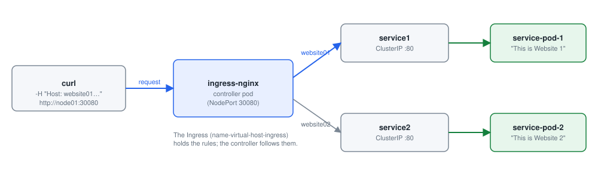
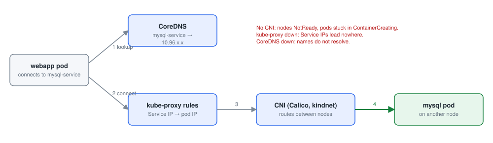

# Module 4: Services and networking

Each lab below is a practical from this repository, step by step: the command, what it does, and what it printed on the practice cluster. Names with random endings (pod names such as `nginx-7d9c…`), IP addresses and ages will differ on yours.

- [Lab 4.1: A Service with manual endpoints](#lab-41-a-service-with-manual-endpoints)
- [Lab 4.2: Services find pods by selector](#lab-42-services-find-pods-by-selector)
- [Lab 4.3: NodePort](#lab-43-nodeport)
- [Lab 4.4: LoadBalancer](#lab-44-loadbalancer)
- [Lab 4.5: Service manifests from the command line](#lab-45-service-manifests-from-the-command-line)
- [Lab 4.6: Named ports](#lab-46-named-ports)
- [Lab 4.7: Namespaces](#lab-47-namespaces)
- [Lab 4.8: Installing Helm](#lab-48-installing-helm)
- [Lab 4.9: Your first Helm charts](#lab-49-your-first-helm-charts)
- [Lab 4.10: Ingress](#lab-410-ingress)
- [Lab 4.11: Service accounts](#lab-411-service-accounts)
- [Lab 4.12: A custom service account](#lab-412-a-custom-service-account)
- [Lab 4.13: Cluster DNS](#lab-413-cluster-dns)

## Lab 4.1: A Service with manual endpoints

### What you will do

Follow [serviceandendpoints.md](https://github.com/kumbulanit/CKA/blob/main/Networking/Services%20and%20Networking/serviceandendpoints.md),
steps 1 to 6:

1. Create the pods **backend-pod-1** and **backend-pod-2** from `nginx`, and **frontend-pod** from
   `ubuntu` running `sleep 3600`.
2. Inside frontend-pod, install curl (`apt-get update && apt-get -y install curl`) and curl
   backend-pod-1's IP address.
3. Write **service.yaml**: a Service **kplabs-service** with port **8080** → targetPort **80** and no
   selector. Apply it and describe it: it has no endpoints.
4. Write **endpoint.yaml**: an Endpoints object **kplabs-service** with backend-pod-1's IP and port 80.
   Apply it.
5. From frontend-pod, curl the service's IP on port 8080.

Press **Check** now; step 7 (deleting everything) comes after the check passes.

### Step by step

**Step 1.** Starts the pod `backend-pod-1` from the image `nginx`.

```bash
kubectl run backend-pod-1 --image=nginx
```

**Step 2.** Starts the pod `backend-pod-2` from the image `nginx`.

```bash
kubectl run backend-pod-2 --image=nginx
```

**Step 3.** Starts the pod `frontend-pod` from the image `ubuntu`.

```bash
kubectl run frontend-pod --image=ubuntu --command -- sleep 3600
```

**Step 4.** Waits until the pods `backend-pod-1`, `backend-pod-2`, `frontend-pod` are Ready.

```bash
kubectl wait --for=condition=Ready pod/backend-pod-1 pod/backend-pod-2 pod/frontend-pod --timeout=180s
```

**Step 5.** Lists the pods, with IP address and node.

```bash
kubectl get pods -o wide
```

**Step 6.** Saves `$BACKEND_POD_1_IP`: prints one field of the pod `backend-pod-1`.

```bash
BACKEND_POD_1_IP=$(kubectl get pod backend-pod-1 -o jsonpath='{.status.podIP}')
```

**Step 7.** Runs a command inside the pod `frontend-pod`.

```bash
kubectl exec frontend-pod -- bash -c "apt-get update && apt-get -y install curl && curl $BACKEND_POD_1_IP"
```

**Step 8.** Writes the file `service.yaml`.

```bash
cat > service.yaml <<'EOF'
apiVersion: v1
kind: Service
metadata:
   name: kplabs-service
spec:
   ports:
   - port: 8080
     targetPort: 80
EOF
```

**Step 9.** Creates the objects in `service.yaml`, or updates them if they exist.

```bash
kubectl apply -f service.yaml
```

**Step 10.** Lists the Services.

```bash
kubectl get service
```

**Step 11.** Shows the details of the Service `kplabs-service`, with its recent events at the bottom.

```bash
kubectl describe service kplabs-service
```

**Step 12.** Writes the file `endpoint.yaml`.

```bash
cat > endpoint.yaml <<EOF
apiVersion: v1
kind: Endpoints
metadata:
  name: kplabs-service
subsets:
  - addresses:
      - ip: $BACKEND_POD_1_IP
    ports:
      - port: 80
EOF
```

**Step 13.** Creates the objects in `endpoint.yaml`, or updates them if they exist.

```bash
kubectl apply -f endpoint.yaml
```

**Step 14.** Saves `$SERVICE_IP`: prints one field of the Service `kplabs-service`.

```bash
SERVICE_IP=$(kubectl get svc kplabs-service -o jsonpath='{.spec.clusterIP}')
```

**Step 15.** Runs a command inside the pod `frontend-pod`.

```bash
kubectl exec frontend-pod -- curl -s $SERVICE_IP:8080
```

### If you see something else

- The check says: _There is no Service kplabs-service with port 8080 and targetPort 80._
- The check says: _kplabs-service should have no selector; its endpoints come from endpoint.yaml._
- The check says: _kplabs-service has no endpoint with backend-pod-1's IP address. Apply endpoint.yaml._
- The check says: _frontend-pod cannot curl the service on port 8080. Is curl installed in frontend-pod (step 2)?_
- `kubectl get pods -o wide` shows each pod's IP address.
- A Service without a selector gets no endpoints by itself. An Endpoints object with the same name as the Service supplies them.

### Why it works

**Why it works.** A Service is a stable virtual IP (the ClusterIP) and port. kube-proxy on every node sends traffic for that IP:port to the Service's endpoints. Normally the endpoints come from the selector; this Service has none, so it stays empty until you create an Endpoints object with the same name. Port 8080 on the Service maps to targetPort 80 on the pod.

**Note:** Endpoints is deprecated since v1.33 in favour of EndpointSlice; the control plane mirrors your Endpoints into an EndpointSlice, which is what kube-proxy reads. Selector-less Services are used to point at things outside the cluster, such as an external database.

---

## Lab 4.2: Services find pods by selector


*How traffic reaches a pod: a Service selects pods by label; NodePort opens a port on every node*

### What you will do

Follow [service-selector.md](https://github.com/kumbulanit/CKA/blob/main/Networking/Services%20and%20Networking/service-selector.md):

1. Write and apply **demo-deployment.yaml**: a Deployment **nginx-deployment** with 3 replicas of
   `nginx:1.27`, label `app: nginx`, containerPort 80.
2. Write and apply **service-selector.yaml**: a Service **kplabs-service-selector** that selects
   `app: nginx`, port 80 → 80. Describe it and count its endpoints.
3. Scale the deployment to **10** replicas and describe the service again.
4. Create a pod **manual-pod** from `nginx`, label it `app=nginx`, and see it join the endpoints.
5. Delete the service, the deployment and manual-pod.

### Step by step

**Step 1.** Writes the file `demo-deployment.yaml`.

```bash
cat > demo-deployment.yaml <<'EOF'
apiVersion: apps/v1
kind: Deployment
metadata:
  name: nginx-deployment
  labels:
    app: nginx
spec:
  replicas: 3
  selector:
    matchLabels:
      app: nginx
  template:
    metadata:
      labels:
        app: nginx
    spec:
      containers:
      - name: nginx
        image: nginx:1.27
        ports:
        - containerPort: 80
EOF
```

**Step 2.** Creates the objects in `demo-deployment.yaml`, or updates them if they exist.

```bash
kubectl apply -f demo-deployment.yaml
```

**Step 3.** Writes the file `service-selector.yaml`.

```bash
cat > service-selector.yaml <<'EOF'
apiVersion: v1
kind: Service
metadata:
   name: kplabs-service-selector
spec:
   selector:
     app: nginx
   ports:
   - port: 80
     targetPort: 80
EOF
```

**Step 4.** Creates the objects in `service-selector.yaml`, or updates them if they exist.

```bash
kubectl apply -f service-selector.yaml
```

**Step 5.** Waits until the rollout of the Deployment `nginx-deployment` has finished.

```bash
kubectl rollout status deployment/nginx-deployment --timeout=180s
```

**Step 6.** Shows the details of the Service `kplabs-service-selector`, with its recent events at the bottom.

```bash
kubectl describe service kplabs-service-selector
```

**Step 7.** Sets the Deployment `nginx-deployment` to 10 replicas.

```bash
kubectl scale deployment/nginx-deployment --replicas=10
```

**Step 8.** Waits until the rollout of the Deployment `nginx-deployment` has finished.

```bash
kubectl rollout status deployment/nginx-deployment --timeout=180s
```

**Step 9.** Shows the details of the Service `kplabs-service-selector`, with its recent events at the bottom.

```bash
kubectl describe service kplabs-service-selector
```

**Step 10.** Starts the pod `manual-pod` from the image `nginx`.

```bash
kubectl run manual-pod --image=nginx
```

**Step 11.** Adds the label `app=nginx` to the pods `manual-pod`, `app=nginx`.

```bash
kubectl label pods manual-pod app=nginx
```

**Step 12.** Waits until the pod `manual-pod` is Ready.

```bash
kubectl wait --for=condition=Ready pod/manual-pod --timeout=120s
```

**Step 13.** Shows the details of the Service `kplabs-service-selector`, with its recent events at the bottom.

```bash
kubectl describe service kplabs-service-selector
```

**Step 14.** Shows the details of the Endpoints `kplabs-service-selector`, with its recent events at the bottom.

```bash
kubectl describe endpoints kplabs-service-selector
```

**Step 15.** Deletes the Service `kplabs-service-selector`.

```bash
kubectl delete service kplabs-service-selector
```

**Step 16.** Deletes the objects in `demo-deployment.yaml`.

```bash
kubectl delete -f demo-deployment.yaml
```

**Step 17.** Deletes the pod `manual-pod`.

```bash
kubectl delete pod manual-pod
```

### If you see something else

- The check says: _/root/service-selector.yaml is missing, or is not the Service kplabs-service-selector selecting app=nginx._
- The check says: _nginx-deployment has not been scaled to 10 replicas yet._
- The check says: _manual-pod has not run yet._
- The check says: _The service, the deployment or manual-pod is still there. The last step deletes them._
- `kubectl describe service kplabs-service-selector` lists the Endpoints: one IP per matching ready pod.
- `kubectl label pods manual-pod app=nginx` makes the pod match the selector, so it gets traffic too.

### Why it works

**Why it works.** The Service's selector `app: nginx` is evaluated continuously: every ready pod with that label becomes an endpoint. Scaling to 10 adds 7 endpoints, and labelling manual-pod `app=nginx` adds an 11th, even though no Deployment owns it. Traffic to the Service is spread across all of them.

**In the exam:** a Service with no endpoints almost always means its selector does not match the pods' labels; compare `kubectl describe svc` with `kubectl get pods --show-labels`.

---

## Lab 4.3: NodePort

### What you will do

Follow [nodeport.md](https://github.com/kumbulanit/CKA/blob/main/Networking/Services%20and%20Networking/nodeport.md):

1. Create a pod **nodeport-pod** from `nginx` with the label `type=publicpod`.
2. Write and apply **nodeport.yaml**: a Service **kplabs-nodeport** of type NodePort that selects
   `type: publicpod`, port 80 → 80.
3. Find the node port with `kubectl get service`, and the worker IPs with `kubectl get nodes -o wide`.
   Instead of a browser, use `curl http://node01:<NODEPORT>`.
4. Delete the pod and the service.

### Step by step

**Step 1.** Starts the pod `nodeport-pod` from the image `nginx`.

```bash
kubectl run nodeport-pod --labels="type=publicpod" --image=nginx
```

**Step 2.** Lists the pods with their labels.

```bash
kubectl get pods --show-labels
```

**Step 3.** Writes the file `nodeport.yaml`.

```bash
cat > nodeport.yaml <<'EOF'
apiVersion: v1
kind: Service
metadata:
   name: kplabs-nodeport
spec:
   selector:
     type: publicpod
   type: NodePort
   ports:
   - port: 80
     targetPort: 80
EOF
```

**Step 4.** Creates the objects in `nodeport.yaml`, or updates them if they exist.

```bash
kubectl apply -f nodeport.yaml
```

**Step 5.** Lists the Services.

```bash
kubectl get service
```

**Step 6.** Lists the nodes, with IP addresses and versions.

```bash
kubectl get nodes -o wide
```

**Step 7.** Waits until the pod `nodeport-pod` is Ready.

```bash
kubectl wait --for=condition=Ready pod/nodeport-pod --timeout=120s
```

**Step 8.** Sends an HTTP request to `http://node01:…` and prints the answer.

```bash
curl -s http://node01:$(kubectl get svc kplabs-nodeport -o jsonpath='{.spec.ports[0].nodePort}') | head -4
```

**Step 9.** Deletes the pod `nodeport-pod`.

```bash
kubectl delete pod nodeport-pod
```

**Step 10.** Deletes the objects in `nodeport.yaml`.

```bash
kubectl delete -f nodeport.yaml
```

### If you see something else

- The check says: _/root/nodeport.yaml is missing, or is not a NodePort Service selecting type=publicpod._
- The check says: _nodeport-pod has not run yet._
- The check says: _nodeport-pod or kplabs-nodeport is still there. The last step deletes them._
- `kubectl get service kplabs-nodeport` shows `80:3XXXX/TCP`; the second number is the node port, open on every node.
- `curl http://node01:<NODEPORT>` and `curl http://node02:<NODEPORT>` both reach the pod.

### Why it works

**Why it works.** A NodePort Service is a ClusterIP Service plus a port (30000–32767 by default) opened on every node. kube-proxy forwards traffic arriving at `<any node>:<nodePort>` to the Service's pods, wherever they run.

**In practice:** NodePort is the simplest way to reach a Service from outside the cluster; you set a fixed port with `nodePort:` under `ports`.

---

## Lab 4.4: LoadBalancer

### What you will do

Follow [loadbalancer.md](https://github.com/kumbulanit/CKA/blob/main/Networking/Services%20and%20Networking/loadbalancer.md):

1. Create a pod **lb-pod** from `nginx` with the label `type=loadbalanced`.
2. Write and apply **elb-service.yaml**: a Service **kplabs-loadbalancer** of type LoadBalancer that
   selects `type: loadbalanced`, port 80.
3. Describe it and get it: `EXTERNAL-IP` stays `<pending>` because nothing here provides load
   balancers. Curl its node port on node01 instead.
4. Delete the pod and the service.

### Step by step

**Step 1.** Starts the pod `lb-pod` from the image `nginx`.

```bash
kubectl run lb-pod --labels="type=loadbalanced" --image=nginx
```

**Step 2.** Lists the pods with their labels.

```bash
kubectl get pods --show-labels
```

**Step 3.** Writes the file `elb-service.yaml`.

```bash
cat > elb-service.yaml <<'EOF'
apiVersion: v1
kind: Service
metadata:
  name: kplabs-loadbalancer
spec:
  type: LoadBalancer
  ports:
  - port: 80
    protocol: TCP
  selector:
    type: loadbalanced
EOF
```

**Step 4.** Creates the objects in `elb-service.yaml`, or updates them if they exist.

```bash
kubectl apply -f elb-service.yaml
```

**Step 5.** Shows the details of the Service `kplabs-loadbalancer`, with its recent events at the bottom.

```bash
kubectl describe service kplabs-loadbalancer
```

**Step 6.** Lists the Service `kplabs-loadbalancer`.

```bash
kubectl get service kplabs-loadbalancer
```

**Step 7.** Waits until the pod `lb-pod` is Ready.

```bash
kubectl wait --for=condition=Ready pod/lb-pod --timeout=120s
```

**Step 8.** Sends an HTTP request to `http://node01:…` and prints the answer.

```bash
curl -s http://node01:$(kubectl get svc kplabs-loadbalancer -o jsonpath='{.spec.ports[0].nodePort}') | head -4
```

**Step 9.** Deletes the pod `lb-pod`.

```bash
kubectl delete pod lb-pod
```

**Step 10.** Deletes the objects in `elb-service.yaml`.

```bash
kubectl delete -f elb-service.yaml
```

### If you see something else

- The check says: _/root/elb-service.yaml is missing, or is not a LoadBalancer Service selecting type=loadbalanced._
- The check says: _lb-pod has not run yet._
- The check says: _lb-pod or kplabs-loadbalancer is still there. The last step deletes them._
- A LoadBalancer Service is a NodePort Service plus a request to the cloud for an external load balancer.
- `kubectl get service kplabs-loadbalancer` shows the node port after `80:`.

### Why it works

**Why it works.** A LoadBalancer Service is a NodePort Service that also asks a cloud controller to create an external load balancer pointing at the node ports. On a cloud cluster `EXTERNAL-IP` gets filled in. On kubeadm (and here) nothing answers the request, so it stays `<pending>`, but the node port works as usual.

**In practice:** on your own machines, add-ons such as MetalLB provide LoadBalancer IPs.

---

## Lab 4.5: Service manifests from the command line

### What you will do

Follow [service-manifest-cli.md](https://github.com/kumbulanit/CKA/blob/main/Networking/Services%20and%20Networking/service-manifest-cli.md):

1. Create a pod **nginx** from `nginx`, and apply **service-deployment.yaml**: a Deployment
   **kplabs-deployment** with 3 replicas, label `tier: frontend`, container `nginx` from `nginx`.
2. With `kubectl expose ... --dry-run=client -o yaml`, save a Service **nginx-service** for the pod
   (port 80 → 80) to **service-01.yaml**, apply it and describe it.
3. Print a NodePort version, then create **nginx-nodeport-service** with `kubectl expose`.
4. Expose the deployment as **nginx-deployment-service** and describe it.
5. Delete the pod, the deployment and the three services.

### Step by step

**Step 1.** Starts the pod `nginx` from the image `nginx`.

```bash
kubectl run nginx --image=nginx
```

**Step 2.** Writes the file `service-deployment.yaml`.

```bash
cat > service-deployment.yaml <<'EOF'
apiVersion: apps/v1
kind: Deployment
metadata:
  name: kplabs-deployment
spec:
  replicas: 3
  selector:
    matchLabels:
      tier: frontend
  template:
    metadata:
      labels:
        tier: frontend
    spec:
      containers:
      - name: nginx
        image: nginx
EOF
```

**Step 3.** Creates the objects in `service-deployment.yaml`, or updates them if they exist.

```bash
kubectl apply -f service-deployment.yaml
```

**Step 4.** Creates a Service in front of the pod `nginx` on port 80.

```bash
kubectl expose pod nginx --name nginx-service --port=80 --target-port=80 --dry-run=client -o yaml
```

**Step 5.** Creates a Service in front of the pod `nginx` on port 80.

```bash
kubectl expose pod nginx --name nginx-service --port=80 --target-port=80 --dry-run=client -o yaml > service-01.yaml
```

**Step 6.** Creates the objects in `service-01.yaml`, or updates them if they exist.

```bash
kubectl apply -f service-01.yaml
```

**Step 7.** Shows the details of the Service `nginx-service`, with its recent events at the bottom.

```bash
kubectl describe service nginx-service
```

**Step 8.** Creates a Service in front of the pod `nginx` on port 80 (type NodePort).

```bash
kubectl expose pod nginx --name nginx-nodeport-service --port=80 --target-port=80 --type=NodePort --dry-run=client -o yaml
```

**Step 9.** Creates a Service in front of the pod `nginx` on port 80 (type NodePort).

```bash
kubectl expose pod nginx --name nginx-nodeport-service --port=80 --target-port=80 --type=NodePort
```

**Step 10.** Lists the Services.

```bash
kubectl get service
```

**Step 11.** Creates a Service in front of the Deployment `kplabs-deployment` on port 80.

```bash
kubectl expose deployment kplabs-deployment --name nginx-deployment-service --port=80 --target-port=80
```

**Step 12.** Waits until the rollout of the Deployment `kplabs-deployment` has finished.

```bash
kubectl rollout status deployment/kplabs-deployment --timeout=180s
```

**Step 13.** Shows the details of the Service `nginx-deployment-service`, with its recent events at the bottom.

```bash
kubectl describe service nginx-deployment-service
```

**Step 14.** Deletes the pod `nginx`.

```bash
kubectl delete pod nginx
```

**Step 15.** Deletes the Deployment `kplabs-deployment`.

```bash
kubectl delete deployment kplabs-deployment
```

**Step 16.** Deletes the Service `nginx-service`.

```bash
kubectl delete service nginx-service
```

**Step 17.** Deletes the Service `nginx-nodeport-service`.

```bash
kubectl delete service nginx-nodeport-service
```

**Step 18.** Deletes the Service `nginx-deployment-service`.

```bash
kubectl delete service nginx-deployment-service
```

### If you see something else

- The check says: _/root/service-01.yaml is missing, or is not the Service nginx-service._
- The check says: _kplabs-deployment has not run with 3 replicas yet._
- The check says: _Some of the objects are still there. The last step deletes them._
- `kubectl expose pod nginx --name nginx-service --port=80 --target-port=80 --dry-run=client -o yaml > service-01.yaml` writes the manifest.
- `kubectl expose` copies the selector from the pod's labels or the deployment's selector, so you never type it.
- `kubectl expose ... --dry-run=client -o yaml` is the quickest way to write a Service manifest. Try step 2.

### Why it works

**Why it works.** `kubectl expose` builds a Service from an existing object: it copies the pod's labels or the Deployment's selector as the Service selector. With `--dry-run=client -o yaml` it only prints the manifest, so you can save and edit it.

**In the exam:** `kubectl expose` is much faster than writing a Service by hand, and it never gets the selector wrong.

---

## Lab 4.6: Named ports

### What you will do

Follow [named-port.md](https://github.com/kumbulanit/CKA/blob/main/Networking/Services%20and%20Networking/named-port.md):

1. Create a pod **nginx** from `nginx` with port 80, expose it as the NodePort Service **first-svc**
   (port 80 → targetPort 80), look at its YAML and curl it on node01.
2. Save a pod **nginx2** (`nginx`, port 80) to **pod_named.yaml** with `--dry-run=client -o yaml`, name
   its port **custom-http**, and apply it.
3. Expose nginx2 as the NodePort Service **named-svc** with `--target-port=custom-http`, and curl it
   on node01. Leave everything running.

### Step by step

**Step 1.** Starts the pod `nginx` from the image `nginx`.

```bash
kubectl run nginx --image=nginx --port=80
```

**Step 2.** Creates a Service in front of the pod `nginx` on port 80 (type NodePort).

```bash
kubectl expose pod nginx --name first-svc --port=80 --target-port=80 --type=NodePort
```

**Step 3.** Lists the Services.

```bash
kubectl get svc
```

**Step 4.** Shows the Service `first-svc` as YAML, as the API server stores it.

```bash
kubectl get svc first-svc -o yaml
```

**Step 5.** Lists the nodes, with IP addresses and versions.

```bash
kubectl get nodes -o wide
```

**Step 6.** Waits until the pod `nginx` is Ready.

```bash
kubectl wait --for=condition=Ready pod/nginx --timeout=120s
```

**Step 7.** Sends an HTTP request to `http://node01:…` and prints the answer.

```bash
curl -s http://node01:$(kubectl get svc first-svc -o jsonpath='{.spec.ports[0].nodePort}') | head -4
```

**Step 8.** Writes the manifest of the pod `nginx2` without creating it.

```bash
kubectl run nginx2 --image=nginx --port=80 --dry-run=client -o yaml > pod_named.yaml
```

**Step 9.** Edits `pod_named.yaml`: `- containerPort: 80` becomes `- containerPort: 80       name: custom-http`. The edit: name the port.

```bash
sed -i 's/^    - containerPort: 80$/    - containerPort: 80\n      name: custom-http/' pod_named.yaml
```

**Step 10.** Creates the objects in `pod_named.yaml`, or updates them if they exist.

```bash
kubectl apply -f pod_named.yaml
```

**Step 11.** Creates a Service in front of the pod `nginx2` on port 80 (type NodePort).

```bash
kubectl expose pod nginx2 --name named-svc --port=80 --target-port=custom-http --type=NodePort
```

**Step 12.** Lists the Services.

```bash
kubectl get svc
```

**Step 13.** Waits until the pod `nginx2` is Ready.

```bash
kubectl wait --for=condition=Ready pod/nginx2 --timeout=120s
```

**Step 14.** Sends an HTTP request to `http://node01:…` and prints the answer.

```bash
curl -s http://node01:$(kubectl get svc named-svc -o jsonpath='{.spec.ports[0].nodePort}') | head -4
```

### If you see something else

- The check says: _There is no NodePort Service first-svc with targetPort 80._
- The check says: _The pod nginx2 (from pod_named.yaml) does not name its port custom-http._
- The check says: _There is no NodePort Service named-svc with targetPort custom-http._
- The check says: _named-svc does not answer on its node port on node01. Is nginx2 running?_
- `kubectl expose pod nginx --name first-svc --port=80 --target-port=80 --type=NodePort` creates the first Service.
- In pod_named.yaml, add `name: custom-http` under `- containerPort: 80`, at the same indentation.

### Why it works

**Why it works.** `targetPort` can be a number or the name of a container port. With `--target-port=custom-http`, the Service looks up which port each pod calls `custom-http`. If a new version of the pod moves to port 8080 but keeps the name, the Service needs no change.

**In the exam:** a named targetPort that matches no port name in the pod leaves the Service with no working endpoints.

---

## Lab 4.7: Namespaces

### What you will do

Follow [namespace.md](https://github.com/kumbulanit/CKA/blob/main/Networking/Services%20and%20Networking/namespace.md):

1. List the namespaces, and the pods in `kube-system`.
2. Create the namespace **teama**.
3. Create a pod **nginx** from `nginx` in teama and list the pods there. Leave it running.

### Step by step

**Step 1.** Lists the namespaces.

```bash
kubectl get namespace
```

**Step 2.** Lists the pods in the namespace `kube-system`.

```bash
kubectl get pods -n kube-system
```

**Step 3.** Creates the namespace `teama`.

```bash
kubectl create namespace teama
```

**Step 4.** Lists the namespaces.

```bash
kubectl get namespace
```

**Step 5.** Starts the pod `nginx` from the image `nginx` in the namespace `teama`.

```bash
kubectl run nginx --image=nginx --namespace teama
```

**Step 6.** Lists the pods in the namespace `teama`.

```bash
kubectl get pods --namespace teama
```

### If you see something else

- The check says: _There is no namespace called teama._
- The check says: _There is no running pod nginx in the namespace teama._
- `kubectl create namespace teama` creates it.
- `--namespace teama` (or `-n teama`) works on every kubectl command, including `kubectl run`.

### Why it works

**Why it works.** A namespace is a scope for names: the pod `nginx` in teama is a different object from a pod `nginx` in default. Most objects are namespaced (pods, Services, Deployments); some are cluster-wide (nodes, namespaces, PersistentVolumes). `kubectl api-resources --namespaced=false` lists the cluster-wide ones.

**In the exam:** every question names its namespace; forgetting `-n` is a common way to lose marks.

---

## Lab 4.8: Installing Helm

### What you will do

Follow [install-helm.md](https://github.com/kumbulanit/CKA/blob/main/Networking/Services%20and%20Networking/install-helm.md)
on controlplane: add Helm's apt repository with its signing key, install the `helm` package, and
check it with `helm version`.

### Step by step

**Step 1.** Installs `curl`, `gpg`, `apt-transport-https`.

```bash
sudo apt-get install curl gpg apt-transport-https --yes
```

**Step 2.** Writes the file `/usr/share/keyrings/helm.gpg`.

```bash
curl -fsSL https://packages.buildkite.com/helm-linux/helm-debian/gpgkey | gpg --dearmor | sudo tee /usr/share/keyrings/helm.gpg > /dev/null
```

**Step 3.** Writes the file `/etc/apt/sources.list.d/helm-stable-debian.list`.

```bash
echo "deb [signed-by=/usr/share/keyrings/helm.gpg] https://packages.buildkite.com/helm-linux/helm-debian/any/ any main" | sudo tee /etc/apt/sources.list.d/helm-stable-debian.list
```

**Step 4.** Refreshes the list of packages.

```bash
sudo apt-get update
```

**Step 5.** Installs `helm`.

```bash
sudo apt-get install helm
```

**Step 6.** Prints the Helm version.

```bash
helm version
```

### If you see something else

- The check says: _The helm package is not installed. Add the apt repository and run `sudo apt-get install helm`._
- The check says: _`helm version` does not work._
- The repository line needs `signed-by=/usr/share/keyrings/helm.gpg`, the key file the `curl ... | gpg --dearmor` step writes.
- Run `sudo apt-get update` after adding the repository, then `sudo apt-get install helm`.

### Why it works

**Why it works.** Helm is a client-only tool: it renders charts into Kubernetes manifests and applies them with your kubeconfig. Installing it from its apt repository means `apt upgrade` keeps it current. The key added with `signed-by=` makes apt trust packages from that repository only.

**Note:** Helm's old `baltocdn.com` apt repository no longer serves packages; the repository now lives at packages.buildkite.com.

---

## Lab 4.9: Your first Helm charts

### What you will do

Follow [first-helm-chart.md](https://github.com/kumbulanit/CKA/blob/main/Networking/Services%20and%20Networking/first-helm-chart.md):

1. Add the `jenkins` repository (https://charts.jenkins.io), install the chart `jenkins/jenkins` as
   the release **my-jenkins**, list the releases, and uninstall it.
2. Add the `grafana` repository (https://grafana.github.io/helm-charts), install `grafana/grafana` as
   **my-release**, look at `helm list`, `helm status` and `helm get values`, and uninstall it.

### Step by step

**Step 1.** Adds a chart repository.

```bash
helm repo add jenkins https://charts.jenkins.io
```

**Step 2.** Downloads the latest chart lists.

```bash
helm repo update
```

**Step 3.** Installs the chart as the release `my-jenkins`.

```bash
helm install my-jenkins jenkins/jenkins
```

**Step 4.** Lists the installed releases.

```bash
helm list
```

**Step 5.** Removes the release `my-jenkins` and everything it created.

```bash
helm uninstall my-jenkins
```

**Step 6.** Adds a chart repository.

```bash
helm repo add grafana https://grafana.github.io/helm-charts
```

**Step 7.** Downloads the latest chart lists.

```bash
helm repo update
```

**Step 8.** Installs the chart as the release `my-release`.

```bash
helm install my-release grafana/grafana
```

**Step 9.** Lists the installed releases.

```bash
helm list
```

**Step 10.** Shows the state of the release `my-release`.

```bash
helm status my-release
```

**Step 11.** Shows the values of a release.

```bash
helm get values my-release --all | head -30
```

**Step 12.** Removes the release `my-release` and everything it created.

```bash
helm uninstall my-release
```

### If you see something else

- The check says: _The jenkins and grafana repositories are not both added (`helm repo add`)._
- The check says: _The release my-jenkins has not been installed yet._
- The check says: _The release my-release has not been installed yet._
- The check says: _my-jenkins or my-release is still installed. Uninstall it with `helm uninstall`._
- `helm repo add <name> <url>`, then `helm repo update`, then `helm install <release> <repo>/<chart>`.
- `helm list` shows the releases in the current namespace; `helm uninstall <release>` removes everything a release created.

### Why it works

**Why it works.** A chart is a package of templated manifests; a repository is an index of charts. `helm install <release> <repo>/<chart>` renders the chart with its default values and creates the objects, all labelled with the release name. `helm uninstall` deletes exactly what that release created.

**In practice:** `helm show values <chart>` lists what you can change, and `--set key=value` or `-f values.yaml` changes it at install time.

---

## Lab 4.10: Ingress



*Ingress: one node port, two websites, chosen by the HTTP Host header*

### What you will do

Follow [ingress.md](https://github.com/kumbulanit/CKA/blob/main/Networking/Services%20and%20Networking/ingress.md)
and [deploy-ingress-controller.md](https://github.com/kumbulanit/CKA/blob/main/Networking/Services%20and%20Networking/deploy-ingress-controller.md),
steps 1 to 6:

1. Create the pods **service-pod-1** and **service-pod-2** from `nginx` and expose them as
   **service1** and **service2** (port 80). Check them from a **frontend-pod** (`ubuntu`, with curl).
2. Write and apply **ingress.yaml**: the Ingress **name-virtual-host-ingress** with
   `ingressClassName: nginx`, sending `website01.example.internal` to service1 and
   `website02.example.internal` to service2.
3. Install the ingress-nginx controller with Helm, exposed on node port **30080**.
4. Change each pod's index.html to `This is Website 1` and `This is Website 2`.
5. Check with `curl -H "Host: website01.example.internal" http://node01:30080` (and website02).

Press **Check** now; step 7 (uninstall and delete) comes after the check passes.

### Step by step

**Step 1.** Starts the pod `service-pod-1` from the image `nginx`.

```bash
kubectl run service-pod-1 --image=nginx
```

**Step 2.** Starts the pod `service-pod-2` from the image `nginx`.

```bash
kubectl run service-pod-2 --image=nginx
```

**Step 3.** Creates a Service in front of the pod `service-pod-1` on port 80.

```bash
kubectl expose pod service-pod-1 --name service1 --port=80 --target-port=80
```

**Step 4.** Creates a Service in front of the pod `service-pod-2` on port 80.

```bash
kubectl expose pod service-pod-2 --name service2 --port=80 --target-port=80
```

**Step 5.** Lists the Services.

```bash
kubectl get services
```

**Step 6.** Starts the pod `frontend-pod` from the image `ubuntu`.

```bash
kubectl run frontend-pod --image=ubuntu --command -- sleep 36000
```

**Step 7.** Waits until the pods `service-pod-1`, `service-pod-2`, `frontend-pod` are Ready.

```bash
kubectl wait --for=condition=Ready pod/service-pod-1 pod/service-pod-2 pod/frontend-pod --timeout=180s
```

**Step 8.** Runs a command inside the pod `frontend-pod`.

```bash
kubectl exec frontend-pod -- bash -c "apt-get update && apt-get -y install curl nano && curl -s $(kubectl get svc service1 -o jsonpath='{.spec.clusterIP}') | head -4 && curl -s $(kubectl get svc service2 -o jsonpath='{.spec.clusterIP}') | head -4"
```

**Step 9.** Writes the file `ingress.yaml`.

```bash
cat > ingress.yaml <<'EOF'
apiVersion: networking.k8s.io/v1
kind: Ingress
metadata:
  name: name-virtual-host-ingress
spec:
  ingressClassName: nginx
  rules:
  - host: website01.example.internal
    http:
      paths:
      - pathType: Prefix
        path: "/"
        backend:
          service:
            name: service1
            port:
              number: 80
  - host: website02.example.internal
    http:
      paths:
      - pathType: Prefix
        path: "/"
        backend:
          service:
            name: service2
            port:
              number: 80
EOF
```

**Step 10.** Creates the objects in `ingress.yaml`, or updates them if they exist.

```bash
kubectl apply -f ingress.yaml
```

**Step 11.** Lists the Ingress.

```bash
kubectl get ingress
```

**Step 12.** Shows the details of the Ingress `name-virtual-host-ingress`, with its recent events at the bottom.

```bash
kubectl describe ingress name-virtual-host-ingress
```

**Step 13.** Upgrades the release `--install`.

```bash
helm upgrade --install ingress-nginx ingress-nginx --repo https://kubernetes.github.io/ingress-nginx --namespace ingress-nginx --create-namespace \
  --set controller.service.type=NodePort --set controller.service.nodePorts.http=30080
```

**Step 14.** Lists the installed releases.

```bash
helm list --all-namespaces
```

**Step 15.** Lists the ingressclass.

```bash
kubectl get ingressclass
```

**Step 16.** Lists the Services in the namespace `ingress-nginx`.

```bash
kubectl get service -n ingress-nginx
```

**Step 17.** Waits until the rollout of the Deployment `ingress-nginx-controller` has finished.

```bash
kubectl -n ingress-nginx rollout status deployment/ingress-nginx-controller --timeout=240s
```

**Step 18.** Creates the objects in `ingress.yaml`, or updates them if they exist.

```bash
kubectl apply -f ingress.yaml
```

**Step 19.** Runs a command inside the pod `service-pod-1`.

```bash
kubectl exec service-pod-1 -- bash -c 'cd /usr/share/nginx/html && echo "This is Website 1" > index.html'
```

**Step 20.** Runs a command inside the pod `service-pod-2`.

```bash
kubectl exec service-pod-2 -- bash -c 'cd /usr/share/nginx/html && echo "This is Website 2" > index.html'
```

**Step 21.** Waits 10 seconds.

```bash
sleep 10
```

**Step 22.** Sends an HTTP request to `http://node01:30080` and prints the answer.

```bash
curl -H "Host: website01.example.internal" http://node01:30080
```

**Step 23.** Sends an HTTP request to `http://node01:30080` and prints the answer.

```bash
curl -H "Host: website02.example.internal" http://node01:30080
```

### If you see something else

- The check says: _There is no Ingress name-virtual-host-ingress with ingressClassName nginx._
- The check says: _The ingress-nginx controller is not installed in the namespace ingress-nginx with node port 30080._
- The check says: _curl -H "Host: website01.example.internal" http://node01:30080 does not show "This is Website 1" (or website02 "This is Website 2") yet._
- An Ingress does nothing until a controller runs: `kubectl get ingressclass` shows `nginx` once ingress-nginx is installed.
- `kubectl exec service-pod-1 -- bash -c 'echo "This is Website 1" > /usr/share/nginx/html/index.html'` changes the page without an interactive shell.

### Why it works

**Why it works.** An Ingress is only a set of rules: host and path → Service. An Ingress controller (here ingress-nginx, exposed on node port 30080) reads those rules and does the routing. It picks the backend from the HTTP Host header, so one IP and port serve both websites. `ingressClassName: nginx` says which controller should handle the Ingress.

**Note:** ingress-nginx is retired; the Gateway API is its successor and is on the current CKA curriculum.

---

## Lab 4.11: Service accounts

### What you will do

Follow [service-account.md](https://github.com/kumbulanit/CKA/blob/main/Networking/Services%20and%20Networking/service-account.md)
and [sa-pointers.md](https://github.com/kumbulanit/CKA/blob/main/Networking/Services%20and%20Networking/sa-pointers.md):

1. List the service accounts in all namespaces.
2. Create a pod **app-pod** from `nginx` and describe it to see its service account.
3. Inside app-pod, go to `/var/run/secrets/kubernetes.io/serviceaccount/`, read the token, and call
   `https://kubernetes.default.svc/api/v1` with curl, `--cacert ca.crt` and the token.
4. Create the namespace **kplabs-test**, check that it got a `default` service account, and create a
   pod **nginx-pod** from `nginx` in it. Look at its mounted token too. Leave both pods running.

### Step by step

**Step 1.** Lists the service accounts in every namespace.

```bash
kubectl get serviceaccount --all-namespaces
```

**Step 2.** Starts the pod `app-pod` from the image `nginx`.

```bash
kubectl run app-pod --image=nginx
```

**Step 3.** Waits until the pod `app-pod` is Ready.

```bash
kubectl wait --for=condition=Ready pod/app-pod --timeout=120s
```

**Step 4.** Lists the pods.

```bash
kubectl get pods
```

**Step 5.** Shows the details of the pod `app-pod`, with its recent events at the bottom.

```bash
kubectl describe pod app-pod
```

**Step 6.** Runs a command inside the pod `app-pod`.

```bash
kubectl exec app-pod -- bash -c 'cd /var/run/secrets/kubernetes.io/serviceaccount/ && ls && token=$(cat token) && echo $token && curl -s --cacert ca.crt -H "Authorization: Bearer $token" https://kubernetes.default.svc/api/v1 | head -20'
```

**Step 7.** Lists the service accounts.

```bash
kubectl get serviceaccount
```

**Step 8.** Lists the service accounts in the namespace `kube-system`.

```bash
kubectl get sa -n kube-system
```

**Step 9.** Creates the namespace `kplabs-test`.

```bash
kubectl create namespace kplabs-test
```

**Step 10.** Lists the service accounts in the namespace `kplabs-test`.

```bash
kubectl get sa -n kplabs-test
```

**Step 11.** Starts the pod `nginx-pod` from the image `nginx` in the namespace `kplabs-test`.

```bash
kubectl run nginx-pod -n kplabs-test --image=nginx
```

**Step 12.** Waits until the pod `nginx-pod` is Ready in the namespace `kplabs-test`.

```bash
kubectl -n kplabs-test wait --for=condition=Ready pod/nginx-pod --timeout=120s
```

**Step 13.** Lists the pods in the namespace `kplabs-test`.

```bash
kubectl get pods -n kplabs-test
```

**Step 14.** Shows the details of the pod `nginx-pod` in the namespace `kplabs-test`, with its recent events at the bottom.

```bash
kubectl describe pod nginx-pod -n kplabs-test
```

**Step 15.** Runs a command inside the pod `nginx-pod`.

```bash
kubectl exec nginx-pod -n kplabs-test -- bash -c 'cd /var/run/secrets/kubernetes.io/serviceaccount/ && ls && cat token'
```

### If you see something else

- The check says: _There is no running pod app-pod using the default service account._
- The check says: _The namespace kplabs-test (with its default service account) does not exist._
- The check says: _There is no running pod nginx-pod in kplabs-test._
- Every namespace gets a service account called `default`, and every pod uses it unless it names another.
- Inside the pod: `curl --cacert ca.crt -H "Authorization: Bearer $(cat token)" https://kubernetes.default.svc/api/v1`.

### Why it works

**Why it works.** Every namespace gets a service account called `default`, and each pod uses one. The kubelet mounts a short-lived token for it, plus the cluster CA and the namespace, at /var/run/secrets/kubernetes.io/serviceaccount/. With that token a process inside the pod can call the API server at `https://kubernetes.default.svc`. What it is allowed to do depends on RBAC (the Security module).

**Note:** since v1.24 service accounts no longer get a long-lived token Secret; `kubectl create token <sa>` issues one on demand.

---

## Lab 4.12: A custom service account

### What you will do

Follow [sa-practical.md](https://github.com/kumbulanit/CKA/blob/main/Networking/Services%20and%20Networking/sa-practical.md):

1. Create the service account **custom-sa**.
2. Save a pod **custom-pod** (`nginx`) to **custom-pod-sa.yaml** with `--dry-run=client -o yaml`, and
   add `serviceAccountName: custom-sa` under `spec`.
3. Apply it and print its service account with `-o jsonpath='{.spec.serviceAccountName}'`.

### Step by step

**Step 1.** Creates the service account `custom-sa`.

```bash
kubectl create serviceaccount custom-sa
```

**Step 2.** Writes the manifest of the pod `custom-pod` without creating it.

```bash
kubectl run custom-pod --image=nginx --dry-run=client -o yaml > custom-pod-sa.yaml
```

**Step 3.** Edits `custom-pod-sa.yaml`: `spec:` becomes `spec:   serviceAccountName: custom-sa`. The edit: add the service account.

```bash
sed -i 's/^spec:$/spec:\n  serviceAccountName: custom-sa/' custom-pod-sa.yaml
```

**Step 4.** Creates the objects in `custom-pod-sa.yaml`, or updates them if they exist.

```bash
kubectl apply -f custom-pod-sa.yaml
```

**Step 5.** Prints one field of the pod `custom-pod`.

```bash
kubectl get pod custom-pod -o jsonpath='{.spec.serviceAccountName}'
```

### If you see something else

- The check says: _There is no service account called custom-sa._
- The check says: _/root/custom-pod-sa.yaml is missing, or has no `serviceAccountName: custom-sa`._
- The check says: _The pod custom-pod does not use the service account custom-sa._
- `kubectl create serviceaccount custom-sa` creates it.
- `serviceAccountName` goes directly under `spec`, next to `containers`. A running pod's service account cannot be changed; delete and recreate it.

### Why it works

**Why it works.** `spec.serviceAccountName` picks the identity the pod's processes use toward the API server. Giving each application its own service account lets you grant it exactly the permissions it needs with RBAC, instead of sharing `default`.

**In the exam:** a pod's service account cannot be changed while it runs; delete the pod and create it again (or edit its Deployment's template).

---

## Lab 4.13: Cluster DNS



*Inside the cluster: DNS finds the Service, kube-proxy picks a pod, the CNI carries the packet*

### What you will do

Follow [DNS for service discovery.md](https://github.com/kumbulanit/CKA/blob/main/Networking/DNS%20for%20service%20discovery.md),
section 4:

1. Look at CoreDNS's configuration: the ConfigMap **coredns** in `kube-system`.
2. Test DNS from a temporary pod: `kubectl run dnstest --image=busybox:1.37 --rm -it --restart=Never -- nslookup kubernetes.default`.

### Step by step

**Step 1.** Shows the ConfigMap `coredns` in the namespace `kube-system` as YAML, as the API server stores it.

```bash
kubectl get configmap coredns -n kube-system -o yaml
```

**Step 2.** Starts a throwaway pod `dnstest` that runs one command and is deleted afterwards.

```bash
kubectl run dnstest --image=busybox:1.37 --rm -i --restart=Never -- nslookup kubernetes.default
```

### If you see something else

- The check says: _The pod dnstest has not run yet._
- The check says: _dnstest is still there. `--rm` deletes it when the command ends; delete it with `kubectl delete pod dnstest`._
- `kubectl get configmap coredns -n kube-system -o yaml` prints the Corefile.
- `kubernetes.default` is the Service `kubernetes` in the namespace `default`; the pod's search domains complete it to `kubernetes.default.svc.cluster.local`.

### Why it works

**Why it works.** CoreDNS runs in kube-system and answers DNS for the cluster. Every pod's /etc/resolv.conf points at it and has search domains such as `default.svc.cluster.local`, so `kubernetes.default` becomes `kubernetes.default.svc.cluster.local`, the API server's Service. The ConfigMap holds CoreDNS's Corefile; its `kubernetes` block answers for Services and pods.

**In the exam:** a throwaway pod with `nslookup` (`kubectl run ... --rm -it --restart=Never`) is the standard way to test DNS.

---
