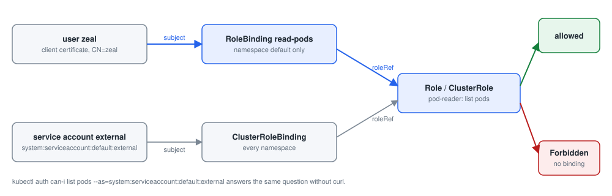

# Module 5: Security

Each lab below is a practical from this repository, step by step: the command, what it does, and what it printed on the practice cluster. Names with random endings (pod names such as `nginx-7d9c…`), IP addresses and ages will differ on yours.

- [Lab 5.1: Authenticating with tokens](#lab-51-authenticating-with-tokens)
- [Lab 5.2: Authorisation with a Role](#lab-52-authorisation-with-a-role)
- [Lab 5.3: ClusterRoles and their bindings](#lab-53-clusterroles-and-their-bindings)
- [Lab 5.4: A user with a client certificate](#lab-54-a-user-with-a-client-certificate)
- [Lab 5.5: Secrets](#lab-55-secrets)
- [Lab 5.6: Secrets inside pods](#lab-56-secrets-inside-pods)
- [Lab 5.7: The API server's certificate](#lab-57-the-api-servers-certificate)
- [Lab 5.8: Security contexts](#lab-58-security-contexts)
- [Lab 5.9: A network policy](#lab-59-a-network-policy)

## Lab 5.1: Authenticating with tokens

### What you will do

Follow [authentication.md](https://github.com/kumbulanit/CKA/blob/main/security/Domain%204%20-%20Security/authentication.md):

1. Create the service account **external**.
2. Save a pod **external-pod** (`nginx`) to **pod-sa.yaml** with `--dry-run=client -o yaml`, add
   `serviceAccountName: external` under `spec`, and apply it. Look at the pod's YAML.
3. Read the token inside the pod (`/var/run/secrets/kubernetes.io/serviceaccount/token`).
4. Call the API server (`kubectl cluster-info` shows it, `https://controlplane:6443`) with
   `curl -k`, first without a token, then `/api/v1` with `--header "Authorization: Bearer <TOKEN>"`.
5. Get a token without a pod: `kubectl create token external`. Leave the pod running.

### Step by step

**Step 1.** Creates the service account `external`.

```bash
kubectl create serviceaccount external
```

**Step 2.** Writes the manifest of the pod `external-pod` without creating it.

```bash
kubectl run external-pod --image=nginx --dry-run=client -o yaml > pod-sa.yaml
```

**Step 3.** Edits `pod-sa.yaml`: `spec:` becomes `spec:   serviceAccountName: external`. The edit: add the service account.

```bash
sed -i 's/^spec:$/spec:\n  serviceAccountName: external/' pod-sa.yaml
```

**Step 4.** Creates the objects in `pod-sa.yaml`, or updates them if they exist.

```bash
kubectl apply -f pod-sa.yaml
```

**Step 5.** Waits until the pod `external-pod` is Ready.

```bash
kubectl wait --for=condition=Ready pod/external-pod --timeout=120s
```

**Step 6.** Lists the pods.

```bash
kubectl get pods
```

**Step 7.** Shows the pod `external-pod` as YAML, as the API server stores it.

```bash
kubectl get pod external-pod -o yaml
```

**Step 8.** Saves `$TOKEN`: runs a command inside the pod `external-pod`.

```bash
TOKEN=$(kubectl exec external-pod -- cat /var/run/secrets/kubernetes.io/serviceaccount/token)
```

**Step 9.** Prints a value.

```bash
echo $TOKEN
```

**Step 10.** Shows the addresses of the API server and CoreDNS.

```bash
kubectl cluster-info
```

**Step 11.** Sends an HTTP request to `https://controlplane:6443` and prints the answer.

```bash
curl -k https://controlplane:6443
```

**Step 12.** Sends an HTTP request to `https://controlplane:6443/api/v1` and prints the answer.

```bash
curl -k https://controlplane:6443/api/v1 --header "Authorization: Bearer $TOKEN"
```

**Step 13.** Creates a short-lived token for the service account `external`.

```bash
kubectl create token external
```

### If you see something else

- The check says: _There is no service account called external._
- The check says: _/root/pod-sa.yaml is missing, or has no `serviceAccountName: external`._
- The check says: _There is no running pod external-pod using the service account external._
- `serviceAccountName` goes directly under `spec`, next to `containers`.
- Without a token the API server treats you as `system:anonymous`; with the token it knows you as `system:serviceaccount:default:external`.

### Why it works

**Why it works.** Every request to the API server is first authenticated. A service account is an identity for software; the kubelet mounts a short-lived token for it into each pod that uses it. The token is a signed JWT naming `system:serviceaccount:default:external`, so the API server knows who is calling. Without any token you are `system:anonymous`, which may only reach a few discovery paths.

**Note:** since v1.24 service accounts no longer get a permanent token Secret; `kubectl create token` issues a short-lived one (one hour by default).

---

## Lab 5.2: Authorisation with a Role



*RBAC: who (subject) may do what (role), where (binding)*

### What you will do

Follow [authorization.md](https://github.com/kumbulanit/CKA/blob/main/security/Domain%204%20-%20Security/authorization.md),
using a token of the service account **external** (`TOKEN=$(kubectl create token external)`):

1. With curl and the token, list the pods in `default`
   (`https://controlplane:6443/api/v1/namespaces/default/pods`): it is **Forbidden**.
2. Write and apply **role.yaml**: a Role **pod-reader** in `default` that may `list` pods.
3. Write and apply **rolebinding.yaml**: a RoleBinding **read-pods** that gives pod-reader to the
   user `system:serviceaccount:default:external`.
4. Run the same curl again: now it lists the pods.

### Step by step

**Step 1.** Saves `$TOKEN`: creates a short-lived token for the service account `external`.

```bash
TOKEN=$(kubectl create token external)
```

**Step 2.** Sends an HTTP request to `https://controlplane:6443/api/v1` and prints the answer.

```bash
curl -k https://controlplane:6443/api/v1 --header "Authorization: Bearer $TOKEN"
```

**Step 3.** Sends an HTTP request to `https://controlplane:6443/api/v1/namespaces/default/pods` and prints the answer.

```bash
curl -k https://controlplane:6443/api/v1/namespaces/default/pods --header "Authorization: Bearer $TOKEN"
```

**Step 4.** Writes the file `role.yaml`.

```bash
cat > role.yaml <<'EOF'
apiVersion: rbac.authorization.k8s.io/v1
kind: Role
metadata:
  namespace: default
  name: pod-reader
rules:
- apiGroups: [""]
  resources: ["pods"]
  verbs: ["list"]
EOF
```

**Step 5.** Creates the objects in `role.yaml`, or updates them if they exist.

```bash
kubectl apply -f role.yaml
```

**Step 6.** Lists the Roles.

```bash
kubectl get role
```

**Step 7.** Shows the details of the Role `pod-reader`, with its recent events at the bottom.

```bash
kubectl describe role pod-reader
```

**Step 8.** Writes the file `rolebinding.yaml`.

```bash
cat > rolebinding.yaml <<'EOF'
apiVersion: rbac.authorization.k8s.io/v1
kind: RoleBinding
metadata:
  name: read-pods
  namespace: default
subjects:
- kind: User
  name: system:serviceaccount:default:external
  apiGroup: rbac.authorization.k8s.io
roleRef:
  kind: Role
  name: pod-reader
  apiGroup: rbac.authorization.k8s.io
EOF
```

**Step 9.** Creates the objects in `rolebinding.yaml`, or updates them if they exist.

```bash
kubectl apply -f rolebinding.yaml
```

**Step 10.** Lists the RoleBindings.

```bash
kubectl get rolebinding
```

**Step 11.** Shows the details of the RoleBinding `read-pods`, with its recent events at the bottom.

```bash
kubectl describe rolebinding read-pods
```

**Step 12.** Sends an HTTP request to `https://controlplane:6443/api/v1/namespaces/default/pods` and prints the answer.

```bash
curl -k https://controlplane:6443/api/v1/namespaces/default/pods --header "Authorization: Bearer $TOKEN"
```

### If you see something else

- The check says: _There is no Role pod-reader in default that may list pods._
- The check says: _There is no RoleBinding read-pods giving the Role pod-reader to system:serviceaccount:default:external._
- The check says: _The service account external still cannot list pods in default._
- A service account's token authenticates as the user `system:serviceaccount:<namespace>:<name>`; that is the subject to bind.
- `kubectl auth can-i list pods --as=system:serviceaccount:default:external` answers yes or no without curl.

### Why it works

**Why it works.** After authentication comes authorisation: on kubeadm clusters, RBAC. A Role lists what may be done (verbs on resources) in one namespace; a RoleBinding gives that Role to subjects (users, groups, service accounts). Nothing is allowed unless a binding allows it, so the first curl is Forbidden and the second, after the binding, lists the pods.

**In the exam:** `kubectl create role` and `kubectl create rolebinding` write the same objects quickly, and `kubectl auth can-i ... --as=...` proves the result.

---

## Lab 5.3: ClusterRoles and their bindings

### What you will do

Follow [cluster-permissions.md](https://github.com/kumbulanit/CKA/blob/main/security/Domain%204%20-%20Security/cluster-permissions.md),
with the same token:

1. Delete the Role and RoleBinding from the last task (`kubectl delete -f role.yaml`, then
   `rolebinding.yaml`).
2. Write and apply **cluster-role.yaml**: a ClusterRole **pod-reader** that may `list` pods.
3. Write and apply **cluster-role-binding.yaml**: a ClusterRoleBinding **list-pods-global** giving
   it to `system:serviceaccount:default:external`. List pods in `default` with curl.
4. Create the namespace **external** and list its pods with curl: allowed everywhere.
5. Delete list-pods-global; the curl to `external` is Forbidden again.
6. Write and apply **clusterrole-to-rolebinding.yaml**: a **RoleBinding** read-pods in `default`
   that refers to the ClusterRole pod-reader. Curl both namespaces: only `default` works.

### Step by step

**Step 1.** Saves `$TOKEN`: creates a short-lived token for the service account `external`.

```bash
TOKEN=$(kubectl create token external)
```

**Step 2.** Deletes the objects in `role.yaml`.

```bash
kubectl delete -f role.yaml
```

**Step 3.** Deletes the objects in `rolebinding.yaml`.

```bash
kubectl delete -f rolebinding.yaml
```

**Step 4.** Writes the file `cluster-role.yaml`.

```bash
cat > cluster-role.yaml <<'EOF'
apiVersion: rbac.authorization.k8s.io/v1
kind: ClusterRole
metadata:
  name: pod-reader
rules:
- apiGroups: [""]
  resources: ["pods"]
  verbs: ["list"]
EOF
```

**Step 5.** Creates the objects in `cluster-role.yaml`, or updates them if they exist.

```bash
kubectl apply -f cluster-role.yaml
```

**Step 6.** Lists the ClusterRoles.

```bash
kubectl get clusterrole
```

**Step 7.** Shows the details of the ClusterRole `pod-reader`, with its recent events at the bottom.

```bash
kubectl describe clusterrole pod-reader
```

**Step 8.** Writes the file `cluster-role-binding.yaml`.

```bash
cat > cluster-role-binding.yaml <<'EOF'
apiVersion: rbac.authorization.k8s.io/v1
kind: ClusterRoleBinding
metadata:
  name: list-pods-global
subjects:
- kind: User
  name: system:serviceaccount:default:external
  apiGroup: rbac.authorization.k8s.io
roleRef:
  kind: ClusterRole
  name: pod-reader
  apiGroup: rbac.authorization.k8s.io
EOF
```

**Step 9.** Creates the objects in `cluster-role-binding.yaml`, or updates them if they exist.

```bash
kubectl apply -f cluster-role-binding.yaml
```

**Step 10.** Lists the ClusterRoleBindings.

```bash
kubectl get clusterrolebinding
```

**Step 11.** Shows the details of the ClusterRoleBinding `list-pods-global`, with its recent events at the bottom.

```bash
kubectl describe clusterrolebinding list-pods-global
```

**Step 12.** Sends an HTTP request to `https://controlplane:6443/api/v1/namespaces/default/pods` and prints the answer.

```bash
curl -k https://controlplane:6443/api/v1/namespaces/default/pods --header "Authorization: Bearer $TOKEN"
```

**Step 13.** Creates the namespace `external`.

```bash
kubectl create namespace external
```

**Step 14.** Sends an HTTP request to `https://controlplane:6443/api/v1/namespaces/external/pods` and prints the answer.

```bash
curl -k https://controlplane:6443/api/v1/namespaces/external/pods --header "Authorization: Bearer $TOKEN"
```

**Step 15.** Deletes the ClusterRoleBinding `list-pods-global`.

```bash
kubectl delete clusterrolebinding list-pods-global
```

**Step 16.** Sends an HTTP request to `https://controlplane:6443/api/v1/namespaces/external/pods` and prints the answer.

```bash
curl -k https://controlplane:6443/api/v1/namespaces/external/pods --header "Authorization: Bearer $TOKEN"
```

**Step 17.** Writes the file `clusterrole-to-rolebinding.yaml`.

```bash
cat > clusterrole-to-rolebinding.yaml <<'EOF'
apiVersion: rbac.authorization.k8s.io/v1
kind: RoleBinding
metadata:
  name: read-pods
  namespace: default
subjects:
- kind: User
  name: system:serviceaccount:default:external
  apiGroup: rbac.authorization.k8s.io
roleRef:
  kind: ClusterRole
  name: pod-reader
  apiGroup: rbac.authorization.k8s.io
EOF
```

**Step 18.** Creates the objects in `clusterrole-to-rolebinding.yaml`, or updates them if they exist.

```bash
kubectl apply -f clusterrole-to-rolebinding.yaml
```

**Step 19.** Sends an HTTP request to `https://controlplane:6443/api/v1/namespaces/external/pods` and prints the answer.

```bash
curl -k https://controlplane:6443/api/v1/namespaces/external/pods --header "Authorization: Bearer $TOKEN"
```

**Step 20.** Sends an HTTP request to `https://controlplane:6443/api/v1/namespaces/default/pods` and prints the answer.

```bash
curl -k https://controlplane:6443/api/v1/namespaces/default/pods --header "Authorization: Bearer $TOKEN"
```

### If you see something else

- The check says: _cluster-role-binding.yaml is missing, or the ClusterRoleBinding list-pods-global is still there (step 5 deletes it)._
- The check says: _The Role pod-reader should be deleted and the ClusterRole pod-reader created._
- The check says: _The RoleBinding read-pods in default does not refer to the ClusterRole pod-reader yet (step 6)._
- The check says: _external should be able to list pods in default but not in the namespace external._
- A ClusterRole has no namespace. Bound with a ClusterRoleBinding it applies in every namespace; bound with a RoleBinding, only in that RoleBinding's namespace.
- `kubectl auth can-i list pods -n external --as=system:serviceaccount:default:external` checks each step without curl.

### Why it works

**Why it works.** A ClusterRole is a Role without a namespace. What decides its reach is the binding: a ClusterRoleBinding grants it in every namespace (and for cluster-wide resources), while a RoleBinding that refers to a ClusterRole grants it only in the RoleBinding's own namespace. That lets you define a role once and hand it out namespace by namespace.

**In the exam:** a RoleBinding's `roleRef` cannot be changed after creation; delete and recreate the binding instead.

---

## Lab 5.4: A user with a client certificate

### What you will do

Follow [certificate-steps.md](https://github.com/kumbulanit/CKA/blob/main/security/Domain%204%20-%20Security/certificate-steps.md)
from step 1 (kubectl is already set up here). First delete the RoleBinding from the last task:
`kubectl delete -f clusterrole-to-rolebinding.yaml`. Then:

1. In **/root/certificates**, create the key **zeal.key** and a CSR **zeal.csr** with
   `-subj "/CN=zeal/O=kplabs"`.
2. Write **csr-requests.yaml**: a CertificateSigningRequest **zeal-csr** with the base64 CSR, signer
   `kubernetes.io/kube-apiserver-client` and usage `client auth`. Apply and approve it.
3. Save the issued certificate as **zeal.crt**.
4. Add the user **zeal** to your kubeconfig and a context **zeal-context** (cluster `kubernetes`).
   `kubectl --context=zeal-context get pods` is Forbidden.
5. Create the Role pod-reader and a RoleBinding read-pods for the user **zeal**, run the same command
   again (now it works), then delete both.

### Step by step

**Step 1.** Deletes the objects in `clusterrole-to-rolebinding.yaml`.

```bash
kubectl delete -f clusterrole-to-rolebinding.yaml
```

**Step 2.** Creates the folder `/root/certificates`.

```bash
mkdir /root/certificates
```

**Step 3.** Goes into `/root/certificates`.

```bash
cd /root/certificates
```

**Step 4.** Creates a private key `zeal.key`.

```bash
openssl genrsa -out zeal.key 2048
```

**Step 5.** Creates a certificate signing request `zeal.csr` for `zeal`.

```bash
openssl req -new -key zeal.key -out zeal.csr -subj "/CN=zeal/O=kplabs"
```

**Step 6.** Shows the file `zeal.csr`.

```bash
cat zeal.csr | base64 | tr -d '\n'
```

**Step 7.** Writes the file `csr-requests.yaml`.

```bash
cat > csr-requests.yaml <<EOF
apiVersion: certificates.k8s.io/v1
kind: CertificateSigningRequest
metadata:
  name: zeal-csr
spec:
  groups:
  - system:authenticated
  request: $(cat zeal.csr | base64 | tr -d '\n')
  signerName: kubernetes.io/kube-apiserver-client
  usages:
  - digital signature
  - key encipherment
  - client auth
EOF
```

**Step 8.** Creates the objects in `csr-requests.yaml`, or updates them if they exist.

```bash
kubectl apply -f csr-requests.yaml
```

**Step 9.** Lists the certificate signing requests.

```bash
kubectl get csr
```

**Step 10.** Approves the certificate signing request `zeal-csr`.

```bash
kubectl certificate approve zeal-csr
```

**Step 11.** Repeats until the condition is true (waits for the cluster to catch up). Wait until it is issued.

```bash
until [ -n "$(kubectl get csr zeal-csr -o jsonpath='{.status.certificate}')" ]; do sleep 1; done
```

**Step 12.** Prints one field of the certificate signing request `zeal-csr`.

```bash
kubectl get csr zeal-csr -o jsonpath='{.status.certificate}' | base64 -d > zeal.crt
```

**Step 13.** Adds a user `zeal`.

```bash
kubectl config set-credentials zeal --client-certificate=zeal.crt --client-key=zeal.key
```

**Step 14.** Lists the clusters.

```bash
kubectl config get-clusters
```

**Step 15.** Adds a context `zeal-context`.

```bash
kubectl config set-context zeal-context --cluster kubernetes --user=zeal
```

**Step 16.** Lists the pods.

```bash
kubectl --context=zeal-context get pods
```

**Step 17.** Writes the file `role.yaml`.

```bash
cat > role.yaml <<'EOF'
apiVersion: rbac.authorization.k8s.io/v1
kind: Role
metadata:
  namespace: default
  name: pod-reader
rules:
- apiGroups: [""]
  resources: ["pods"]
  verbs: ["list"]
EOF
```

**Step 18.** Creates the objects in `role.yaml`, or updates them if they exist.

```bash
kubectl apply -f role.yaml
```

**Step 19.** Writes the file `rolebinding.yaml`.

```bash
cat > rolebinding.yaml <<'EOF'
apiVersion: rbac.authorization.k8s.io/v1
kind: RoleBinding
metadata:
  name: read-pods
  namespace: default
subjects:
- kind: User
  name: zeal
  apiGroup: rbac.authorization.k8s.io
roleRef:
  kind: Role
  name: pod-reader
  apiGroup: rbac.authorization.k8s.io
EOF
```

**Step 20.** Creates the objects in `rolebinding.yaml`, or updates them if they exist.

```bash
kubectl apply -f rolebinding.yaml
```

**Step 21.** Lists the pods.

```bash
kubectl --context=zeal-context get pods
```

**Step 22.** Deletes the objects in `role.yaml`.

```bash
kubectl delete -f role.yaml
```

**Step 23.** Deletes the objects in `rolebinding.yaml`.

```bash
kubectl delete -f rolebinding.yaml
```

### If you see something else

- The check says: _/root/certificates/zeal.crt is missing, or is not a certificate for CN=zeal signed by the cluster CA._
- The check says: _Your kubeconfig has no context zeal-context for the cluster kubernetes and the user zeal._
- The check says: _kubectl --context=zeal-context does not log in as zeal. Check the certificate and key in set-credentials._
- The check says: _The Role pod-reader or the RoleBinding read-pods is still there. The last step deletes them._
- The CSR's `request` field is the CSR file in base64 on one line: `cat zeal.csr | base64 | tr -d '\n'`.
- `kubectl config set-credentials zeal --client-certificate=zeal.crt --client-key=zeal.key`, then `kubectl config set-context zeal-context --cluster kubernetes --user=zeal`.

### Why it works

**Why it works.** Kubernetes has no user objects. A user is anyone who presents a client certificate signed by the cluster CA: the certificate's CN is the user name and its O fields are the groups. The CertificateSigningRequest API lets an admin get a CSR signed by the cluster CA (`kubernetes.io/kube-apiserver-client` signer) without touching ca.key. The new user can log in straight away but can do nothing until RBAC grants something.

**In practice:** `kubectl config set-credentials` and `set-context` only edit your kubeconfig file; nothing changes in the cluster.

---

## Lab 5.5: Secrets

### What you will do

Follow [secret-data.md](https://github.com/kumbulanit/CKA/blob/main/security/Domain%204%20-%20Security/secret-data.md):

1. Create **firstsecret** from the literal `dbpassword=mypassword123`.
2. Write `dbuser=admin` to **credentials.txt** and create **secondsecret** from that file.
3. Look at firstsecret's YAML and decode its value with `base64 -d`.
4. Write and apply **secret-data.yaml** (Secret **thirdsecret** with base64 `data`) and
   **secret-stringdata.yaml** (Secret **stringdata** with a `config.yaml` in `stringData`).

### Step by step

**Step 1.** Creates the Secret `firstsecret`.

```bash
kubectl create secret generic  firstsecret --from-literal=dbpassword=mypassword123
```

**Step 2.** Writes `credentials.txt`.

```bash
echo 'dbuser=admin' > credentials.txt
```

**Step 3.** Creates the Secret `secondsecret`.

```bash
kubectl create secret generic  secondsecret --from-file=./credentials.txt
```

**Step 4.** Shows the Secret `firstsecret` as YAML, as the API server stores it.

```bash
kubectl get secret firstsecret -o yaml
```

**Step 5.** Prints one field of the Secret `firstsecret`.

```bash
kubectl get secret firstsecret -o jsonpath='{.data.dbpassword}' | base64 -d
```

**Step 6.** Writes the file `secret-data.yaml`.

```bash
cat > secret-data.yaml <<'EOF'
apiVersion: v1
kind: Secret
metadata:
  name: thirdsecret
type: Opaque
data:
  username: ZGJhZG1pbg==
  password: bXlwYXNzd29yZDEyMw==
EOF
```

**Step 7.** Creates the objects in `secret-data.yaml`, or updates them if they exist.

```bash
kubectl apply -f secret-data.yaml
```

**Step 8.** Writes the file `secret-stringdata.yaml`.

```bash
cat > secret-stringdata.yaml <<'EOF'
apiVersion: v1
kind: Secret
metadata:
  name: stringdata
type: Opaque
stringData:
 config.yaml: |-
   username: dbadmin
   password: mypassword
EOF
```

**Step 9.** Creates the objects in `secret-stringdata.yaml`, or updates them if they exist.

```bash
kubectl apply -f secret-stringdata.yaml
```

### If you see something else

- The check says: _firstsecret is missing, or its dbpassword is not mypassword123._
- The check says: _secondsecret is missing, or has no key credentials.txt containing dbuser=admin._
- The check says: _thirdsecret is missing, or its username and password are not dbadmin and mypassword123._
- The check says: _The Secret stringdata is missing, or its config.yaml does not hold the username dbadmin._
- `--from-file=./credentials.txt` uses the file name as the key; `--from-literal=key=value` sets one key directly.
- `data` values must be base64 (`echo -n dbadmin | base64`); `stringData` takes plain text and the API server encodes it.

### Why it works

**Why it works.** A Secret holds small pieces of sensitive data as key/value pairs. `--from-literal` and `--from-file` build it for you; in YAML, `data` needs base64 values while `stringData` takes plain text and is encoded by the API server. base64 is an encoding, not encryption: anyone who can read the Secret can read the value, so access to Secrets is controlled with RBAC (and etcd encryption at rest, if configured).

---

## Lab 5.6: Secrets inside pods

### What you will do

Follow [mounting-secrets.md](https://github.com/kumbulanit/CKA/blob/main/security/Domain%204%20-%20Security/mounting-secrets.md)
(it uses firstsecret from the last task):

1. Write and apply **secretpod.yaml**: a pod **secretmount** (`nginx`) that mounts firstsecret
   read-only at `/etc/foo`. Read `/etc/foo/dbpassword` inside it.
2. Write and apply **secret-env.yaml**: a pod **secret-env** (`nginx`) with the environment variable
   `SECRET_USERNAME` taken from firstsecret's key `dbpassword`. Print it inside the pod.

### Step by step

**Step 1.** Writes the file `secretpod.yaml`.

```bash
cat > secretpod.yaml <<'EOF'
apiVersion: v1
kind: Pod
metadata:
  name: secretmount
spec:
  containers:
  - name: secretmount
    image: nginx
    volumeMounts:
    - name: foo
      mountPath: "/etc/foo"
      readOnly: true
  volumes:
  - name: foo
    secret:
      secretName: firstsecret
EOF
```

**Step 2.** Creates the objects in `secretpod.yaml`, or updates them if they exist.

```bash
kubectl apply -f secretpod.yaml
```

**Step 3.** Writes the file `secret-env.yaml`.

```bash
cat > secret-env.yaml <<'EOF'
apiVersion: v1
kind: Pod
metadata:
  name: secret-env
spec:
  containers:
  - name: secret-env
    image: nginx
    env:
      - name: SECRET_USERNAME
        valueFrom:
          secretKeyRef:
            name: firstsecret
            key: dbpassword
  restartPolicy: Never
EOF
```

**Step 4.** Creates the objects in `secret-env.yaml`, or updates them if they exist.

```bash
kubectl apply -f secret-env.yaml
```

**Step 5.** Waits until the pods `secretmount`, `secret-env` are Ready.

```bash
kubectl wait --for=condition=Ready pod/secretmount pod/secret-env --timeout=120s
```

**Step 6.** Runs a command inside the pod `secretmount`.

```bash
kubectl exec secretmount -- cat /etc/foo/dbpassword
```

**Step 7.** Runs a command inside the pod `secret-env`.

```bash
kubectl exec secret-env -- printenv SECRET_USERNAME
```

### If you see something else

- The check says: _The pod secretmount is not running, or /etc/foo/dbpassword inside it is not firstsecret's value._
- The check says: _The pod secret-env is not running, or its SECRET_USERNAME is not firstsecret's dbpassword._
- A secret volume puts each key in a file named after it: firstsecret's dbpassword becomes /etc/foo/dbpassword.
- `env[].valueFrom.secretKeyRef` takes `name` (the Secret) and `key`.

### Why it works

**Why it works.** A pod can use a Secret as files (a `secret` volume, one file per key) or as environment variables (`secretKeyRef`). Mounted files are updated when the Secret changes; environment variables are fixed when the container starts.

**In practice:** files are usually preferred, because environment variables leak more easily (into logs, crash dumps and child processes).

---

## Lab 5.7: The API server's certificate

### What you will do

Follow sections 2 to 4 of [Configuring TLS access to API.md](https://github.com/kumbulanit/CKA/blob/main/security/Configuring%20TLS%20access%20to%20API.md)
on controlplane:

1. Inspect `/etc/kubernetes/pki/apiserver.crt` with `openssl x509` (its SANs, subject, issuer and
   dates), and find the certificate files in the kube-apiserver manifest.
2. Check every certificate's expiry with `kubeadm certs check-expiration`.
3. Add the names `controlplane`, `k8s.example.internal` and `192.168.56.100` to the API server
   certificate: save the ClusterConfiguration to **kubeadm.yaml**, add them under
   `apiServer.certSANs`, move the old certificate and key to your home folder, and run
   `kubeadm init phase certs apiserver --config kubeadm.yaml`.
4. Check the SANs again, and `curl --cacert /etc/kubernetes/pki/ca.crt https://controlplane:6443/version`.

### Step by step

**Step 1.** Prints the certificate in readable form.

```bash
sudo openssl x509 -in /etc/kubernetes/pki/apiserver.crt -noout -text | grep -A1 "Subject Alternative Name"
```

**Step 2.** Signs the certificate with the cluster CA.

```bash
sudo openssl x509 -in /etc/kubernetes/pki/apiserver.crt -noout -subject -issuer -dates
```

**Step 3.** Searches for the text.

```bash
sudo grep -E "tls-cert-file|tls-private-key-file|client-ca-file" /etc/kubernetes/manifests/kube-apiserver.yaml
```

**Step 4.** Shows when the cluster certificates expire.

```bash
sudo kubeadm certs check-expiration
```

**Step 5.** Prints one field of the ConfigMap `kubeadm-config` in the namespace `kube-system`.

```bash
kubectl -n kube-system get configmap kubeadm-config -o jsonpath='{.data.ClusterConfiguration}' > kubeadm.yaml
```

**Step 6.** Runs the command only when the condition is true. The edit: add the names under apiServer.certSANs (or create the list).

```bash
if grep -q 'certSANs:' kubeadm.yaml; then
  sed -i '/certSANs:/a\  - controlplane\n  - k8s.example.internal\n  - 192.168.56.100' kubeadm.yaml
else
  sed -i 's/^apiServer:$/apiServer:\n  certSANs:\n  - controlplane\n  - k8s.example.internal\n  - 192.168.56.100/' kubeadm.yaml
fi
```

**Step 7.** Moves `/etc/kubernetes/pki/apiserver.{crt,key}` to `~/`.

```bash
sudo mv /etc/kubernetes/pki/apiserver.{crt,key} ~/
```

**Step 8.** Creates the control plane: certificates, etcd, the API server, the scheduler and the controller manager.

```bash
sudo kubeadm init phase certs apiserver --config kubeadm.yaml
```

**Step 9.** Prints the certificate in readable form.

```bash
sudo openssl x509 -in /etc/kubernetes/pki/apiserver.crt -noout -text | grep -A1 "Subject Alternative Name"
```

**Step 10.** Waits 10 seconds.

```bash
sleep 10
```

**Step 11.** Sends an HTTP request to `https://controlplane:6443/version` and prints the answer.

```bash
curl --cacert /etc/kubernetes/pki/ca.crt https://controlplane:6443/version
```

### If you see something else

- The check says: _The old apiserver.crt and apiserver.key are not in /root (step 3 moves them there)._
- The check says: _/etc/kubernetes/pki/apiserver.crt does not list k8s.example.internal and 192.168.56.100 yet._
- The check says: _curl --cacert /etc/kubernetes/pki/ca.crt https://controlplane:6443/version does not answer._
- In kubeadm.yaml, `certSANs` is a list under `apiServer:`; add the three names as `- name` lines at the same indentation as any that are there.
- kubeadm will not overwrite an existing certificate, which is why the old one is moved away first.

### Why it works

**Why it works.** Clients check the API server's certificate against the cluster CA and against the name they connected to: the name must be one of the certificate's Subject Alternative Names. To reach the API server under a new name (a load balancer, a DNS alias), the certificate must be regenerated with that SAN, signed by the same CA. kubeadm does that from the ClusterConfiguration, and the API server picks up the new certificate without a restart.

**In the exam:** `kubeadm certs check-expiration` and `kubeadm certs renew` manage certificate lifetimes (one year for kubeadm's certificates, ten for the CA).

---

## Lab 5.8: Security contexts

### What you will do

Follow the first part of [security-context-and-network-policy.md](https://github.com/kumbulanit/CKA/blob/main/security/Domain%204%20-%20Security/security-context-and-network-policy.md):

1. Apply **privileged.yaml**: the pods **privileged** (`securityContext.privileged: true`) and
   **non-privileged**. Compare `ls /dev | wc -l` and `grep CapEff /proc/1/status` in both.
2. Apply **capabilities.yaml**: the pod **privileged1**, which drops the `LINUX_IMMUTABLE`
   capability. Compare its CapEff with non-privileged's.

### Step by step

**Step 1.** Writes the file `privileged.yaml`.

```bash
cat > privileged.yaml <<'EOF'
apiVersion: v1
kind: Pod
metadata:
  name: privileged
spec:
  containers:
  - name: privileged
    image: nginx
    securityContext:
      privileged: true

---
apiVersion: v1
kind: Pod
metadata:
  name: non-privileged
spec:
  containers:
  - name: non-privileged
    image: nginx
EOF
```

**Step 2.** Creates the objects in `privileged.yaml`, or updates them if they exist.

```bash
kubectl apply -f privileged.yaml
```

**Step 3.** Lists the pods.

```bash
kubectl get pods
```

**Step 4.** Waits until the pods `privileged`, `non-privileged` are Ready.

```bash
kubectl wait --for=condition=Ready pod/privileged pod/non-privileged --timeout=120s
```

**Step 5.** Runs a command inside the pod `privileged`.

```bash
kubectl exec privileged -- sh -c 'ls /dev | wc -l; grep CapEff /proc/1/status'
```

**Step 6.** Runs a command inside the pod `non-privileged`.

```bash
kubectl exec non-privileged -- sh -c 'ls /dev | wc -l; grep CapEff /proc/1/status'
```

**Step 7.** Writes the file `capabilities.yaml`.

```bash
cat > capabilities.yaml <<'EOF'
apiVersion: v1
kind: Pod
metadata:
  name: privileged1
spec:
  containers:
  - name: privileged1
    image: nginx
    securityContext:
      capabilities:
        drop:
          - LINUX_IMMUTABLE
EOF
```

**Step 8.** Creates the objects in `capabilities.yaml`, or updates them if they exist.

```bash
kubectl apply -f capabilities.yaml
```

**Step 9.** Waits until the pod `privileged1` is Ready.

```bash
kubectl wait --for=condition=Ready pod/privileged1 --timeout=120s
```

**Step 10.** Runs a command inside the pod `privileged1`.

```bash
kubectl exec privileged1 -- grep CapEff /proc/1/status
```

### If you see something else

- The check says: _The pods privileged (with privileged true) and non-privileged are not both running._
- The check says: _The pod privileged1, dropping LINUX_IMMUTABLE, is not running._
- `securityContext` can be set for the whole pod (`spec.securityContext`) or per container; privileged and capabilities are per container.
- CapEff is a bit mask of the container's capabilities: a privileged container has them all, a dropped capability clears one bit.

### Why it works

**Why it works.** A security context sets the Linux security options a container runs with. `privileged: true` gives it all capabilities and access to the host's devices, nearly the same power as root on the node; avoid it except for system components. Capabilities split root's power into pieces (for example `NET_ADMIN`, `LINUX_IMMUTABLE`); dropping the ones a container does not need limits what an attacker could do with it.

**In the exam:** `runAsUser`, `runAsNonRoot`, `readOnlyRootFilesystem` and `capabilities` are the fields to know.

---

## Lab 5.9: A network policy

### What you will do

Follow the second part of [security-context-and-network-policy.md](https://github.com/kumbulanit/CKA/blob/main/security/Domain%204%20-%20Security/security-context-and-network-policy.md):

1. Create a pod **pod01** from `nginx` and check from a temporary busybox pod that it answers
   (`wget -T 3 -qO- <POD01-IP>`).
2. Apply **nsp-deny-pod.yaml**: the NetworkPolicy **default-deny-pod**, which selects `run: pod01`
   and denies all its ingress and egress. Describe it.
3. Try the same wget again: it times out now.

### Step by step

**Step 1.** Starts the pod `pod01` from the image `nginx`.

```bash
kubectl run pod01 --image=nginx
```

**Step 2.** Waits until the pod `pod01` is Ready.

```bash
kubectl wait --for=condition=Ready pod/pod01 --timeout=120s
```

**Step 3.** Lists the pod `pod01`, with IP address and node.

```bash
kubectl get pod pod01 -o wide
```

**Step 4.** Saves `$POD01_IP`: prints one field of the pod `pod01`.

```bash
POD01_IP=$(kubectl get pod pod01 -o jsonpath='{.status.podIP}')
```

**Step 5.** Starts a throwaway pod `test` that runs one command and is deleted afterwards.

```bash
kubectl run test --image=busybox:1.37 --rm -i --restart=Never -- wget -T 3 -qO- $POD01_IP
```

**Step 6.** Writes the file `nsp-deny-pod.yaml`.

```bash
cat > nsp-deny-pod.yaml <<'EOF'
apiVersion: networking.k8s.io/v1
kind: NetworkPolicy
metadata:
  name: default-deny-pod
  namespace: default
spec:
  podSelector:
    matchLabels:
        run: pod01
  policyTypes:
  - Ingress
  - Egress
EOF
```

**Step 7.** Creates the objects in `nsp-deny-pod.yaml`, or updates them if they exist.

```bash
kubectl apply -f nsp-deny-pod.yaml
```

**Step 8.** Lists the NetworkPolicies.

```bash
kubectl get networkpolicy
```

**Step 9.** Shows the details of the NetworkPolicy `default-deny-pod`, with its recent events at the bottom.

```bash
kubectl describe networkpolicy default-deny-pod
```

**Step 10.** Waits 5 seconds.

```bash
sleep 5
```

**Step 11.** Starts a throwaway pod `test` that runs one command and is deleted afterwards.

```bash
kubectl run test --image=busybox:1.37 --rm -i --restart=Never -- wget -T 3 -qO- $POD01_IP
```

### If you see something else

- The check says: _There is no NetworkPolicy default-deny-pod selecting run=pod01 with both Ingress and Egress._
- The check says: _pod01 still answers. Is the policy selecting it (`run: pod01`)?_
- A policy with `policyTypes: [Ingress, Egress]` and no `ingress`/`egress` rules allows nothing for the pods it selects.
- `kubectl run pod01` labels the pod `run=pod01`, which is what the policy's podSelector matches.

### Why it works

**Why it works.** By default every pod can talk to every pod. A NetworkPolicy selects pods with `podSelector` and, for each policy type it lists, allows only the traffic its rules describe. With `Ingress` and `Egress` listed and no rules, nothing is allowed in or out of pod01. Policies are enforced by the network plugin; one without policy support (such as Flannel) silently ignores them.

**In the exam:** policies only add allowances; to open a path, add an `ingress` or `egress` rule with `from`/`to` selectors and ports.

---
