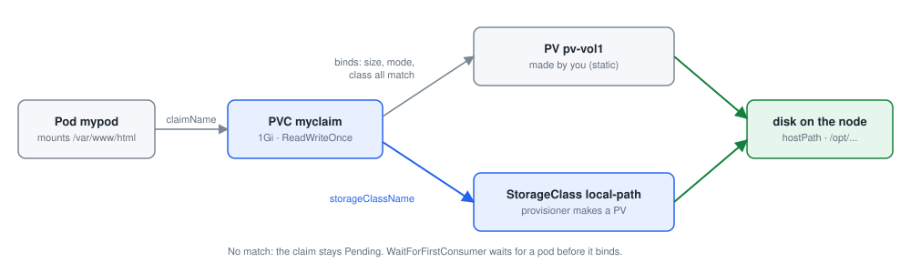

# Module 6: Storage

Each lab below is a practical from this repository, step by step: the command, what it does, and what it printed on the practice cluster. Names with random endings (pod names such as `nginx-7d9c…`), IP addresses and ages will differ on yours. The outputs show Kubernetes v1.36.4 (v1.37.0 after the upgrade lab), the newest version the practice cluster's images have; the cluster `setup.sh` makes runs v1.36.5, so the VERSION columns on yours say v1.36.5. Lab numbers are those of the labs in Desired Labs.

- [Lab 6.1: A hostPath volume](#lab-61-a-hostpath-volume)
- [Lab 6.2: PersistentVolumes and claims](#lab-62-persistentvolumes-and-claims)
- [Lab 6.3: Practice test: persistent volume claims](#lab-63-practice-test-persistent-volume-claims)
- [Lab 6.4: Storage classes and dynamic provisioning](#lab-64-storage-classes-and-dynamic-provisioning)
- [Lab 6.5: Practice test: storage classes](#lab-65-practice-test-storage-classes)

## Before you start

Start the practice cluster on your Ubuntu server, as in the [README](../README.md#the-practice-cluster):

```bash
git clone https://github.com/kumbulanit/CKA.git && cd CKA
sudo ./setup.sh          # minikube with three nodes, Kubernetes v1.36 (about 10 minutes the first time)
kubectl get nodes         # minikube, minikube-m02, minikube-m03
```

The steps use those node names, and `minikube ssh -n <node>` for commands on a node. Run `kubectl` as your own user on the server; commands on the control plane's files (`/etc/kubernetes/manifests`, the kubelet) go through `minikube ssh` with `sudo`. The outputs were recorded in Desired Labs, whose cluster is set out like minikube's (the API server on port 8443, certificates in `/var/lib/minikube/certs` and `~/.minikube`); its terminal is root on `minikube`, so prompts differ, and addresses and ages on yours will differ too.

## Lab 6.1: A hostPath volume

### What you will do

Follow [06-volumes.md](https://github.com/kumbulanit/CKA/blob/main/06-storage/06-volumes.md):

1. Write and apply **random-number-generator.yaml**: a pod **random-number-generator** (`alpine`)
   that writes a random number to `/opt/number.out`, with `/opt` on a `hostPath` volume at `/data`
   (`type: DirectoryOrCreate`).
2. Find the node it ran on (`kubectl get pod -o wide`) and read `/data/number.out` on that node,
   not on the server: `minikube ssh -n <NODE> -- "cat /data/number.out"`.
3. Delete the pod, and check that the file is still on the node, the same way.

### Step by step

**Step 1.** Writes the file `random-number-generator.yaml`.

```bash
cat > random-number-generator.yaml <<'EOF'
apiVersion: v1
kind: Pod
metadata:
  name: random-number-generator
spec:
  containers:
  - image: alpine
    name: alpine
    command: ["/bin/sh", "-c"]
    args: ["shuf -i 0-100 -n 1 >> /opt/number.out;"]
    volumeMounts:
    - mountPath: /opt
      name: data-volume
  volumes:
  - name: data-volume
    hostPath:
      path: /data
      type: DirectoryOrCreate
EOF
```

It prints nothing when it works.

**Step 2.** Creates the objects in `random-number-generator.yaml`, or updates them if they exist.

```bash
kubectl apply -f random-number-generator.yaml
```

You should see something like:

```text
pod/random-number-generator created
```

**Step 3.** Repeats until the condition is true (waits for the cluster to catch up).

```bash
until kubectl get events --field-selector involvedObject.name=random-number-generator,reason=Started -o name | grep -q .; do sleep 2; done
```

It prints nothing when it works.

**Step 4.** Lists the pod `random-number-generator`, with IP address and node.

```bash
kubectl get pod random-number-generator -o wide
```

You should see something like:

```text
NAME                      READY   STATUS    RESTARTS     AGE   IP           NODE           NOMINATED NODE   READINESS GATES
random-number-generator   1/1     Running   1 (2s ago)   25s   10.244.3.2   minikube-m03   <none>           <none>
```

**Step 5.** Saves `$NODE`: prints one field of the pod `random-number-generator`.

```bash
NODE=$(kubectl get pod random-number-generator -o jsonpath='{.spec.nodeName}')
```

It prints nothing when it works.

**Step 6.** On the node `$NODE`, not on the server: shows the file `/data/number.out`.

```bash
minikube ssh -n $NODE -- "cat /data/number.out"
```

You should see something like:

```text
16
61
```

**Step 7.** Deletes the pod `random-number-generator`.

```bash
kubectl delete pod random-number-generator
```

You should see something like:

```text
pod "random-number-generator" deleted from default namespace
```

**Step 8.** On the node `$NODE`, not on the server: shows the file `/data/number.out`.

```bash
minikube ssh -n $NODE -- "cat /data/number.out"
```

You should see something like:

```text
16
61
```

### If you see something else

- The check says: _The pod random-number-generator has not run yet._
- The check says: _random-number-generator is still there. Delete it (step 3)._
- The check says: _There is no /data/number.out on minikube-m02 or minikube-m03._
- The pod's `volumes` entry names the hostPath; the container's `volumeMounts` entry mounts it by that name at /opt.
- The container exits after writing, and the kubelet restarts it, so the file collects several numbers. That is fine.

### Why it works

**Why it works.** A container's own filesystem disappears with it. A volume is storage the pod mounts from elsewhere; a `hostPath` volume is a folder on the node itself, so the file outlives the pod. But it lives on that one node only: a pod scheduled to another node sees a different, empty folder. That is why hostPath is for single-node tests and node-level agents, not application data.

---

## Lab 6.2: PersistentVolumes and claims



*Storage: a pod asks for a claim; the claim binds a volume, made by an admin or by a provisioner*

### What you will do

Follow [07-persistent-volumes.md](https://github.com/kumbulanit/CKA/blob/main/06-storage/07-persistent-volumes.md),
[08-persistent-volume-claims.md](https://github.com/kumbulanit/CKA/blob/main/06-storage/08-persistent-volume-claims.md) and
[09-using-pvcs-in-pods.md](https://github.com/kumbulanit/CKA/blob/main/06-storage/09-using-pvcs-in-pods.md):

1. Write **pv-definition.yaml** (PersistentVolume **pv-vol1**, 1Gi, ReadWriteOnce, hostPath
   `/tmp/data`) and **pvc-definition.yaml** (claim **myclaim**, ReadWriteOnce, 1Gi).
2. Create the PV and the claim and watch the claim go from Pending to **Bound** to pv-vol1.
3. Delete the claim and the PV, then create them again (document 09).
4. Write and create **pod-definition.yaml**: a pod **mypod** (`nginx`, container `myfrontend`) that
   mounts myclaim at `/var/www/html`. List `pod,pvc,pv`. Leave it running.

### Step by step

**Step 1.** Writes the file `pv-definition.yaml`.

```bash
cat > pv-definition.yaml <<'EOF'
kind: PersistentVolume
apiVersion: v1
metadata:
    name: pv-vol1
spec:
    accessModes: [ "ReadWriteOnce" ]
    capacity:
     storage: 1Gi
    hostPath:
     path: /tmp/data
EOF
```

It prints nothing when it works.

**Step 2.** Writes the file `pvc-definition.yaml`.

```bash
cat > pvc-definition.yaml <<'EOF'
kind: PersistentVolumeClaim
apiVersion: v1
metadata:
  name: myclaim
spec:
  storageClassName: ""   # bind to the lesson's PV, not a default StorageClass
  accessModes: [ "ReadWriteOnce" ]
  resources:
   requests:
     storage: 1Gi
EOF
```

It prints nothing when it works.

**Step 3.** Creates the objects in `pv-definition.yaml`.

```bash
kubectl create -f pv-definition.yaml
```

You should see something like:

```text
persistentvolume/pv-vol1 created
```

**Step 4.** Lists the PersistentVolumes.

```bash
kubectl get pv
```

You should see something like:

```text
NAME      CAPACITY   ACCESS MODES   RECLAIM POLICY   STATUS      CLAIM   STORAGECLASS   VOLUMEATTRIBUTESCLASS   REASON   AGE
pv-vol1   1Gi        RWO            Retain           Available                          <unset>                          0s
```

**Step 5.** Creates the objects in `pvc-definition.yaml`.

```bash
kubectl create -f pvc-definition.yaml
```

You should see something like:

```text
persistentvolumeclaim/myclaim created
```

**Step 6.** Lists the PersistentVolumeClaims.

```bash
kubectl get pvc
```

You should see something like:

```text
NAME      STATUS   VOLUME    CAPACITY   ACCESS MODES   STORAGECLASS   VOLUMEATTRIBUTESCLASS   AGE
myclaim   Bound    pv-vol1   1Gi        RWO                           <unset>                 0s
```

**Step 7.** Deletes the PersistentVolumeClaim `myclaim`.

```bash
kubectl delete pvc myclaim
```

You should see something like:

```text
persistentvolumeclaim "myclaim" deleted from default namespace
```

**Step 8.** Deletes the PersistentVolume `pv-vol1`.

```bash
kubectl delete pv pv-vol1
```

You should see something like:

```text
persistentvolume "pv-vol1" deleted
```

**Step 9.** Creates the objects in `pv-definition.yaml`.

```bash
kubectl create -f pv-definition.yaml
```

You should see something like:

```text
persistentvolume/pv-vol1 created
```

**Step 10.** Creates the objects in `pvc-definition.yaml`.

```bash
kubectl create -f pvc-definition.yaml
```

You should see something like:

```text
persistentvolumeclaim/myclaim created
```

**Step 11.** Writes the file `pod-definition.yaml`.

```bash
cat > pod-definition.yaml <<'EOF'
apiVersion: v1
kind: Pod
metadata:
  name: mypod
spec:
  containers:
    - name: myfrontend
      image: nginx
      volumeMounts:
      - mountPath: "/var/www/html"
        name: web
  volumes:
    - name: web
      persistentVolumeClaim:
        claimName: myclaim
EOF
```

It prints nothing when it works.

**Step 12.** Creates the objects in `pod-definition.yaml`.

```bash
kubectl create -f pod-definition.yaml
```

You should see something like:

```text
pod/mypod created
```

**Step 13.** Waits until the pod `mypod` is Ready.

```bash
kubectl wait --for=condition=Ready pod/mypod --timeout=120s
```

You should see something like:

```text
pod/mypod condition met
```

**Step 14.** Lists the pod, PersistentVolumeClaim, PersistentVolumes.

```bash
kubectl get pod,pvc,pv
```

You should see something like:

```text
NAME        READY   STATUS    RESTARTS   AGE
pod/mypod   1/1     Running   0          14s

NAME                            STATUS   VOLUME    CAPACITY   ACCESS MODES   STORAGECLASS   VOLUMEATTRIBUTESCLASS   AGE
persistentvolumeclaim/myclaim   Bound    pv-vol1   1Gi        RWO                           <unset>                 14s

NAME                       CAPACITY   ACCESS MODES   RECLAIM POLICY   STATUS   CLAIM             STORAGECLASS   VOLUMEATTRIBUTESCLASS   REASON   AGE
persistentvolume/pv-vol1   1Gi        RWO            Retain           Bound    default/myclaim                  <unset>                          14s
```

### If you see something else

- The check says: _There is no PersistentVolume pv-vol1 (1Gi, ReadWriteOnce, hostPath /tmp/data)._
- The check says: _The claim myclaim is not Bound to pv-vol1._
- The check says: _There is no running pod mypod using the claim myclaim._
- A claim binds to a PV whose capacity, access modes and storage class satisfy it; with no storage class on either side, pv-vol1 matches myclaim.
- The pod refers to the claim (`persistentVolumeClaim.claimName`), never to the PV.

### Why it works

**Why it works.** A PersistentVolume is a piece of storage an admin makes available to the cluster (cluster-wide); a PersistentVolumeClaim is an application's request for storage (namespaced). Kubernetes binds a claim to a PV that satisfies its size, access modes and storage class, one to one. The pod refers only to the claim, so the same pod spec works whatever storage backs it.

**Note:** this cluster, like minikube, has a default StorageClass (`standard`). A claim without `storageClassName` would get a new, dynamically provisioned volume from it instead of binding to pv-vol1; `storageClassName: ""` asks for a PersistentVolume without a class, so it binds to yours. A fresh kubeadm cluster has no default StorageClass, so there the line makes no difference.

---

## Lab 6.3: Practice test: persistent volume claims

### What you will do

Work through [10-practice-test-persistent-volume-claims.md](https://github.com/kumbulanit/CKA/blob/main/06-storage/10-practice-test-persistent-volume-claims.md).
The pod **webapp** writes its log to `/log/app.log` inside the container only.

1. Recreate webapp with a `hostPath` volume `/var/log/webapp` (type Directory) mounted at `/log`.
2. Create the PersistentVolume **pv-log**: 100Mi, **ReadWriteMany**, hostPath `/pv/log`.
3. Create the claim **claim-log-1**: ReadWriteOnce, 50Mi. Why does it stay Pending?
4. Fix the claim's access mode (delete and recreate it) so it binds to pv-log.
5. Recreate webapp so `/log` uses claim-log-1 instead.
6. Delete claim-log-1: it hangs in `Terminating`. Why? Delete webapp, and look at the claim and
   the PV's status.

### Step by step

**Step 1.** Repeats the command for each of `minikube`, `minikube-m02`, `minikube-m03`.

```bash
for n in minikube minikube-m02 minikube-m03; do minikube ssh -n $n -- sudo mkdir -p /var/log/webapp; done
```

It prints nothing when it works.

**Step 2.** Shows the pod `webapp` as YAML, as the API server stores it.

```bash
kubectl get pod webapp -o yaml > webapp.yaml
```

It prints nothing when it works.

**Step 3.** Deletes the pod `webapp`.

```bash
kubectl delete pod webapp
```

You should see something like:

```text
pod "webapp" deleted from default namespace
```

**Step 4.** Writes the file `webapp.yaml`.

```bash
cat > webapp.yaml <<'EOF'
apiVersion: v1
kind: Pod
metadata:
  name: webapp
spec:
  containers:
  - name: event-simulator
    image: kodekloud/event-simulator
    env:
    - name: LOG_HANDLERS
      value: file
    volumeMounts:
    - mountPath: /log
      name: log-volume

  volumes:
  - name: log-volume
    hostPath:
      # directory location on host
      path: /var/log/webapp
      # this field is optional
      type: Directory
EOF
```

It prints nothing when it works.

**Step 5.** Creates the objects in `webapp.yaml`, or updates them if they exist.

```bash
kubectl apply -f webapp.yaml
```

You should see something like:

```text
pod/webapp created
```

**Step 6.** Writes the file `pv-log.yaml`.

```bash
cat > pv-log.yaml <<'EOF'
apiVersion: v1
kind: PersistentVolume
metadata:
  name: pv-log
spec:
  accessModes:
    - ReadWriteMany
  capacity:
    storage: 100Mi
  hostPath:
    path: /pv/log
EOF
```

It prints nothing when it works.

**Step 7.** Creates the objects in `pv-log.yaml`, or updates them if they exist.

```bash
kubectl apply -f pv-log.yaml
```

You should see something like:

```text
persistentvolume/pv-log created
```

**Step 8.** Writes the file `claim-log-1.yaml`.

```bash
cat > claim-log-1.yaml <<'EOF'
kind: PersistentVolumeClaim
apiVersion: v1
metadata:
  name: claim-log-1
spec:
  storageClassName: ""   # bind to the lesson's PV, not a default StorageClass
  accessModes:
    - ReadWriteOnce
  resources:
    requests:
      storage: 50Mi
EOF
```

It prints nothing when it works.

**Step 9.** Creates the objects in `claim-log-1.yaml`, or updates them if they exist.

```bash
kubectl apply -f claim-log-1.yaml
```

You should see something like:

```text
persistentvolumeclaim/claim-log-1 created
```

**Step 10.** Lists the PersistentVolumeClaim `claim-log-1`.

```bash
kubectl get pvc claim-log-1
```

You should see something like:

```text
NAME          STATUS    VOLUME   CAPACITY   ACCESS MODES   STORAGECLASS   VOLUMEATTRIBUTESCLASS   AGE
claim-log-1   Pending                                                     <unset>                 0s
```

**Step 11.** Deletes the PersistentVolumeClaim `claim-log-1`.

```bash
kubectl delete pvc claim-log-1
```

You should see something like:

```text
persistentvolumeclaim "claim-log-1" deleted from default namespace
```

**Step 12.** Edits `claim-log-1.yaml`: `ReadWriteOnce` becomes `ReadWriteMany`. The fix: ask for the mode pv-log offers.

```bash
sed -i 's/ReadWriteOnce/ReadWriteMany/' claim-log-1.yaml
```

It prints nothing when it works.

**Step 13.** Creates the objects in `claim-log-1.yaml`, or updates them if they exist.

```bash
kubectl apply -f claim-log-1.yaml
```

You should see something like:

```text
persistentvolumeclaim/claim-log-1 created
```

**Step 14.** Lists the PersistentVolumeClaim `claim-log-1`.

```bash
kubectl get pvc claim-log-1
```

You should see something like:

```text
NAME          STATUS   VOLUME   CAPACITY   ACCESS MODES   STORAGECLASS   VOLUMEATTRIBUTESCLASS   AGE
claim-log-1   Bound    pv-log   100Mi      RWX                           <unset>                 0s
```

**Step 15.** Deletes the pod `webapp`.

```bash
kubectl delete pod webapp
```

You should see something like:

```text
pod "webapp" deleted from default namespace
```

**Step 16.** Writes the file `webapp.yaml`.

```bash
cat > webapp.yaml <<'EOF'
apiVersion: v1
kind: Pod
metadata:
  name: webapp
spec:
  containers:
  - name: event-simulator
    image: kodekloud/event-simulator
    env:
    - name: LOG_HANDLERS
      value: file
    volumeMounts:
    - mountPath: /log
      name: log-volume

  volumes:
  - name: log-volume
    persistentVolumeClaim:
      claimName: claim-log-1
EOF
```

It prints nothing when it works.

**Step 17.** Creates the objects in `webapp.yaml`, or updates them if they exist.

```bash
kubectl apply -f webapp.yaml
```

You should see something like:

```text
pod/webapp created
```

**Step 18.** Waits until the pod `webapp` is Ready.

```bash
kubectl wait --for=condition=Ready pod/webapp --timeout=120s
```

You should see something like:

```text
pod/webapp condition met
```

**Step 19.** Prints one field of the PersistentVolume `pv-log`, `echo`.

```bash
kubectl get pv pv-log -o jsonpath='{.spec.persistentVolumeReclaimPolicy}'; echo
```

You should see something like:

```text
Retain
```

**Step 20.** Deletes the PersistentVolumeClaim `claim-log-1`.

```bash
kubectl delete pvc claim-log-1 --wait=false
```

You should see something like:

```text
persistentvolumeclaim "claim-log-1" deleted from default namespace
```

**Step 21.** Lists the PersistentVolumeClaim `claim-log-1`.

```bash
kubectl get pvc claim-log-1
```

You should see something like:

```text
NAME          STATUS        VOLUME   CAPACITY   ACCESS MODES   STORAGECLASS   VOLUMEATTRIBUTESCLASS   AGE
claim-log-1   Terminating   pv-log   100Mi      RWX                           <unset>                 35s
```

**Step 22.** Deletes the pod `webapp`.

```bash
kubectl delete pod webapp
```

You should see something like:

```text
pod "webapp" deleted from default namespace
```

**Step 23.** Waits until the PersistentVolumeClaim `claim-log-1` is deleted.

```bash
kubectl wait --for=delete pvc/claim-log-1 --timeout=60s
```

It prints nothing when it works.

**Step 24.** Lists the PersistentVolume `pv-log`.

```bash
kubectl get pv pv-log
```

You should see something like:

```text
NAME     CAPACITY   ACCESS MODES   RECLAIM POLICY   STATUS     CLAIM                 STORAGECLASS   VOLUMEATTRIBUTESCLASS   REASON   AGE
pv-log   100Mi      RWX            Retain           Released   default/claim-log-1                  <unset>                          68s
```

### If you see something else

- The check says: _There is no PersistentVolume pv-log (100Mi, ReadWriteMany, hostPath /pv/log)._
- The check says: _pv-log has not been bound to claim-log-1 yet (step 4)._
- The check says: _claim-log-1 or webapp is still there. The last step deletes both._
- The check says: _pv-log should be Released after its claim is deleted._
- A claim only binds to a PV that offers every access mode it asks for: pv-log offers ReadWriteMany only.
- Kubernetes protects a claim that a pod still uses (the `kubernetes.io/pvc-protection` finalizer); it is removed once the pod is gone.

### Why it works

**Why it works.** claim-log-1 asked for ReadWriteOnce, but pv-log only offers ReadWriteMany, so no PV matches and the claim stays Pending; asking for ReadWriteMany fixes it. Deleting a claim that a pod still mounts only marks it Terminating: the `kubernetes.io/pvc-protection` finalizer waits until no pod uses it. Once the claim is gone, pv-log's reclaim policy (`Retain`, the default for PVs you create) keeps the volume and its data, with status Released; it is not offered to new claims until an admin cleans it up.

---

## Lab 6.4: Storage classes and dynamic provisioning

### What you will do

Follow [11-storage-classes.md](https://github.com/kumbulanit/CKA/blob/main/06-storage/11-storage-classes.md).
First delete mypod and myclaim from task 6.2. Then:

1. Install the local-path provisioner (v0.0.37) and list the storage classes.
2. Create **sc-definition.yaml**: the StorageClass **google-storage** (provisioner
   `pd.csi.storage.gke.io`). Nothing here can provision it; it is there to see the object.
3. Create **pvc-definition.yaml** again: claim **myclaim**, 500Mi, with
   `storageClassName: local-path`, as the document says for a kubeadm cluster.
4. Create **mypod** (`nginx`, container `frontend`) with the claim at `/var/www/html`, and watch
   the claim become Bound to a PV the provisioner creates.

### Step by step

**Step 1.** Deletes the pod `mypod`.

```bash
kubectl delete pod mypod --ignore-not-found
```

You should see something like:

```text
pod "mypod" deleted from default namespace
```

**Step 2.** Deletes the PersistentVolumeClaim `myclaim`.

```bash
kubectl delete pvc myclaim --ignore-not-found
```

You should see something like:

```text
persistentvolumeclaim "myclaim" deleted from default namespace
```

**Step 3.** Creates the objects in `https://raw.githubusercontent.com/rancher/local-path-provisioner/v0.0.37/deploy/local-path-storage.yaml`, or updates them if they exist.

```bash
kubectl apply -f https://raw.githubusercontent.com/rancher/local-path-provisioner/v0.0.37/deploy/local-path-storage.yaml
```

You should see something like:

```text
namespace/local-path-storage unchanged
serviceaccount/local-path-provisioner-service-account unchanged
role.rbac.authorization.k8s.io/local-path-provisioner-role unchanged
clusterrole.rbac.authorization.k8s.io/local-path-provisioner-role unchanged
rolebinding.rbac.authorization.k8s.io/local-path-provisioner-bind unchanged
clusterrolebinding.rbac.authorization.k8s.io/local-path-provisioner-bind unchanged
deployment.apps/local-path-provisioner configured
storageclass.storage.k8s.io/local-path created
configmap/local-path-config configured
```

**Step 4.** Lists the StorageClass.

```bash
kubectl get storageclass
```

You should see something like:

```text
NAME                 PROVISIONER             RECLAIMPOLICY   VOLUMEBINDINGMODE      ALLOWVOLUMEEXPANSION   AGE
local-path           rancher.io/local-path   Delete          WaitForFirstConsumer   false                  0s
standard (default)   rancher.io/local-path   Delete          WaitForFirstConsumer   false                  3m54s
```

**Step 5.** Writes the file `sc-definition.yaml`.

```bash
cat > sc-definition.yaml <<'EOF'
apiVersion: storage.k8s.io/v1
kind: StorageClass
metadata:
   name: google-storage
provisioner: pd.csi.storage.gke.io
EOF
```

It prints nothing when it works.

**Step 6.** Creates the objects in `sc-definition.yaml`.

```bash
kubectl create -f sc-definition.yaml
```

You should see something like:

```text
storageclass.storage.k8s.io/google-storage created
```

**Step 7.** Lists the StorageClass.

```bash
kubectl get sc
```

You should see something like:

```text
NAME                 PROVISIONER             RECLAIMPOLICY   VOLUMEBINDINGMODE      ALLOWVOLUMEEXPANSION   AGE
google-storage       pd.csi.storage.gke.io   Delete          Immediate              false                  0s
local-path           rancher.io/local-path   Delete          WaitForFirstConsumer   false                  0s
standard (default)   rancher.io/local-path   Delete          WaitForFirstConsumer   false                  3m54s
```

**Step 8.** Writes the file `pvc-definition.yaml`.

```bash
cat > pvc-definition.yaml <<'EOF'
kind: PersistentVolumeClaim
apiVersion: v1
metadata:
  name: myclaim
spec:
  accessModes: [ "ReadWriteOnce" ]
  storageClassName: local-path
  resources:
   requests:
     storage: 500Mi
EOF
```

It prints nothing when it works.

**Step 9.** Creates the objects in `pvc-definition.yaml`.

```bash
kubectl create -f pvc-definition.yaml
```

You should see something like:

```text
persistentvolumeclaim/myclaim created
```

**Step 10.** Writes the file `pod-definition.yaml`.

```bash
cat > pod-definition.yaml <<'EOF'
apiVersion: v1
kind: Pod
metadata:
  name: mypod
spec:
  containers:
    - name: frontend
      image: nginx
      volumeMounts:
      - mountPath: "/var/www/html"
        name: web
  volumes:
    - name: web
      persistentVolumeClaim:
        claimName: myclaim
EOF
```

It prints nothing when it works.

**Step 11.** Creates the objects in `pod-definition.yaml`.

```bash
kubectl create -f pod-definition.yaml
```

You should see something like:

```text
pod/mypod created
```

**Step 12.** Waits until the pod `mypod` is Ready.

```bash
kubectl wait --for=condition=Ready pod/mypod --timeout=180s
```

You should see something like:

```text
pod/mypod condition met
```

**Step 13.** Lists the PersistentVolumeClaim, PersistentVolumes.

```bash
kubectl get pvc,pv
```

You should see something like:

```text
NAME                            STATUS   VOLUME                                     CAPACITY   ACCESS MODES   STORAGECLASS   VOLUMEATTRIBUTESCLASS   AGE
persistentvolumeclaim/myclaim   Bound    pvc-c88e2d16-4966-4951-a976-31d5f19c88fe   500Mi      RWO            local-path     <unset>                 6s

NAME                                                        CAPACITY   ACCESS MODES   RECLAIM POLICY   STATUS     CLAIM                 STORAGECLASS   VOLUMEATTRIBUTESCLASS   REASON   AGE
persistentvolume/pv-log                                     100Mi      RWX            Retain           Released   default/claim-log-1                  <unset>                          79s
persistentvolume/pv-vol1                                    1Gi        RWO            Retain           Released   default/myclaim                      <unset>                          2m18s
persistentvolume/pvc-c88e2d16-4966-4951-a976-31d5f19c88fe   500Mi      RWO            Delete           Bound      default/myclaim       local-path     <unset>                          3s
```

### If you see something else

- The check says: _The storage classes local-path (from the provisioner) and google-storage do not both exist._
- The check says: _The claim myclaim does not use the storage class local-path, or is not Bound yet._
- The check says: _There is no running pod mypod using the claim myclaim._
- local-path's binding mode is WaitForFirstConsumer: the claim stays Pending until a pod that uses it is scheduled.
- A claim's storage class cannot be changed, which is why the old myclaim has to go first.

### Why it works

**Why it works.** With static provisioning an admin creates PVs in advance. A StorageClass enables dynamic provisioning: when a claim names the class, its provisioner creates a matching PV on demand. In the cloud the provisioner is the provider's CSI driver; on your own machines the local-path provisioner creates folders on the node. Its `WaitForFirstConsumer` binding mode waits for the pod, so the volume is created on the node where the pod is scheduled.

---

## Lab 6.5: Practice test: storage classes

### What you will do

Work through [12-practice-test-storage-classes.md](https://github.com/kumbulanit/CKA/blob/main/06-storage/12-practice-test-storage-classes.md).
The cluster now has the storage classes **local-storage** and **portworx-io-priority-high**, and a
PersistentVolume **local-pv** on minikube-m02.

1. Look at the storage classes: which provisioner and binding mode does each use?
2. Create the claim **local-pvc**: ReadWriteOnce, 500Mi, `storageClassName: local-storage`.
   Why does it stay Pending?
3. Create the pod **nginx** (`nginx:alpine`, label `name: nginx`) that mounts local-pvc at
   `/var/www/html`, and watch the claim bind.
4. Create the StorageClass **delayed-volume-sc**: provisioner `kubernetes.io/no-provisioner`,
   binding mode `WaitForFirstConsumer`.

### Step by step

**Step 1.** On the node `minikube-m02`, not on the server: creates the folder `/opt/vol1`.

```bash
minikube ssh -n minikube-m02 -- sudo mkdir -p /opt/vol1
```

It prints nothing when it works.

**Step 2.** Lists the StorageClass.

```bash
kubectl get sc
```

You should see something like:

```text
NAME                        PROVISIONER                     RECLAIMPOLICY   VOLUMEBINDINGMODE      ALLOWVOLUMEEXPANSION   AGE
google-storage              pd.csi.storage.gke.io           Delete          Immediate              false                  9s
local-path                  rancher.io/local-path           Delete          WaitForFirstConsumer   false                  9s
local-storage               kubernetes.io/no-provisioner    Delete          WaitForFirstConsumer   false                  1s
portworx-io-priority-high   kubernetes.io/portworx-volume   Delete          Immediate              false                  1s
standard (default)          rancher.io/local-path           Delete          WaitForFirstConsumer   false                  4m3s
```

**Step 3.** Writes the file `local-pvc.yaml`.

```bash
cat > local-pvc.yaml <<'EOF'
apiVersion: v1
kind: PersistentVolumeClaim
metadata:
  name: local-pvc
spec:
  accessModes:
  - ReadWriteOnce
  resources:
    requests:
      storage: 500Mi
  storageClassName: local-storage
EOF
```

It prints nothing when it works.

**Step 4.** Creates the objects in `local-pvc.yaml`, or updates them if they exist.

```bash
kubectl apply -f local-pvc.yaml
```

You should see something like:

```text
persistentvolumeclaim/local-pvc created
```

**Step 5.** Lists the PersistentVolumeClaim `local-pvc`.

```bash
kubectl get pvc local-pvc
```

You should see something like:

```text
NAME        STATUS    VOLUME   CAPACITY   ACCESS MODES   STORAGECLASS    VOLUMEATTRIBUTESCLASS   AGE
local-pvc   Pending                                      local-storage   <unset>                 0s
```

**Step 6.** Shows the details of the PersistentVolumeClaim `local-pvc`, with its recent events at the bottom.

```bash
kubectl describe pvc local-pvc
```

You should see something like:

```text
Name:          local-pvc
Namespace:     default
StorageClass:  local-storage
Status:        Pending
Volume:        
Labels:        <none>
Annotations:   <none>
Finalizers:    [kubernetes.io/pvc-protection]
Capacity:      
Access Modes:  
VolumeMode:    Filesystem
Used By:       <none>
Events:
  Type    Reason                Age   From                         Message
  ----    ------                ----  ----                         -------
  Normal  WaitForFirstConsumer  0s    persistentvolume-controller  waiting for first consumer to be created before binding
```

**Step 7.** Writes the file `nginx.yaml`.

```bash
cat > nginx.yaml <<'EOF'
apiVersion: v1
kind: Pod
metadata:
  name: nginx
  labels:
    name: nginx
spec:
    containers:
    - name: nginx
      image: nginx:alpine
      volumeMounts:
      - name: local-persistent-storage
        mountPath: /var/www/html
    volumes:
    - name: local-persistent-storage
      persistentVolumeClaim:
        claimName: local-pvc
EOF
```

It prints nothing when it works.

**Step 8.** Creates the objects in `nginx.yaml`, or updates them if they exist.

```bash
kubectl apply -f nginx.yaml
```

You should see something like:

```text
pod/nginx created
```

**Step 9.** Waits until the pod `nginx` is Ready.

```bash
kubectl wait --for=condition=Ready pod/nginx --timeout=120s
```

You should see something like:

```text
pod/nginx condition met
```

**Step 10.** Lists the PersistentVolumeClaim `local-pvc`.

```bash
kubectl get pvc local-pvc
```

You should see something like:

```text
NAME        STATUS   VOLUME     CAPACITY   ACCESS MODES   STORAGECLASS    VOLUMEATTRIBUTESCLASS   AGE
local-pvc   Bound    local-pv   500Mi      RWO            local-storage   <unset>                 11s
```

**Step 11.** Writes the file `delayed-volume-sc.yaml`.

```bash
cat > delayed-volume-sc.yaml <<'EOF'
apiVersion: storage.k8s.io/v1
kind: StorageClass
metadata:
  name: delayed-volume-sc
provisioner: kubernetes.io/no-provisioner
volumeBindingMode: WaitForFirstConsumer
EOF
```

It prints nothing when it works.

**Step 12.** Creates the objects in `delayed-volume-sc.yaml`, or updates them if they exist.

```bash
kubectl apply -f delayed-volume-sc.yaml
```

You should see something like:

```text
storageclass.storage.k8s.io/delayed-volume-sc created
```

**Step 13.** Lists the StorageClass.

```bash
kubectl get sc
```

You should see something like:

```text
NAME                        PROVISIONER                     RECLAIMPOLICY   VOLUMEBINDINGMODE      ALLOWVOLUMEEXPANSION   AGE
delayed-volume-sc           kubernetes.io/no-provisioner    Delete          WaitForFirstConsumer   false                  0s
google-storage              pd.csi.storage.gke.io           Delete          Immediate              false                  20s
local-path                  rancher.io/local-path           Delete          WaitForFirstConsumer   false                  20s
local-storage               kubernetes.io/no-provisioner    Delete          WaitForFirstConsumer   false                  12s
portworx-io-priority-high   kubernetes.io/portworx-volume   Delete          Immediate              false                  12s
standard (default)          rancher.io/local-path           Delete          WaitForFirstConsumer   false                  4m14s
```

### If you see something else

- The check says: _The claim local-pvc (storage class local-storage) is not Bound to local-pv yet._
- The check says: _There is no running pod nginx using the claim local-pvc._
- The check says: _There is no StorageClass delayed-volume-sc with provisioner kubernetes.io/no-provisioner and WaitForFirstConsumer._
- `kubectl get sc` shows each class's PROVISIONER and VOLUMEBINDINGMODE; `kubectl describe pvc local-pvc` says why it waits.
- `kubernetes.io/no-provisioner` creates nothing; claims of that class bind to PVs an admin made, such as local-pv.

### Why it works

**Why it works.** `kubernetes.io/no-provisioner` means the class never creates volumes: claims bind to PVs an admin made, such as local-pv. Because local-storage uses `WaitForFirstConsumer`, local-pvc stays Pending until a pod using it is scheduled; the scheduler then places the pod where local-pv lives (its nodeAffinity says minikube-m02) and binds the claim. With `Immediate`, binding would happen at once, possibly to a volume on a node the pod cannot run on.

**In the exam:** `kubectl describe pvc` shows `WaitForFirstConsumer` in its events; that Pending is expected, not an error.

---
