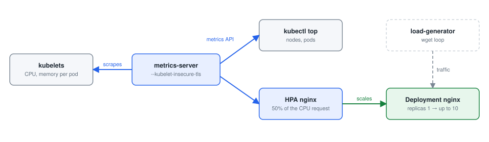

# Module 7: Logging and monitoring

Each lab below is a practical from this repository, step by step: the command, what it does, and what it printed on the practice cluster. Names with random endings (pod names such as `nginx-7d9c…`), IP addresses and ages will differ on yours.

- [Lab 7.1: Install the Metrics Server](#lab-71-install-the-metrics-server)
- [Lab 7.2: Practice test: monitor cluster components](#lab-72-practice-test-monitor-cluster-components)
- [Lab 7.3: Application logs](#lab-73-application-logs)
- [Lab 7.4: Practice test: application logs](#lab-74-practice-test-application-logs)
- [Lab 7.5: Autoscaling with the Metrics Server](#lab-75-autoscaling-with-the-metrics-server)
- [Lab 7.6: Prometheus and Grafana](#lab-76-prometheus-and-grafana)

## Before you start

Start the practice cluster on your Ubuntu server, as in the [README](../README.md#the-practice-cluster):

```bash
git clone https://github.com/kumbulanit/CKA.git && cd CKA
sudo ./setup.sh          # minikube with three nodes, Kubernetes v1.36 (about 10 minutes the first time)
kubectl get nodes         # minikube, minikube-m02, minikube-m03
```

The steps use those node names, and `minikube ssh -n <node>` for commands on a node. Run `kubectl` as your own user on the server; commands on the control plane's files (`/etc/kubernetes/manifests`, the kubelet) go through `minikube ssh` with `sudo`. The outputs were recorded in Desired Labs, where the terminal is already root on `minikube` and the API server answers on port 6443 (8443 on minikube): addresses, ports and ages on yours will differ.

## Lab 7.1: Install the Metrics Server

### What you will do

Follow [02-monitor-cluster-components.md](https://github.com/kumbulanit/CKA/blob/main/07-logging-monitoring/02-monitor-cluster-components.md)
and steps 1 and 2 of [03-metrics-server-and-autoscaling.md](https://github.com/kumbulanit/CKA/blob/main/07-logging-monitoring/03-metrics-server-and-autoscaling.md):

1. Apply the Metrics Server's latest release manifest.
2. Patch its deployment with `--kubelet-insecure-tls`, so it accepts the kubelets' self-signed
   certificates, and check that the deployment is ready.
3. After a minute, run `kubectl top nodes` and `kubectl top pods --all-namespaces`.

### Step by step

**Step 1.** Creates the objects in `https://github.com/kubernetes-sigs/metrics-server/releases/latest/download/components.yaml`, or updates them if they exist.

```bash
kubectl apply -f https://github.com/kubernetes-sigs/metrics-server/releases/latest/download/components.yaml
```

You should see something like:

```text
serviceaccount/metrics-server created
clusterrole.rbac.authorization.k8s.io/system:aggregated-metrics-reader created
clusterrole.rbac.authorization.k8s.io/system:metrics-server created
rolebinding.rbac.authorization.k8s.io/metrics-server-auth-reader created
clusterrolebinding.rbac.authorization.k8s.io/metrics-server:system:auth-delegator created
clusterrolebinding.rbac.authorization.k8s.io/system:metrics-server created
service/metrics-server created
deployment.apps/metrics-server created
apiservice.apiregistration.k8s.io/v1beta1.metrics.k8s.io created
```

**Step 2.** Changes part of the Deployment `metrics-server`, `\` in place (a patch instead of a whole manifest).

```bash
kubectl -n kube-system patch deployment metrics-server --type=json \
  -p '[{"op":"add","path":"/spec/template/spec/containers/0/args/-","value":"--kubelet-insecure-tls"}]'
```

You should see something like:

```text
deployment.apps/metrics-server patched
```

**Step 3.** Waits until the rollout of the Deployment `metrics-server` has finished.

```bash
kubectl -n kube-system rollout status deployment metrics-server --timeout=180s
```

You should see something like:

```text
Waiting for deployment "metrics-server" rollout to finish: 1 old replicas are pending termination...
Waiting for deployment "metrics-server" rollout to finish: 1 old replicas are pending termination...
Waiting for deployment "metrics-server" rollout to finish: 1 old replicas are pending termination...
deployment "metrics-server" successfully rolled out
```

**Step 4.** Lists the Deployment `metrics-server` in the namespace `kube-system`.

```bash
kubectl get deployment metrics-server -n kube-system
```

You should see something like:

```text
NAME             READY   UP-TO-DATE   AVAILABLE   AGE
metrics-server   1/1     1            1           34s
```

**Step 5.** Repeats until the condition is true (waits for the cluster to catch up).

```bash
until kubectl top nodes 2>/dev/null; do sleep 5; done
```

You should see something like:

```text
NAME           CPU(cores)   CPU(%)   MEMORY(bytes)   MEMORY(%)   
minikube       156m         1%       573Mi           9%          
minikube-m02   129m         1%       135Mi           2%          
minikube-m03   141m         1%       133Mi           2%
```

**Step 6.** Shows the CPU and memory used by each pod in every namespace (from the Metrics Server).

```bash
kubectl top pods --all-namespaces
```

You should see something like:

```text
NAMESPACE            NAME                                      CPU(cores)   MEMORY(bytes)   
kube-system          coredns-589f44dc88-rb26c                  7m           10Mi            
kube-system          coredns-589f44dc88-t8dch                  12m          11Mi            
kube-system          etcd-minikube                             25m          39Mi            
kube-system          kindnet-h52vd                             1m           9Mi             
kube-system          kindnet-pzpn6                             1m           8Mi             
kube-system          kindnet-zhlx4                             1m           9Mi             
kube-system          kube-apiserver-minikube                   59m          206Mi           
kube-system          kube-controller-manager-minikube          14m          63Mi            
kube-system          kube-proxy-bwdx4                          6m           15Mi            
kube-system          kube-proxy-gdk8d                          2m           14Mi            
kube-system          kube-proxy-tfwzp                          3m           14Mi            
kube-system          kube-scheduler-minikube                   10m          20Mi            
kube-system          metrics-server-5b58578978-pqbqh           36m          14Mi            
local-path-storage   local-path-provisioner-56c4685b7c-wjr7c   1m           8Mi
```

### If you see something else

- The check says: _There is no metrics-server deployment with --kubelet-insecure-tls in kube-system._
- The check says: _`kubectl top nodes` does not work yet. Is the metrics-server pod 1/1? It needs about a minute to collect data._
- Without `--kubelet-insecure-tls` the pod stays `0/1` and its logs show `x509` errors: kubeadm's kubelet certificates are self-signed.
- `kubectl top` reads from the metrics API (`kubectl get apiservice v1beta1.metrics.k8s.io`), which the Metrics Server serves.

### Why it works

**Why it works.** Every kubelet measures the CPU and memory its pods use (through cAdvisor). The Metrics Server collects those numbers from all kubelets every few seconds, keeps only the latest values in memory, and serves them through the metrics API (`metrics.k8s.io`), which `kubectl top` and the Horizontal Pod Autoscaler read. It keeps no history; for that you need Prometheus.

**Note:** `--kubelet-insecure-tls` is fine for a lab. In production, give the kubelets serving certificates signed by the cluster CA instead (kubelet `serverTLSBootstrap`).

---

## Lab 7.2: Practice test: monitor cluster components

### What you will do

Work through [04-practice-test-monitor-cluster-components.md](https://github.com/kumbulanit/CKA/blob/main/07-logging-monitoring/04-practice-test-monitor-cluster-components.md).
The pods **elephant**, **lion** and **rabbit** are running workloads.

1. Download the Metrics Server manifest into **kubernetes-metrics-server/components.yaml** and
   create it with `kubectl create -f .` from that folder (and the `--kubelet-insecure-tls` patch).
   If you did task 7.1 it already runs; the create then reports `AlreadyExists`, which is fine.
2. With `kubectl top node`, find the nodes using the most CPU and the most memory.
3. With `kubectl top pod`, write the name of the pod using the most **memory** to
   `/opt/answers/most-memory-pod`, and the pod using the most **CPU** to `/opt/answers/most-cpu-pod`.

### Step by step

**Step 1.** Lists the pods.

```bash
kubectl get pods
```

You should see something like:

```text
NAME       READY   STATUS    RESTARTS   AGE
elephant   1/1     Running   0          7s
lion       1/1     Running   0          7s
rabbit     1/1     Running   0          7s
```

**Step 2.** Creates the folder `kubernetes-metrics-server`.

```bash
mkdir kubernetes-metrics-server
```

It prints nothing when it works.

**Step 3.** Downloads `https://github.com/kubernetes-sigs/metrics-server/releases/latest/download/components.yaml`.

```bash
curl -L -o kubernetes-metrics-server/components.yaml https://github.com/kubernetes-sigs/metrics-server/releases/latest/download/components.yaml
```

You should see something like:

```text
  % Total    % Received % Xferd  Average Speed   Time    Time     Time  Current
                                 Dload  Upload   Total   Spent    Left  Speed
  0     0    0     0    0     0      0      0 --:--:-- --:--:-- --:--:--     0
  0     0    0     0    0     0      0      0 --:--:-- --:--:-- --:--:--     0
100  4330  100  4330    0     0   5439      0 --:--:-- --:--:-- --:--:--  5439
```

**Step 4.** Goes into `kubernetes-metrics-server`.

```bash
cd kubernetes-metrics-server
```

It prints nothing when it works.

**Step 5.** Creates the objects in every file in this folder.

```bash
kubectl create -f .
```

You should see something like:

```text
Error from server (AlreadyExists): error when creating "components.yaml": serviceaccounts "metrics-server" already exists
Error from server (AlreadyExists): error when creating "components.yaml": clusterroles.rbac.authorization.k8s.io "system:aggregated-metrics-reader" already exists
Error from server (AlreadyExists): error when creating "components.yaml": clusterroles.rbac.authorization.k8s.io "system:metrics-server" already exists
Error from server (AlreadyExists): error when creating "components.yaml": rolebindings.rbac.authorization.k8s.io "metrics-server-auth-reader" already exists
Error from server (AlreadyExists): error when creating "components.yaml": clusterrolebindings.rbac.authorization.k8s.io "metrics-server:system:auth-delegator" already exists
Error from server (AlreadyExists): error when creating "components.yaml": clusterrolebindings.rbac.authorization.k8s.io "system:metrics-server" already exists
Error from server (AlreadyExists): error when creating "components.yaml": services "metrics-server" already exists
Error from server (AlreadyExists): error when creating "components.yaml": deployments.apps "metrics-server" already exists
Error from server (AlreadyExists): error when creating "components.yaml": apiservices.apiregistration.k8s.io "v1beta1.metrics.k8s.io" already exists
```

**Step 6.** Changes part of the Deployment `metrics-server` in place (a patch instead of a whole manifest).

```bash
kubectl -n kube-system patch deployment metrics-server --type=json -p '[{"op":"add","path":"/spec/template/spec/containers/0/args/-","value":"--kubelet-insecure-tls"}]'
```

You should see something like:

```text
deployment.apps/metrics-server patched
```

**Step 7.** Goes back to your home folder.

```bash
cd
```

It prints nothing when it works.

**Step 8.** Repeats until the condition is true (waits for the cluster to catch up). Wait for metrics.

```bash
until kubectl top pod lion 2>/dev/null; do sleep 5; done
```

You should see something like:

```text
NAME   CPU(cores)   MEMORY(bytes)   
lion   200m         0Mi
```

**Step 9.** Shows the CPU and memory used by each node (from the Metrics Server).

```bash
kubectl top node
```

You should see something like:

```text
NAME           CPU(cores)   CPU(%)   MEMORY(bytes)   MEMORY(%)   
minikube       192m         2%       575Mi           9%          
minikube-m02   108m         1%       303Mi           5%          
minikube-m03   169m         2%       161Mi           2%
```

**Step 10.** Shows the CPU and memory used by each pod (from the Metrics Server).

```bash
kubectl top pod
```

You should see something like:

```text
NAME       CPU(cores)   MEMORY(bytes)   
elephant   6m           150Mi           
lion       200m         0Mi             
rabbit     2m           0Mi
```

**Step 11.** Shows the CPU and memory used by each pod (from the Metrics Server).

```bash
kubectl top pod --no-headers --sort-by=memory | grep -E '^(elephant|lion|rabbit) ' | head -1 | awk '{print $1}' > /opt/answers/most-memory-pod
```

It prints nothing when it works.

**Step 12.** Shows the CPU and memory used by each pod (from the Metrics Server).

```bash
kubectl top pod --no-headers --sort-by=cpu | grep -E '^(elephant|lion|rabbit) ' | head -1 | awk '{print $1}' > /opt/answers/most-cpu-pod
```

It prints nothing when it works.

**Step 13.** Shows the file `/opt/answers/most-memory-pod`.

```bash
cat /opt/answers/most-memory-pod /opt/answers/most-cpu-pod
```

You should see something like:

```text
elephant
lion
```

### If you see something else

- The check says: _/root/kubernetes-metrics-server/components.yaml has not been downloaded._
- The check says: _/opt/answers/most-memory-pod does not name the pod that uses the most memory._
- The check says: _/opt/answers/most-cpu-pod does not name the pod that uses the most CPU._
- `kubectl top pod --sort-by=memory` and `--sort-by=cpu` put the biggest first.
- `echo <pod-name> > /opt/answers/most-memory-pod` writes an answer.

### Why it works

**Why it works.** `kubectl top node` shows each node's current CPU (in cores or millicores) and memory, and `kubectl top pod` the same per pod. elephant holds 150Mi in a memory-backed emptyDir, which counts as its memory; lion spins in a loop, capped at 200m CPU by its limit; rabbit only sleeps. `--sort-by=cpu` or `--sort-by=memory` answers such questions in one command.

**In the exam:** questions like these usually want the name written to a file; `kubectl top pod --sort-by=cpu --no-headers | head -1` gets it.

---

## Lab 7.3: Application logs

### What you will do

Follow [05-managing-application-logs.md](https://github.com/kumbulanit/CKA/blob/main/07-logging-monitoring/05-managing-application-logs.md):

1. Create the pod **event-simulator-pod** from the document (image `kodekloud/event-simulator`, or
   the busybox version it gives for arm64 machines).
2. Follow its logs with `kubectl logs -f` (Ctrl+C to stop), then try `--previous`,
   `--all-containers` and `-c event-simulator`. Leave it running.

### Step by step

**Step 1.** Writes the file `event-simulator.yaml`.

```bash
cat > event-simulator.yaml <<'EOF'
apiVersion: v1
kind: Pod
metadata:
  name: event-simulator-pod
spec:
  containers:
  - name: event-simulator
    image: kodekloud/event-simulator
EOF
```

It prints nothing when it works.

**Step 2.** Creates the objects in `event-simulator.yaml`, or updates them if they exist.

```bash
kubectl apply -f event-simulator.yaml
```

You should see something like:

```text
pod/event-simulator-pod created
```

**Step 3.** Waits until the pod `event-simulator-pod` is Ready.

```bash
kubectl wait --for=condition=Ready pod/event-simulator-pod --timeout=180s
```

You should see something like:

```text
pod/event-simulator-pod condition met
```

**Step 4.** Waits 5 seconds.

```bash
sleep 5
```

It prints nothing when it works.

**Step 5.** Prints the logs of the pod `-f` and keeps following them, for 5 seconds. Ctrl+C stops -f.

```bash
timeout 5 kubectl logs -f event-simulator-pod
```

You should see something like:

```text
[2026-10-28 05:52:28,459] INFO in event-simulator: USER3 is viewing page3
[2026-10-28 05:52:29,471] INFO in event-simulator: USER1 is viewing page3
[2026-10-28 05:52:30,476] INFO in event-simulator: USER4 is viewing page2
[2026-10-28 05:52:31,481] INFO in event-simulator: USER4 logged out
[2026-10-28 05:52:32,487] INFO in event-simulator: USER2 is viewing page1
[2026-10-28 05:52:33,496] WARNING in event-simulator: USER5 Failed to Login as the account is locked due to MANY FAILED ATTEMPTS.
[2026-10-28 05:52:33,499] INFO in event-simulator: USER4 logged out
[2026-10-28 05:52:34,505] INFO in event-simulator: USER4 is viewing page3
[2026-10-28 05:52:35,511] INFO in event-simulator: USER3 is viewing page2
[2026-10-28 05:52:36,518] WARNING in event-simulator: USER7 Order failed as the item is OUT OF STOCK.
[2026-10-28 05:52:36,519] INFO in event-simulator: USER3 logged in
[2026-10-28 05:52:37,521] INFO in event-simulator: USER3 is viewing page2
context canceled
```

**Step 6.** Prints the logs of the pod `event-simulator-pod`.

```bash
kubectl logs event-simulator-pod --previous
```

You should see something like:

```text
Error from server (BadRequest): previous terminated container "event-simulator" in pod "event-simulator-pod" not found
```

**Step 7.** Prints the logs of the pod `event-simulator-pod`.

```bash
kubectl logs event-simulator-pod --all-containers
```

You should see something like:

```text
[2026-10-28 05:52:28,459] INFO in event-simulator: USER3 is viewing page3
[2026-10-28 05:52:29,471] INFO in event-simulator: USER1 is viewing page3
[2026-10-28 05:52:30,476] INFO in event-simulator: USER4 is viewing page2
[2026-10-28 05:52:31,481] INFO in event-simulator: USER4 logged out
[2026-10-28 05:52:32,487] INFO in event-simulator: USER2 is viewing page1
[2026-10-28 05:52:33,496] WARNING in event-simulator: USER5 Failed to Login as the account is locked due to MANY FAILED ATTEMPTS.
[2026-10-28 05:52:33,499] INFO in event-simulator: USER4 logged out
[2026-10-28 05:52:34,505] INFO in event-simulator: USER4 is viewing page3
[2026-10-28 05:52:35,511] INFO in event-simulator: USER3 is viewing page2
[2026-10-28 05:52:36,518] WARNING in event-simulator: USER7 Order failed as the item is OUT OF STOCK.
[2026-10-28 05:52:36,519] INFO in event-simulator: USER3 logged in
[2026-10-28 05:52:37,521] INFO in event-simulator: USER3 is viewing page2
```

**Step 8.** Prints the logs of the pod `event-simulator-pod`.

```bash
kubectl logs event-simulator-pod -c event-simulator --tail=5
```

You should see something like:

```text
[2026-10-28 05:52:34,505] INFO in event-simulator: USER4 is viewing page3
[2026-10-28 05:52:35,511] INFO in event-simulator: USER3 is viewing page2
[2026-10-28 05:52:36,518] WARNING in event-simulator: USER7 Order failed as the item is OUT OF STOCK.
[2026-10-28 05:52:36,519] INFO in event-simulator: USER3 logged in
[2026-10-28 05:52:37,521] INFO in event-simulator: USER3 is viewing page2
```

### If you see something else

- The check says: _There is no running pod event-simulator-pod._
- The check says: _event-simulator-pod's log has no events yet._
- `kubectl logs` shows what the container writes to stdout and stderr; the kubelet keeps it in /var/log/pods on the node.
- `--previous` shows the log of the container before its last restart; with no restart yet, it says so.

### Why it works

**Why it works.** Containers should log to stdout and stderr. The container runtime writes that stream to files under /var/log/pods on the node, and `kubectl logs` asks the kubelet for them. `-f` follows new lines, `--previous` reads the log of the container before its last restart (handy for crash loops), and `-c` picks a container in a multi-container pod.

**In practice:** the files on the node are rotated and lost with the pod, so clusters ship logs to a central store (Loki, Elasticsearch) with an agent such as Fluent Bit running as a DaemonSet.

---

## Lab 7.4: Practice test: application logs

### What you will do

Work through [06-practice-test-managing-application-logs.md](https://github.com/kumbulanit/CKA/blob/main/07-logging-monitoring/06-practice-test-managing-application-logs.md).
The pods **webapp-1** and **webapp-2** are running.

1. Inspect webapp-1's logs. Which user is locked out? Write it to `/opt/answers/webapp-1-user`.
2. webapp-2 has two containers. Inspect the application container's logs: which user's order
   failed? Write it to `/opt/answers/webapp-2-user`.

### Step by step

**Step 1.** Lists the pods.

```bash
kubectl get pods
```

You should see something like:

```text
NAME                  READY   STATUS    RESTARTS   AGE
elephant              1/1     Running   0          48s
event-simulator-pod   1/1     Running   0          29s
lion                  1/1     Running   0          48s
rabbit                1/1     Running   0          48s
webapp-1              1/1     Running   0          9s
webapp-2              2/2     Running   0          9s
```

**Step 2.** Prints the logs of the pod `webapp-1`.

```bash
kubectl logs webapp-1
```

You should see something like:

```text
Wed Oct 28 05:52:39 UTC 2026 INFO USER2 logged in
Wed Oct 28 05:52:41 UTC 2026 INFO USER3 logged in
Wed Oct 28 05:52:43 UTC 2026 INFO USER4 logged in
Wed Oct 28 05:52:45 UTC 2026 INFO USER1 logged in
Wed Oct 28 05:52:47 UTC 2026 INFO USER2 logged in
Wed Oct 28 05:52:47 UTC 2026 WARNING USER5 Failed to Login as the account is locked due to MANY FAILED ATTEMPTS.
```

**Step 3.** Prints the logs of the pod `webapp-1`.

```bash
kubectl logs webapp-1 | grep -o 'USER[0-9]* Failed' | head -1 | cut -d' ' -f1 > /opt/answers/webapp-1-user
```

It prints nothing when it works.

**Step 4.** Lists the pods.

```bash
kubectl get pods
```

You should see something like:

```text
NAME                  READY   STATUS    RESTARTS   AGE
elephant              1/1     Running   0          48s
event-simulator-pod   1/1     Running   0          29s
lion                  1/1     Running   0          48s
rabbit                1/1     Running   0          48s
webapp-1              1/1     Running   0          9s
webapp-2              2/2     Running   0          9s
```

**Step 5.** Prints the logs of the pod `webapp-2`.

```bash
kubectl logs webapp-2 -c simple-webapp
```

You should see something like:

```text
Wed Oct 28 05:52:39 UTC 2026 INFO USER2 is viewing page2
Wed Oct 28 05:52:41 UTC 2026 INFO USER3 is viewing page2
Wed Oct 28 05:52:43 UTC 2026 INFO USER4 is viewing page2
Wed Oct 28 05:52:45 UTC 2026 INFO USER1 is viewing page2
Wed Oct 28 05:52:47 UTC 2026 INFO USER2 is viewing page2
Wed Oct 28 05:52:47 UTC 2026 WARNING USER30 Order failed as the item is OUT OF STOCK.
```

**Step 6.** Prints the logs of the pod `webapp-2`.

```bash
kubectl logs webapp-2 -c simple-webapp | grep -o 'USER[0-9]* Order failed' | head -1 | cut -d' ' -f1 > /opt/answers/webapp-2-user
```

It prints nothing when it works.

**Step 7.** Shows the file `/opt/answers/webapp-1-user`.

```bash
cat /opt/answers/webapp-1-user /opt/answers/webapp-2-user
```

You should see something like:

```text
USER5
USER30
```

### If you see something else

- The check says: _/opt/answers/webapp-1-user does not name the user who is locked out._
- The check says: _/opt/answers/webapp-2-user does not name the user whose order failed._
- `kubectl logs webapp-1 | grep -i warning` finds the problem lines quickly.
- For a pod with several containers, `kubectl logs` needs `-c <container>`; `kubectl get pod webapp-2 -o jsonpath='{.spec.containers[*].name}'` lists them.

### Why it works

**Why it works.** Reading logs is mostly searching them: `kubectl logs webapp-1 | grep -i warning` finds the locked account. webapp-2 has two containers, so `kubectl logs webapp-2` alone asks you to choose; `-c simple-webapp` reads the application and `-c db` the other one (or `--all-containers` for both).

**In the exam:** `kubectl logs <pod> -c <container> | grep ...` and writing the answer to the requested file is a common question shape.

---

## Lab 7.5: Autoscaling with the Metrics Server



*Metrics and autoscaling: from each kubelet to kubectl top and the HPA*

### What you will do

Follow steps 3 and 4 of [03-metrics-server-and-autoscaling.md](https://github.com/kumbulanit/CKA/blob/main/07-logging-monitoring/03-metrics-server-and-autoscaling.md):

1. Create the deployment **nginx** from `nginx`, give it a CPU request of `50m`, and expose it on
   port 80.
2. Autoscale it: `--cpu-percent=50 --min=1 --max=10`, and look at `kubectl get hpa`.
3. Run the busybox **load-generator** from the document and watch the HPA add replicas
   (`kubectl get hpa`, `kubectl get pods -l app=nginx`). Stop the load with Ctrl+C.

### Step by step

**Step 1.** Creates the Deployment `nginx` from the image `nginx`.

```bash
kubectl create deployment nginx --image=nginx
```

You should see something like:

```text
deployment.apps/nginx created
```

**Step 2.** Changes the Deployment `nginx`.

```bash
kubectl set resources deployment nginx --requests=cpu=50m
```

You should see something like:

```text
deployment.apps/nginx resource requirements updated
```

**Step 3.** Creates a Service in front of the Deployment `nginx` on port 80.

```bash
kubectl expose deployment nginx --port=80 --target-port=80
```

You should see something like:

```text
service/nginx exposed
```

**Step 4.** Creates a HorizontalPodAutoscaler for the Deployment `nginx` (1 to 10 replicas, 50% CPU).

```bash
kubectl autoscale deployment nginx --cpu-percent=50 --min=1 --max=10
```

You should see something like:

```text
Flag --cpu-percent has been deprecated, Use --cpu with percentage or resource quantity format (e.g., '70%' for utilization or '500m' for milliCPU).
horizontalpodautoscaler.autoscaling/nginx autoscaled
```

**Step 5.** Lists the HorizontalPodAutoscalers.

```bash
kubectl get hpa
```

You should see something like:

```text
NAME    REFERENCE          TARGETS              MINPODS   MAXPODS   REPLICAS   AGE
nginx   Deployment/nginx   cpu: <unknown>/50%   1         10        0          0s
```

**Step 6.** Waits until the rollout of the Deployment `nginx` has finished.

```bash
kubectl rollout status deployment nginx --timeout=120s
```

You should see something like:

```text
Waiting for deployment "nginx" rollout to finish: 1 old replicas are pending termination...
Waiting for deployment "nginx" rollout to finish: 1 old replicas are pending termination...
Waiting for deployment "nginx" rollout to finish: 1 old replicas are pending termination...
deployment "nginx" successfully rolled out
```

**Step 7.** Starts the pod `load-generator` from the image `busybox:1.37`. In the document: -i --tty --rm, stopped with Ctrl+C.

```bash
kubectl run load-generator --image=busybox:1.37 --restart=Never -- /bin/sh -c "while true; do wget -q -O- http://nginx.default.svc.cluster.local; done"
```

You should see something like:

```text
pod/load-generator created
```

**Step 8.** Repeats the command for each of `@SUB@`.

```bash
for i in $(seq 1 60); do
  [ "$(kubectl get hpa nginx -o jsonpath='{.status.desiredReplicas}')" -gt 1 ] 2>/dev/null && break
  sleep 5
done
```

It prints nothing when it works.

**Step 9.** Lists the HorizontalPodAutoscalers.

```bash
kubectl get hpa
```

You should see something like:

```text
NAME    REFERENCE          TARGETS        MINPODS   MAXPODS   REPLICAS   AGE
nginx   Deployment/nginx   cpu: 84%/50%   1         10        1          3m3s
```

**Step 10.** Lists the pods that match the label selector `app=nginx`.

```bash
kubectl get pods -l app=nginx
```

You should see something like:

```text
NAME                     READY   STATUS              RESTARTS   AGE
nginx-74757cc96f-5tk92   0/1     ContainerCreating   0          3s
nginx-74757cc96f-lfv78   1/1     Running             0          3m4s
```

**Step 11.** Deletes the pod `load-generator`.

```bash
kubectl delete pod load-generator --wait=false
```

You should see something like:

```text
pod "load-generator" deleted from default namespace
```

### If you see something else

- The check says: _There is no HorizontalPodAutoscaler nginx (min 1, max 10, 50% CPU)._
- The check says: _The deployment nginx has no CPU request of 50m; the HPA needs one to compute utilisation._
- The check says: _The HPA has not scaled nginx yet. Run the load generator and give it a minute or two._
- `kubectl set resources deployment nginx --requests=cpu=50m` adds the request; without it `kubectl get hpa` shows `<unknown>`.
- The HPA checks every 15 seconds and scales up quickly, but waits 5 minutes before scaling down.

### Why it works

**Why it works.** The Horizontal Pod Autoscaler reads the pods' CPU use from the metrics API every 15 seconds and compares it with their CPU **request**: 50% of 50m is 25m per pod. When the load generator pushes usage above that, it raises the Deployment's replicas (up to 10) so the average comes back to the target. It scales down only after usage has stayed low for 5 minutes, to avoid flapping.

**In the exam:** `kubectl autoscale deployment ... --cpu-percent --min --max` creates an `autoscaling/v2` HPA; without a CPU request on the pods, the HPA reports `<unknown>` and does nothing.

---

## Lab 7.6: Prometheus and Grafana

### What you will do

Follow steps 1, 3 and 5 of [07-prometheus-and-grafana.md](https://github.com/kumbulanit/CKA/blob/main/07-logging-monitoring/07-prometheus-and-grafana.md):

1. Add the `prometheus-community` Helm repository and install the chart
   `prometheus-community/prometheus` as **prometheus**, with the two `--set` options from the
   document that turn off persistent storage. Check its pods.
2. Expose the deployment `prometheus-server` as the NodePort service **prometheus-service** on
   port 9090, and check `curl http://minikube-m02:<NODEPORT>/-/ready`.
3. Install Grafana with Helm as the release **grafana**.

### Step by step

**Step 1.** Adds a chart repository.

```bash
helm repo add prometheus-community https://prometheus-community.github.io/helm-charts
```

**Step 2.** Downloads the latest chart lists.

```bash
helm repo update
```

**Step 3.** Installs the chart as the release `prometheus`.

```bash
helm install prometheus prometheus-community/prometheus \
  --set server.persistentVolume.enabled=false --set alertmanager.persistence.enabled=false
```

**Step 4.** Waits until the rollout of the Deployment `prometheus-server` has finished.

```bash
kubectl rollout status deployment prometheus-server --timeout=300s
```

**Step 5.** Lists the pods that match the label selector `app.kubernetes.io/instance=prometheus`.

```bash
kubectl get pods -l app.kubernetes.io/instance=prometheus
```

**Step 6.** Creates a Service in front of the Deployment `prometheus-server` on port 9090 (type NodePort).

```bash
kubectl expose deployment prometheus-server --type=NodePort --name=prometheus-service --port=9090
```

**Step 7.** Sends an HTTP request to `http://minikube-m02:…/-/ready` and prints the answer.

```bash
curl -s http://minikube-m02:$(kubectl get svc prometheus-service -o jsonpath='{.spec.ports[0].nodePort}')/-/ready
```

**Step 8.** Adds a chart repository.

```bash
helm repo add grafana https://grafana.github.io/helm-charts
```

**Step 9.** Downloads the latest chart lists.

```bash
helm repo update
```

**Step 10.** Installs the chart as the release `grafana`.

```bash
helm install grafana grafana/grafana
```

**Step 11.** Waits until the rollout of the Deployment `grafana` has finished.

```bash
kubectl rollout status deployment grafana --timeout=300s
```

### If you see something else

- The check says: _The Helm release prometheus is not installed, or its prometheus-server is not ready yet._
- The check says: _prometheus-service does not answer `/-/ready` on its node port._
- The check says: _The Helm release grafana is not installed, or Grafana is not ready yet._
- `kubectl get pods -l app.kubernetes.io/instance=prometheus` lists the chart's pods: server, Alertmanager, node exporter, kube-state-metrics and pushgateway.
- `kubectl expose deployment prometheus-server --type=NodePort --name=prometheus-service --port=9090` creates the service.

### Why it works

**Why it works.** Prometheus scrapes metrics over HTTP from targets it discovers through the Kubernetes API (nodes, pods, services) and stores them as time series, so you get history and can query it with PromQL. The Helm chart also installs Alertmanager (alert routing), node-exporter (a DaemonSet with node metrics), kube-state-metrics (the state of Kubernetes objects) and a pushgateway. Grafana draws dashboards from Prometheus as its data source.

**Note:** with persistence off, Prometheus keeps its data on the pod and loses it when the pod restarts; on a real cluster, give it a PersistentVolume.

---
