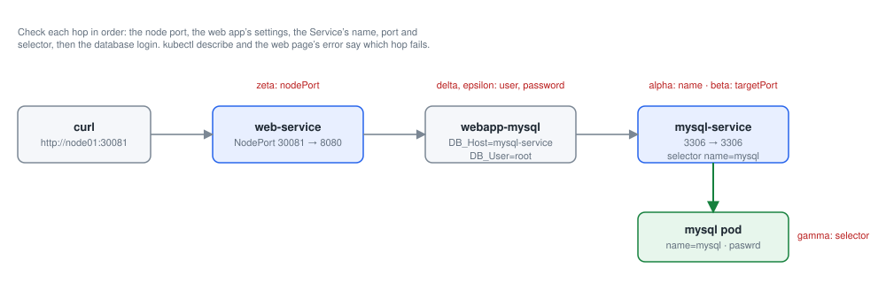

# Module 8: Troubleshooting

Each lab below is a practical from this repository, step by step: the command, what it does, and what it printed on the practice cluster. Names with random endings (pod names such as `nginx-7d9c…`), IP addresses and ages will differ on yours.

- [Lab 8.1: App failure: alpha](#lab-81-app-failure-alpha)
- [Lab 8.2: App failure: beta](#lab-82-app-failure-beta)
- [Lab 8.3: App failure: gamma](#lab-83-app-failure-gamma)
- [Lab 8.4: App failure: delta](#lab-84-app-failure-delta)
- [Lab 8.5: App failure: epsilon (two issues)](#lab-85-app-failure-epsilon-two-issues)
- [Lab 8.6: App failure: zeta (three issues)](#lab-86-app-failure-zeta-three-issues)
- [Lab 8.7: The scheduler is down](#lab-87-the-scheduler-is-down)
- [Lab 8.8: Scaling does not happen](#lab-88-scaling-does-not-happen)
- [Lab 8.9: Scaling stops again](#lab-89-scaling-stops-again)
- [Lab 8.10: node01 is NotReady](#lab-810-node01-is-notready)
- [Lab 8.11: node01 is broken again](#lab-811-node01-is-broken-again)
- [Lab 8.12: node01 is broken a third time](#lab-812-node01-is-broken-a-third-time)
- [Lab 8.13: Services stopped working](#lab-813-services-stopped-working)
- [Lab 8.14: Pods cannot start](#lab-814-pods-cannot-start)

## Before you start

You need the three machines of the course, `controlplane`, `node01` and `node02`. On one Ubuntu server (a VM is fine: 4 CPUs, 8 GB RAM, 40 GB disk), [scripts/one-server.sh](../scripts/one-server.sh) runs them as containers, each a full Ubuntu 24.04 machine:

```bash
git clone https://github.com/kumbulanit/CKA.git && cd CKA
sudo ./scripts/one-server.sh install   # the three machines with Kubernetes v1.36 installed (5 to 10 minutes)
sudo ./scripts/one-server.sh shell     # you are now root@controlplane; the repository is in /root/CKA
```

If you did the installation module on these machines, you already have this cluster. `sudo ./scripts/one-server.sh shell node01` opens node01, and `sudo ./scripts/one-server.sh delete` removes the machines so you can start again. In Patchbay, starting the lab gives you the same machines.

## Lab 8.1: App failure: alpha



*The two-tier app of the troubleshooting labs, and where each scenario breaks it*

### What you will do

A simple 2 tier application is deployed in the **alpha** namespace. It must show a green page
that says *DATABASE CONNECTION SUCCESSFUL*. Open it from the terminal:

```
curl http://node01:30081
```

It is currently failed. Troubleshoot and fix it. Stick to this architecture (the same names
and ports); you may edit, delete or recreate objects as needed:

| Object | Details |
| --- | --- |
| pod **mysql** (label `name=mysql`) | database, port 3306, `MYSQL_ROOT_PASSWORD=paswrd` |
| service **mysql-service** | ClusterIP, port 3306 → pod port 3306, selects `name=mysql` |
| deployment **webapp-mysql** | web app, port 8080, env `DB_Host=mysql-service`, `DB_User=root`, `DB_Password=paswrd` |
| service **web-service** | NodePort, port 8080, nodePort **30081**, selects `name=webapp-mysql` |

The lecture notes: [02-Application-Failure.md](https://github.com/kumbulanit/CKA/blob/main/Troubleshooting/02-Application-Failure.md).

### Step by step

**Step 1.** Lists the Services in the namespace `alpha`.

```bash
kubectl get service -n alpha
```

You should see something like:

```text
NAME          TYPE        CLUSTER-IP      EXTERNAL-IP   PORT(S)          AGE
mysql         ClusterIP   10.96.76.149    <none>        3306/TCP         1s
web-service   NodePort    10.96.181.161   <none>        8080:30081/TCP   0s
```

**Step 2.** Shows the Service `mysql` in the namespace `alpha` as YAML, as the API server stores it.

```bash
kubectl get service -n alpha mysql -o yaml > service.yaml
```

It prints nothing when it works.

**Step 3.** Edits `service.yaml`: `name: mysql` becomes `name: mysql-service`. In vi: change metadata.name to mysql-service.

```bash
sed -i 's/^  name: mysql$/  name: mysql-service/' service.yaml
```

It prints nothing when it works.

**Step 4.** Deletes the Service `mysql` in the namespace `alpha`.

```bash
kubectl delete svc mysql -n alpha
```

You should see something like:

```text
service "mysql" deleted from alpha namespace
```

**Step 5.** Creates the objects in `service.yaml`.

```bash
kubectl create -f service.yaml
```

You should see something like:

```text
service/mysql-service created
```

### If you see something else

- The check says: _The web app connects to its database as `mysql-service`, and there is no service with that name in alpha._
- Read the error on the page. "Name does not resolve" or "Unknown MySQL server host" means the app cannot find a service with the name it uses.
- `kubectl get service -n alpha`: compare the names with the architecture. You cannot rename an object with `kubectl edit`; save it with `-o yaml`, change the name, delete and create it again.
- Start every application failure by opening the app (`curl http://node01:30081`). Its error message tells you which link in the chain is broken.

### Why it works

**Why it works.** The web app finds its database by DNS name: `DB_Host=mysql-service`. CoreDNS only answers for services that exist, so a service called `mysql` gives "Name does not resolve" (or "Unknown MySQL server host"). Kubernetes cannot rename an object, which is why the fix is: save it (`-o yaml`), change `metadata.name`, delete the old one and create the new one.

**Method:** work from the outside in, following the request: web-service → webapp pod → mysql-service → mysql pod. The app's own error tells you which hop fails.

---

## Lab 8.2: App failure: beta

### What you will do

The same 2 tier application is deployed in the **beta** namespace (same architecture as 8.1;
`curl http://node01:30081`). It is currently failed. Troubleshoot and fix it.

### Step by step

**Step 1.** Prints one field of the pod `mysql` in the namespace `beta`.

```bash
kubectl get po -n beta mysql -o jsonpath='{.spec.containers[*].ports[*].containerPort}'
```

You should see something like:

```text
3306@@PB-STEP 1@@
service/mysql-service edited
```

**Step 2.** Edits the Service `mysql-service`, `beta` with a scripted editor: `targetPort: 8080` becomes `targetPort: 3306`. Kubectl edit service mysql-service -n beta   -> change targetPort: 8080 to targetPort: 3306.

```bash
KUBE_EDITOR="sed -i 's/targetPort: 8080/targetPort: 3306/'" kubectl edit service mysql-service -n beta
```

### If you see something else

- The check says: _mysql-service still sends traffic to the wrong port on the mysql pod._
- "Can't connect to MySQL server on 'mysql-service:3306'" means the service exists, so look at its ports.
- `kubectl get po -n beta mysql -o jsonpath='{.spec.containers[*].ports[*].containerPort}'` shows the port the database listens on; `targetPort` must match it.

### Why it works

**Why it works.** A service has two ports: `port` (where clients connect, 3306) and `targetPort` (where it forwards to on the pod). MySQL listens on 3306, so forwarding to 8080 reaches nothing: "Can't connect to MySQL server". The pod's `containerPort` (or the database's documentation) tells you the right `targetPort`.

---

## Lab 8.3: App failure: gamma

### What you will do

The same 2 tier application is deployed in the **gamma** namespace (same architecture as 8.1;
`curl http://node01:30081`). It is currently failed or unresponsive. Troubleshoot and fix it.

### Step by step

**Step 1.** Lists the pods in the namespace `gamma` with their labels.

```bash
kubectl get pods -n gamma --show-labels
```

You should see something like:

```text
NAME                            READY   STATUS              RESTARTS   AGE   LABELS
mysql                           0/1     ContainerCreating   0          0s    name=mysql
webapp-mysql-59699d9cb7-cpvkt   0/1     ContainerCreating   0          0s    name=webapp-mysql,pod-template-hash=59699d9cb7
```

**Step 2.** Edits the Service `mysql-service`, `gamma` with a scripted editor: `name: sql00001` becomes `name: mysql`. Kubectl edit service mysql-service -n gamma   -> change the selector name: sql00001 to name: mysql.

```bash
KUBE_EDITOR="sed -i 's/name: sql00001/name: mysql/'" kubectl edit service mysql-service -n gamma
```

You should see something like:

```text
service/mysql-service edited
```

### If you see something else

- The check says: _mysql-service's selector still does not match the mysql pod's labels._
- Name and ports look right? Then check whether the service has any endpoints (`kubectl describe service mysql-service -n gamma`).
- `kubectl get pods -n gamma --show-labels` shows the pod labels; the service's `selector` must match them.

### Why it works

**Why it works.** A service finds its pods by label. With the selector `name: sql00001` it matches no pod, so it has no endpoints and connections are refused. `kubectl describe service` shows `Endpoints: <none>`; `kubectl get pods --show-labels` shows the label to use (ignore `pod-template-hash`, which Kubernetes adds itself).

---

## Lab 8.4: App failure: delta

### What you will do

The same 2 tier application is deployed in the **delta** namespace (same architecture as 8.1;
`curl http://node01:30081`). It is currently failed. Troubleshoot and fix it.

### Step by step

**Step 1.** Edits the Deployment `webapp-mysql`, `delta` with a scripted editor: `value: sql-user` becomes `value: root`. Kubectl edit deployment webapp-mysql -n delta   -> set DB_User to root.

```bash
KUBE_EDITOR="sed -i 's/value: sql-user/value: root/'" kubectl edit deployment webapp-mysql -n delta
```

You should see something like:

```text
deployment.apps/webapp-mysql edited
```

**Step 2.** Waits until the rollout of the Deployment `webapp-mysql` has finished.

```bash
kubectl rollout status deployment webapp-mysql -n delta
```

You should see something like:

```text
Waiting for deployment "webapp-mysql" rollout to finish: 1 old replicas are pending termination...
Waiting for deployment "webapp-mysql" rollout to finish: 1 old replicas are pending termination...
Waiting for deployment "webapp-mysql" rollout to finish: 1 old replicas are pending termination...
deployment "webapp-mysql" successfully rolled out
```

### If you see something else

- The check says: _webapp-mysql still logs in to the database with the wrong user._
- "Access denied for user 'sql-user'": the app reaches the database but uses the wrong account. Compare with the architecture.
- The account comes from the deployment's environment: `kubectl edit deployment webapp-mysql -n delta`.

### Why it works

**Why it works.** "Access denied for user 'sql-user'" means the network path works and the database answers, but rejects the login. The credentials come from the deployment's environment variables. Editing the deployment's pod template starts a rollout: new pods with `DB_User=root` replace the old ones.

---

## Lab 8.5: App failure: epsilon (two issues)

### What you will do

The same 2 tier application is deployed in the **epsilon** namespace (same architecture as 8.1;
`curl http://node01:30081`). It is currently failed. There are **two** issues. Troubleshoot and fix them.

### Step by step

**Step 1.** Edits the Deployment `webapp-mysql`, `epsilon` with a scripted editor: `value: sql-user` becomes `value: root`.

```bash
KUBE_EDITOR="sed -i 's/value: sql-user/value: root/'" kubectl edit deployment webapp-mysql -n epsilon
```

You should see something like:

```text
deployment.apps/webapp-mysql edited
```

**Step 2.** Shows the pod `mysql` in the namespace `epsilon` as YAML, as the API server stores it.

```bash
kubectl get pod -n epsilon mysql -o yaml > mysql.yaml
```

It prints nothing when it works.

**Step 3.** Edits `mysql.yaml`: `value: passwooooorrddd` becomes `value: paswrd`. In vi: fix MYSQL_ROOT_PASSWORD.

```bash
sed -i 's/value: passwooooorrddd/value: paswrd/' mysql.yaml
```

It prints nothing when it works.

**Step 4.** Replaces the objects in `mysql.yaml` with the edited file (deletes and creates it again).

```bash
kubectl replace --force -f mysql.yaml
```

You should see something like:

```text
pod "mysql" deleted from epsilon namespace
pod/mysql replaced
```

**Step 5.** Waits until the pod `mysql` is Ready in the namespace `epsilon`.

```bash
kubectl wait -n epsilon --for=condition=Ready pod/mysql --timeout=180s
```

You should see something like:

```text
pod/mysql condition met
```

### If you see something else

- The check says: _webapp-mysql still logs in to the database with the wrong user._
- The check says: _The database's root password is still not the one the app uses._
- Fix the user first, as in delta. If it still fails, the database itself has a different password than the architecture says.
- You cannot change a standalone pod's environment with `kubectl edit`. Save it with `kubectl get pod -n epsilon mysql -o yaml > mysql.yaml`, fix it, and `kubectl replace --force -f mysql.yaml`.
- A pod's environment cannot be changed in place. Save it as YAML, fix it, and recreate it with `kubectl replace --force -f`.

### Why it works

**Why it works.** Two things must agree: the user and password the app sends, and the password the database was started with (`MYSQL_ROOT_PASSWORD`). The app side is fixed in the deployment. The database is a standalone pod, and a pod's spec (its environment included) cannot be edited in place, so `kubectl replace --force -f` deletes it and creates it again from the fixed file. The database initialises with the new password because it starts with empty storage.

---

## Lab 8.6: App failure: zeta (three issues)

### What you will do

The same 2 tier application is deployed in the **zeta** namespace (same architecture as 8.1).
The app should be reachable at `curl http://node01:30081`. It is currently failed. There are
**three** issues. Troubleshoot and fix them.

### Step by step

**Step 1.** Lists the Services in the namespace `zeta`.

```bash
kubectl get service -n zeta
```

**Step 2.** Edits the Service `zeta`, `web-service` with a scripted editor: `nodePort: 30088` becomes `nodePort: 30081`. Kubectl edit service -n zeta web-service   -> set nodePort to 30081.

```bash
KUBE_EDITOR="sed -i 's/nodePort: 30088/nodePort: 30081/'" kubectl edit service -n zeta web-service
```

**Step 3.** Edits the Deployment `webapp-mysql`, `zeta` with a scripted editor: `value: sql-user` becomes `value: root`.

```bash
KUBE_EDITOR="sed -i 's/value: sql-user/value: root/'" kubectl edit deployment webapp-mysql -n zeta
```

**Step 4.** Shows the pod `mysql` in the namespace `zeta` as YAML, as the API server stores it.

```bash
kubectl get pod -n zeta mysql -o yaml > mysql.yaml
```

**Step 5.** Edits `mysql.yaml`: `value: passwooooorrddd` becomes `value: paswrd`.

```bash
sed -i 's/value: passwooooorrddd/value: paswrd/' mysql.yaml
```

**Step 6.** Replaces the objects in `mysql.yaml` with the edited file (deletes and creates it again).

```bash
kubectl replace --force -f mysql.yaml
```

**Step 7.** Waits until the pod `mysql` is Ready in the namespace `zeta`.

```bash
kubectl wait -n zeta --for=condition=Ready pod/mysql --timeout=180s
```

### If you see something else

- The check says: _Nothing answers on node port 30081. Check web-service's nodePort against the architecture._
- The check says: _webapp-mysql still logs in to the database with the wrong user._
- The check says: _The database's root password is still not the one the app uses._
- If nothing answers on 30081, start at the outside: `kubectl get service -n zeta` shows which node port web-service really uses.
- Then fix the two database issues exactly as in epsilon.

### Why it works

**Why it works.** Nothing answered on 30081 because web-service listened on node port 30088: a NodePort service opens exactly the `nodePort` in its spec on every node. Once traffic arrives, the two database issues from epsilon show up one after the other. Fixing problems in the order you meet them, from the outside in, keeps each step clear.

---

## Lab 8.7: The scheduler is down

### What you will do

The cluster is broken. The deployment **app** in the default namespace has a pod that never
starts. Find out why and fix the cluster, so the pod of **app** runs.

The lecture notes: [04-Control-Plane-Failure.md](https://github.com/kumbulanit/CKA/blob/main/Troubleshooting/04-Control-Plane-Failure.md).

### Step by step

**Step 1.** Lists the pods in the namespace `kube-system`.

```bash
kubectl get pods -n kube-system
```

**Step 2.** Edits `/etc/kubernetes/manifests/kube-scheduler.yaml`: `kube-schedulerrrr` becomes `kube-scheduler`.

```bash
sed -i 's/kube-schedulerrrr/kube-scheduler/g' /etc/kubernetes/manifests/kube-scheduler.yaml
```

### If you see something else

- The check says: _The kube-scheduler manifest still has a wrong setting._
- The check says: _The scheduler is not running yet. It can take half a minute after the manifest is fixed._
- The check says: _app's pod is not running yet._
- `kubectl get pods` shows app's pod `Pending`; `kubectl get pods -n kube-system` shows which control plane component is not running.
- kubeadm runs the control plane as static pods from `/etc/kubernetes/manifests/`. `kubectl -n kube-system describe pod kube-scheduler-controlplane` shows why it fails to start.

### Why it works

**Why it works.** A pod stays `Pending` until the scheduler assigns it a node. On a kubeadm cluster the scheduler is a static pod: the kubelet on controlplane runs whatever is in `/etc/kubernetes/manifests/`, and restarts it whenever the file changes. The manifest's command said `kube-schedulerrrr`, a program that does not exist, so the container could never start. Fixing the file is enough; the kubelet notices within seconds.

**In the exam:** `kubectl get pods -n kube-system` first. If the API server itself is down, use `crictl ps -a` and `crictl logs` on the control plane node.

---

## Lab 8.8: Scaling does not happen

### What you will do

Scale the deployment **app** to **2** pods. Then make sure 2 pods of **app** are really running:
if they are not, find out why and fix the cluster.

(Do 8.7 first: app needs a working scheduler.)

### Step by step

**Step 1.** Sets the Deployment `app` to 2 replicas.

```bash
kubectl scale deploy app --replicas=2
```

**Step 2.** Lists the pods in the namespace `kube-system`.

```bash
kubectl get pods -n kube-system
```

**Step 3.** Edits `/etc/kubernetes/manifests/kube-controller-manager.yaml`: `controller-manager-XXXX.conf` becomes `controller-manager.conf`.

```bash
sed -i 's/controller-manager-XXXX.conf/controller-manager.conf/' /etc/kubernetes/manifests/kube-controller-manager.yaml
```

### If you see something else

- The check says: _The deployment app is not scaled to 2._
- The check says: _The kube-controller-manager manifest still has a wrong setting._
- The check says: _The controller manager is not running yet._
- The check says: _app does not have 2 ready pods yet._
- The deployment says 2 replicas but no new pod appears. Which component creates pods for a ReplicaSet?
- `kubectl -n kube-system logs kube-controller-manager-controlplane` (or `crictl logs` on controlplane if the pod keeps restarting) shows which file it cannot find.

### Why it works

**Why it works.** `kubectl scale` only changes `spec.replicas`. The ReplicaSet controller, inside kube-controller-manager, is what creates the extra pods. The controller manager was told to use `/etc/kubernetes/controller-manager-XXXX.conf`, which does not exist, so it could not reach the API server and nothing acted on the new replica count.

---

## Lab 8.9: Scaling stops again

### What you will do

Something is wrong with scaling again. Scale the deployment **app** to **3** pods, and make sure
3 pods of **app** are really running.

### Step by step

**Step 1.** Sets the Deployment `app` to 3 replicas.

```bash
kubectl scale deploy app --replicas=3
```

**Step 2.** Lists the pods in the namespace `kube-system`.

```bash
kubectl get pods -n kube-system
```

**Step 3.** Edits `/etc/kubernetes/manifests/kube-controller-manager.yaml`: `WRONG-PKI-DIRECTORY` becomes `pki`.

```bash
sed -i 's/WRONG-PKI-DIRECTORY/pki/' /etc/kubernetes/manifests/kube-controller-manager.yaml
```

### If you see something else

- The check says: _The deployment app is not scaled to 3._
- The check says: _The kube-controller-manager manifest still has a wrong setting._
- The check says: _The controller manager is not running yet._
- The check says: _app does not have 3 ready pods yet._
- The controller manager is failing again, for a different reason. Its logs say it cannot read a certificate.
- Compare the `volumes` in `/etc/kubernetes/manifests/kube-controller-manager.yaml` with the files in `/etc/kubernetes/`.

### Why it works

**Why it works.** The controller manager reads the cluster CA and signing keys from `/etc/kubernetes/pki`, mounted into its pod through a `hostPath` volume. The volume pointed at `/etc/kubernetes/WRONG-PKI-DIRECTORY`, so inside the container `/etc/kubernetes/pki` was empty and it failed at start. The flags were right; the volume behind them was wrong, which is why it pays to read the whole manifest, `volumes` included.

---

## Lab 8.10: node01 is NotReady

### What you will do

Fix the broken cluster: **node01** is not working. It can take up to a minute before
`kubectl get nodes` shows it as `NotReady`.

The lecture notes: [07-Worker-Node-Failure.md](https://github.com/kumbulanit/CKA/blob/main/Troubleshooting/07-Worker-Node-Failure.md).

### Step by step

**Step 1.** Lists the nodes.

```bash
kubectl get nodes
```

**Step 2.** On `node01`: shows the state of kubelet.

```bash
ssh node01 systemctl status kubelet --no-pager
```

**Step 3.** On `node01`: starts kubelet.

```bash
ssh node01 systemctl start kubelet
```

**Step 4.** Waits until the node `node01` is Ready.

```bash
kubectl wait --for=condition=Ready node/node01 --timeout=90s
```

### If you see something else

- The check says: _The kubelet on node01 is not running._
- The check says: _node01 is not Ready yet. Give it a few seconds and check again._
- `NotReady` usually means the API server lost contact with the node's kubelet. Log in with `ssh node01`.
- `systemctl status kubelet` on node01 shows whether it is running.

### Why it works

**Why it works.** A node is `Ready` while its kubelet keeps reporting to the API server. With the kubelet stopped, the reports stop, and after about 40 seconds the node controller marks the node `NotReady`. Starting the kubelet (`systemctl start kubelet`) brings it back. `systemctl enable kubelet` makes sure it also starts after a reboot.

---

## Lab 8.11: node01 is broken again

### What you will do

The cluster is broken again: **node01** is not working. Investigate and fix the issue.

### Step by step

**Step 1.** On `node01`: shows the log of the `kubelet` service.

```bash
ssh node01 journalctl -u kubelet --no-pager -n 5
```

**Step 2.** On `node01`: lists the files in `/etc/kubernetes/pki`.

```bash
ssh node01 ls -l /etc/kubernetes/pki
```

**Step 3.** On `node01`: runs systemctl on kubelet.

```bash
ssh node01 systemctl cat kubelet
```

**Step 4.** On `node01`: edits `/var/lib/kubelet/config.yaml`: `WRONG-CA-FILE.crt` becomes `ca.crt`.

```bash
ssh node01 "sed -i 's/WRONG-CA-FILE.crt/ca.crt/g' /var/lib/kubelet/config.yaml"
```

**Step 5.** Waits until the node `node01` is Ready.

```bash
kubectl wait --for=condition=Ready node/node01 --timeout=90s
```

### If you see something else

- The check says: _The kubelet on node01 still points at a CA file that does not exist._
- The check says: _The kubelet on node01 is not running steadily yet._
- The check says: _node01 is not Ready yet. Give it a few seconds and check again._
- On node01, `systemctl status kubelet` shows it restarting; `journalctl -u kubelet` shows why.
- `systemctl cat kubelet` shows which configuration file the kubelet reads (`--config=`).
- `journalctl -u kubelet` on node01 shows the exact error; search it for `failed` or `error`.

### Why it works

**Why it works.** The kubelet's settings live in `/var/lib/kubelet/config.yaml` (from `--config=` in `systemctl cat kubelet`). `clientCAFile` is the CA it uses to check who is calling it; with a file that does not exist it exits at start, and systemd restarts it every few seconds (`activating (auto-restart)`). `journalctl -u kubelet` names the missing file. Once the file is fixed, the next automatic restart succeeds.

---

## Lab 8.12: node01 is broken a third time

### What you will do

The cluster is broken again: **node01** goes `NotReady` (it can take up to a minute). Investigate and fix the issue.

### Step by step

**Step 1.** On `node01`: shows the log of the `kubelet` service.

```bash
ssh node01 journalctl -u kubelet --no-pager -n 5
```

**Step 2.** On `node01`: edits `/etc/kubernetes/kubelet.conf`: `6553` becomes `6443`.

```bash
ssh node01 "sed -i 's/6553/6443/g' /etc/kubernetes/kubelet.conf"
```

**Step 3.** On `node01`: restarts kubelet.

```bash
ssh node01 systemctl restart kubelet
```

**Step 4.** Waits until the node `node01` is Ready.

```bash
kubectl wait --for=condition=Ready node/node01 --timeout=90s
```

### If you see something else

- The check says: _The kubelet on node01 still connects to the wrong API server port._
- The check says: _node01 is not Ready yet. Did you restart the kubelet after fixing its kubeconfig?_
- This time the kubelet is `active (running)`. Its log says it cannot register the node: look at the address it uses.
- The kubelet finds the API server through its kubeconfig, `--kubeconfig=/etc/kubernetes/kubelet.conf` (see `systemctl cat kubelet`). The API server listens on port 6443.
- A running kubelet only reads its kubeconfig when it starts. Run `systemctl restart kubelet` on node01 after the fix.

### Why it works

**Why it works.** The kubelet reaches the API server through its own kubeconfig, `/etc/kubernetes/kubelet.conf`. With the server address on port 6553 the kubelet runs but cannot register or report, so the node goes `NotReady` even though `systemctl status kubelet` looks fine. The API server listens on 6443. Unlike a crash-looping kubelet, a running one only rereads its kubeconfig on restart.

---

## Lab 8.13: Services stopped working


*Inside the cluster: DNS finds the Service, kube-proxy picks a pod, the CNI carries the packet*

### What you will do

The 2 tier application is deployed in the **triton** namespace (same architecture as 8.1;
`curl http://node01:30081`). It does not work. Make sure all the cluster's components work, and
that the app shows its green page.

The repository's notes: [10-Practice-Test-Troubleshoot-Network.md](https://github.com/kumbulanit/CKA/blob/main/Troubleshooting/10-Practice-Test-Troubleshoot-Network.md) (Test 2).

### Step by step

**Step 1.** Lists the pods in every namespace.

```bash
kubectl get pods -A
```

**Step 2.** Prints the logs of it.

```bash
kubectl -n kube-system logs -l k8s-app=kube-proxy --tail=3
```

**Step 3.** Shows the details of the ConfigMap `kube-proxy` in the namespace `kube-system`, with its recent events at the bottom.

```bash
kubectl describe cm -n kube-system kube-proxy | grep -E '^(config|kubeconfig)'
```

**Step 4.** Edits the DaemonSet `kube-system`, `kube-proxy` with a scripted editor: `/var/lib/kube-proxy/configuration.conf` becomes `/var/lib/kube-proxy/config.conf`. Kubectl edit ds -n kube-system kube-proxy   -> --config=/var/lib/kube-proxy/config.conf.

```bash
KUBE_EDITOR="sed -i 's#/var/lib/kube-proxy/configuration.conf#/var/lib/kube-proxy/config.conf#'" kubectl edit ds -n kube-system kube-proxy
```

**Step 5.** Waits until the rollout of the DaemonSet `kube-proxy` has finished.

```bash
kubectl -n kube-system rollout status ds/kube-proxy
```

### If you see something else

- The check says: _The kube-proxy DaemonSet still points at a configuration file that does not exist._
- The check says: _The kube-proxy pods are not all running yet._
- `kubectl get pods -A`: one system component keeps crashing. `kubectl -n kube-system logs <its pod>` tells you why.
- The DaemonSet mounts a ConfigMap at `/var/lib/kube-proxy`; `kubectl describe cm -n kube-system kube-proxy` lists the files in it.

### Why it works

**Why it works.** kube-proxy turns services into packet-forwarding rules on every node; without it, new services and node ports do nothing. It runs as a DaemonSet that reads its settings from the `kube-proxy` ConfigMap, mounted at `/var/lib/kube-proxy`. The ConfigMap holds `config.conf` and `kubeconfig.conf`, so `--config=.../configuration.conf` made every kube-proxy pod crash at start. Editing the DaemonSet rolls out fixed pods on all nodes.

---

## Lab 8.14: Pods cannot start

### What you will do

The 2 tier application in **triton** has been redeployed, and now its pods do not start.
Examine the cluster (nodes, then pods in all namespaces), find the problem and fix it, so that
`curl http://node01:30081` shows the green page again.

The repository's notes: [10-Practice-Test-Troubleshoot-Network.md](https://github.com/kumbulanit/CKA/blob/main/Troubleshooting/10-Practice-Test-Troubleshoot-Network.md) (Test 1).

### Step by step

**Step 1.** Lists the nodes.

```bash
kubectl get nodes
```

**Step 2.** Lists the pods in every namespace.

```bash
kubectl get pods -A
```

**Step 3.** Creates the objects in `https://raw.githubusercontent.com/projectcalico/calico/v3.33.0/manifests/calico.yaml`, or updates them if they exist.

```bash
kubectl apply -f https://raw.githubusercontent.com/projectcalico/calico/v3.33.0/manifests/calico.yaml
```

**Step 4.** Waits until the rollout of the DaemonSet `calico-node` has finished.

```bash
kubectl -n kube-system rollout status ds/calico-node --timeout=180s
```

**Step 5.** Lists the pods in the namespace `triton`.

```bash
kubectl get pods -n triton
```

**Step 6.** Restarts every pod of the Deployment `coredns`.

```bash
kubectl -n kube-system rollout restart deployment coredns
```

**Step 7.** Waits until the rollout of the Deployment `coredns` has finished.

```bash
kubectl -n kube-system rollout status deployment coredns --timeout=120s
```

**Step 8.** Sends an HTTP request to `http://node01:30081` and prints the answer.

```bash
curl http://node01:30081
```

### If you see something else

- The check says: _Not all nodes are Ready yet. Is a network plugin running on every node?_
- `kubectl describe node node01` shows why the node is not ready; `kubectl describe pod` on an app pod shows why it cannot start.
- The cluster has no network (CNI) plugin. Install the one from the installation guide, Calico.
- Nodes Ready but the app still cannot find `mysql-service`? CoreDNS started on the old network and kept its old address: `kubectl -n kube-system rollout restart deployment coredns`.

### Why it works

**Why it works.** Kubernetes does not connect pods itself: the container runtime calls a CNI plugin, configured in `/etc/cni/net.d/`, to give each pod an IP address. With no plugin, the nodes report `NetworkReady=false` and go `NotReady`, and new pods cannot start. Installing a network plugin (here Calico) runs an agent on every node that installs its CNI configuration; the nodes become Ready and the pods start.

Pods that were already running keep the addresses the old plugin gave them, and the new plugin does not route those. CoreDNS is one of them, so name lookups such as `mysql-service` time out until it is restarted with `kubectl -n kube-system rollout restart deployment coredns`.

**Note:** this cluster's original plugin was removed for the exercise. On your own kubeadm cluster, the installation guide installs Calico right after `kubeadm init`.

---
