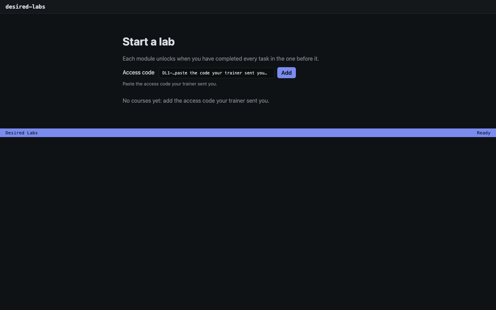
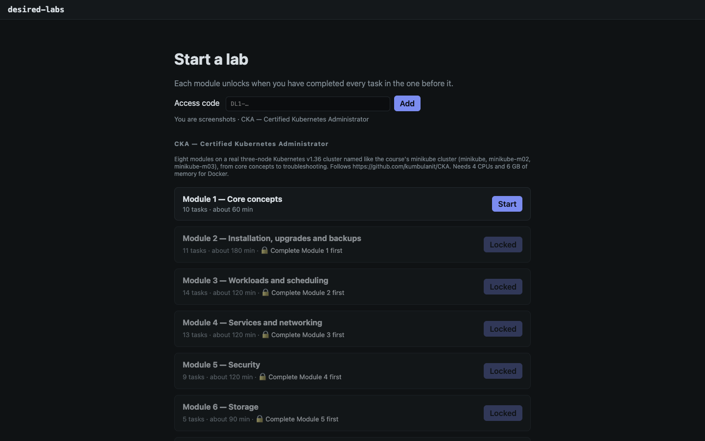
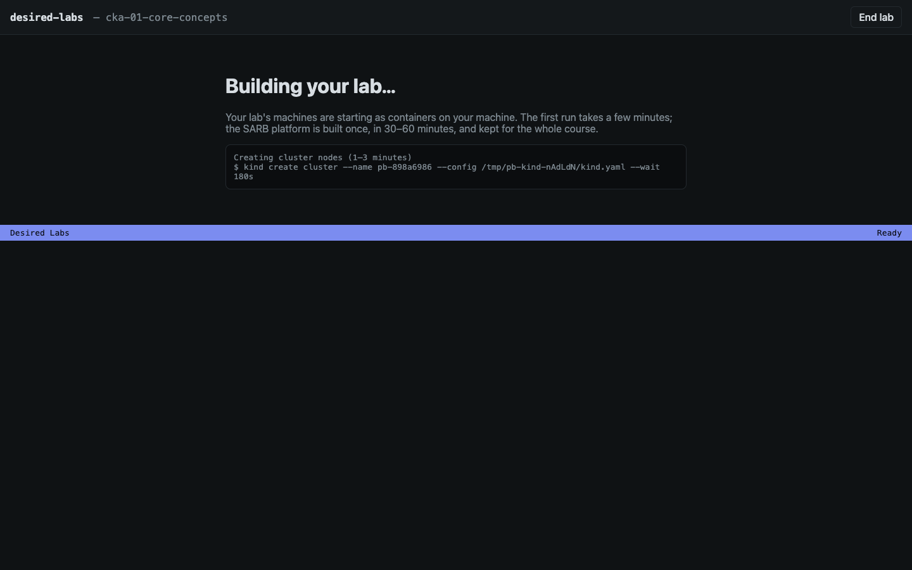

# Lab guides

Every practical of the course, step by step: each command, a sentence on what it does, the output it printed on the practice cluster, what to check when you see something else, and why it works. The same steps are in the Patchbay labs (open a task's solution).

| Module | Guide | Labs | Outputs |
| --- | --- | --- | --- |
| 1 | [Installation](./01-installation.md) | 7 | all recorded |
| 2 | [Core concepts](./02-core-concepts.md) | 10 | all recorded |
| 3 | [Workloads and scheduling](./03-scheduling.md) | 14 | all recorded |
| 4 | [Services and networking](./04-networking.md) | 13 | all recorded |
| 5 | [Security](./05-security.md) | 9 | all recorded |
| 6 | [Storage](./06-storage.md) | 5 | all recorded |
| 7 | [Logging and monitoring](./07-logging-monitoring.md) | 6 | all recorded |
| 8 | [Troubleshooting](./08-troubleshooting.md) | 14 | all recorded |
| 9 | [Cluster maintenance](./09-cluster-maintenance.md) | 3 | all recorded |

## Doing these labs in Desired Labs

The same practicals run in Desired Labs, with automatic checks, hints and these step-by-step solutions.

*Paste the access code your trainer sent you: it opens your courses*

*Your courses and their modules; each module unlocks when the one before it is done*

*A lab starting: its machines are built as containers on your computer*

The outputs were recorded on the practice cluster (Kubernetes v1.36.4, then v1.37.0 after the upgrade lab; the course's own cluster runs v1.36.5). These guides are generated from the Patchbay labs; change the lab and run `node tools/build-guides.mjs labs/cka <this repository>` there, not the guide.
