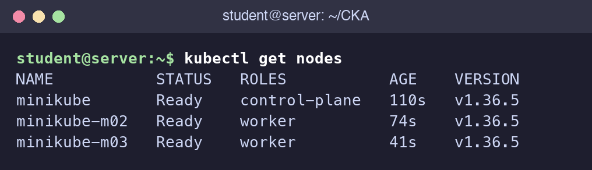

# Setup: get your server ready (once)

**Goal:** a Kubernetes cluster with three nodes, running on your Ubuntu server.

You need one Ubuntu server (24.04 or newer) with 4 CPUs, 8 GB RAM and 30 GB free disk. You do everything **on that server**, in a terminal, as your own user.

> **How to use this lab**
>
> - **📋 Copy and paste into your terminal:** copy the whole grey box (the copy button is in its top right corner), paste it into the terminal of your server, and press Enter.
> - **👀 You should see** *(do not paste)*: what the command prints. Names that end in random letters, IP addresses and ages are different on your server. That is normal.
> - **📖 Read only:** something to look at. Do not paste it.
> - **💡 Tip:** a shortcut or an extra. You do not need it to finish the lab.

## Step 1: get the course files

**📋 Copy and paste into your terminal:**

```bash
cd ~
git clone https://github.com/kumbulanit/CKA.git
cd ~/CKA
```

**What this does:**

- `cd ~`: Goes to the folder `~`.
- `git clone https://github.com/kumbulanit/CKA.git`: Downloads the course files into the folder `CKA`.
- `cd ~/CKA`: Goes to the folder `~/CKA`.

**👀 You should see** (the first line) *(do not paste)*:

```text
Cloning into 'CKA'...
```

## Step 2: install everything and start the cluster

This one command installs everything and starts the cluster. You do not install anything by hand. It takes about 10 minutes.

**📋 Copy and paste into your terminal:**

```bash
sudo ./setup.sh
```

**What this does:** Runs the course setup script as administrator. It:

- installs Docker, minikube, kubectl and helm
- installs the shortcuts `kubens` and `kubectx`, and sets up `k` and Tab completion (Step 5)
- creates and starts the cluster: one control plane node and two worker nodes

**👀 You should see** (the last lines) *(do not paste)*:

```text
==> OK: 1 control plane and 2 worker nodes, all Ready; kubectl uses the minikube cluster

The cluster is ready. As ubuntu:
  kubectl get nodes               the cluster (kubectl is set up in /home/ubuntu/.kube/config)
  kubens dev                      work in the namespace dev (kubectx: switch context)
```

If it stops with an error (for example a download that failed), run the same command again. It carries on where it stopped.

## Step 3: use Docker without sudo

**📋 Copy and paste into your terminal:**

```bash
newgrp docker
```

**What this does:** Starts a new shell in which your user may use Docker without `sudo`.

**👀 You should see** no output. The new shell looks just like the old one.

## Step 4: check the cluster

**📋 Copy and paste into your terminal:**

```bash
kubectl get nodes
```

**What this does:** Lists the nodes.

**👀 You should see** *(do not paste)*:

```text
NAME           STATUS   ROLES           AGE    VERSION
minikube       Ready    control-plane   110s   v1.36.5
minikube-m02   Ready    worker          74s    v1.36.5
minikube-m03   Ready    worker          41s    v1.36.5
```



## Step 5 (recommended): try the shortcuts

`setup.sh` installed a few shortcuts. You do not need them for the labs, but they save typing. The labs always show the full `kubectl` command, and point out where a shortcut can be used (💡).

**📋 Copy and paste into your terminal:**

```bash
kubens
kubectx
```

**What this does:**

- `kubens`: Lists the namespaces. The one you work in is highlighted.
- `kubectx`: Lists the contexts (a cluster plus a user). The one you use is highlighted.

**👀 You should see** *(do not paste)* the namespaces, and then the context `minikube`:

```text
default
kube-node-lease
kube-public
kube-system
minikube
```

| Shortcut | Instead of |
| --- | --- |
| `kubens dev` | `kubectl config set-context --current --namespace=dev` |
| `kubectx thabo` | `kubectl config use-context thabo` |
| `k get pods` | `kubectl get pods` (`k` is a short name for `kubectl`) |
| Press **Tab** while typing | Typing full names: `kubectl get po` + Tab, `kubectl describe pod back` + Tab |
| `kubectl get pods -w` | Running `kubectl get pods` again and again (stop with Ctrl+C) |

If `kubens` says `command not found`, `setup.sh` could not install it (it says so in a `note:` line). The labs work without it: use the full `kubectl` command.

💡 **Tip:** in the CKA exam, `k` and Tab completion are ready to use, but `kubens` and `kubectx` are not installed. Learn the full commands too.

## Step 6: check that everything is ready

One script checks everything the labs need: the server, the tools, the cluster and its parts, and the Shop. It only looks; it changes nothing. Run it now, at the start of every course day, and whenever something looks wrong.

**📋 Copy and paste into your terminal:**

```bash
~/CKA/scenario-labs/scripts/check-ready.sh
```

**What this does:** Runs the course script that checks the server, the tools, the cluster and the Shop, and prints one line per check.

**👀 You should see** *(do not paste)* (the start and the end):

SEE-CHECK-READY-OUTPUT

| The line says | Meaning |
| --- | --- |
| `OK` | Fine. |
| `WARN` | It works, but look at it. The `fix:` line under it says what to do. |
| `FAIL` | Fix it before you go on: do what the `fix:` line under it says, then run the script again. |
| `INFO` | Only for your information. Before Lab 1.1, for example, the Shop is not there yet. |

✅ **Check:** the last line says `Everything is ready for the labs.` or `Ready for the labs, with ... warning(s)`. Now go to [Lab 1.1](./01-core-concepts/lab-1.1-architecture-and-namespaces.md).

## If something is wrong

Run `~/CKA/scenario-labs/scripts/check-ready.sh` first: every `FAIL` line says what to do.

| What you see | What to do |
| --- | --- |
| `The connection to the server ... was refused` | The cluster is stopped. Run `cd ~/CKA && sudo ./setup.sh` again. |
| A node says `NotReady` | Wait one minute and look again. Still `NotReady`: run `cd ~/CKA && sudo ./setup.sh`. |
| `permission denied ... docker.sock` | Run `newgrp docker`, or log out and in again. |
| The server was restarted | Run `cd ~/CKA && sudo ./setup.sh`. Your work in the cluster is kept. |
