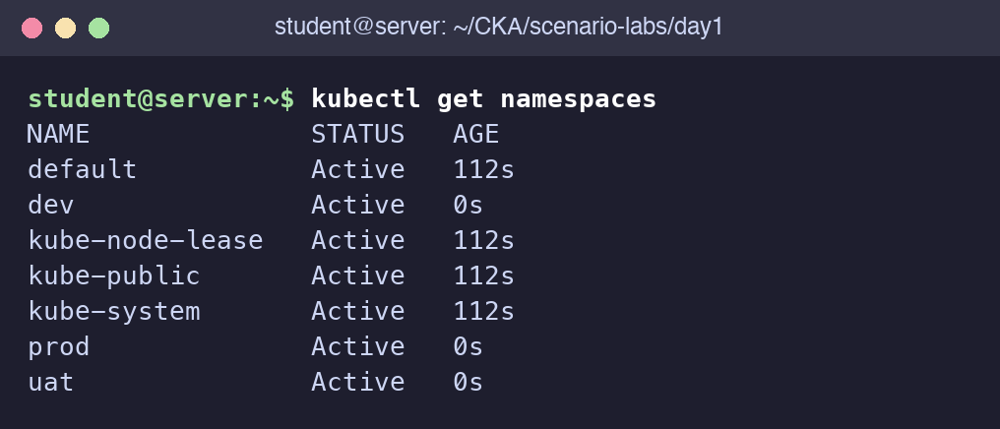

# Lab 1.1: Kubernetes architecture and the three environments

**The situation:** You are going to build a small online shop on Kubernetes. Before you build anything, look at the cluster it will run on, and make room for three environments.

**Goal:** look at the cluster the Shop will run on, and create the three environments: `dev`, `uat` and `prod`.

**Outline topic:** 1. Core concepts and Kubernetes architecture: *Kubernetes architecture and its main components*, *Namespaces*.

**What you learn:** nodes, the control plane and its parts, `kubectl`, namespaces.

> **How to use this lab**
>
> - **📋 Copy and paste into your terminal:** copy the whole grey box (the copy button is in its top right corner), paste it into the terminal of your server, and press Enter.
> - **👀 You should see** *(do not paste)*: what the command prints. Names that end in random letters, IP addresses and ages are different on your server. That is normal.
> - **📖 Read only:** something to look at. Do not paste it.
> - **💡 Tip:** a shortcut or an extra. You do not need it to finish the lab.

## Step 1: go to the lab folder

All the files for this module are in one folder. Stay in it for the whole module.

**📋 Copy and paste into your terminal:**

```bash
cd ~/CKA/scenario-labs/01-core-concepts
```

**What this does:** Goes to the folder `~/CKA/scenario-labs/01-core-concepts`.

**👀 You should see** no output. Your prompt now ends in `01-core-concepts`.

## Step 2: look at the nodes

A node is a machine in the cluster. Yours has three.

**📋 Copy and paste into your terminal:**

```bash
kubectl get nodes
```

**What this does:** Lists the nodes.

**👀 You should see** *(do not paste)*:

```text
NAME           STATUS   ROLES           AGE    VERSION
minikube       Ready    control-plane   110s   v1.36.5
minikube-m02   Ready    worker          74s    v1.36.5
minikube-m03   Ready    worker          41s    v1.36.5
```

- `minikube` is the **control plane**: the brain of the cluster.
- `minikube-m02` and `minikube-m03` are **workers**: they run your applications.

## Step 3: look at the control plane

**📋 Copy and paste into your terminal:**

```bash
kubectl cluster-info
```

**What this does:** Shows the address of the control plane (the API server) and of the cluster's DNS.

**👀 You should see** *(do not paste)*:

```text
Kubernetes control plane is running at https://192.168.49.2:8443
CoreDNS is running at https://192.168.49.2:8443/api/v1/namespaces/kube-system/services/kube-dns:dns/proxy
```

The parts of the control plane run as pods, in the namespace `kube-system`:

**📋 Copy and paste into your terminal:**

```bash
kubectl get pods -n kube-system
```

**What this does:** Lists the pods in the namespace `kube-system`.

**👀 You should see** (the names end differently on your server) *(do not paste)*:

```text
NAME                                       READY   STATUS    RESTARTS   AGE
calico-kube-controllers-7848b846c6-ktlhl   1/1     Running   0          103s
calico-node-8klt2                          1/1     Running   0          75s
calico-node-96zs2                          1/1     Running   0          104s
calico-node-tbs7q                          1/1     Running   0          42s
coredns-589f44dc88-2vxh5                   1/1     Running   0          103s
etcd-minikube                              1/1     Running   0          110s
kube-apiserver-minikube                    1/1     Running   0          109s
kube-controller-manager-minikube           1/1     Running   0          109s
kube-proxy-548k8                           1/1     Running   0          42s
kube-proxy-8qh4j                           1/1     Running   0          75s
kube-proxy-mck2w                           1/1     Running   0          104s
kube-scheduler-minikube                    1/1     Running   0          109s
storage-provisioner                        1/1     Running   0          106s
```

| Pod | What it does |
| --- | --- |
| `kube-apiserver` | The front door. Every `kubectl` command goes to it. |
| `etcd` | The database of the cluster. Everything you create is stored here. |
| `kube-scheduler` | Chooses a node for every new pod. |
| `kube-controller-manager` | Keeps things as you asked (for example: 2 copies stay 2 copies). |
| `coredns` | Gives names to Services, so pods can find each other. |
| `kube-proxy`, `calico-node` | The network, one per node. |

## Step 4: create the three environments

A **namespace** is a separate room in the cluster. The Shop gets three rooms: one to build in (`dev`), one to test in (`uat`) and one for real users (`prod`).

**📋 Copy and paste into your terminal:**

```bash
kubectl create namespace dev
kubectl create namespace uat
kubectl create namespace prod
```

**What this does:**

- `kubectl create namespace dev`: Creates the namespace `dev`.
- `kubectl create namespace uat`: Creates the namespace `uat`.
- `kubectl create namespace prod`: Creates the namespace `prod`.

**👀 You should see** *(do not paste)*:

```text
namespace/dev created
namespace/uat created
namespace/prod created
```

**📋 Copy and paste into your terminal:**

```bash
kubectl get namespaces
```

**What this does:** Lists the namespaces.

**👀 You should see** *(do not paste)*:

```text
NAME              STATUS   AGE
default           Active   112s
dev               Active   0s
kube-node-lease   Active   112s
kube-public       Active   112s
kube-system       Active   112s
prod              Active   0s
uat               Active   0s
```



## Step 5: make `dev` your working namespace

In this module you work in `dev`. This command saves you from typing `-n dev` after every command.

**📋 Copy and paste into your terminal:**

```bash
kubectl config set-context --current --namespace=dev
```

**What this does:** Makes `dev` your working namespace: commands without `-n` now work in `dev`.

**👀 You should see** *(do not paste)*:

```text
Context "minikube" modified.
```

💡 **Tip:** if you installed `kubens` ([setup, Step 5](../00-setup.md)), `kubens dev` does the same, and `kubens` on its own shows which namespace you are in.

💡 **Exam tip:** in the exam, every task names its namespace. Always check which namespace you are in before you create something.

✅ **Check:** `kubectl get namespaces` shows `dev`, `uat` and `prod`.

**Next:** [Lab 1.2: Pods, labels and selectors](./lab-1.2-pods-labels-selectors.md)
