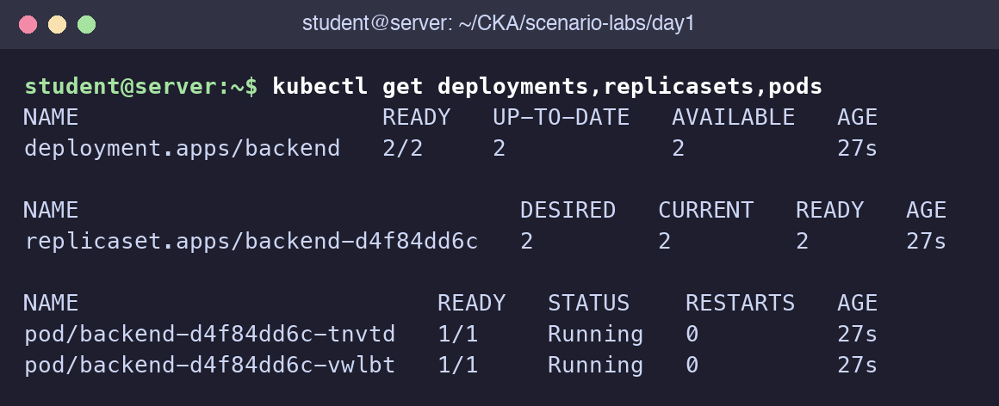

# Lab 1.3: Deployments: two copies of the backend and the frontend

**The situation:** The backend pod from Lab 1.2 was deleted, and nothing brought it back. A shop that disappears when one pod dies is no good.

**Goal:** run the backend and the frontend as **Deployments**, with 2 copies each, so that a lost pod comes back by itself.

**Outline topic:** 1. Core concepts: *Deployments*.

**What you learn:** Deployments, ReplicaSets, self-healing, scaling.

A **Deployment** says: "keep this many copies of this pod running". Kubernetes does the rest.

> **How to use this lab**
>
> - **📋 Copy and paste into your terminal:** copy the whole grey box (the copy button is in its top right corner), paste it into the terminal of your server, and press Enter.
> - **👀 You should see** *(do not paste)*: what the command prints. Names that end in random letters, IP addresses and ages are different on your server. That is normal.
> - **📖 Read only:** something to look at. Do not paste it.
> - **💡 Tip:** a shortcut or an extra. You do not need it to finish the lab.

## Before you start

Go to the folder of this module, and make `dev` your working namespace:

**📋 Copy and paste into your terminal:**

```bash
cd ~/CKA/scenario-labs/01-core-concepts
kubectl config set-context --current --namespace=dev
```

**What this does:**

- `cd ~/CKA/scenario-labs/01-core-concepts`: Goes to the folder `~/CKA/scenario-labs/01-core-concepts`.
- `kubectl config set-context --current --namespace=dev`: Makes `dev` your working namespace: commands without `-n` now work in `dev`.

**👀 You should see** *(do not paste)*:

```text
Context "minikube" modified.
```

💡 **Tip:** `kubens dev` does the same as the second line (see the shortcuts in [setup, Step 5](../00-setup.md)).

## Step 1: create the backend Deployment

**📋 Copy and paste into your terminal:**

```bash
cat backend-deployment.yaml
```

**What this does:** Shows what is in the file `backend-deployment.yaml`.

**👀 You should see** *(do not paste)*:

```yaml
apiVersion: apps/v1
kind: Deployment
metadata:
  name: backend
  labels:
    app: backend
spec:
  replicas: 2
  selector:
    matchLabels:
      app: backend
  template:
    metadata:
      labels:
        app: backend
    spec:
      containers:
      - name: backend
        image: postgrest/postgrest:v12.2.3
        ports:
        - containerPort: 3000
```

| Line | Meaning |
| --- | --- |
| `replicas: 2` | Keep 2 copies running |
| `selector: matchLabels` | The Deployment owns the pods with the label `app=backend` |
| `template:` | The pod to copy. It is the pod from Lab 1.2. |

**📋 Copy and paste into your terminal:**

```bash
kubectl apply -f backend-deployment.yaml
```

**What this does:** Creates (or updates) what is described in `backend-deployment.yaml`.

**👀 You should see** *(do not paste)*:

```text
deployment.apps/backend created
```

## Step 2: see what it made

**📋 Copy and paste into your terminal:**

```bash
kubectl get deployments,replicasets,pods
```

**What this does:** Lists the Deployments, the ReplicaSets and the pods.

**👀 You should see** *(do not paste)*:

```text
NAME                      READY   UP-TO-DATE   AVAILABLE   AGE
deployment.apps/backend   2/2     2            2           27s

NAME                                DESIRED   CURRENT   READY   AGE
replicaset.apps/backend-d4f84dd6c   2         2         2       27s

NAME                          READY   STATUS    RESTARTS   AGE
pod/backend-d4f84dd6c-tnvtd   1/1     Running   0          27s
pod/backend-d4f84dd6c-vwlbt   1/1     Running   0          27s
```



The Deployment made a **ReplicaSet**, and the ReplicaSet made the **2 pods**.

## Step 3: delete a pod and watch it come back

Copy the name of one of **your** pods from the list above, and put it in place of `POD-NAME`:

**📋 Copy and paste, then change `POD-NAME`:**

```bash
kubectl delete pod POD-NAME
```

**What this does:** Deletes the pod `POD-NAME`.

**👀 You should see**, with the name of your pod *(do not paste)*:

```text
pod "backend-d4f84dd6c-vwlbt" deleted from dev namespace
```

**📋 Copy and paste into your terminal:**

```bash
kubectl get pods
```

**What this does:** Lists the pods.

**👀 You should see** two pods again. One of them is new (look at `AGE`) *(do not paste)*:

```text
NAME                      READY   STATUS    RESTARTS   AGE
backend-d4f84dd6c-tnvtd   1/1     Running   0          45s
backend-d4f84dd6c-x7k2m   1/1     Running   0          4s
```

This is **self-healing**: you asked for 2, so Kubernetes keeps 2.

## Step 4: scale up and down

**📋 Copy and paste into your terminal:**

```bash
kubectl scale deployment backend --replicas=3
kubectl get pods
```

**What this does:**

- `kubectl scale deployment backend --replicas=3`: Changes the number of pods of the Deployment `backend` to 3.
- `kubectl get pods`: Lists the pods.

**👀 You should see** three pods *(do not paste)*:

```text
deployment.apps/backend scaled
NAME                      READY   STATUS              RESTARTS   AGE
backend-d4f84dd6c-2l8qc   0/1     ContainerCreating   0          8s
backend-d4f84dd6c-tnvtd   1/1     Running             0          39s
backend-d4f84dd6c-vwlbt   1/1     Running             0          39s
```

Go back to 2:

**📋 Copy and paste into your terminal:**

```bash
kubectl scale deployment backend --replicas=2
```

**What this does:** Changes the number of pods of the Deployment `backend` to 2.

**👀 You should see** *(do not paste)*:

```text
deployment.apps/backend scaled
```

## Step 5: create the frontend Deployment

The frontend is the web page. It is an nginx web server, also with 2 copies.

**📋 Copy and paste into your terminal:**

```bash
kubectl apply -f frontend-deployment.yaml
kubectl rollout status deployment/frontend
```

**What this does:**

- `kubectl apply -f frontend-deployment.yaml`: Creates (or updates) what is described in `frontend-deployment.yaml`.
- `kubectl rollout status deployment/frontend`: Waits until the new pods of the Deployment `frontend` are all ready, and says when it is done.

**👀 You should see** *(do not paste)*:

```text
deployment.apps/frontend created
Waiting for deployment "frontend" rollout to finish: 0 of 2 updated replicas are available...
Waiting for deployment "frontend" rollout to finish: 1 of 2 updated replicas are available...
deployment "frontend" successfully rolled out
```

## Step 6: check both parts

**📋 Copy and paste into your terminal:**

```bash
kubectl get deployments
```

**What this does:** Lists the Deployments.

**👀 You should see** *(do not paste)*:

```text
NAME       READY   UP-TO-DATE   AVAILABLE   AGE
backend    2/2     2            2           54s
frontend   2/2     2            2           15s
```

💡 **Tip:** `kubectl get pods -w` keeps watching and prints a new line every time a pod changes. Run it before you delete a pod in Step 3, and watch the new pod appear. Stop it with **Ctrl+C**.

💡 **Exam tip:** this one line creates a Deployment without a file:

**📖 Read only (do not paste):**

```text
kubectl create deployment frontend --image=nginx:1.27-alpine --replicas=2
```

✅ **Check:** `backend` and `frontend` both show `2/2`.

**The Shop so far:** two parts run, but they cannot find each other yet. That is the next lab.

**Next:** [Lab 1.4: Services](./lab-1.4-services.md)
