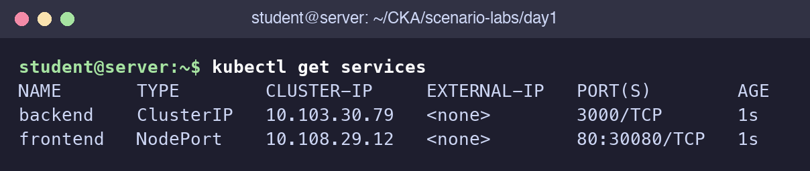

# Lab 1.4: Services: the frontend finds the backend

**The situation:** The frontend and the backend both run, but they cannot find each other. Pods get a new address every time they are replaced.

**Goal:** give the backend and the frontend each a fixed name and address, so that the frontend can call the backend, and you can open the frontend.

**Outline topic:** 1. Core concepts: *Services*.

**What you learn:** Services (ClusterIP and NodePort), selectors, endpoints, Service names.

📘 **More detail:** [Lab 1.4 explained](./lab-1.4-services-explained.md): what happens in the cluster at each step, common mistakes and exam notes.

Pods come and go, and each new pod gets a new IP address. A **Service** is a fixed name and address in front of a group of pods. It finds its pods by their **label**.

> **How to use this lab**
>
> - **📋 Copy and paste into your terminal:** copy the whole grey box (the copy button is in its top right corner), paste it into the terminal of your server, and press Enter.
> - **👀 You should see** *(do not paste)*: what the command prints. Names that end in random letters, IP addresses and ages are different on your server. That is normal.
> - **📖 Read only:** something to look at. Do not paste it.
> - **💡 Tip:** a shortcut or an extra. You do not need it to finish the lab.

## Before you start

Go to the folder of this module, and make `dev` your working namespace:

**📋 Copy and paste into your terminal:**

```bash
cd ~/CKA/scenario-labs/01-core-concepts
kubectl config set-context --current --namespace=dev
```

**What this does:**

- `cd ~/CKA/scenario-labs/01-core-concepts`: Goes to the folder `~/CKA/scenario-labs/01-core-concepts`.
- `kubectl config set-context --current --namespace=dev`: Makes `dev` your working namespace: commands without `-n` now work in `dev`.

**👀 You should see** *(do not paste)*:

```text
Context "minikube" modified.
```

💡 **Tip:** `kubens dev` does the same as the second line (see the shortcuts in [setup, Step 5](../00-setup.md)).

## Step 1: look at the two Services

**⌨️ Command line option** *(read only: the same as the YAML below, made with a command)*:

```bash
kubectl create service clusterip backend --tcp=3000:3000
kubectl create service nodeport frontend --tcp=80:80 --node-port=30080
```

**What this does:**

- `kubectl create service clusterip backend --tcp=3000:3000`: Creates the Service `backend` of type ClusterIP, port 3000 to the pods' port 3000. The selector `app=backend` is added for you (it is the name).
- `kubectl create service nodeport frontend ...`: Creates the Service `frontend` of type NodePort, port 80, open on every node at port 30080. The selector is `app=frontend`.

💡 `kubectl expose deployment backend --port=3000` also works, and takes the selector from the Deployment. But `expose` cannot choose the node port.

💡 Add `--dry-run=client -o yaml` to print the YAML without creating anything. With `> file.yaml` at the end, that is the fastest way to start a YAML file in the exam.

**📋 Copy and paste into your terminal:**

```bash
cat backend-service.yaml frontend-service.yaml
```

**What this does:** Shows what is in the files `backend-service.yaml` and `frontend-service.yaml`.

**👀 You should see** *(do not paste)*:

```yaml
apiVersion: v1
kind: Service
metadata:
  name: backend
spec:
  type: ClusterIP
  selector:
    app: backend
  ports:
  - port: 3000
    targetPort: 3000
apiVersion: v1
kind: Service
metadata:
  name: frontend
spec:
  type: NodePort
  selector:
    app: frontend
  ports:
  - port: 80
    targetPort: 80
    nodePort: 30080
```

| Service | Type | Who can reach it |
| --- | --- | --- |
| `backend` | `ClusterIP` | Only pods inside the cluster |
| `frontend` | `NodePort` | Also from outside the cluster, on port `30080` of every node |

`selector: app: backend` means: send the traffic to the pods with the label `app=backend`.

## Step 2: create them

**📋 Copy and paste into your terminal:**

```bash
kubectl apply -f backend-service.yaml -f frontend-service.yaml
```

**What this does:** Creates (or updates) what is described in `backend-service.yaml` and `frontend-service.yaml`.

**👀 You should see** *(do not paste)*:

```text
service/backend created
service/frontend created
```

**📋 Copy and paste into your terminal:**

```bash
kubectl get services
```

**What this does:** Lists the Services.

**👀 You should see** *(do not paste)*:

```text
NAME       TYPE        CLUSTER-IP     EXTERNAL-IP   PORT(S)        AGE
backend    ClusterIP   10.103.30.79   <none>        3000/TCP       1s
frontend   NodePort    10.108.29.12   <none>        80:30080/TCP   1s
```



## Step 3: see which pods are behind each Service

**📋 Copy and paste into your terminal:**

```bash
kubectl get endpointslices
```

**What this does:** Lists the EndpointSlices (the addresses of the pods behind each Service).

**👀 You should see** *(do not paste)*:

```text
NAME             ADDRESSTYPE   PORTS   ENDPOINTS                     AGE
backend-dxsj2    IPv4          3000    10.244.151.1,10.244.205.194   2s
frontend-vtfnl   IPv4          80      10.244.151.2,10.244.205.195   2s
```

Each Service has two addresses behind it: its two pods. Compare them with the pod IPs:

**📋 Copy and paste into your terminal:**

```bash
kubectl get pods -o wide
```

**What this does:** Lists the pods, with extra columns such as the IP address and the node.

**👀 You should see** four pods. Their addresses in the `IP` column are the same four as in the EndpointSlices above.

## Step 4: find the backend by name (DNS)

Every Service gets a DNS name. Ask the cluster's DNS for the backend:

**📋 Copy and paste into your terminal:**

```bash
kubectl run dns-test --rm -i --restart=Never --image=busybox:1.36 -- nslookup backend.dev.svc.cluster.local
```

**What this does:** Starts one pod called `dns-test` from the image `busybox:1.36`, which runs `nslookup backend.dev.svc.cluster.local`. `--rm` deletes the pod again when it is done.

**👀 You should see** *(do not paste)*:

```text
Server:		10.96.0.10
Address:	10.96.0.10:53

Name:	backend.dev.svc.cluster.local
Address: 10.103.30.79

pod "dns-test" deleted from dev namespace
```

In your terminal, `kubectl` often adds three lines, and then shows the answer a second time:

```text
All commands and output from this session will be recorded in container logs, including credentials and sensitive information passed through the command prompt.
If you don't see a command prompt, try pressing enter.
warning: couldn't attach to pod/dns-test, falling back to streaming logs: ...
```

That is fine. The pod finished before `kubectl` could connect to it, so `kubectl` shows its log instead. The answer is the same. Every `kubectl run ... --rm -i` in the course (Labs 3.1 and 3.3, Workshop 2) can do this.

The name is built like this: `<service>.<namespace>.svc.cluster.local`. Inside the same namespace, the short name `backend` is enough. Lab 3.3 looks at DNS in detail.

## Step 5: call the backend from the frontend

Go inside a frontend pod and call the backend by its name:

**📋 Copy and paste into your terminal:**

```bash
kubectl exec deployment/frontend -- curl -s http://backend:3000/
```

**What this does:** From inside a frontend pod, calls the backend by its Service name `backend`, on port 3000.

**👀 You should see** *(do not paste)*:

```text
{"code":"PGRST302","details":null,"hint":null,"message":"Anonymous access is disabled"}
```

That answer comes **from the backend**. The frontend found the backend by name. (The backend refuses to work because it has no settings yet. You give it settings in the next lab.)

## Step 6: open the frontend from your server

The frontend is a NodePort Service, so you can reach it on port `30080` of a node:

**📋 Copy and paste into your terminal:**

```bash
curl -s http://$(minikube ip):30080 | head -5
```

**What this does:** Opens the frontend from your server, as a web browser would. `$(minikube ip)` fills in the address of your cluster, and `30080` is the NodePort. `| head` shows only the first 5 lines.

**👀 You should see** *(do not paste)*:

```text
<!DOCTYPE html>
<html>
<head>
<title>Welcome to nginx!</title>
<style>
```

That is the standard nginx page. The Shop page comes in the next lab.

💡 **Exam tip:** this one line creates a Service for a Deployment:

**📖 Read only (do not paste):**

```text
kubectl expose deployment backend --port=3000 --target-port=3000
```

✅ **Check:** Step 5 gives an answer from the backend, and Step 6 gives a web page.

**The Shop so far:** the frontend and the backend run and can talk to each other.

**Next:** [Lab 1.5: ConfigMaps and Secrets](./lab-1.5-configmaps-and-secrets.md)
