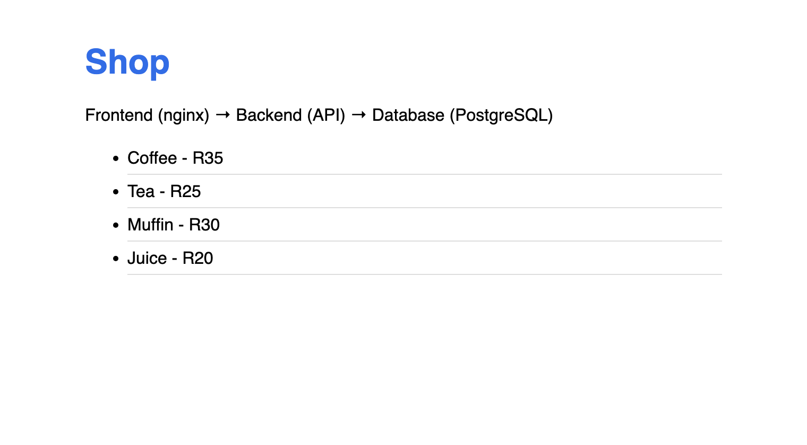
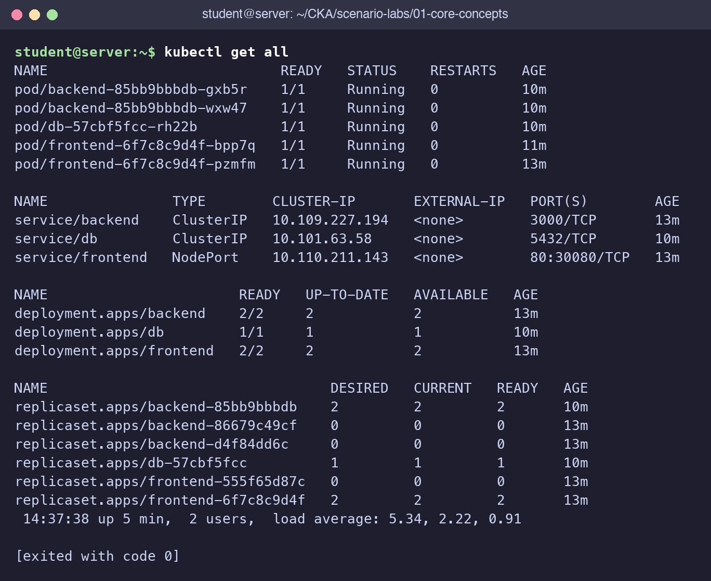

# Lab 1.6: The database: the Shop is complete

**The situation:** The backend is waiting for a database. This is the last part of the Shop.

**Goal:** add the last part of the Shop, the **database**, and see a request go through all three parts.

**Outline topic:** 1. Core concepts: *Deployment of applications and services*.

**What you learn:** how the parts of one application use everything from this module together: a Deployment, a Service, a ConfigMap and a Secret.

📘 **More detail:** [Lab 1.6 explained](./lab-1.6-the-database-explained.md): what happens in the cluster at each step, common mistakes and exam notes.

> **How to use this lab**
>
> - **📋 Copy and paste into your terminal:** copy the whole grey box (the copy button is in its top right corner), paste it into the terminal of your server, and press Enter.
> - **👀 You should see** *(do not paste)*: what the command prints. Names that end in random letters, IP addresses and ages are different on your server. That is normal.
> - **📖 Read only:** something to look at. Do not paste it.
> - **💡 Tip:** a shortcut or an extra. You do not need it to finish the lab.

## Before you start

Go to the folder of this module, and make `dev` your working namespace:

**📋 Copy and paste into your terminal:**

```bash
cd ~/CKA/scenario-labs/01-core-concepts
kubectl config set-context --current --namespace=dev
```

**What this does:**

- `cd ~/CKA/scenario-labs/01-core-concepts`: Goes to the folder `~/CKA/scenario-labs/01-core-concepts`.
- `kubectl config set-context --current --namespace=dev`: Makes `dev` your working namespace: commands without `-n` now work in `dev`.

**👀 You should see** *(do not paste)*:

```text
Context "minikube" modified.
```

💡 **Tip:** `kubens dev` does the same as the second line (see the shortcuts in [setup, Step 5](../00-setup.md)).

## Step 1: look at the three files

**⌨️ Command line option** *(read only: the same as the YAML below, made with a command)*:

```bash
kubectl create deployment db --image=postgres:16-alpine --port=5432
kubectl set env deployment/db POSTGRES_USER=shop POSTGRES_DB=shop PGDATA=/var/lib/postgresql/data/pgdata
kubectl set env deployment/db --from=secret/db-secret --keys=password --prefix=POSTGRES_
```

**What this does:**

- `kubectl create deployment db ...`: Creates the Deployment `db` with the image `postgres:16-alpine` and port 5432.
- `kubectl set env deployment/db POSTGRES_USER=shop ...`: Adds the three plain settings.
- `kubectl set env ... --from=secret/db-secret --keys=password --prefix=POSTGRES_`: Adds `POSTGRES_PASSWORD`, taken from the key `password` of the Secret `db-secret`.

Not possible with a command: the `Recreate` strategy and the two volumes. Add them with `kubectl edit deployment db`. Also, kubectl names the container `postgres` (after the image); the file names it `db`.

**📋 Copy and paste into your terminal:**

```bash
cat db-deployment.yaml
```

**What this does:** Shows what is in the file `db-deployment.yaml`.

**👀 You should see** *(do not paste)*:

```yaml
apiVersion: apps/v1
kind: Deployment
metadata:
  name: db
  labels:
    app: db
spec:
  replicas: 1
  strategy:
    type: Recreate            # stop the old pod before starting a new one (one disk, one database)
  selector:
    matchLabels:
      app: db
  template:
    metadata:
      labels:
        app: db
    spec:
      containers:
      - name: db
        image: postgres:16-alpine
        ports:
        - containerPort: 5432
        env:
        - name: POSTGRES_USER
          value: shop
        - name: POSTGRES_DB
          value: shop
        - name: POSTGRES_PASSWORD
          valueFrom:
            secretKeyRef:
              name: db-secret
              key: password
        - name: PGDATA
          value: /var/lib/postgresql/data/pgdata
        volumeMounts:
        - name: data
          mountPath: /var/lib/postgresql/data          # the database files
        - name: init
          mountPath: /docker-entrypoint-initdb.d       # runs once, on an empty disk
      volumes:
      - name: data
        emptyDir: {}                                   # temporary: gone when the pod is deleted
      - name: init
        configMap:
          name: db-init
```

You know every piece of it:

| Piece | From |
| --- | --- |
| A Deployment with a label `app: db` | Lab 1.3 |
| The password from the Secret `db-secret` | Lab 1.5 |
| A ConfigMap (`db-init`) mounted as a file: the first three items of the Shop | Lab 1.5 |

One thing is new: `emptyDir`. That is a **temporary** folder for the database files. It is enough for now. You will see its weak point later, and fix it in the Storage module.

## Step 2: start the database

Three files: the first data, the Deployment, and a Service named `db`. The backend looks for that name (Lab 1.5: `postgres://shop@db:5432/shop`).

**📋 Copy and paste into your terminal:**

```bash
kubectl apply -f db-init.yaml -f db-deployment.yaml -f db-service.yaml
kubectl rollout status deployment/db
```

**What this does:**

- `kubectl apply -f db-init.yaml ...`: Creates (or updates) what is described in `db-init.yaml` and `db-deployment.yaml` and `db-service.yaml`.
- `kubectl rollout status deployment/db`: Waits until the new pods of the Deployment `db` are all ready, and says when it is done.

**👀 You should see** *(do not paste)*:

```text
configmap/db-init created
deployment.apps/db created
service/db created
Waiting for deployment "db" rollout to finish: 0 of 1 updated replicas are available...
deployment "db" successfully rolled out
```

## Step 3: connect the backend

Restart the backend, so that it connects to the new database at once:

**📋 Copy and paste into your terminal:**

```bash
kubectl rollout restart deployment/backend
kubectl rollout status deployment/backend
```

**What this does:**

- `kubectl rollout restart deployment/backend`: Replaces the pods of the Deployment `backend` with new ones, one by one.
- `kubectl rollout status deployment/backend`: Waits until the new pods of the Deployment `backend` are all ready, and says when it is done.

**👀 You should see** (the last line) *(do not paste)*:

```text
deployment "backend" successfully rolled out
```

## Step 4: the whole Shop works

**📋 Copy and paste into your terminal:**

```bash
sleep 10
curl -s http://$(minikube ip):30080/api/items; echo
```

**What this does:**

- `sleep 10`: Waits 10 seconds, to give Kubernetes time.
- `curl -s http://$(minikube ip):30080/api/items; echo`: Asks the Shop for its items, as a web browser would. This time the backend reads them from the database.

**👀 You should see** *(do not paste)*:

```text
[{"id":1,"name":"Coffee","price":35},
 {"id":2,"name":"Tea","price":25},
 {"id":3,"name":"Muffin","price":30}]
```

🎉 That request went **frontend → backend → database** and back.

If you get an error instead of the list, wait 10 more seconds and run the `curl` command again.

## Step 5: add an item

**📋 Copy and paste into your terminal:**

```bash
curl -s -X POST http://$(minikube ip):30080/api/items \
  -H 'Content-Type: application/json' \
  -d '{"name":"Juice","price":20}' -w '%{http_code}\n'
```

**What this does:** Adds a new item, Juice, to the Shop, as a customer filling in a form would (a POST request). `-w` prints only the answer code: `201` means it was created.

**👀 You should see** *(do not paste)*:

```text
201
```

`201` means: created.

**📋 Copy and paste into your terminal:**

```bash
curl -s http://$(minikube ip):30080/api/items; echo
```

**What this does:** Asks the Shop for its items again.

**👀 You should see** four items now *(do not paste)*:

```text
[{"id":1,"name":"Coffee","price":35},
 {"id":2,"name":"Tea","price":25},
 {"id":3,"name":"Muffin","price":30},
 {"id":4,"name":"Juice","price":20}]
```

## Step 6: see the Shop in a browser (optional)

Make the Shop reachable on `localhost` of your server:

**📋 Copy and paste into your terminal:**

```bash
kubectl port-forward service/frontend 8080:80 > /dev/null 2>&1 &
sleep 2
curl -s http://localhost:8080 | grep "<h1>"
```

**What this does:**

- `kubectl port-forward service/frontend 8080:80 ...`: Connects port 8080 of your server (`localhost:8080`) to the Service `frontend`. The `&` at the end keeps it running in the background.
- `sleep 2`: Waits 2 seconds, to give Kubernetes time.
- `curl -s http://localhost:8080 | grep "<h1>"`: Asks for `http://localhost:8080`, as a web browser would, and prints the answer. `| grep` keeps only the lines with `<h1>`.

**👀 You should see** *(do not paste)*:

```text
  <h1>Shop</h1>
```

If your server has a desktop, open `http://localhost:8080` in its browser. You see this:



Stop the port-forward:

**📋 Copy and paste into your terminal:**

```bash
kill %1
```

**What this does:** Stops the command that runs in the background (the port-forward).

**👀 You should see** this line, now or after your next command *(do not paste)*:

```text
[1]+  Terminated              kubectl port-forward service/frontend 8080:80 > /dev/null 2>&1
```

## Step 7: look at everything you built

**📋 Copy and paste into your terminal:**

```bash
kubectl get all
```

**What this does:** Lists everything: pods, Services, Deployments and ReplicaSets.

**👀 You should see** 5 pods, 3 Services and 3 Deployments *(do not paste)*:



✅ **Check:** Step 5 shows four items, with the Juice.

**The Shop so far:** all three parts run in `dev` and work together.

**Next:** [Lab 1.7: Health checks](./lab-1.7-health-checks.md)
