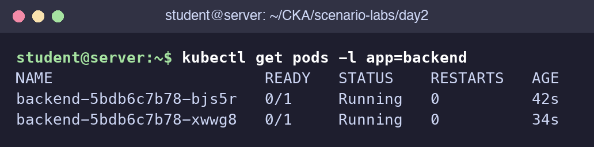

# Lab 1.7: Health checks: Kubernetes looks after the backend

**The situation:** Kubernetes says a pod is `Running` when its program has started. But a running backend that cannot reach its database is no use to a customer.

**Goal:** teach Kubernetes how to see whether the backend is healthy, so that it restarts a stuck backend and sends no users to a backend that cannot work.

**Outline topic:** 1. Core concepts: *Application lifecycle management* (self-healing applications).

**What you learn:** liveness probes, readiness probes.

📘 **More detail:** [Lab 1.7 explained](./lab-1.7-health-checks-explained.md): what happens in the cluster at each step, common mistakes and exam notes.

`Running` only means "the program started". It does not mean "the program works". A **probe** is a check that Kubernetes does again and again:

| Probe | The question | When the answer is no |
| --- | --- | --- |
| **Liveness** | Is the program still alive? | Kubernetes **restarts** the container |
| **Readiness** | Can it serve users right now? | Kubernetes **sends it no traffic**, until it can |

> **How to use this lab**
>
> - **📋 Copy and paste into your terminal:** copy the whole grey box (the copy button is in its top right corner), paste it into the terminal of your server, and press Enter.
> - **👀 You should see** *(do not paste)*: what the command prints. Names that end in random letters, IP addresses and ages are different on your server. That is normal.
> - **📖 Read only:** something to look at. Do not paste it.
> - **💡 Tip:** a shortcut or an extra. You do not need it to finish the lab.

## Before you start

Go to the folder of this module, and make `dev` your working namespace:

**📋 Copy and paste into your terminal:**

```bash
cd ~/CKA/scenario-labs/01-core-concepts
kubectl config set-context --current --namespace=dev
```

**What this does:**

- `cd ~/CKA/scenario-labs/01-core-concepts`: Goes to the folder `~/CKA/scenario-labs/01-core-concepts`.
- `kubectl config set-context --current --namespace=dev`: Makes `dev` your working namespace: commands without `-n` now work in `dev`.

**👀 You should see** *(do not paste)*:

```text
Context "minikube" modified.
```

💡 **Tip:** `kubens dev` does the same as the second line (see the shortcuts in [setup, Step 5](../00-setup.md)).

## Step 1: add the probes to the backend

This file is the backend Deployment from Lab 1.5, with these lines added:

**⌨️ Command line option:** none for these lines. kubectl has no command that adds a liveness or readiness probe (`kubectl set probe` exists only in OpenShift's `oc`, not in kubectl). The command-line way is to open the Deployment in the editor and type the lines yourself:

```bash
kubectl edit deployment backend
```

**📖 Read only (do not paste):**

```yaml
        livenessProbe:                 # is the program still alive? if not: restart it
          httpGet:
            path: /live
            port: 3001
          initialDelaySeconds: 5
          periodSeconds: 10
        readinessProbe:                # can it reach the database? if not: send it no traffic
          httpGet:
            path: /ready
            port: 3001
          initialDelaySeconds: 5
          periodSeconds: 5
```

| Line | Meaning |
| --- | --- |
| `httpGet` | The check is a web request to this path and port |
| `initialDelaySeconds: 5` | Wait 5 seconds after the start before the first check |
| `periodSeconds: 10` | Check every 10 seconds |

**📋 Copy and paste into your terminal:**

```bash
kubectl apply -f backend-deployment-with-probes.yaml
kubectl rollout status deployment/backend
```

**What this does:**

- `kubectl apply -f backend-deployment-with-probes.yaml`: Creates (or updates) what is described in `backend-deployment-with-probes.yaml`.
- `kubectl rollout status deployment/backend`: Waits until the new pods of the Deployment `backend` are all ready, and says when it is done.

**👀 You should see** (the last line) *(do not paste)*:

```text
deployment "backend" successfully rolled out
```

## Step 2: see the probes

**📋 Copy and paste into your terminal:**

```bash
kubectl describe deployment backend | grep -E "Liveness|Readiness"
```

**What this does:** Shows all the details of the Deployment `backend`. The events at the bottom say what happened to it. `| grep` keeps only the lines with `Liveness` or `Readiness`.

**👀 You should see** *(do not paste)*:

```text
    Liveness:   http-get http://:3001/live delay=5s timeout=1s period=10s #success=1 #failure=3
    Readiness:  http-get http://:3001/ready delay=5s timeout=1s period=5s #success=1 #failure=3
```

`#failure=3` means: after 3 failed checks in a row, Kubernetes acts.

## Step 3: take the database away

The backend is only ready when it can reach the database. Stop the database and watch.

**📋 Copy and paste into your terminal:**

```bash
kubectl scale deployment db --replicas=0
sleep 25
kubectl get pods -l app=backend
```

**What this does:**

- `kubectl scale deployment db --replicas=0`: Changes the number of pods of the Deployment `db` to 0.
- `sleep 25`: Waits 25 seconds, to give Kubernetes time.
- `kubectl get pods -l app=backend`: Lists the pods with the label `app=backend`.

**👀 You should see** *(do not paste)*:

```text
deployment.apps/db scaled
NAME                       READY   STATUS    RESTARTS   AGE
backend-5bdb6c7b78-bjs5r   0/1     Running   0          42s
backend-5bdb6c7b78-xwwg8   0/1     Running   0          34s
```



Look at `READY`: **`0/1`**. The pods are `Running`, but **not ready**. And `RESTARTS` is still `0`: the program is alive (liveness is fine), so Kubernetes does not restart it. It only stops sending users to it.

## Step 4: read why

**📋 Copy and paste into your terminal:**

```bash
kubectl get events --field-selector reason=Unhealthy | tail -2
```

**What this does:** Lists the events (what Kubernetes did, step by step), only those with the reason `Unhealthy`. `| tail` shows only the last 2 lines.

**👀 You should see** *(do not paste)*:

```text
4s          Warning   Unhealthy   pod/backend-5bdb6c7b78-bjs5r   Readiness probe failed: HTTP probe failed with statuscode: 503
2s          Warning   Unhealthy   pod/backend-5bdb6c7b78-xwwg8   Readiness probe failed: HTTP probe failed with statuscode: 503
```

## Step 5: bring the database back

**📋 Copy and paste into your terminal:**

```bash
kubectl scale deployment db --replicas=1
sleep 40
kubectl get pods -l app=backend
```

**What this does:**

- `kubectl scale deployment db --replicas=1`: Changes the number of pods of the Deployment `db` to 1.
- `sleep 40`: Waits 40 seconds, to give Kubernetes time.
- `kubectl get pods -l app=backend`: Lists the pods with the label `app=backend`.

**👀 You should see** *(do not paste)*:

```text
deployment.apps/db scaled
NAME                       READY   STATUS    RESTARTS   AGE
backend-5bdb6c7b78-bjs5r   1/1     Running   0          83s
backend-5bdb6c7b78-xwwg8   1/1     Running   0          75s
```

`1/1` again, by itself. Nobody restarted anything. If it still says `0/1`, wait 20 seconds and look again.

## Step 6: check the Shop

**📋 Copy and paste into your terminal:**

```bash
curl -s http://$(minikube ip):30080/api/items; echo
```

**What this does:** Asks the Shop for its items, as a web browser would.

**👀 You should see** the items *(do not paste)*:

```text
[{"id":1,"name":"Coffee","price":35},
 {"id":2,"name":"Tea","price":25},
 {"id":3,"name":"Muffin","price":30}]
```

Look closely: the **Juice** you added in Lab 1.6 is **gone**. The database pod was stopped and started again, and it lost its data. Remember this. You fix it in the Storage module (Lab 7.2).

💡 **Exam tip:** there are three ways to check: `httpGet` (a web request), `tcpSocket` (is the port open?) and `exec` (run a command in the container). `kubectl explain pod.spec.containers.livenessProbe` shows them all.

✅ **Check:** the backend pods show `1/1` and the Shop gives its items.

**Next:** [Lab 1.8: Releases and rollbacks](./lab-1.8-releases-and-rollbacks.md)
