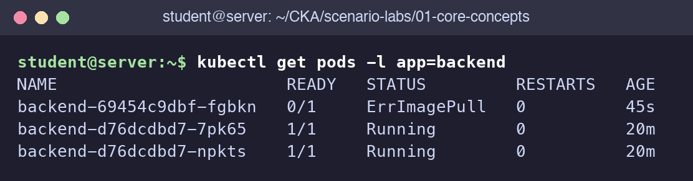

# Lab 1.8: Releases and rollbacks: a bad version of the backend

**The situation:** New versions of the Shop have to go out without closing it, and a bad version must be undone quickly.

**Goal:** release a new version of the frontend without closing the Shop. Then release a **bad** backend version, see that the Shop stays open, and roll it back.

**Outline topic:** 1. Core concepts: *Application lifecycle management* (rolling updates and rollbacks).

**What you learn:** rolling updates, `kubectl rollout status`, `history` and `undo`.

📘 **More detail:** [Lab 1.8 explained](./lab-1.8-releases-and-rollbacks-explained.md): what happens in the cluster at each step, common mistakes and exam notes.

A Deployment replaces its pods **one by one**: it starts a new pod, waits until it is ready, and only then stops an old one. That is a **rolling update**. Users notice nothing.

> **How to use this lab**
>
> - **📋 Copy and paste into your terminal:** copy the whole grey box (the copy button is in its top right corner), paste it into the terminal of your server, and press Enter.
> - **👀 You should see** *(do not paste)*: what the command prints. Names that end in random letters, IP addresses and ages are different on your server. That is normal.
> - **📖 Read only:** something to look at. Do not paste it.
> - **💡 Tip:** a shortcut or an extra. You do not need it to finish the lab.

## Before you start

Go to the folder of this module, and make `dev` your working namespace:

**📋 Copy and paste into your terminal:**

```bash
cd ~/CKA/scenario-labs/01-core-concepts
kubectl config set-context --current --namespace=dev
```

**What this does:**

- `cd ~/CKA/scenario-labs/01-core-concepts`: Goes to the folder `~/CKA/scenario-labs/01-core-concepts`.
- `kubectl config set-context --current --namespace=dev`: Makes `dev` your working namespace: commands without `-n` now work in `dev`.

**👀 You should see** *(do not paste)*:

```text
Context "minikube" modified.
```

💡 **Tip:** `kubens dev` does the same as the second line (see the shortcuts in [setup, Step 5](../00-setup.md)).

## Part A: a good release

### Step 1: look at the history

**📋 Copy and paste into your terminal:**

```bash
kubectl rollout history deployment/frontend
```

**What this does:** Shows the list of versions (revisions) of the Deployment `frontend`.

**👀 You should see** a list of revisions. Every change to the pods made one (your number of revisions can differ) *(do not paste)*:

```text
deployment.apps/frontend
REVISION  CHANGE-CAUSE
1         <none>
2         <none>
```

### Step 2: release a new nginx version

**📋 Copy and paste into your terminal:**

```bash
kubectl set image deployment/frontend frontend=nginx:1.28-alpine
kubectl annotate deployment/frontend kubernetes.io/change-cause="nginx 1.28"
kubectl rollout status deployment/frontend
sleep 15
```

**What this does:**

- `kubectl set image deployment/frontend ...`: Changes the image of the container `frontend` in the Deployment `frontend` to `nginx:1.28-alpine`. This starts a rolling update.
- `kubectl annotate deployment/frontend kubernetes.io/change-cause="nginx ...`: Writes the note "nginx 1.28" on the Deployment. It shows up in the rollout history.
- `kubectl rollout status deployment/frontend`: Waits until the new pods of the Deployment `frontend` are all ready, and says when it is done.
- `sleep 15`: Waits 15 seconds, until the old pods are gone everywhere. Right after an update, a request can still be sent to a pod that is stopping, and then it hangs.

**👀 You should see** (the last line) *(do not paste)*:

```text
deployment "frontend" successfully rolled out
```

`frontend=nginx:1.28-alpine` means: in the container named `frontend`, use this image. The `annotate` line writes a note in the history.

### Step 3: check

**📋 Copy and paste into your terminal:**

```bash
kubectl get deployment frontend -o wide
curl -s http://$(minikube ip):30080 | grep "<h1>"
```

**What this does:**

- `kubectl get deployment frontend -o wide`: Lists the Deployment `frontend`, with extra columns such as the IP address and the node.
- `curl -s http://$(minikube ip):30080 | grep "<h1>"`: Opens the Shop page, as a web browser would. `| grep` keeps only the title line (`<h1>`).

**👀 You should see** the new image, and the Shop still answers *(do not paste)*:

```text
NAME       READY   UP-TO-DATE   AVAILABLE   AGE   CONTAINERS   IMAGES              SELECTOR
frontend   2/2     2            2           30m   frontend     nginx:1.28-alpine   app=frontend
  <h1>Shop</h1>
```

## Part B: a bad release

### Step 4: release a backend version that does not exist

Someone types the wrong version: `v99`.

**📋 Copy and paste into your terminal:**

```bash
kubectl set image deployment/backend backend=postgrest/postgrest:v99
kubectl annotate deployment/backend kubernetes.io/change-cause="backend v99"
kubectl rollout status deployment/backend --timeout=40s
```

**What this does:**

- `kubectl set image deployment/backend ...`: Changes the image of the container `backend` in the Deployment `backend` to `postgrest/postgrest:v99`. This starts a rolling update.
- `kubectl annotate deployment/backend kubernetes.io/change-cause="backend ...`: Writes the note "backend v99" on the Deployment. It shows up in the rollout history.
- `kubectl rollout status deployment/backend --timeout=40s`: Waits until the new pods of the Deployment `backend` are all ready, and says when it is done.

**👀 You should see** that it does not finish *(do not paste)*:

```text
deployment.apps/backend image updated
deployment.apps/backend annotated
Waiting for deployment "backend" rollout to finish: 1 out of 2 new replicas have been updated...
error: timed out waiting for the condition
```

### Step 5: look at the pods

**📋 Copy and paste into your terminal:**

```bash
kubectl get pods -l app=backend
```

**What this does:** Lists the pods with the label `app=backend`.

**👀 You should see** the old pods still `Running`, and one new pod that cannot start *(do not paste)*:

```text
NAME                       READY   STATUS         RESTARTS   AGE
backend-69454c9dbf-fgbkn   0/1     ErrImagePull   0          45s
backend-d76dcdbd7-7pk65    1/1     Running        0          20m
backend-d76dcdbd7-npkts    1/1     Running        0          20m
```



`ImagePullBackOff` (or `ErrImagePull`) means: Kubernetes cannot fetch the image.

### Step 6: find the reason

**📋 Copy and paste into your terminal:**

```bash
kubectl get events --field-selector reason=Failed | tail -2
```

**What this does:** Lists the events (what Kubernetes did, step by step), only those with the reason `Failed`. `| tail` shows only the last 2 lines.

**👀 You should see** (long lines that say) that the image `v99` could not be pulled *(do not paste)*:

```text
... Warning   Failed   pod/backend-69454c9dbf-fgbkn   Failed to pull image "postgrest/postgrest:v99": ... not found
... Warning   Failed   pod/backend-69454c9dbf-fgbkn   Error: ErrImagePull
```

### Step 7: is the Shop still open?

**📋 Copy and paste into your terminal:**

```bash
curl -s http://$(minikube ip):30080/api/items; echo
```

**What this does:** Asks the Shop for its items, as a web browser would.

**👀 You should see** *(do not paste)*:

```text
[{"id":1,"name":"Coffee","price":35},
 {"id":2,"name":"Tea","price":25},
 {"id":3,"name":"Muffin","price":30}]
```

**Yes.** The rolling update never stopped the old pods, because the new one never became ready. The readiness probe from Lab 1.7 protects your users.

### Step 8: roll back

**📋 Copy and paste into your terminal:**

```bash
kubectl rollout history deployment/backend
```

**What this does:** Shows the list of versions (revisions) of the Deployment `backend`.

**👀 You should see** the bad release as the last revision *(do not paste)*:

```text
deployment.apps/backend
REVISION  CHANGE-CAUSE
1         <none>
2         <none>
3         <none>
4         <none>
5         backend v99
```

**📋 Copy and paste into your terminal:**

```bash
kubectl rollout undo deployment/backend
kubectl rollout status deployment/backend
kubectl get pods -l app=backend
```

**What this does:**

- `kubectl rollout undo deployment/backend`: Goes back to the version of the Deployment `backend` before the last change.
- `kubectl rollout status deployment/backend`: Waits until the new pods of the Deployment `backend` are all ready, and says when it is done.
- `kubectl get pods -l app=backend`: Lists the pods with the label `app=backend`.

**👀 You should see** only healthy pods again. (kubectl also prints a `Warning` line about `kubectl apply`. You can ignore it here.)

```text
deployment.apps/backend rolled back
deployment "backend" successfully rolled out
NAME                      READY   STATUS    RESTARTS   AGE
backend-d76dcdbd7-7pk65   1/1     Running   0          20m
backend-d76dcdbd7-npkts   1/1     Running   0          20m
```

`rollout undo` goes back one revision. To go to a chosen one: `kubectl rollout undo deployment/backend --to-revision=2`.

💡 **Exam tip:** the four commands: `kubectl rollout status`, `kubectl rollout history`, `kubectl rollout undo`, `kubectl rollout restart`. They work for Deployments, DaemonSets and StatefulSets.

✅ **Check:** all backend pods are `1/1 Running`, and the `curl` command from Step 7 gives the items.

**Next:** [Lab 1.9: The Shop in UAT and PROD](./lab-1.9-uat-and-prod.md)
