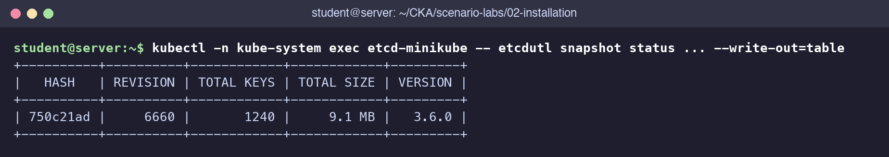
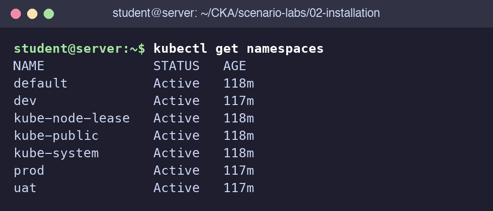

# Lab 2.5: Cluster maintenance: back up etcd, lose PROD, get it back

**The situation:** PROD now holds the Shop. One wrong command can delete it. You need a backup of the cluster, and you need to know that a restore works.

**Goal:** make a backup of the cluster's database (etcd), delete the whole PROD namespace by accident, and bring it back from the backup.

**Outline topic:** 2. Installation, Configuration & Validation: *Cluster maintenance*.

**What you learn:** what etcd is, `etcdctl snapshot save`, `etcdutl snapshot restore`, where etcd keeps its data.

📘 **More detail:** [Lab 2.5 explained](./lab-2.5-cluster-maintenance-etcd-backup-explained.md): what happens in the cluster at each step, common mistakes and exam notes.

**etcd** is the database of Kubernetes. Every Deployment, Service, Secret and ConfigMap you made is stored in it. If etcd is lost, the cluster forgets everything. So you back it up.

⚠️ A restore puts the **whole cluster** back to the moment of the backup: all namespaces, not only `prod`. Do the steps in order, and do not skip the checks. The restore restarts the cluster, so the Shop is closed for about three minutes.

> **How to use this lab**
>
> - **📋 Copy and paste into your terminal:** copy the whole grey box (the copy button is in its top right corner), paste it into the terminal of your server, and press Enter.
> - **👀 You should see** *(do not paste)*: what the command prints. Names that end in random letters, IP addresses and ages are different on your server. That is normal.
> - **📖 Read only:** something to look at. Do not paste it.
> - **💡 Tip:** a shortcut or an extra. You do not need it to finish the lab.

## Before you start

Go to the folder of this module, and make `dev` your working namespace:

**📋 Copy and paste into your terminal:**

```bash
cd ~/CKA/scenario-labs/02-installation
kubectl config set-context --current --namespace=dev
```

**What this does:**

- `cd ~/CKA/scenario-labs/02-installation`: Goes to the folder `~/CKA/scenario-labs/02-installation`.
- `kubectl config set-context --current --namespace=dev`: Makes `dev` your working namespace: commands without `-n` now work in `dev`.

**👀 You should see** *(do not paste)*:

```text
Context "minikube" modified.
```

💡 **Tip:** `kubens dev` does the same as the second line (see the shortcuts in [setup, Step 5](../00-setup.md)).

## Part A: the backup

### Step 1: make the snapshot

etcd runs as a pod on the control plane node. The tool `etcdctl` is inside that pod. It needs three certificate files to log in to etcd.

**📋 Copy and paste into your terminal:**

```bash
kubectl -n kube-system exec etcd-minikube -- etcdctl --endpoints=https://127.0.0.1:2379 \
  --cacert=/var/lib/minikube/certs/etcd/ca.crt \
  --cert=/var/lib/minikube/certs/etcd/server.crt \
  --key=/var/lib/minikube/certs/etcd/server.key \
  snapshot save /var/lib/minikube/etcd/shop-backup.db
```

**What this does:** Asks etcd, inside its pod, to save a backup (a snapshot) of the whole cluster database to the file `/var/lib/minikube/etcd/shop-backup.db` on the control plane node. The `--cacert`, `--cert` and `--key` options are the certificates etcd needs to let you in.

**👀 You should see** (the last lines) *(do not paste)*:

```text
Snapshot saved at /var/lib/minikube/etcd/shop-backup.db
Server version 3.6.0
```

| Option | Meaning |
| --- | --- |
| `--endpoints` | Where etcd listens |
| `--cacert`, `--cert`, `--key` | The certificates to log in |
| `snapshot save <file>` | Write everything to this file |

### Step 2: check the snapshot

**📋 Copy and paste into your terminal:**

```bash
kubectl -n kube-system exec etcd-minikube -- etcdutl snapshot status /var/lib/minikube/etcd/shop-backup.db --write-out=table
```

**What this does:** Checks the backup file `/var/lib/minikube/etcd/shop-backup.db` and shows its size and number of keys in a table.

**👀 You should see** a small table (your numbers differ) *(do not paste)*:

```text
+----------+----------+------------+------------+---------+
|   HASH   | REVISION | TOTAL KEYS | TOTAL SIZE | VERSION |
+----------+----------+------------+------------+---------+
| 750c21ad |     6660 |       1240 |     9.1 MB |   3.6.0 |
+----------+----------+------------+------------+---------+
```



The backup is a file on the control plane node. In real life you copy it to a safe place, away from the cluster.

## Part B: the accident

### Step 3: note what PROD looks like now

**📋 Copy and paste into your terminal:**

```bash
kubectl get deployments,services,configmaps,secrets -n prod
```

**What this does:** Lists the Deployments, Services, ConfigMaps and Secrets in the namespace `prod`.

**👀 You should see** 3 Deployments (`db`, `backend`, `frontend`), 3 Services, 4 ConfigMaps and the Secret `db-secret`.

Remember the list. In a minute it is gone.

### Step 4: delete PROD

Someone runs the wrong command:

**📋 Copy and paste into your terminal:**

```bash
kubectl delete namespace prod
```

**What this does:** Deletes the namespace `prod` and everything in it.

**👀 You should see** (it takes up to a minute) *(do not paste)*:

```text
namespace "prod" deleted
```

**📋 Copy and paste into your terminal:**

```bash
kubectl get all -n prod
```

**What this does:** Lists everything: pods, Services, Deployments and ReplicaSets in the namespace `prod`.

**👀 You should see** *(do not paste)*:

```text
No resources found in prod namespace.
```

PROD is gone: the Deployments, the Services, the ConfigMaps, the Secret. Everything.

## Part C: the restore

A restore has three moves: build a new data folder from the snapshot, put it in the place of the live data, and restart the cluster so that every part reads the restored data.

### Step 5: build a new data folder from the snapshot

**📋 Copy and paste into your terminal:**

```bash
kubectl -n kube-system exec etcd-minikube -- etcdutl snapshot restore /var/lib/minikube/etcd/shop-backup.db --data-dir /var/lib/minikube/etcd/restore
```

**What this does:** Builds a new etcd data folder `/var/lib/minikube/etcd/restore` from the backup `/var/lib/minikube/etcd/shop-backup.db`. The running cluster is not changed yet.

**👀 You should see** some log lines. The last one starts like this *(do not paste)*:

```text
... info	snapshot/v3_snapshot.go:333	restored snapshot	{"path": "/var/lib/minikube/etcd/shop-backup.db", ...
```

Nothing has changed in the cluster yet. There is only a new folder, `restore`, next to the live data.

### Step 6: put the restored data in the place of the live data

etcd keeps its data in the folder `member` on the control plane node. Put the live data aside, and move the restored data in:

**📋 Copy and paste into your terminal:**

```bash
minikube ssh -- "sudo mv /var/lib/minikube/etcd/member /var/lib/minikube/etcd/member-old && sudo mv /var/lib/minikube/etcd/restore/member /var/lib/minikube/etcd/member && sudo ls /var/lib/minikube/etcd"
```

**What this does:** On the control plane node: renames the live etcd data folder `member` to `member-old`, moves the restored `member` folder into its place, and lists the folder.

**👀 You should see** *(do not paste)*:

```text
member	member-old  restore  shop-backup.db
```

| Folder | What it is now |
| --- | --- |
| `member` | The **restored** data: the cluster as it was at the backup |
| `member-old` | The data from before the restore, kept in case you need it |

### Step 7: restart the cluster

Every part of the cluster remembers the state it saw last. Restart the cluster, so that every part starts from the restored data:

**📋 Copy and paste into your terminal:**

```bash
minikube stop
minikube start
```

**What this does:**

- `minikube stop`: Stops the cluster (all its nodes). Nothing in it is lost.
- `minikube start`: Starts the cluster (all its nodes).

**👀 You should see** (the last line of each, after about three minutes in total) *(do not paste)*:

```text
* 3 nodes stopped.
* Done! kubectl is now configured to use "minikube" cluster and "default" namespace by default
```

Wait one minute, then check the nodes:

**📋 Copy and paste into your terminal:**

```bash
sleep 60
kubectl get nodes
```

**What this does:**

- `sleep 60`: Waits 60 seconds, to give Kubernetes time.
- `kubectl get nodes`: Lists the nodes.

**👀 You should see** three `Ready` nodes. If a node says `NotReady`, wait 30 seconds and look again.

### Step 8: PROD is back

**📋 Copy and paste into your terminal:**

```bash
kubectl get namespaces
kubectl get deployments,services -n prod
```

**What this does:**

- `kubectl get namespaces`: Lists the namespaces.
- `kubectl get deployments,services -n prod`: Lists the Deployments and the Services in the namespace `prod`.

**👀 You should see** `prod` in the list again, with its three Deployments and three Services *(do not paste)*:

```text
NAME              STATUS   AGE
default           Active   118m
dev               Active   117m
kube-node-lease   Active   118m
kube-public       Active   118m
kube-system       Active   118m
prod              Active   117m
uat               Active   117m
NAME                       READY   UP-TO-DATE   AVAILABLE   AGE
deployment.apps/backend    2/2     2            2           83m
deployment.apps/db         1/1     1            1           83m
deployment.apps/frontend   2/2     2            2           83m

NAME               TYPE        CLUSTER-IP       EXTERNAL-IP   PORT(S)    AGE
service/backend    ClusterIP   10.103.38.14     <none>        3000/TCP   83m
service/db         ClusterIP   10.100.171.119   <none>        5432/TCP   83m
service/frontend   ClusterIP   10.99.72.103     <none>        80/TCP     83m
```



Wait until the pods run, then test the Shop:

**📋 Copy and paste into your terminal:**

```bash
kubectl rollout status deployment/db -n prod
kubectl rollout status deployment/backend -n prod
kubectl rollout status deployment/frontend -n prod
kubectl exec -n prod deployment/frontend -- curl -s http://localhost/api/items; echo
```

**What this does:**

- `kubectl rollout status deployment/db -n prod`: Waits until the new pods of the Deployment `db` in the namespace `prod` are all ready, and says when it is done.
- `kubectl rollout status deployment/backend -n prod`: Waits until the new pods of the Deployment `backend` in the namespace `prod` are all ready, and says when it is done.
- `kubectl rollout status deployment/frontend -n prod`: Waits until the new pods of the Deployment `frontend` in the namespace `prod` are all ready, and says when it is done.
- `kubectl exec -n prod ...`: From inside a PROD frontend pod, asks for the items. The request goes frontend → backend → database, so an answer means the whole restored PROD Shop works.

**👀 You should see** *(do not paste)*:

```text
deployment "db" successfully rolled out
deployment "backend" successfully rolled out
deployment "frontend" successfully rolled out
[{"id":1,"name":"Coffee","price":35},
 {"id":2,"name":"Tea","price":25},
 {"id":3,"name":"Muffin","price":30}]
```

🎉 PROD is back, with everything: the Deployments, the Services, the ConfigMaps and the Secret.

One thing to understand: etcd holds the **Kubernetes objects**. It does **not** hold the data **inside** your database. The PROD database pod is a new pod, and it started with the first three items again. The data of an application needs its own storage and its own backup. That is the Storage module.

💡 **Exam tip:** the exam asks for the same two commands: `etcdctl snapshot save` and `etcdutl snapshot restore`. Know the four options of the save command by heart: `--endpoints`, `--cacert`, `--cert`, `--key`. You find the certificate paths in the etcd file: `minikube ssh -- 'sudo grep -E "cert|key|trusted" /etc/kubernetes/manifests/etcd.yaml'` (the single quotes send the whole command, with its `|`, to the node).

✅ **Check:** the last command of Step 8 gives the items.

🧹 **Clean up** the folders you no longer need:

**📋 Copy and paste into your terminal:**

```bash
minikube ssh -- "sudo rm -rf /var/lib/minikube/etcd/member-old /var/lib/minikube/etcd/restore"
```

**What this does:** On the control plane node: deletes the old data folder and the empty restore folder.

**👀 You should see** no output. That means it worked.

**Next:** [Lab 2.6: Upgrade to a new version](./lab-2.6-upgrade.md)
