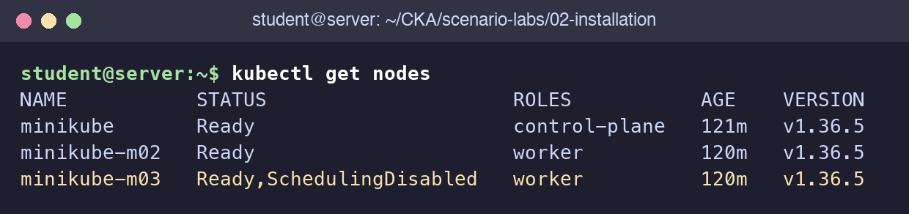
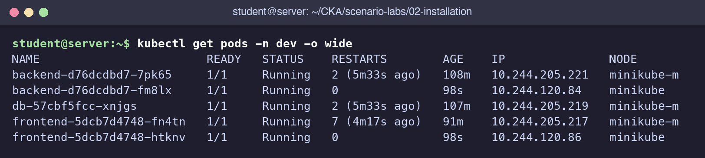

# Lab 2.7: Cordoning and draining nodes: empty a node while the Shop stays open

**The situation:** the node `minikube-m03` needs maintenance, and the Shop must stay open.

**Goal:** Move its pods away safely, check that the Shop stays open, and bring the node back.

**Outline topic:** 2. Installation, Configuration & Validation: *Cordoning and draining nodes*.

**What you learn:** `cordon`, `drain`, `uncordon`.

📘 **More detail:** [Lab 2.7 explained](./lab-2.7-cordon-and-drain-explained.md): what happens in the cluster at each step, common mistakes and exam notes.

| Command | What it does |
| --- | --- |
| `kubectl cordon <node>` | No **new** pods on this node. The pods that are there stay. |
| `kubectl drain <node>` | Cordon, **and** move the pods away |
| `kubectl uncordon <node>` | The node takes pods again |

Draining is the first and the last step of the upgrade of every node (Lab 2.6).

> **How to use this lab**
>
> - **📋 Copy and paste into your terminal:** copy the whole grey box (the copy button is in its top right corner), paste it into the terminal of your server, and press Enter.
> - **👀 You should see** *(do not paste)*: what the command prints. Names that end in random letters, IP addresses and ages are different on your server. That is normal.
> - **📖 Read only:** something to look at. Do not paste it.
> - **💡 Tip:** a shortcut or an extra. You do not need it to finish the lab.

## Before you start

Go to the folder of this module, and make `dev` your working namespace:

**📋 Copy and paste into your terminal:**

```bash
cd ~/CKA/scenario-labs/02-installation
kubectl config set-context --current --namespace=dev
```

**What this does:**

- `cd ~/CKA/scenario-labs/02-installation`: Goes to the folder `~/CKA/scenario-labs/02-installation`.
- `kubectl config set-context --current --namespace=dev`: Makes `dev` your working namespace: commands without `-n` now work in `dev`.

**👀 You should see** *(do not paste)*:

```text
Context "minikube" modified.
```

💡 **Tip:** `kubens dev` does the same as the second line (see the shortcuts in [setup, Step 5](../00-setup.md)).

## Step 1: see which pods are on the node

**📋 Copy and paste into your terminal:**

```bash
kubectl get pods -A -o wide --field-selector spec.nodeName=minikube-m03
```

**What this does:** Lists the pods in all namespaces, only those on the node `minikube-m03`, with extra columns such as the IP address and the node.

**👀 You should see** the pods on `minikube-m03`: some of the Shop (from `dev`, `uat` and `prod`) and some system pods. Something like *(do not paste)*:

```text
NAMESPACE     NAME                        READY   STATUS    RESTARTS   AGE    IP              NODE           NOMINATED NODE   READINESS GATES
dev           backend-d76dcdbd7-npkts     1/1     Running   0          106m   10.244.151.28   minikube-m03   <none>           <none>
dev           frontend-5dcb7d4748-98kpp   1/1     Running   0          89m    10.244.151.27   minikube-m03   <none>           <none>
kube-system   calico-node-xjdj4           1/1     Running   0          120m   192.168.49.4    minikube-m03   <none>           <none>
kube-system   kube-proxy-6ss6t            1/1     Running   0          120m   192.168.49.4    minikube-m03   <none>           <none>
prod          db-69955bdc5f-ckgcs         1/1     Running   0          14m    10.244.151.29   minikube-m03   <none>           <none>
prod          frontend-5bcf598847-7mwgn   1/1     Running   0          14m    10.244.151.26   minikube-m03   <none>           <none>
uat           backend-5bdb6c7b78-t4fxw    1/1     Running   0          85m    10.244.151.30   minikube-m03   <none>           <none>
uat           db-57cbf5fcc-7vs77          1/1     Running   0          85m    10.244.151.31   minikube-m03   <none>           <none>
uat           frontend-6f7c8c9d4f-8s58d   1/1     Running   0          85m    10.244.151.25   minikube-m03   <none>           <none>
```

## Step 2: cordon the node

**📋 Copy and paste into your terminal:**

```bash
kubectl cordon minikube-m03
kubectl get nodes
```

**What this does:**

- `kubectl cordon minikube-m03`: Marks the node `minikube-m03` so that no new pods are put on it.
- `kubectl get nodes`: Lists the nodes.

**👀 You should see** *(do not paste)*:

```text
node/minikube-m03 cordoned
NAME           STATUS                     ROLES           AGE   VERSION
minikube       Ready                      control-plane   3h    v1.36.5
minikube-m02   Ready                      worker          3h    v1.36.5
minikube-m03   Ready,SchedulingDisabled   worker          3h    v1.36.5
```



`SchedulingDisabled`: the scheduler puts nothing new here. The pods on it still run.

## Step 3: drain the node

**📋 Copy and paste into your terminal:**

```bash
kubectl drain minikube-m03 --ignore-daemonsets --delete-emptydir-data
```

**What this does:** Empties the node `minikube-m03`: marks it as closed and moves its pods to other nodes.

**👀 You should see** a `Warning` that the DaemonSet pods stay (that is what `--ignore-daemonsets` asks for), the pods being moved away, and at the end *(do not paste)*:

```text
node/minikube-m03 already cordoned
Warning: ignoring DaemonSet-managed Pods: kube-system/calico-node-jnmmz, kube-system/kube-proxy-tzm95
evicting pod dev/frontend-5dcb7d4748-s6rxg
...
pod/frontend-6f7c8c9d4f-8s58d evicted
pod/frontend-5bcf598847-7mwgn evicted
pod/backend-5bdb6c7b78-t4fxw evicted
pod/db-57cbf5fcc-7vs77 evicted
pod/db-69955bdc5f-ckgcs evicted
pod/backend-d76dcdbd7-npkts evicted
node/minikube-m03 drained
```

| Option | Why |
| --- | --- |
| `--ignore-daemonsets` | DaemonSet pods (the network) belong to the node. They stay. |
| `--delete-emptydir-data` | Pods with a temporary folder (`emptyDir`) lose that folder when they move. This option says: I know, go on. |

Remember Lab 1.6: the database uses an `emptyDir`. If a database pod was on this node, it starts again somewhere else, **empty**, with only its first three items. That is the second time you see this weak point. The Storage module fixes it.

## Step 4: where are the pods now, and is the Shop open?

**📋 Copy and paste into your terminal:**

```bash
sleep 30
kubectl get pods -n dev -o wide
curl -s http://$(minikube ip):30080/api/items; echo
```

**What this does:**

- `sleep 30`: Waits 30 seconds, to give Kubernetes time.
- `kubectl get pods -n dev -o wide`: Lists the pods in the namespace `dev`, with extra columns such as the IP address and the node.
- `curl -s http://$(minikube ip):30080/api/items; echo`: Asks the Shop for its items, as a web browser would.

**👀 You should see** no DEV pod on `minikube-m03`, and the Shop still answers *(do not paste)*:

```text
NAME                        READY   STATUS    RESTARTS   AGE    IP               NODE           NOMINATED NODE   READINESS GATES
backend-d76dcdbd7-7pk65     1/1     Running   0          108m   10.244.205.221   minikube-m02   <none>           <none>
backend-d76dcdbd7-fm8lx     1/1     Running   0          98s    10.244.120.84    minikube       <none>           <none>
db-57cbf5fcc-xnjgs          1/1     Running   0          107m   10.244.205.219   minikube-m02   <none>           <none>
frontend-5dcb7d4748-fn4tn   1/1     Running   0          91m    10.244.205.217   minikube-m02   <none>           <none>
frontend-5dcb7d4748-htknv   1/1     Running   0          98s    10.244.120.86    minikube       <none>           <none>
[{"id":1,"name":"Coffee","price":35},
 {"id":2,"name":"Tea","price":25},
 {"id":3,"name":"Muffin","price":30}]
```



The Deployments made new pods on the other nodes. With 2 copies of the frontend and the backend, there was always one copy to answer.

If the `curl` gives an error, the DEV database was on the drained node and is starting again. Wait 20 seconds and try once more.

## Step 5: the maintenance is done: bring the node back

**📋 Copy and paste into your terminal:**

```bash
kubectl uncordon minikube-m03
kubectl get nodes
```

**What this does:**

- `kubectl uncordon minikube-m03`: Makes the node `minikube-m03` take new pods again.
- `kubectl get nodes`: Lists the nodes.

**👀 You should see** all three nodes `Ready`, without `SchedulingDisabled` *(do not paste)*:

```text
node/minikube-m03 uncordoned
NAME           STATUS   ROLES           AGE   VERSION
minikube       Ready    control-plane   3h    v1.36.5
minikube-m02   Ready    worker          3h    v1.36.5
minikube-m03   Ready    worker          3h    v1.36.5
```

## Step 6: spread the pods again

Pods do not move back by themselves. The node stays empty until something new is scheduled. Restart the Deployments, and the new pods are spread over all nodes again:

**📋 Copy and paste into your terminal:**

```bash
kubectl rollout restart deployment/frontend deployment/backend -n dev
kubectl rollout restart deployment/frontend deployment/backend -n uat
kubectl rollout restart deployment/frontend deployment/backend -n prod
kubectl rollout status deployment/backend -n prod
kubectl get pods -A -o wide --field-selector spec.nodeName=minikube-m03 | grep -E "dev|uat|prod"
```

**What this does:**

- `kubectl rollout restart deployment/frontend ...`: Replaces the pods of the Deployments `frontend` and `backend` in the namespace `dev` with new ones, one by one.
- `kubectl rollout restart deployment/frontend ...`: Replaces the pods of the Deployments `frontend` and `backend` in the namespace `uat` with new ones, one by one.
- `kubectl rollout restart deployment/frontend ...`: Replaces the pods of the Deployments `frontend` and `backend` in the namespace `prod` with new ones, one by one.
- `kubectl rollout status deployment/backend -n prod`: Waits until the new pods of the Deployment `backend` in the namespace `prod` are all ready, and says when it is done.
- `kubectl get pods -A ...`: Lists the pods in all namespaces, only those on the node `minikube-m03`, with extra columns such as the IP address and the node. `| grep` keeps only the lines with `dev` or `uat` or `prod`.

**👀 You should see** Shop pods on `minikube-m03` again *(do not paste)*:

```text
dev           backend-69bc6f67c6-j8cbc    1/1     Running   0     91s   10.244.151.32   minikube-m03   <none>   <none>
dev           frontend-57d8c789cd-9gclq   1/1     Running   0     91s   10.244.151.34   minikube-m03   <none>   <none>
prod          backend-69bc6f67c6-ckb84    1/1     Running   0     91s   10.244.151.35   minikube-m03   <none>   <none>
prod          frontend-69bb75c875-xxfjq   1/1     Running   0     91s   10.244.151.37   minikube-m03   <none>   <none>
uat           backend-69bc6f67c6-scsc8    1/1     Running   0     91s   10.244.151.33   minikube-m03   <none>   <none>
uat           frontend-69bb75c875-sj2ck   1/1     Running   0     91s   10.244.151.36   minikube-m03   <none>   <none>
```

💡 **Exam tip:** if `kubectl drain` stops with an error about pods "not managed by a controller" (standalone pods, Lab 2.3), add `--force`. Those pods are deleted and do **not** come back, so look before you do it.

✅ **Check:** `kubectl get nodes` shows three `Ready` nodes and nothing says `SchedulingDisabled`.

**Next:** [Lab 3.1: The network model](../03-networking/lab-3.1-network-model.md)
