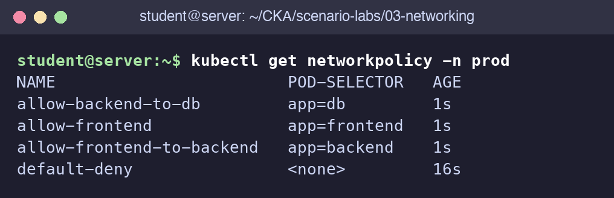

# Lab 3.1: The container network model: who can talk to whom

**The situation:** Any pod in the cluster can call any other pod, also across environments. A test pod in `dev` can read the PROD database.

**Goal:** see how pods are connected in Kubernetes, and then lock down PROD so that only the traffic the Shop needs is allowed.

**Outline topic:** 3. Networking: *Containers network model in Kubernetes*.

**What you learn:** pod IP addresses, the network plugin (CNI), pod-to-pod traffic across nodes, NetworkPolicy.

📘 **More detail:** [Lab 3.1 explained](./lab-3.1-network-model-explained.md): what happens in the cluster at each step, common mistakes and exam notes.

> **How to use this lab**
>
> - **📋 Copy and paste into your terminal:** copy the whole grey box (the copy button is in its top right corner), paste it into the terminal of your server, and press Enter.
> - **👀 You should see** *(do not paste)*: what the command prints. Names that end in random letters, IP addresses and ages are different on your server. That is normal.
> - **📖 Read only:** something to look at. Do not paste it.
> - **💡 Tip:** a shortcut or an extra. You do not need it to finish the lab.

## The network model in four rules

1. Every pod gets its **own IP address**.
2. Every pod can reach **every other pod**, on any node, without address translation.
3. A **network plugin** (CNI) makes that work. Your cluster uses **Calico**.
4. Because rule 2 is very open, **NetworkPolicies** are the firewall rules for pods.

## Before you start

Go to the folder of this module, and make `dev` your working namespace:

**📋 Copy and paste into your terminal:**

```bash
cd ~/CKA/scenario-labs/03-networking
kubectl config set-context --current --namespace=dev
```

**What this does:**

- `cd ~/CKA/scenario-labs/03-networking`: Goes to the folder `~/CKA/scenario-labs/03-networking`.
- `kubectl config set-context --current --namespace=dev`: Makes `dev` your working namespace: commands without `-n` now work in `dev`.

**👀 You should see** *(do not paste)*:

```text
Context "minikube" modified.
```

💡 **Tip:** `kubens dev` does the same as the second line (see the shortcuts in [setup, Step 5](../00-setup.md)).

## Part A: see the network

### Step 1: every pod has its own address

**📋 Copy and paste into your terminal:**

```bash
kubectl get pods -n prod -o wide
```

**What this does:** Lists the pods in the namespace `prod`, with extra columns such as the IP address and the node.

**👀 You should see** a different `IP` for every pod, and the pods spread over the nodes *(do not paste)*:

```text
NAME                        READY   STATUS    RESTARTS   AGE   IP               NODE           NOMINATED NODE   READINESS GATES
backend-c5d9479f-vkqfh      1/1     Running   0          2h    10.244.205.210   minikube-m02   <none>           <none>
backend-c5d9479f-vs47x      1/1     Running   0          2h    10.244.151.20    minikube-m03   <none>           <none>
db-747c44dc87-rg87j         1/1     Running   0          2h    10.244.205.212   minikube-m02   <none>           <none>
frontend-5f69b684d8-d8wqg   1/1     Running   0          2h    10.244.151.21    minikube-m03   <none>           <none>
frontend-5f69b684d8-g5n6w   1/1     Running   0          2h    10.244.205.211   minikube-m02   <none>           <none>
```

Look at the addresses: pods on the same node share the start of the address (`10.244.205.x` on one node, `10.244.151.x` on another). Each node has its own block of addresses.

### Step 2: see the network plugin

**📋 Copy and paste into your terminal:**

```bash
kubectl get pods -n kube-system -l k8s-app=calico-node -o wide
```

**What this does:** Lists the pods with the label `k8s-app=calico-node` in the namespace `kube-system`, with extra columns such as the IP address and the node.

**👀 You should see** one Calico pod on every node *(do not paste)*:

```text
NAME                READY   STATUS    RESTARTS   AGE   IP             NODE           NOMINATED NODE   READINESS GATES
calico-node-8klt2   1/1     Running   0          3h    192.168.49.3   minikube-m02   <none>           <none>
calico-node-96zs2   1/1     Running   0          3h    192.168.49.2   minikube       <none>           <none>
calico-node-tbs7q   1/1     Running   0          3h    192.168.49.4   minikube-m03   <none>           <none>
```

These pods connect the pods of their node with the pods on the other nodes.

### Step 3: a pod reaches a pod on another node, by IP

Take the IP of a backend pod and call it from a frontend pod:

**📋 Copy and paste into your terminal:**

```bash
BACKEND_IP=$(kubectl get pods -n prod -l app=backend -o jsonpath='{.items[0].status.podIP}')
echo $BACKEND_IP
kubectl exec -n prod deployment/frontend -- curl -s http://$BACKEND_IP:3000/items; echo
```

**What this does:**

- `BACKEND_IP=$(kubectl get pods -n ...`: Saves the answer of the command in the variable `$BACKEND_IP`, to use in the next lines. The command: reads the pods with the label `app=backend` in the namespace `prod`, and prints only one value from it.
- `echo $BACKEND_IP`: Prints what is in the variable `$BACKEND_IP`.
- `kubectl exec -n prod ...`: From a PROD frontend pod, asks that backend pod for the items, straight at its IP address, without a Service in between.

**👀 You should see** the IP address, and then the items *(do not paste)*:

```text
10.244.151.35
[{"id":1,"name":"Coffee","price":35},
 {"id":2,"name":"Tea","price":25},
 {"id":3,"name":"Muffin","price":30}]
```

Pod to pod, directly, by IP. That is rule 2. In real life you use the Service name, because pod IPs change. But this is what happens underneath.

## Part B: the firewall for pods

Rule 2 has a dark side: **every pod can talk to every pod**, in every namespace. A pod in `dev` can call the PROD database.

The rules you build:

| From | To | Port | Allowed? |
| --- | --- | --- | --- |
| anyone | frontend | 80 | ✅ yes |
| frontend | backend | 3000 | ✅ yes |
| backend | database | 5432 | ✅ yes |
| anything else | anything in PROD | any | ❌ no |

### Step 4: see the problem

A pod in **DEV** asks the **PROD** backend for its items:

**📋 Copy and paste into your terminal:**

```bash
kubectl run test -n dev --rm -i --restart=Never --image=busybox:1.36 -- wget -q -T 5 -O- http://backend.prod:3000/items
```

**What this does:** Starts one pod called `test` in the namespace `dev` from the image `busybox:1.36`, which runs `wget -q -T 5 -O- http://backend.prod:3000/items`. `--rm` deletes the pod again when it is done.

**👀 You should see** the PROD items *(do not paste)*:

```text
[{"id":1,"name":"Coffee","price":35},
 {"id":2,"name":"Tea","price":25},
 {"id":3,"name":"Muffin","price":30}]
pod "test" deleted from dev namespace
```

DEV can read PROD. That is not what you want.

### Step 5: close everything in PROD (default deny)

**📋 Copy and paste into your terminal:**

```bash
cat netpol-default-deny.yaml
```

**What this does:** Shows what is in the file `netpol-default-deny.yaml`.

**👀 You should see** *(do not paste)*:

```yaml
apiVersion: networking.k8s.io/v1
kind: NetworkPolicy
metadata:
  name: default-deny
spec:
  podSelector: {}          # every pod in the namespace
  policyTypes:
  - Ingress                # no incoming traffic, unless another policy allows it
```

**📋 Copy and paste into your terminal:**

```bash
kubectl apply -f netpol-default-deny.yaml -n prod
kubectl get networkpolicy -n prod
```

**What this does:**

- `kubectl apply -f netpol-default-deny.yaml -n prod`: Creates (or updates) what is described in `netpol-default-deny.yaml` in the namespace `prod`.
- `kubectl get networkpolicy -n prod`: Lists the network policies in the namespace `prod`.

**👀 You should see** *(do not paste)*:

```text
networkpolicy.networking.k8s.io/default-deny created
NAME           POD-SELECTOR   AGE
default-deny   <none>         3s
```

### Step 6: see that the Shop is closed

The PROD frontend tries to call the PROD backend:

**📋 Copy and paste into your terminal:**

```bash
kubectl exec -n prod deployment/frontend -- curl -s -m 5 -o /dev/null -w "%{http_code}\n" http://backend:3000/items
```

**What this does:** Asks a PROD frontend pod to call the backend, and prints only the answer code: `200` means it answered, `000` means no answer. `-m 5` gives up after 5 seconds.

**👀 You should see** (after 5 seconds) *(do not paste)*:

```text
000
command terminated with exit code 28
```

`000` means: no answer at all. Nobody can reach any PROD pod now, not even the Shop's own frontend. PROD is safe, but closed. Now you open only what is needed.

### Step 7: open the three paths

**📋 Copy and paste into your terminal:**

```bash
cat netpol-allow-app.yaml
```

**What this does:** Shows what is in the file `netpol-allow-app.yaml`.

**👀 You should see** *(do not paste)*:

```yaml
# 1. Anyone may reach the frontend on port 80
apiVersion: networking.k8s.io/v1
kind: NetworkPolicy
metadata:
  name: allow-frontend
spec:
  podSelector:
    matchLabels:
      app: frontend
  ingress:
  - ports:
    - port: 80
---
# 2. Only the frontend may reach the backend on port 3000
apiVersion: networking.k8s.io/v1
kind: NetworkPolicy
metadata:
  name: allow-frontend-to-backend
spec:
  podSelector:
    matchLabels:
      app: backend
  ingress:
  - from:
    - podSelector:
        matchLabels:
          app: frontend
    ports:
    - port: 3000
---
# 3. Only the backend may reach the database on port 5432
apiVersion: networking.k8s.io/v1
kind: NetworkPolicy
metadata:
  name: allow-backend-to-db
spec:
  podSelector:
    matchLabels:
      app: db
  ingress:
  - from:
    - podSelector:
        matchLabels:
          app: backend
    ports:
    - port: 5432
```

How to read one policy:

| Part | Meaning |
| --- | --- |
| `podSelector` (at the top) | The pods this rule **protects** |
| `ingress: from:` | Who may come **in** |
| `ports:` | On which port |

**📋 Copy and paste into your terminal:**

```bash
kubectl apply -f netpol-allow-app.yaml -n prod
kubectl get networkpolicy -n prod
```

**What this does:**

- `kubectl apply -f netpol-allow-app.yaml -n prod`: Creates (or updates) what is described in `netpol-allow-app.yaml` in the namespace `prod`.
- `kubectl get networkpolicy -n prod`: Lists the network policies in the namespace `prod`.

**👀 You should see** *(do not paste)*:

```text
networkpolicy.networking.k8s.io/allow-frontend created
networkpolicy.networking.k8s.io/allow-frontend-to-backend created
networkpolicy.networking.k8s.io/allow-backend-to-db created
NAME                        POD-SELECTOR   AGE
allow-backend-to-db         app=db         15s
allow-frontend              app=frontend   25s
allow-frontend-to-backend   app=backend    22s
default-deny                <none>         7m38s
```



### Step 8: the Shop is open again

**📋 Copy and paste into your terminal:**

```bash
kubectl exec -n prod deployment/frontend -- curl -s -m 5 http://localhost/api/items; echo
```

**What this does:** From inside a PROD frontend pod, asks for the items through the frontend itself, so the request goes frontend → backend → database. `-m 5` gives up after 5 seconds.

**👀 You should see** *(do not paste)*:

```text
[{"id":1,"name":"Coffee","price":35},
 {"id":2,"name":"Tea","price":25},
 {"id":3,"name":"Muffin","price":30}]
```

### Step 9: DEV cannot read PROD any more

The same command as in Step 4:

**📋 Copy and paste into your terminal:**

```bash
kubectl run test -n dev --rm -i --restart=Never --image=busybox:1.36 -- wget -q -T 5 -O- http://backend.prod:3000/items
```

**What this does:** Starts one pod called `test` in the namespace `dev` from the image `busybox:1.36`, which runs `wget -q -T 5 -O- http://backend.prod:3000/items`. `--rm` deletes the pod again when it is done.

**👀 You should see** *(do not paste)*:

```text
wget: download timed out
pod "test" deleted from dev namespace
pod dev/test terminated (Error)
```

Blocked. ✅

### Step 10: only the backend reaches the database

A pod **without** the backend label tries the database port:

**📋 Copy and paste into your terminal:**

```bash
kubectl run test -n prod --rm -i --restart=Never --image=busybox:1.36 -- nc -zv -w 3 db 5432
```

**What this does:** Starts one pod called `test` in the namespace `prod` from the image `busybox:1.36`, which runs `nc -zv -w 3 db 5432`. `--rm` deletes the pod again when it is done.

**👀 You should see** *(do not paste)*:

```text
nc: db (10.100.171.119:5432): Connection timed out
pod "test" deleted from prod namespace
pod prod/test terminated (Error)
```

Now the same test from a pod **with** the label `app=backend`:

**📋 Copy and paste into your terminal:**

```bash
kubectl run test -n prod --rm -i --restart=Never --labels=app=backend --image=busybox:1.36 -- nc -zv -w 3 db 5432
```

**What this does:** Starts one pod called `test` in the namespace `prod` from the image `busybox:1.36`, which runs `nc -zv -w 3 db 5432`, with the label `app=backend`. `--rm` deletes the pod again when it is done.

**👀 You should see** *(do not paste)*:

```text
db (10.100.171.119:5432) open
pod "test" deleted from prod namespace
```

`open`: the same port, the same database, but this pod has the label that the policy allows.

The policy does not look at names. It looks at **labels**.

### Step 11: do the same for DEV and UAT

**📋 Copy and paste into your terminal:**

```bash
kubectl apply -f netpol-default-deny.yaml -f netpol-allow-app.yaml -n dev
kubectl apply -f netpol-default-deny.yaml -f netpol-allow-app.yaml -n uat
```

**What this does:**

- `kubectl apply -f netpol-default-deny.yaml ...`: Creates (or updates) what is described in `netpol-default-deny.yaml` and `netpol-allow-app.yaml` in the namespace `dev`.
- `kubectl apply -f netpol-default-deny.yaml ...`: Creates (or updates) what is described in `netpol-default-deny.yaml` and `netpol-allow-app.yaml` in the namespace `uat`.

💡 **Exam tip:** a NetworkPolicy only **allows**. There is no "deny" rule. As soon as one policy selects a pod, everything that is not allowed for that pod is blocked. And check the labels first: `kubectl get pods --show-labels`.

✅ **Check:** Step 8 gives the items, Step 9 times out.

**Next:** [Lab 3.2: Service discovery, scaling and load balancing](./lab-3.2-service-discovery-scaling-load-balancing.md)
