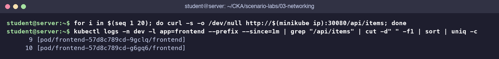
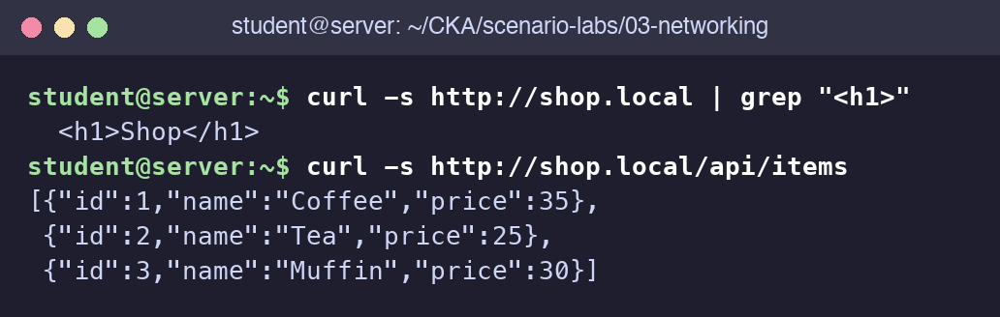

# Lab 3.2: Service discovery, scaling and load balancing

**The situation:** the Shop gets busy. One frontend pod is not enough, and real users want to type a name, not an IP address and a port.

**Goal:** see how a Service spreads the requests over its pods, add pods when it gets busy, and give PROD a real hostname: `http://shop.local`.

**Outline topic:** 3. Networking: *Service discovery, scaling and load balancing*.

**What you learn:** how a Service load-balances, scaling a Deployment, Service types, Ingress.

📘 **More detail:** [Lab 3.2 explained](./lab-3.2-service-discovery-scaling-load-balancing-explained.md): what happens in the cluster at each step, common mistakes and exam notes.

| Word | Meaning |
| --- | --- |
| **Service discovery** | A pod finds another part of the application by its Service name, not by an IP address |
| **Load balancing** | The Service spreads the requests over all the pods behind it |
| **Scaling** | More pods behind the same Service when it gets busy |

> **How to use this lab**
>
> - **📋 Copy and paste into your terminal:** copy the whole grey box (the copy button is in its top right corner), paste it into the terminal of your server, and press Enter.
> - **👀 You should see** *(do not paste)*: what the command prints. Names that end in random letters, IP addresses and ages are different on your server. That is normal.
> - **📖 Read only:** something to look at. Do not paste it.
> - **💡 Tip:** a shortcut or an extra. You do not need it to finish the lab.

## Before you start

Go to the folder of this module, and make `dev` your working namespace:

**📋 Copy and paste into your terminal:**

```bash
cd ~/CKA/scenario-labs/03-networking
kubectl config set-context --current --namespace=dev
```

**What this does:**

- `cd ~/CKA/scenario-labs/03-networking`: Goes to the folder `~/CKA/scenario-labs/03-networking`.
- `kubectl config set-context --current --namespace=dev`: Makes `dev` your working namespace: commands without `-n` now work in `dev`.

**👀 You should see** *(do not paste)*:

```text
Context "minikube" modified.
```

💡 **Tip:** `kubens dev` does the same as the second line (see the shortcuts in [setup, Step 5](../00-setup.md)).

## Part A: load balancing and scaling in DEV

### Step 1: send 20 requests and see who answered

**📋 Copy and paste into your terminal:**

```bash
for i in $(seq 1 20); do curl -s -o /dev/null http://$(minikube ip):30080/api/items; done
kubectl logs -n dev -l app=frontend --prefix --since=1m | grep "/api/items" | cut -d' ' -f1 | sort | uniq -c
```

**What this does:**

- `for i in $(seq ...`: Asks the Shop for its items 20 times in a row (a `for` loop), and throws the answers away.
- `kubectl logs -n dev ...`: Shows the log (what the program printed) of all pods with the label `app=frontend` in the namespace `dev`, only of the last 1 minute( seconds), with the pod name in front of each line. `| grep` keeps only the lines with `/api/items`; `| cut` keeps only part of each line; `| sort | uniq -c` counts how many times each line appears.

**👀 You should see** how many of the 20 requests each frontend pod answered (your numbers differ) *(do not paste)*:

```text
      9 [pod/frontend-57d8c789cd-9gclq/frontend]
     10 [pod/frontend-57d8c789cd-g6gq6/frontend]
```



You sent all 20 requests to **one address** (the Service). The Service spread them over **two pods**. That is load balancing.

### Step 2: scale up

**📋 Copy and paste into your terminal:**

```bash
kubectl scale deployment frontend -n dev --replicas=4
kubectl rollout status deployment/frontend -n dev
kubectl get endpointslices -n dev -l kubernetes.io/service-name=frontend
```

**What this does:**

- `kubectl scale deployment frontend -n dev --replicas=4`: Changes the number of pods of the Deployment `frontend` in the namespace `dev` to 4.
- `kubectl rollout status deployment/frontend -n dev`: Waits until the new pods of the Deployment `frontend` in the namespace `dev` are all ready, and says when it is done.
- `kubectl get endpointslices -n ...`: Lists the EndpointSlices (the addresses of the pods behind each Service) with the label `kubernetes.io/service-name=frontend` in the namespace `dev`.

**👀 You should see** four addresses behind the Service now *(do not paste)*:

```text
deployment.apps/frontend scaled
deployment "frontend" successfully rolled out
NAME             ADDRESSTYPE   PORTS   ENDPOINTS                                                AGE
frontend-l65q2   IPv4          80      10.244.151.34,10.244.205.225,10.244.151.41 + 1 more...   127m
```

You changed nothing in the Service. It **discovered** the new pods by their label.

### Step 3: send 20 requests again

**📋 Copy and paste into your terminal:**

```bash
sleep 60
for i in $(seq 1 20); do curl -s -o /dev/null http://$(minikube ip):30080/api/items; done
kubectl logs -n dev -l app=frontend --prefix --since=30s | grep "/api/items" | cut -d' ' -f1 | sort | uniq -c
```

**What this does:**

- `sleep 60`: Waits 60 seconds, to give Kubernetes time.
- `for i in $(seq ...`: Asks the Shop for its items 20 times in a row (a `for` loop), and throws the answers away.
- `kubectl logs -n dev ...`: Shows the log (what the program printed) of all pods with the label `app=frontend` in the namespace `dev`, only of the last 30 seconds, with the pod name in front of each line. `| grep` keeps only the lines with `/api/items`; `| cut` keeps only part of each line; `| sort | uniq -c` counts how many times each line appears.

**👀 You should see** the requests spread over four pods (your numbers differ) *(do not paste)*:

```text
      7 [pod/frontend-57d8c789cd-9gclq/frontend]
      5 [pod/frontend-57d8c789cd-g6gq6/frontend]
      6 [pod/frontend-57d8c789cd-hkkxb/frontend]
      2 [pod/frontend-57d8c789cd-s4b9z/frontend]
```

### Step 4: go back to 2

**📋 Copy and paste into your terminal:**

```bash
kubectl scale deployment frontend -n dev --replicas=2
```

**What this does:** Changes the number of pods of the Deployment `frontend` in the namespace `dev` to 2.

**👀 You should see** *(do not paste)*:

```text
deployment.apps/frontend scaled
```

### The three Service types

| Type | Reachable from | You used it |
| --- | --- | --- |
| `ClusterIP` | Inside the cluster only | `backend`, `db` |
| `NodePort` | Outside, on a port of every node (30000-32767) | `frontend` in `dev`, port 30080 |
| `LoadBalancer` | Outside, through a load balancer of a cloud provider | Not in this lab: it needs a cloud |

A node port is fine for testing. Real users need a name. That is the job of an **Ingress**.

## Part B: a hostname for PROD (Ingress)

An **Ingress** is a list of rules: "requests for this hostname go to that Service". An **Ingress controller** is the program that reads the rules and does the work.

### Step 5: switch on the Ingress controller

**📋 Copy and paste into your terminal:**

```bash
minikube addons enable ingress
```

**What this does:** Switches on the minikube add-on `ingress`.

**👀 You should see** (the last line, after about a minute) *(do not paste)*:

```text
* The 'ingress' addon is enabled
```

**📋 Copy and paste into your terminal:**

```bash
kubectl rollout status deployment/ingress-nginx-controller -n ingress-nginx
sleep 20
kubectl get pods -n ingress-nginx
kubectl get ingressclass
```

**What this does:**

- `kubectl rollout status deployment/ingress-nginx-controller -n ingress-nginx`: Waits until the Ingress controller is ready. `minikube addons enable` says "enabled" before the controller is ready.
- `sleep 20`: Waits 20 seconds more: the controller also checks every new Ingress (a webhook), and that check needs a moment longer to answer.
- `kubectl get pods -n ingress-nginx`: Lists the pods in the namespace `ingress-nginx`.
- `kubectl get ingressclass`: Lists the Ingress classes.

**👀 You should see** *(do not paste)*:

```text
deployment "ingress-nginx-controller" successfully rolled out
NAME                                        READY   STATUS      RESTARTS   AGE
ingress-nginx-admission-create-r6knf        0/1     Completed   0          3m50s
ingress-nginx-admission-patch-hndfg         0/1     Completed   0          3m50s
ingress-nginx-controller-7b86db8c55-6rxxr   1/1     Running     0          3m49s
NAME              CONTROLLER             PARAMETERS   AGE
nginx (default)   k8s.io/ingress-nginx   <none>       4m2s
```

The controller pod is `Running`. The two `Completed` pods did a one-time setup job: that is normal.

### Step 6: look at the rules

**⌨️ Command line option** *(read only: the same as the YAML below, made with a command)*:

```bash
kubectl create ingress shop -n prod --class=nginx --rule="shop.local/*=frontend:80"
```

**What this does:**

- `kubectl create ingress shop -n prod ...`: Creates the Ingress `shop` in the namespace `prod`, for the class `nginx`.
- `--rule="shop.local/*=frontend:80"`: The host `shop.local`, path `/`, goes to the Service `frontend`, port 80. The `*` after the `/` makes the `pathType` `Prefix`; without it, it is `Exact`.

💡 Add `--dry-run=client -o yaml` to print the YAML without creating anything. With `> file.yaml` at the end, that is the fastest way to start a YAML file in the exam.

**📋 Copy and paste into your terminal:**

```bash
cat ingress.yaml
```

**What this does:** Shows what is in the file `ingress.yaml`.

**👀 You should see** *(do not paste)*:

```yaml
apiVersion: networking.k8s.io/v1
kind: Ingress
metadata:
  name: shop
spec:
  ingressClassName: nginx
  rules:
  - host: shop.local               # the website
    http:
      paths:
      - path: /
        pathType: Prefix
        backend:
          service:
            name: frontend
            port:
              number: 80
```

One rule: requests for the hostname `shop.local` go to the Service `frontend`, port 80.

### Step 7: create the Ingress in PROD

**📋 Copy and paste into your terminal:**

```bash
kubectl apply -f ingress.yaml -n prod
kubectl get ingress -n prod
```

**What this does:**

- `kubectl apply -f ingress.yaml -n prod`: Creates (or updates) what is described in `ingress.yaml` in the namespace `prod`.
- `kubectl get ingress -n prod`: Lists the Ingress rules in the namespace `prod`.

**👀 You should see** *(do not paste)*:

```text
ingress.networking.k8s.io/shop created
NAME   CLASS   HOSTS        ADDRESS   PORTS   AGE
shop   nginx   shop.local             80      21s
```

If you see `failed calling webhook "validate.nginx.ingress.kubernetes.io" ... connection refused` instead, the controller is still starting: wait 30 seconds and run the box again.

### Step 8: teach your server the name

`shop.local` is not a real internet name. Tell your server that the name points to the cluster:

**📋 Copy and paste into your terminal:**

```bash
echo "$(minikube ip) shop.local" | sudo tee -a /etc/hosts
```

**What this does:** Adds the line `<cluster IP> shop.local` to the file `/etc/hosts`, so your server knows where `shop.local` is.

**👀 You should see** *(do not paste)*:

```text
192.168.49.2 shop.local
```

### Step 9: open the Shop by name

**📋 Copy and paste into your terminal:**

```bash
curl -s http://shop.local | grep "<h1>"
```

**What this does:** Asks for `http://shop.local`, as a web browser would, and prints the answer. `| grep` keeps only the lines with `<h1>`.

**👀 You should see** *(do not paste)*:

```text
  <h1>Shop</h1>
```

**📋 Copy and paste into your terminal:**

```bash
curl -s http://shop.local/api/items; echo
```

**What this does:** Asks for `http://shop.local/api/items`, as a web browser would, and prints the answer.

**👀 You should see** the PROD items *(do not paste)*:

```text
[{"id":1,"name":"Coffee","price":35},
 {"id":2,"name":"Tea","price":25},
 {"id":3,"name":"Muffin","price":30}]
```



### Step 10: ask without a name

**📋 Copy and paste into your terminal:**

```bash
curl -s -o /dev/null -w "%{http_code}\n" http://$(minikube ip)/
```

**What this does:** Asks the Ingress controller for a page without the hostname `shop.local`, and prints only the answer code.

**👀 You should see** *(do not paste)*:

```text
404
```

`404` means "not found". The controller only answers for hostnames it has a rule for.

💡 **Exam tip:** this one line writes an Ingress for you:

**📖 Read only (do not paste):**

```text
kubectl create ingress shop --class=nginx --rule="shop.local/*=frontend:80" --dry-run=client -o yaml
```

✅ **Check:** `curl -s http://shop.local/api/items` gives the three PROD items.

**Next:** [Lab 3.3: DNS for service discovery](./lab-3.3-dns.md)
