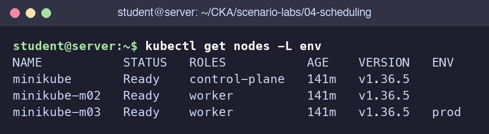

# Lab 4.1: Node selectors: send PROD to its own node

**The situation:** PROD shares its nodes with DEV and UAT. A test in DEV that eats all the CPU would slow down real users. PROD should get its own node: `minikube-m03`.

**Goal:** make the PROD frontend run only on `minikube-m03`.

**Outline topic:** 4. Scheduling: *Node selectors*.

**What you learn:** how the scheduler chooses a node, node labels, `nodeSelector`.

The **scheduler** chooses a node for every new pod. By default it picks any node with enough room. A **nodeSelector** on the pod says: only nodes with this label.

> **How to use this lab**
>
> - **📋 Copy and paste into your terminal:** copy the whole grey box (the copy button is in its top right corner), paste it into the terminal of your server, and press Enter.
> - **👀 You should see** *(do not paste)*: what the command prints. Names that end in random letters, IP addresses and ages are different on your server. That is normal.
> - **📖 Read only:** something to look at. Do not paste it.
> - **💡 Tip:** a shortcut or an extra. You do not need it to finish the lab.

## Before you start

Go to the folder of this module, and make `dev` your working namespace:

**📋 Copy and paste into your terminal:**

```bash
cd ~/CKA/scenario-labs/04-scheduling
kubectl config set-context --current --namespace=dev
```

**What this does:**

- `cd ~/CKA/scenario-labs/04-scheduling`: Goes to the folder `~/CKA/scenario-labs/04-scheduling`.
- `kubectl config set-context --current --namespace=dev`: Makes `dev` your working namespace: commands without `-n` now work in `dev`.

**👀 You should see** *(do not paste)*:

```text
Context "minikube" modified.
```

💡 **Tip:** `kubens dev` does the same as the second line (see the shortcuts in [setup, Step 5](../00-setup.md)).

## Step 1: see where the PROD pods run now

**📋 Copy and paste into your terminal:**

```bash
kubectl get pods -n prod -o wide
```

**What this does:** Lists the pods in the namespace `prod`, with extra columns such as the IP address and the node.

**👀 You should see** the PROD pods spread over the nodes, wherever the scheduler found room.

## Step 2: label the node

**📋 Copy and paste into your terminal:**

```bash
kubectl label node minikube-m03 env=prod
kubectl get nodes -L env
```

**What this does:**

- `kubectl label node minikube-m03 env=prod`: Puts the label `env=prod` on the node `minikube-m03`.
- `kubectl get nodes -L env`: Lists the nodes, with a column for the label `env`.

**👀 You should see** *(do not paste)*:

```text
node/minikube-m03 labeled
NAME           STATUS   ROLES           AGE    VERSION   ENV
minikube       Ready    control-plane   6h8m   v1.36.5
minikube-m02   Ready    worker          6h7m   v1.36.5
minikube-m03   Ready    worker          6h7m   v1.36.5   prod
```



## Step 3: look at the node selector

**📋 Copy and paste into your terminal:**

```bash
cat prod-node-selector.yaml
```

**What this does:** Shows what is in the file `prod-node-selector.yaml`.

**👀 You should see** *(do not paste)*:

```yaml
# run only on nodes with the label env=prod
spec:
  template:
    spec:
      nodeSelector:
        env: prod
```

This small file is a **patch**: it adds these lines to a Deployment that is already there.

## Step 4: send the PROD frontend to that node

**📋 Copy and paste into your terminal:**

```bash
kubectl patch deployment frontend -n prod --patch-file prod-node-selector.yaml
kubectl rollout status deployment/frontend -n prod
kubectl get pods -n prod -l app=frontend -o wide
```

**What this does:**

- `kubectl patch deployment frontend ...`: Changes the Deployment `frontend` in the namespace `prod`: adds the lines of the file `prod-node-selector.yaml` to it.
- `kubectl rollout status deployment/frontend -n prod`: Waits until the new pods of the Deployment `frontend` in the namespace `prod` are all ready, and says when it is done.
- `kubectl get pods -n prod -l app=frontend -o wide`: Lists the pods with the label `app=frontend` in the namespace `prod`, with extra columns such as the IP address and the node.

**👀 You should see** both frontend pods on `minikube-m03` *(do not paste)*:

```text
NAME                       READY   STATUS    RESTARTS   AGE   IP              NODE           NOMINATED NODE   READINESS GATES
frontend-f44f64b75-kwm4s   1/1     Running   0          39s   10.244.151.31   minikube-m03   <none>           <none>
frontend-f44f64b75-rr6w4   1/1     Running   0          13s   10.244.151.32   minikube-m03   <none>           <none>
```

The Deployment made new pods, and the scheduler had only one node to choose from.

## Step 5: what if no node has the label?

Try it with a test pod that asks for a label no node has:

**📋 Copy and paste into your terminal:**

```bash
kubectl run nowhere -n dev --image=busybox:1.36 --overrides='{"spec":{"nodeSelector":{"env":"moon"}}}' -- sleep 3600
sleep 5
kubectl get pod nowhere -n dev
```

**What this does:**

- `kubectl run nowhere -n ...`: Starts one pod called `nowhere` in the namespace `dev` from the image `busybox:1.36`, which runs `sleep 3600`, with the extra settings given in `--overrides`.
- `sleep 5`: Waits 5 seconds, to give Kubernetes time.
- `kubectl get pod nowhere -n dev`: Lists the pod `nowhere` in the namespace `dev`.

**👀 You should see** *(do not paste)*:

```text
NAME      READY   STATUS    RESTARTS   AGE
nowhere   0/1     Pending   0          5s
```

`Pending` means: the scheduler found no node. Ask why:

**📋 Copy and paste into your terminal:**

```bash
kubectl describe pod nowhere -n dev | tail -3
```

**What this does:** Shows all the details of the pod `nowhere` in the namespace `dev`. The events at the bottom say what happened to it. `| tail` shows only the last 3 lines.

**👀 You should see** (one long line that says) *(do not paste)*:

```text
Warning  FailedScheduling  ...  0/3 nodes are available: 3 node(s) didn't match Pod's node affinity/selector.
```

🧹 **Clean up:**

**📋 Copy and paste into your terminal:**

```bash
kubectl delete pod nowhere -n dev --now
```

**What this does:** Deletes the pod `nowhere` in the namespace `dev`, at once.

A node selector is a **hard rule**. That is its strength, and its risk: if `minikube-m03` breaks, the PROD frontend has nowhere to go. The next lab makes that softer.

💡 **Exam tip:** every node already has useful labels. See them with `kubectl get nodes --show-labels`. The label `kubernetes.io/hostname` is the node's name.

✅ **Check:** both PROD frontend pods run on `minikube-m03`.

**Next:** [Lab 4.2: Affinity and anti-affinity](./lab-4.2-affinity-and-anti-affinity.md)
