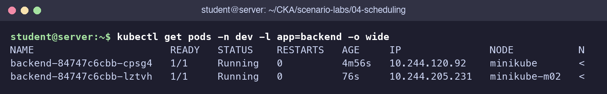

# Lab 4.2: Affinity and anti-affinity rules

**The situation:** two problems. First: the PROD frontend can **only** run on `minikube-m03`, so if that node breaks, PROD is down. Second: nothing stops both backend pods from landing on the same node, and then one broken node takes the whole backend with it.

**Goal:** make "run on the PROD node" a **wish** instead of a rule, and keep the two backend pods on **different** nodes.

**Outline topic:** 4. Scheduling: *Affinity and anti-affinity rules*.

**What you learn:** node affinity (required and preferred), pod anti-affinity.

📘 **More detail:** [Lab 4.2 explained](./lab-4.2-affinity-and-anti-affinity-explained.md): what happens in the cluster at each step, common mistakes and exam notes.

| Rule | It says | Example |
| --- | --- | --- |
| **Node affinity** | "Put me on a node with this label" | PROD pods on the PROD node |
| **Pod affinity** | "Put me near pods with this label" | The backend next to its cache |
| **Pod anti-affinity** | "Put me away from pods with this label" | The two backend pods on different nodes |

Each can be a hard rule (`required...`) or a wish (`preferred...`).

> **How to use this lab**
>
> - **📋 Copy and paste into your terminal:** copy the whole grey box (the copy button is in its top right corner), paste it into the terminal of your server, and press Enter.
> - **👀 You should see** *(do not paste)*: what the command prints. Names that end in random letters, IP addresses and ages are different on your server. That is normal.
> - **📖 Read only:** something to look at. Do not paste it.
> - **💡 Tip:** a shortcut or an extra. You do not need it to finish the lab.

## Before you start

Go to the folder of this module, and make `dev` your working namespace:

**📋 Copy and paste into your terminal:**

```bash
cd ~/CKA/scenario-labs/04-scheduling
kubectl config set-context --current --namespace=dev
```

**What this does:**

- `cd ~/CKA/scenario-labs/04-scheduling`: Goes to the folder `~/CKA/scenario-labs/04-scheduling`.
- `kubectl config set-context --current --namespace=dev`: Makes `dev` your working namespace: commands without `-n` now work in `dev`.

**👀 You should see** *(do not paste)*:

```text
Context "minikube" modified.
```

💡 **Tip:** `kubens dev` does the same as the second line (see the shortcuts in [setup, Step 5](../00-setup.md)).

## Part A: node affinity for PROD

### Step 1: look at the rule

**⌨️ Command line option** *(read only: the same as the YAML below, made with a command)*:

```bash
kubectl patch deployment frontend -n prod -p '{"spec":{"template":{"spec":{"nodeSelector":null,"affinity":{"nodeAffinity":{"preferredDuringSchedulingIgnoredDuringExecution":[{"weight":100,"preference":{"matchExpressions":[{"key":"env","operator":"In","values":["prod"]}]}}]}}}}}}'
```

**What this does:**

- `kubectl patch deployment frontend -n prod -p '...'`: The same patch, written on the command line as JSON instead of in a file. Run it again with `backend` for the backend.

kubectl has no flag for affinity, so it is a patch or `kubectl edit`. For long rules like this one, the file is easier to read.

**📋 Copy and paste into your terminal:**

```bash
cat prod-affinity.yaml
```

**What this does:** Shows what is in the file `prod-affinity.yaml`.

**👀 You should see** *(do not paste)*:

```yaml
# prefer nodes with the label env=prod, but run somewhere else if there is none
spec:
  template:
    spec:
      nodeSelector: null
      affinity:
        nodeAffinity:
          preferredDuringSchedulingIgnoredDuringExecution:
          - weight: 100
            preference:
              matchExpressions:
              - key: env
                operator: In
                values:
                - prod
```

| Line | Meaning |
| --- | --- |
| `nodeSelector: null` | Take the hard rule of Lab 4.1 away |
| `preferredDuringScheduling...` | A wish: the scheduler tries, but may choose another node |
| `...IgnoredDuringExecution` | Pods that already run are not moved when a label changes |
| `key: env`, `values: prod` | The label to look for on the node |

### Step 2: give it to the PROD frontend and backend

**📋 Copy and paste into your terminal:**

```bash
kubectl patch deployment frontend -n prod --patch-file prod-affinity.yaml
kubectl patch deployment backend -n prod --patch-file prod-affinity.yaml
kubectl rollout status deployment/frontend -n prod
kubectl rollout status deployment/backend -n prod
kubectl get pods -n prod -o wide
```

**What this does:**

- `kubectl patch deployment frontend ...`: Changes the Deployment `frontend` in the namespace `prod`: adds the lines of the file `prod-affinity.yaml` to it.
- `kubectl patch deployment backend ...`: Changes the Deployment `backend` in the namespace `prod`: adds the lines of the file `prod-affinity.yaml` to it.
- `kubectl rollout status deployment/frontend -n prod`: Waits until the new pods of the Deployment `frontend` in the namespace `prod` are all ready, and says when it is done.
- `kubectl rollout status deployment/backend -n prod`: Waits until the new pods of the Deployment `backend` in the namespace `prod` are all ready, and says when it is done.
- `kubectl get pods -n prod -o wide`: Lists the pods in the namespace `prod`, with extra columns such as the IP address and the node.

**👀 You should see** the PROD frontend and backend on `minikube-m03` *(do not paste)*:

```text
NAME                        READY   STATUS    RESTARTS   AGE     IP               NODE           NOMINATED NODE   READINESS GATES
backend-64c47cb7d8-cvpkm    1/1     Running   0          2m15s   10.244.151.36    minikube-m03   <none>           <none>
backend-64c47cb7d8-rsdrp    1/1     Running   0          79s     10.244.151.39    minikube-m03   <none>           <none>
db-747c44dc87-rg87j         1/1     Running   0          6h4m    10.244.205.212   minikube-m02   <none>           <none>
frontend-5fddf7f475-5248t   1/1     Running   0          2m15s   10.244.151.37    minikube-m03   <none>           <none>
frontend-5fddf7f475-rwg72   1/1     Running   0          70s     10.244.151.38    minikube-m03   <none>           <none>
```

The result looks the same as with the node selector. The difference shows when the node is not there: these pods would start on another node. (You did not change the database, so it stays where it is.)

## Part B: anti-affinity for the DEV backend

### Step 3: see where the two DEV backend pods are

**📋 Copy and paste into your terminal:**

```bash
kubectl get pods -n dev -l app=backend -o wide
```

**What this does:** Lists the pods with the label `app=backend` in the namespace `dev`, with extra columns such as the IP address and the node.

Look at the `NODE` column. Maybe they are on different nodes, maybe on the same one. It is luck. You want a rule.

### Step 4: look at the rule

**⌨️ Command line option** *(read only: the same as the YAML below, made with a command)*:

```bash
kubectl patch deployment backend -n dev -p '{"spec":{"template":{"spec":{"affinity":{"podAntiAffinity":{"preferredDuringSchedulingIgnoredDuringExecution":[{"weight":100,"podAffinityTerm":{"topologyKey":"kubernetes.io/hostname","labelSelector":{"matchLabels":{"app":"backend"}}}}]}}}}}}'
```

**What this does:**

- `kubectl patch deployment backend -n dev -p '...'`: The same patch, written on the command line as JSON instead of in a file.

**📋 Copy and paste into your terminal:**

```bash
cat backend-anti-affinity.yaml
```

**What this does:** Shows what is in the file `backend-anti-affinity.yaml`.

**👀 You should see** *(do not paste)*:

```yaml
# keep the backend pods away from each other: prefer a node that has no backend pod yet
spec:
  template:
    spec:
      affinity:
        podAntiAffinity:
          preferredDuringSchedulingIgnoredDuringExecution:
          - weight: 100
            podAffinityTerm:
              topologyKey: kubernetes.io/hostname
              labelSelector:
                matchLabels:
                  app: backend
```

| Line | Meaning |
| --- | --- |
| `podAntiAffinity` | Stay **away** from certain pods |
| `labelSelector: app: backend` | ...from pods with this label (the other backend pods) |
| `topologyKey: kubernetes.io/hostname` | "Away" means: on another **node** |

### Step 5: give it to the DEV backend

**📋 Copy and paste into your terminal:**

```bash
kubectl patch deployment backend -n dev --patch-file backend-anti-affinity.yaml
kubectl rollout status deployment/backend -n dev
kubectl get pods -n dev -l app=backend -o wide
```

**What this does:**

- `kubectl patch deployment backend ...`: Changes the Deployment `backend` in the namespace `dev`: adds the lines of the file `backend-anti-affinity.yaml` to it.
- `kubectl rollout status deployment/backend -n dev`: Waits until the new pods of the Deployment `backend` in the namespace `dev` are all ready, and says when it is done.
- `kubectl get pods -n dev -l app=backend -o wide`: Lists the pods with the label `app=backend` in the namespace `dev`, with extra columns such as the IP address and the node.

**👀 You should see** the two backend pods on **two different nodes** *(do not paste)*:

```text
NAME                       READY   STATUS    RESTARTS   AGE   IP               NODE           NOMINATED NODE   READINESS GATES
backend-7c9d8b6f5d-h4n2k   1/1     Running   0          40s   10.244.205.225   minikube-m02   <none>           <none>
backend-7c9d8b6f5d-w8p3x   1/1     Running   0          22s   10.244.120.70    minikube       <none>           <none>
```



Now one broken node can never take both backend pods.

💡 **Exam tip:** the long names are easier in two halves. First half: `required` (a rule) or `preferred` (a wish). Second half, always the same: `DuringSchedulingIgnoredDuringExecution`. Find the layout with `kubectl explain pod.spec.affinity.nodeAffinity`.

✅ **Check:** the two DEV backend pods are on different nodes, and the PROD frontend and backend are on `minikube-m03`.

## More practice

The Shop part of the lab is done. These exercises use test pods in `dev`, and the clean-up at the end removes them, so the Shop stays as it is.

### 🟡 Practice 1: a hard node rule with a list of values

`requiredDuring...` is a **rule**, like a node selector. But it can say more: here, "a node with `disk=ssd` **or** `disk=nvme`".

**⌨️ Command line option** *(read only: the same as the YAML below, made with a command)*:

```bash
kubectl run fast-disk -n dev --image=busybox:1.36 --overrides='{"spec":{"affinity":{"nodeAffinity":{"requiredDuringSchedulingIgnoredDuringExecution":{"nodeSelectorTerms":[{"matchExpressions":[{"key":"disk","operator":"In","values":["ssd","nvme"]}]}]}}}}}' -- sleep 3600
```

**What this does:**

- `kubectl run fast-disk ... --overrides='...'`: Starts the pod `fast-disk` with the node affinity written as JSON.

**📋 Copy and paste into your terminal:**

```bash
kubectl apply -n dev -f - <<'YAML'
apiVersion: v1
kind: Pod
metadata:
  name: fast-disk
spec:
  affinity:
    nodeAffinity:
      requiredDuringSchedulingIgnoredDuringExecution:
        nodeSelectorTerms:
        - matchExpressions:
          - key: disk
            operator: In
            values: ["ssd", "nvme"]     # one of these is enough
  containers:
  - name: fast-disk
    image: busybox:1.36
    command: ["sleep", "3600"]
YAML
sleep 5
kubectl get pod fast-disk -n dev
```

**What this does:** Creates what is in the YAML between the two `YAML` lines, in the namespace `dev`, waits 5 seconds and shows the pod.

**👀 You should see** `Pending`: no node has the label `disk` yet. Now give one node `disk=nvme`:

**📋 Copy and paste into your terminal:**

```bash
kubectl label node minikube-m02 disk=nvme
sleep 5
kubectl get pod fast-disk -n dev -o wide
```

**What this does:**

- `kubectl label node minikube-m02 disk=nvme`: Puts the label `disk=nvme` on the node `minikube-m02`.
- `sleep 5`: Waits 5 seconds, to give Kubernetes time.
- `kubectl get pod fast-disk -n dev -o wide`: Shows the pod and its node.

**👀 You should see** the pod `Running` on `minikube-m02`. A node selector could not say "ssd **or** nvme".

### 🟡 Practice 2: keep away from a label with `DoesNotExist`

The operators are `In`, `NotIn`, `Exists`, `DoesNotExist`, `Gt` and `Lt`. Here: never on a node that has the label `env` (the PROD node).

**📋 Copy and paste into your terminal:**

```bash
kubectl create deployment not-prod -n dev --image=nginx:1.27-alpine --replicas=4
kubectl patch deployment not-prod -n dev -p '{"spec":{"template":{"spec":{"affinity":{"nodeAffinity":{"requiredDuringSchedulingIgnoredDuringExecution":{"nodeSelectorTerms":[{"matchExpressions":[{"key":"env","operator":"DoesNotExist"}]}]}}}}}}}'
kubectl rollout status deployment/not-prod -n dev
kubectl get pods -n dev -l app=not-prod -o wide
```

**What this does:**

- `kubectl create deployment not-prod ...`: Creates the Deployment `not-prod` with 4 pods.
- `kubectl patch deployment not-prod ...`: Adds the rule: only nodes **without** the label `env`.
- `kubectl rollout status deployment/not-prod -n dev`: Waits until the new pods are ready.
- `kubectl get pods -n dev -l app=not-prod -o wide`: Shows the pods and their nodes.

**👀 You should see** the 4 pods on `minikube` and `minikube-m02`, never on `minikube-m03`.

📖 **Read only:** the same rule as YAML, in the pod template:

```yaml
affinity:
  nodeAffinity:
    requiredDuringSchedulingIgnoredDuringExecution:
      nodeSelectorTerms:
      - matchExpressions:
        - key: env
          operator: DoesNotExist     # no value: only "is the label there or not"
```

### 🟡 Practice 3: pod affinity: run next to another pod

Pod **affinity** is the opposite of what you did in Part B: "put me on the same node as pods with this label".

**📋 Copy and paste into your terminal:**

```bash
kubectl run cache -n dev --image=busybox:1.36 --labels=app=cache -- sleep 3600
kubectl wait pod/cache -n dev --for=condition=Ready --timeout=60s
kubectl get pod cache -n dev -o wide
```

**What this does:**

- `kubectl run cache ... --labels=app=cache`: Starts a pod `cache` with the label `app=cache`.
- `kubectl wait pod/cache ...`: Waits until the pod is ready (at most 60 seconds).
- `kubectl get pod cache -n dev -o wide`: Shows the pod and its node. Remember the node.

**⌨️ Command line option** *(read only: the same as the YAML below, made with a command)*:

```bash
kubectl run near-cache -n dev --image=busybox:1.36 --overrides='{"spec":{"affinity":{"podAffinity":{"requiredDuringSchedulingIgnoredDuringExecution":[{"topologyKey":"kubernetes.io/hostname","labelSelector":{"matchLabels":{"app":"cache"}}}]}}}}' -- sleep 3600
```

**What this does:**

- `kubectl run near-cache ... --overrides='...'`: Starts the pod `near-cache` with the pod affinity written as JSON.

**📋 Copy and paste into your terminal:**

```bash
kubectl apply -n dev -f - <<'YAML'
apiVersion: v1
kind: Pod
metadata:
  name: near-cache
spec:
  affinity:
    podAffinity:
      requiredDuringSchedulingIgnoredDuringExecution:
      - topologyKey: kubernetes.io/hostname   # "near" means: the same node
        labelSelector:
          matchLabels:
            app: cache
  containers:
  - name: near-cache
    image: busybox:1.36
    command: ["sleep", "3600"]
YAML
sleep 5
kubectl get pods cache near-cache -n dev -o wide
```

**What this does:** Creates the pod `near-cache` from the YAML between the two `YAML` lines, waits 5 seconds and shows both pods with their nodes.

**👀 You should see** `near-cache` on the **same node** as `cache`. If `cache` is deleted, `near-cache` keeps running (`IgnoredDuringExecution`), but a new `near-cache` would stay `Pending`.

### 🔵 Optional 4: a hard anti-affinity rule with too many pods

In Part B the rule was a wish. What if it is a **rule**, and there are more pods than nodes?

**📋 Copy and paste into your terminal:**

```bash
kubectl create deployment one-per-node -n dev --image=nginx:1.27-alpine --replicas=4
kubectl patch deployment one-per-node -n dev -p '{"spec":{"template":{"spec":{"affinity":{"podAntiAffinity":{"requiredDuringSchedulingIgnoredDuringExecution":[{"topologyKey":"kubernetes.io/hostname","labelSelector":{"matchLabels":{"app":"one-per-node"}}}]}}}}}}'
sleep 20
kubectl get pods -n dev -l app=one-per-node -o wide
```

**What this does:**

- `kubectl create deployment one-per-node ...`: Creates the Deployment `one-per-node` with 4 pods.
- `kubectl patch deployment one-per-node ...`: Adds the **rule**: never two of these pods on the same node.
- `sleep 20`: Waits 20 seconds, to give Kubernetes time.
- `kubectl get pods -n dev -l app=one-per-node -o wide`: Shows the pods and their nodes.

**👀 You should see** one `Running` pod per node that can take it, and the rest `Pending`. Ask why:

**📋 Copy and paste into your terminal:**

```bash
kubectl describe pod -n dev -l app=one-per-node | grep FailedScheduling | tail -1
```

**What this does:** Shows the details of these pods, keeps only the `FailedScheduling` lines, and shows the last one.

**👀 You should see** a message with `didn't match pod anti-affinity rules`.

| | `preferred...` (a wish) | `required...` (a rule) |
| --- | --- | --- |
| More pods than nodes | Some pods share a node | The extra pods stay `Pending` |
| Good for | Spreading a normal app | A database or a cluster that must never share a node |

(Pods that stay `Pending` also make `kubectl rollout status` wait forever. That is why this exercise uses `sleep`.)

### 🔵 Optional 5: challenge

Without looking at the answer: make the pods of `not-prod` (Practice 2) **prefer**, with weight 50, a node that already runs a DEV `db` pod. Keep the `DoesNotExist` rule.

<details><summary>Show the answer</summary>

**📋 Copy and paste into your terminal:**

```bash
kubectl patch deployment not-prod -n dev -p '{"spec":{"template":{"spec":{"affinity":{"podAffinity":{"preferredDuringSchedulingIgnoredDuringExecution":[{"weight":50,"podAffinityTerm":{"topologyKey":"kubernetes.io/hostname","labelSelector":{"matchLabels":{"app":"db"}}}}]}}}}}}'
kubectl rollout status deployment/not-prod -n dev
kubectl get pods -n dev -l 'app in (db,not-prod)' -o wide
```

**What this does:**

- `kubectl patch deployment not-prod ...`: Adds a pod affinity wish next to the node affinity rule. The patch adds `podAffinity` and keeps `nodeAffinity`.
- `kubectl rollout status deployment/not-prod -n dev`: Waits until the new pods are ready.
- `kubectl get pods -n dev -l 'app in (db,not-prod)' -o wide`: Shows the `db` pod and the `not-prod` pods with their nodes.

**👀 You should see** most `not-prod` pods on the node of the `db` pod, as long as that node is not the PROD node. A wish never breaks the rule.

</details>

🧹 **Clean up the practice:**

**📋 Copy and paste into your terminal:**

```bash
kubectl delete pod fast-disk cache near-cache -n dev --now --ignore-not-found
kubectl delete deployment not-prod one-per-node -n dev --ignore-not-found
kubectl label node minikube-m02 disk- 2>/dev/null; true
```

**What this does:**

- `kubectl delete pod fast-disk cache near-cache ...`: Deletes the three test pods, at once.
- `kubectl delete deployment not-prod one-per-node ...`: Deletes the two test Deployments and their pods.
- `kubectl label node minikube-m02 disk-`: Removes the label `disk` from the node `minikube-m02`.

**Next:** [Lab 4.3: Taints and tolerations](./lab-4.3-taints-and-tolerations.md)
