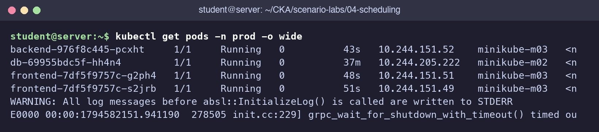

# Lab 4.3: Taints and tolerations: keep everyone else off the PROD node

**The situation:** the PROD pods prefer `minikube-m03`. But DEV and UAT pods can still land there too, and use the CPU that PROD needs. The node must refuse everyone except PROD.

**Goal:** close `minikube-m03` for all pods, and give only the PROD frontend and backend a pass.

**Outline topic:** 4. Scheduling: *Taints and tolerations*.

**What you learn:** taints, their effects, tolerations.

📘 **More detail:** [Lab 4.3 explained](./lab-4.3-taints-and-tolerations-explained.md): what happens in the cluster at each step, common mistakes and exam notes.

Affinity works from the side of the **pod**: "I want that node". A taint works from the side of the **node**: "I do not want pods".

| Word | On | Think of it as |
| --- | --- | --- |
| **Taint** | A node | A "Keep out" sign |
| **Toleration** | A pod | A pass for that sign |

| Taint effect | Meaning |
| --- | --- |
| `NoSchedule` | No **new** pods without a pass. Pods that already run there stay. |
| `PreferNoSchedule` | Try to keep new pods away, but allow them if there is no other place |
| `NoExecute` | No new pods, **and** pods without a pass that run there are thrown out |

> **How to use this lab**
>
> - **📋 Copy and paste into your terminal:** copy the whole grey box (the copy button is in its top right corner), paste it into the terminal of your server, and press Enter.
> - **👀 You should see** *(do not paste)*: what the command prints. Names that end in random letters, IP addresses and ages are different on your server. That is normal.
> - **📖 Read only:** something to look at. Do not paste it.
> - **💡 Tip:** a shortcut or an extra. You do not need it to finish the lab.

## Before you start

Go to the folder of this module, and make `dev` your working namespace:

**📋 Copy and paste into your terminal:**

```bash
cd ~/CKA/scenario-labs/04-scheduling
kubectl config set-context --current --namespace=dev
```

**What this does:**

- `cd ~/CKA/scenario-labs/04-scheduling`: Goes to the folder `~/CKA/scenario-labs/04-scheduling`.
- `kubectl config set-context --current --namespace=dev`: Makes `dev` your working namespace: commands without `-n` now work in `dev`.

**👀 You should see** *(do not paste)*:

```text
Context "minikube" modified.
```

💡 **Tip:** `kubens dev` does the same as the second line (see the shortcuts in [setup, Step 5](../00-setup.md)).

## Step 1: see who is on the PROD node now

**📋 Copy and paste into your terminal:**

```bash
kubectl get pods -A -o wide --field-selector spec.nodeName=minikube-m03 | grep -E "NAMESPACE|dev|uat|prod"
```

**What this does:** Lists the pods in all namespaces, only those on the node `minikube-m03`, with extra columns such as the IP address and the node. `| grep` keeps only the lines with `NAMESPACE` or `dev` or `uat` or `prod`.

**👀 You should see** the PROD pods, and probably some pods of `dev` or `uat` too.

## Step 2: put the taint on the node

**📋 Copy and paste into your terminal:**

```bash
kubectl taint node minikube-m03 dedicated=prod:NoSchedule
kubectl describe node minikube-m03 | grep Taints
```

**What this does:**

- `kubectl taint node minikube-m03 dedicated=prod:NoSchedule`: Puts the taint `dedicated=prod:NoSchedule` on the node `minikube-m03`: new pods without a matching toleration may not start there.
- `kubectl describe node minikube-m03 | grep Taints`: Shows all the details of the node `minikube-m03`. The events at the bottom say what happened to it. `| grep` keeps only the lines with `Taints`.

**👀 You should see** *(do not paste)*:

```text
node/minikube-m03 tainted
Taints:             dedicated=prod:NoSchedule
```

A taint has three parts: a key (`dedicated`), a value (`prod`) and an effect (`NoSchedule`).

## Step 3: DEV and UAT can no longer start there

Restart the DEV and UAT frontend and backend. Their new pods need a node:

**📋 Copy and paste into your terminal:**

```bash
kubectl rollout restart deployment/frontend deployment/backend -n dev
kubectl rollout restart deployment/frontend deployment/backend -n uat
kubectl rollout status deployment/backend -n dev
kubectl rollout status deployment/backend -n uat
kubectl get pods -n dev -o wide
```

**What this does:**

- `kubectl rollout restart deployment/frontend ...`: Replaces the pods of the Deployments `frontend` and `backend` in the namespace `dev` with new ones, one by one.
- `kubectl rollout restart deployment/frontend ...`: Replaces the pods of the Deployments `frontend` and `backend` in the namespace `uat` with new ones, one by one.
- `kubectl rollout status deployment/backend -n dev`: Waits until the new pods of the Deployment `backend` in the namespace `dev` are all ready, and says when it is done.
- `kubectl rollout status deployment/backend -n uat`: Waits until the new pods of the Deployment `backend` in the namespace `uat` are all ready, and says when it is done.
- `kubectl get pods -n dev -o wide`: Lists the pods in the namespace `dev`, with extra columns such as the IP address and the node.

**👀 You should see** no DEV frontend or backend pod on `minikube-m03` any more. They run on `minikube` and `minikube-m02`.

## Step 4: but PROD cannot start there either

The taint keeps **everyone** out who has no pass. Restart the PROD frontend:

**📋 Copy and paste into your terminal:**

```bash
kubectl rollout restart deployment/frontend -n prod
kubectl rollout status deployment/frontend -n prod
kubectl get pods -n prod -l app=frontend -o wide
```

**What this does:**

- `kubectl rollout restart deployment/frontend -n prod`: Replaces the pods of the Deployment `frontend` in the namespace `prod` with new ones, one by one.
- `kubectl rollout status deployment/frontend -n prod`: Waits until the new pods of the Deployment `frontend` in the namespace `prod` are all ready, and says when it is done.
- `kubectl get pods -n prod -l app=frontend -o wide`: Lists the pods with the label `app=frontend` in the namespace `prod`, with extra columns such as the IP address and the node.

**👀 You should see** the new PROD frontend pods on **other** nodes, not on `minikube-m03` *(do not paste)*:

```text
NAME                        READY   STATUS    RESTARTS   AGE   IP               NODE           NOMINATED NODE   READINESS GATES
frontend-6b8f9d7c54-2jq8m   1/1     Running   0          30s   10.244.205.231   minikube-m02   <none>           <none>
frontend-6b8f9d7c54-x9r4t   1/1     Running   0          18s   10.244.120.74    minikube       <none>           <none>
```

They **prefer** `minikube-m03` (Lab 4.2), but the node refuses them, so the scheduler chose another node. With the hard node selector of Lab 4.1 they would be `Pending` now, and the release would hang. That is why a wish was the better choice.

## Step 5: give the PROD pods a pass

**⌨️ Command line option** *(read only: the same as the YAML below, made with a command)*:

```bash
kubectl patch deployment frontend -n prod -p '{"spec":{"template":{"spec":{"tolerations":[{"key":"dedicated","operator":"Equal","value":"prod","effect":"NoSchedule"}]}}}}'
```

**What this does:**

- `kubectl patch deployment frontend -n prod -p '...'`: The same patch, written on the command line as JSON instead of in a file. Run it again with `backend` for the backend.

The taint itself is made with a command (`kubectl taint nodes ...`), but there is no command for a toleration.

**📋 Copy and paste into your terminal:**

```bash
cat prod-toleration.yaml
```

**What this does:** Shows what is in the file `prod-toleration.yaml`.

**👀 You should see** *(do not paste)*:

```yaml
# allowed on nodes with the taint dedicated=prod
spec:
  template:
    spec:
      tolerations:
      - key: dedicated
        operator: Equal
        value: prod
        effect: NoSchedule
```

The toleration repeats the three parts of the taint: key, value, effect.

**📋 Copy and paste into your terminal:**

```bash
kubectl patch deployment frontend -n prod --patch-file prod-toleration.yaml
kubectl patch deployment backend -n prod --patch-file prod-toleration.yaml
kubectl rollout status deployment/frontend -n prod
kubectl rollout status deployment/backend -n prod
kubectl get pods -n prod -o wide
```

**What this does:**

- `kubectl patch deployment frontend ...`: Changes the Deployment `frontend` in the namespace `prod`: adds the lines of the file `prod-toleration.yaml` to it.
- `kubectl patch deployment backend ...`: Changes the Deployment `backend` in the namespace `prod`: adds the lines of the file `prod-toleration.yaml` to it.
- `kubectl rollout status deployment/frontend -n prod`: Waits until the new pods of the Deployment `frontend` in the namespace `prod` are all ready, and says when it is done.
- `kubectl rollout status deployment/backend -n prod`: Waits until the new pods of the Deployment `backend` in the namespace `prod` are all ready, and says when it is done.
- `kubectl get pods -n prod -o wide`: Lists the pods in the namespace `prod`, with extra columns such as the IP address and the node.

**👀 You should see** the PROD frontend and backend back on `minikube-m03` *(do not paste)*:

```text
NAME                        READY   STATUS    RESTARTS   AGE     IP               NODE           NOMINATED NODE   READINESS GATES
backend-64c47cb7d8-cvpkm    1/1     Running   0          2m15s   10.244.151.36    minikube-m03   <none>           <none>
backend-64c47cb7d8-rsdrp    1/1     Running   0          79s     10.244.151.39    minikube-m03   <none>           <none>
db-747c44dc87-rg87j         1/1     Running   0          6h4m    10.244.205.212   minikube-m02   <none>           <none>
frontend-5fddf7f475-5248t   1/1     Running   0          2m15s   10.244.151.37    minikube-m03   <none>           <none>
frontend-5fddf7f475-rwg72   1/1     Running   0          70s     10.244.151.38    minikube-m03   <none>           <none>
```



## Step 6: the two halves together

| | Affinity (Lab 4.2) | Taint + toleration (this lab) |
| --- | --- | --- |
| Who decides | The pod | The node |
| What it does | Pulls the PROD pods **to** the node | Keeps all other pods **off** the node |

A toleration alone does not pull a pod to the node. It only lets it in. You need both halves for a node that is kept for PROD.

💡 **Exam tip:** to remove a taint, repeat the command with a minus at the end: `kubectl taint node minikube-m03 dedicated=prod:NoSchedule-`. To remove a label: `kubectl label node minikube-m03 env-`. **Do not run these now**: the Shop keeps this setup.

✅ **Check:** the PROD frontend and backend pods run on `minikube-m03`, and no DEV or UAT frontend or backend pod does.

## More practice

The Shop part of the lab is done. Practices 1 to 3 use test pods in `dev` and do not touch the Shop. Optional 4 moves the PROD pods for a minute, and puts them back at the end.

### 🟡 Practice 1: why do the system pods still run on the PROD node?

**📋 Copy and paste into your terminal:**

```bash
kubectl get pods -n kube-system -o wide --field-selector spec.nodeName=minikube-m03
kubectl get daemonset kube-proxy -n kube-system -o jsonpath='{.spec.template.spec.tolerations}'; echo
```

**What this does:**

- `kubectl get pods -n kube-system ... --field-selector spec.nodeName=minikube-m03`: Lists the system pods on the node `minikube-m03`.
- `kubectl get daemonset kube-proxy ... -o jsonpath=...`: Shows only the tolerations of the DaemonSet `kube-proxy`. `echo` adds a new line at the end.

**👀 You should see** pods such as `kube-proxy` and `calico-node` on `minikube-m03`, and a toleration like this *(do not paste)*:

```text
[{"operator":"Exists"}]
```

`operator: Exists` with **no key** tolerates **every** taint. Network and proxy pods must run on every node, so they carry this "master key".

### 🟡 Practice 2: a toleration alone does not pull

**📋 Copy and paste into your terminal:**

```bash
kubectl create deployment pass-only -n dev --image=nginx:1.27-alpine --replicas=6
kubectl patch deployment pass-only -n dev -p '{"spec":{"template":{"spec":{"tolerations":[{"key":"dedicated","operator":"Equal","value":"prod","effect":"NoSchedule"}]}}}}'
kubectl rollout status deployment/pass-only -n dev
kubectl get pods -n dev -l app=pass-only -o wide
```

**What this does:**

- `kubectl create deployment pass-only ...`: Creates the Deployment `pass-only` with 6 pods.
- `kubectl patch deployment pass-only ...`: Gives its pods the same pass as PROD.
- `kubectl rollout status deployment/pass-only -n dev`: Waits until the new pods are ready.
- `kubectl get pods -n dev -l app=pass-only -o wide`: Shows the pods and their nodes.

**👀 You should see** the 6 pods spread over the nodes, usually with some on `minikube-m03` (the pass lets them in) and the others elsewhere. The pass only **allows** that node; it does not choose it. Now add the other half, the node selector:

**📋 Copy and paste into your terminal:**

```bash
kubectl patch deployment pass-only -n dev -p '{"spec":{"template":{"spec":{"nodeSelector":{"env":"prod"}}}}}'
kubectl rollout status deployment/pass-only -n dev
kubectl get pods -n dev -l app=pass-only -o wide
```

**What this does:**

- `kubectl patch deployment pass-only ...`: Adds the node selector `env=prod`.
- `kubectl rollout status deployment/pass-only -n dev`: Waits until the new pods are ready.
- `kubectl get pods -n dev -l app=pass-only -o wide`: Shows the pods and their nodes.

**👀 You should see** all 6 pods on `minikube-m03`. Pass **and** pull: that is Step 6 in practice. (It also shows why only the cluster admin should hand out passes: a DEV team with this toleration can fill the PROD node.)

### 🟡 Practice 3: `PreferNoSchedule`, the soft taint

**📋 Copy and paste into your terminal:**

```bash
kubectl taint node minikube-m02 busy=yes:PreferNoSchedule
kubectl create deployment soft -n dev --image=nginx:1.27-alpine --replicas=4
kubectl rollout status deployment/soft -n dev
kubectl get pods -n dev -l app=soft -o wide
```

**What this does:**

- `kubectl taint node minikube-m02 busy=yes:PreferNoSchedule`: Puts a soft taint on `minikube-m02`: "keep away if you can".
- `kubectl create deployment soft ...`: Creates the Deployment `soft` with 4 pods, without any toleration.
- `kubectl rollout status deployment/soft -n dev`: Waits until the pods are ready.
- `kubectl get pods -n dev -l app=soft -o wide`: Shows the pods and their nodes.

**👀 You should see** all or most of the 4 pods on `minikube`, the only node with no taint at all. `minikube-m03` is closed (`NoSchedule`), and `minikube-m02` is avoided as long as there is room elsewhere. If `minikube` were full, they would go to `minikube-m02` anyway.

Take the soft taint away again:

**📋 Copy and paste into your terminal:**

```bash
kubectl taint node minikube-m02 busy=yes:PreferNoSchedule-
```

**What this does:** Removes the taint `busy=yes:PreferNoSchedule` from `minikube-m02` (the minus at the end means "remove").

### 🔵 Optional 4: `NoExecute` and `tolerationSeconds`

`NoExecute` also throws out pods that **already run** there. A toleration with `tolerationSeconds` lets a pod stay a while, then it goes too.

⚠️ This moves the PROD frontend and backend off `minikube-m03` for a minute. The last step puts them back.

Start a test pod on the PROD node that may stay 60 seconds after a `maintenance` taint:

**⌨️ Command line option** *(read only: the same as the YAML below, made with a command)*:

```bash
kubectl run visitor -n dev --image=busybox:1.36 --overrides='{"spec":{"nodeSelector":{"env":"prod"},"tolerations":[{"key":"dedicated","operator":"Equal","value":"prod","effect":"NoSchedule"},{"key":"maintenance","operator":"Exists","effect":"NoExecute","tolerationSeconds":60}]}}' -- sleep 3600
```

**What this does:**

- `kubectl run visitor ... --overrides='...'`: Starts the pod `visitor` with the node selector and the two tolerations written as JSON.

**📋 Copy and paste into your terminal:**

```bash
kubectl apply -n dev -f - <<'YAML'
apiVersion: v1
kind: Pod
metadata:
  name: visitor
spec:
  nodeSelector:
    env: prod                     # go to the PROD node
  tolerations:
  - key: dedicated                # the pass for the PROD node
    operator: Equal
    value: prod
    effect: NoSchedule
  - key: maintenance              # may stay 60 seconds after a maintenance taint
    operator: Exists
    effect: NoExecute
    tolerationSeconds: 60
  containers:
  - name: visitor
    image: busybox:1.36
    command: ["sleep", "3600"]
YAML
kubectl wait pod/visitor -n dev --for=condition=Ready --timeout=60s
```

**What this does:** Creates the pod `visitor` from the YAML between the two `YAML` lines, and waits until it is ready.

Now put a `NoExecute` taint on the PROD node, and watch:

**📋 Copy and paste into your terminal:**

```bash
kubectl taint node minikube-m03 maintenance=now:NoExecute
sleep 10
kubectl get pods -A -o wide --field-selector spec.nodeName=minikube-m03 | grep -E "NAMESPACE|dev|prod"
```

**What this does:**

- `kubectl taint node minikube-m03 maintenance=now:NoExecute`: Puts a `NoExecute` taint on `minikube-m03`.
- `sleep 10`: Waits 10 seconds, to give Kubernetes time.
- `kubectl get pods -A ... | grep ...`: Lists the `dev` and `prod` pods that are still on `minikube-m03`.

**👀 You should see** only `visitor` left: the PROD pods have no pass for `maintenance`, so they were thrown out at once, and their Deployments made new pods on other nodes. Wait a minute and ask again:

**📋 Copy and paste into your terminal:**

```bash
sleep 60
kubectl get pod visitor -n dev
```

**What this does:** Waits 60 seconds, then shows the pod `visitor`.

**👀 You should see** `Error from server (NotFound)` or the pod `Terminating`: its 60 seconds are over, so it was thrown out too.

Put everything back: remove the taint, and restart PROD so its pods return to their node:

**📋 Copy and paste into your terminal:**

```bash
kubectl taint node minikube-m03 maintenance=now:NoExecute-
kubectl rollout restart deployment/frontend deployment/backend -n prod
kubectl rollout status deployment/frontend -n prod
kubectl rollout status deployment/backend -n prod
kubectl get pods -n prod -o wide
```

**What this does:**

- `kubectl taint node minikube-m03 maintenance=now:NoExecute-`: Removes the `maintenance` taint.
- `kubectl rollout restart deployment/frontend deployment/backend -n prod`: Replaces the PROD frontend and backend pods with new ones. Pods do not move back by themselves.
- `kubectl rollout status ...`: Waits until the new pods are ready.
- `kubectl get pods -n prod -o wide`: Shows the PROD pods and their nodes.

**👀 You should see** the PROD frontend and backend on `minikube-m03` again, as at the end of Step 5.

This is what Kubernetes itself does when a node stops answering: it puts `node.kubernetes.io/unreachable:NoExecute` on it, and every pod has a toleration for it with `tolerationSeconds: 300`. That is why pods of a dead node move after about 5 minutes.

### 🔵 Optional 5: challenge

Without looking at the answer: a monitoring agent must run on **every** node, whatever taints are there or come later. Write the one toleration that does that, and test it on a pod `agent` that you pin to `minikube-m03` with a node selector on `kubernetes.io/hostname`.

<details><summary>Show the answer</summary>

**📋 Copy and paste into your terminal:**

```bash
kubectl run agent -n dev --image=busybox:1.36 --overrides='{"spec":{"nodeSelector":{"kubernetes.io/hostname":"minikube-m03"},"tolerations":[{"operator":"Exists"}]}}' -- sleep 3600
sleep 5
kubectl get pod agent -n dev -o wide
```

**What this does:** Starts the pod `agent` with a node selector for `minikube-m03` and the toleration `operator: Exists` with no key, waits 5 seconds and shows the pod and its node.

**👀 You should see** `agent` `Running` on `minikube-m03`, even though the node is closed with `dedicated=prod:NoSchedule`. This is the same toleration as `kube-proxy` in Practice 1.

</details>

🧹 **Clean up the practice:**

**📋 Copy and paste into your terminal:**

```bash
kubectl delete deployment pass-only soft -n dev --ignore-not-found
kubectl delete pod visitor agent -n dev --now --ignore-not-found
kubectl taint node minikube-m02 busy- 2>/dev/null; kubectl taint node minikube-m03 maintenance- 2>/dev/null; true
kubectl describe nodes | grep -E "^Name:|^Taints:"
```

**What this does:**

- `kubectl delete deployment pass-only soft ...`: Deletes the two test Deployments and their pods.
- `kubectl delete pod visitor agent ...`: Deletes the test pods, at once, if they are still there.
- `kubectl taint node ... busy-` and `... maintenance-`: Remove the test taints, if they are still there. Messages for taints that are already gone are hidden.
- `kubectl describe nodes | grep ...`: Shows each node's name and taints.

**👀 You should see** only one taint left in the cluster: `dedicated=prod:NoSchedule` on `minikube-m03`.

**Next:** [Lab 5.1: Authentication, authorization and RBAC](../05-security/lab-5.1-authentication-authorization-rbac.md)
