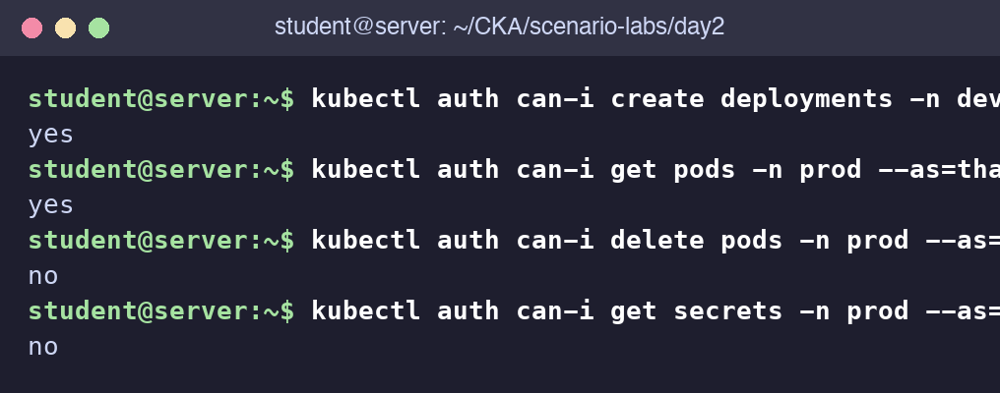

# Lab 5.1: Authentication, authorization and RBAC: a developer and PROD

**The situation:** until now you did everything as the cluster administrator. A developer, **Thabo**, joins the team. He must be able to change everything in `dev`, but only look in `prod`. And the Shop's own pods should have no more rights than they need.

**Goal:** give Thabo the right access, and give the PROD backend its own identity.

**Outline topic:** 5. Security: *Authentication, Authorization and RBAC*.

**What you learn:** the difference between authentication and authorization, Roles, ClusterRoles, RoleBindings, `kubectl auth can-i`, ServiceAccounts.

📘 **More detail:** [Lab 5.1 explained](./lab-5.1-authentication-authorization-rbac-explained.md): what happens in the cluster at each step, common mistakes and exam notes.

Every request to the cluster passes two gates:

| Gate | The question | How |
| --- | --- | --- |
| **Authentication** | **Who** are you? | A certificate (people) or a token (pods). Lab 5.2. |
| **Authorization** | **May** you do this? | RBAC: role-based access control. This lab. |

RBAC has two kinds of objects:

| Object | What it says |
| --- | --- |
| **Role** / **ClusterRole** | **What** may be done (for example: read pods) |
| **RoleBinding** | **Who** gets that role, in **which namespace** |

Kubernetes has ready-made ClusterRoles. You use two of them: `edit` (change most things) and `view` (only look, and no Secrets).

> **How to use this lab**
>
> - **📋 Copy and paste into your terminal:** copy the whole grey box (the copy button is in its top right corner), paste it into the terminal of your server, and press Enter.
> - **👀 You should see** *(do not paste)*: what the command prints. Names that end in random letters, IP addresses and ages are different on your server. That is normal.
> - **📖 Read only:** something to look at. Do not paste it.
> - **💡 Tip:** a shortcut or an extra. You do not need it to finish the lab.

## Before you start

Go to the folder of this module, and make `dev` your working namespace:

**📋 Copy and paste into your terminal:**

```bash
cd ~/CKA/scenario-labs/05-security
kubectl config set-context --current --namespace=dev
```

**What this does:**

- `cd ~/CKA/scenario-labs/05-security`: Goes to the folder `~/CKA/scenario-labs/05-security`.
- `kubectl config set-context --current --namespace=dev`: Makes `dev` your working namespace: commands without `-n` now work in `dev`.

**👀 You should see** *(do not paste)*:

```text
Context "minikube" modified.
```

💡 **Tip:** `kubens dev` does the same as the second line (see the shortcuts in [setup, Step 5](../00-setup.md)).

## Step 0: who are you now?

**📋 Copy and paste into your terminal:**

```bash
kubectl auth whoami
```

**What this does:** Shows who you are logged in as, and your groups.

**👀 You should see** your user and its groups *(do not paste)*:

```text
ATTRIBUTE                                           VALUE
Username                                            minikube-user
Groups                                              [system:masters system:authenticated]
Extra: authentication.kubernetes.io/credential-id   [X509SHA256=fc355da1f973862b...]
```

The group `system:masters` is the administrator group: it may do everything.

## Part A: give Thabo his access

### Step 1: bind the roles

**📋 Copy and paste into your terminal:**

```bash
kubectl create rolebinding thabo-edit -n dev --clusterrole=edit --user=thabo
kubectl create rolebinding thabo-view -n prod --clusterrole=view --user=thabo
```

**What this does:**

- `kubectl create rolebinding thabo-edit ...`: Gives the user `thabo` the role `edit` in the namespace `dev` (a RoleBinding called `thabo-edit`).
- `kubectl create rolebinding thabo-view ...`: Gives the user `thabo` the role `view` in the namespace `prod` (a RoleBinding called `thabo-view`).

**👀 You should see** *(do not paste)*:

```text
rolebinding.rbac.authorization.k8s.io/thabo-edit created
rolebinding.rbac.authorization.k8s.io/thabo-view created
```

### Step 2: ask what Thabo may do

`kubectl auth can-i` answers `yes` or `no`. With `--as=thabo` you ask it for Thabo.

**📋 Copy and paste into your terminal:**

```bash
kubectl auth can-i create deployments -n dev --as=thabo
kubectl auth can-i get pods -n prod --as=thabo
kubectl auth can-i delete pods -n prod --as=thabo
kubectl auth can-i get secrets -n prod --as=thabo
kubectl auth can-i get nodes --as=thabo
```

**What this does:**

- `kubectl auth can-i create deployments -n dev --as=thabo`: Asks: may `thabo` create deployments in the namespace `dev`? The answer is `yes` or `no`.
- `kubectl auth can-i get pods -n prod --as=thabo`: Asks: may `thabo` get pods in the namespace `prod`? The answer is `yes` or `no`.
- `kubectl auth can-i delete pods -n prod --as=thabo`: Asks: may `thabo` delete pods in the namespace `prod`? The answer is `yes` or `no`.
- `kubectl auth can-i get secrets -n prod --as=thabo`: Asks: may `thabo` get secrets in the namespace `prod`? The answer is `yes` or `no`.
- `kubectl auth can-i get nodes --as=thabo`: Asks: may `thabo` get nodes? The answer is `yes` or `no`.

**👀 You should see** *(do not paste)*:

```text
yes
yes
no
no
Warning: resource 'nodes' is not namespace scoped

no
```



| Question | Answer | Why |
| --- | --- | --- |
| Create deployments in `dev`? | yes | `edit` in `dev` |
| Look at pods in `prod`? | yes | `view` in `prod` |
| Delete pods in `prod`? | no | `view` only looks |
| Read Secrets in `prod`? | no | `view` does not include Secrets |
| Look at the nodes? | no | Nobody gave him that |

### Step 3: write your own Role

The ready-made roles are not always right. In `uat`, Thabo may only look at **pods**. Nothing else.

**📋 Copy and paste into your terminal:**

```bash
kubectl create role pod-reader -n uat --verb=get,list,watch --resource=pods
kubectl create rolebinding thabo-pod-reader -n uat --role=pod-reader --user=thabo
```

**What this does:**

- `kubectl create role pod-reader ...`: Creates a Role called `pod-reader` in the namespace `uat`: it allows `get,list,watch` on `pods`.
- `kubectl create rolebinding thabo-pod-reader ...`: Gives the user `thabo` the role `pod-reader` in the namespace `uat` (a RoleBinding called `thabo-pod-reader`).

**👀 You should see** *(do not paste)*:

```text
role.rbac.authorization.k8s.io/pod-reader created
rolebinding.rbac.authorization.k8s.io/thabo-pod-reader created
```

**📋 Copy and paste into your terminal:**

```bash
kubectl auth can-i list pods -n uat --as=thabo
kubectl auth can-i list services -n uat --as=thabo
```

**What this does:**

- `kubectl auth can-i list pods -n uat --as=thabo`: Asks: may `thabo` list pods in the namespace `uat`? The answer is `yes` or `no`.
- `kubectl auth can-i list services -n uat --as=thabo`: Asks: may `thabo` list services in the namespace `uat`? The answer is `yes` or `no`.

**👀 You should see** *(do not paste)*:

```text
yes
no
```

## Part B: an identity for the backend (ServiceAccount)

People get users. **Pods** get a **ServiceAccount**. Every pod runs as the ServiceAccount `default`, unless you say something else. The PROD backend gets its own.

### Step 4: create it and give it to the backend

**📋 Copy and paste into your terminal:**

```bash
kubectl create serviceaccount backend -n prod
kubectl set serviceaccount deployment backend backend -n prod
kubectl rollout status deployment/backend -n prod
```

**What this does:**

- `kubectl create serviceaccount backend -n prod`: Creates a ServiceAccount (an identity for pods) called `backend` in the namespace `prod`.
- `kubectl set serviceaccount deployment ...`: Makes the pods of the Deployment `backend` in the namespace `prod` run as the ServiceAccount `backend`.
- `kubectl rollout status deployment/backend -n prod`: Waits until the new pods of the Deployment `backend` in the namespace `prod` are all ready, and says when it is done.

**👀 You should see** (the last line) *(do not paste)*:

```text
deployment "backend" successfully rolled out
```

**📋 Copy and paste into your terminal:**

```bash
kubectl get pods -n prod -l app=backend -o custom-columns=NAME:.metadata.name,SERVICEACCOUNT:.spec.serviceAccountName
```

**What this does:** Lists the pods with the label `app=backend` in the namespace `prod`, showing only the columns named in the command.

**👀 You should see** *(do not paste)*:

```text
NAME                       SERVICEACCOUNT
backend-59df57cf8c-d7dbk   backend
backend-59df57cf8c-f4ssd   backend
```

### Step 5: what may the backend do in the cluster?

**📋 Copy and paste into your terminal:**

```bash
kubectl auth can-i list pods -n prod --as=system:serviceaccount:prod:backend
```

**What this does:** Asks: may `system:serviceaccount:prod:backend` list pods in the namespace `prod`? The answer is `yes` or `no`.

**👀 You should see** *(do not paste)*:

```text
no
```

Good. The backend only needs its database. It has no business with the Kubernetes API, so it gets no rights. That is **least privilege**: give only what is needed.

💡 **Exam tip:** the four commands to know by heart: `kubectl create role`, `kubectl create rolebinding`, `kubectl create clusterrole`, `kubectl create clusterrolebinding`. Always check your work with `kubectl auth can-i ... --as=...`.

✅ **Check:** Step 2 gives `yes, yes, no, no, no`.

## More practice

The Shop part of the lab is done. The clean-up at the end removes everything these exercises create, so Thabo has exactly the rights of Step 2 again. Lab 5.2 needs that.

### 🟡 Practice 1: everything Thabo may do, and where it comes from

**📋 Copy and paste into your terminal:**

```bash
kubectl auth can-i --list -n prod --as=thabo | head -15
kubectl get rolebindings -A -o wide | grep -E "NAMESPACE|thabo"
```

**What this does:**

- `kubectl auth can-i --list -n prod --as=thabo`: Lists everything `thabo` may do in `prod`: one line per kind of object, with the verbs. `| head` shows the first 15 lines.
- `kubectl get rolebindings -A -o wide | grep ...`: Lists the RoleBindings in all namespaces, with the role and the users, and keeps only the header and the lines with `thabo`.

**👀 You should see** only `get`, `list` and `watch` in the `prod` list, and three RoleBindings: `thabo-edit` in `dev`, `thabo-pod-reader` in `uat`, and `thabo-view` in `prod`.

`can-i` answers "may he?", and `get rolebindings` answers "why?". In real life you need both.

### 🟡 Practice 2: a ClusterRole for the nodes, and a classic mistake

Thabo wants to see the nodes. Nodes are not in a namespace. Make a ClusterRole, and first bind it the **wrong** way, with a RoleBinding:

**📋 Copy and paste into your terminal:**

```bash
kubectl create clusterrole node-reader --verb=get,list,watch --resource=nodes
kubectl create rolebinding thabo-nodes-wrong -n dev --clusterrole=node-reader --user=thabo
kubectl auth can-i list nodes --as=thabo
```

**What this does:**

- `kubectl create clusterrole node-reader ...`: Creates a ClusterRole called `node-reader`: it allows `get,list,watch` on `nodes`.
- `kubectl create rolebinding thabo-nodes-wrong -n dev ...`: Gives `thabo` that role, but only **in the namespace `dev`**.
- `kubectl auth can-i list nodes --as=thabo`: Asks: may `thabo` list nodes?

**👀 You should see** `no` (and a warning that nodes are not namespaced). A RoleBinding only gives rights **inside one namespace**, and nodes are in none. For objects outside the namespaces, you need a **ClusterRoleBinding**:

**📋 Copy and paste into your terminal:**

```bash
kubectl delete rolebinding thabo-nodes-wrong -n dev
kubectl create clusterrolebinding thabo-node-reader --clusterrole=node-reader --user=thabo
kubectl auth can-i list nodes --as=thabo
kubectl auth can-i delete nodes --as=thabo
```

**What this does:**

- `kubectl delete rolebinding thabo-nodes-wrong -n dev`: Deletes the wrong binding.
- `kubectl create clusterrolebinding thabo-node-reader ...`: Gives `thabo` the role `node-reader` in the **whole cluster**.
- `kubectl auth can-i list nodes --as=thabo`: Asks: may `thabo` list nodes?
- `kubectl auth can-i delete nodes --as=thabo`: Asks: may `thabo` delete nodes?

**👀 You should see** `yes`, then `no`.

| Binding | Role | Gives |
| --- | --- | --- |
| RoleBinding | Role | That role, in that namespace |
| RoleBinding | ClusterRole | The ClusterRole's rights, but only in that namespace (as `edit` and `view` in Step 1) |
| ClusterRoleBinding | ClusterRole | The rights everywhere, and on objects outside namespaces (nodes, PVs, namespaces) |

### 🟡 Practice 3: give a role to a group

Binding every person one by one does not scale. Bind a **group** instead. (Lab 5.2 shows where the group comes from: the `O=` in the certificate.)

**📋 Copy and paste into your terminal:**

```bash
kubectl create rolebinding shop-devs-view -n uat --clusterrole=view --group=shop-devs
kubectl auth can-i list services -n uat --as=lerato
kubectl auth can-i list services -n uat --as=lerato --as-group=shop-devs
```

**What this does:**

- `kubectl create rolebinding shop-devs-view ...`: Gives every member of the group `shop-devs` the role `view` in `uat`.
- `kubectl auth can-i ... --as=lerato`: Asks for the user `lerato`, with no groups.
- `kubectl auth can-i ... --as=lerato --as-group=shop-devs`: Asks for `lerato` as a member of `shop-devs`.

**👀 You should see** `no`, then `yes`. Lerato is not named anywhere. Her group is enough.

### 🟡 Practice 4: the `403` of a ServiceAccount in the wrong namespace

A very common mistake. A ServiceAccount `reporter` lives in `dev`, and must read the pods in `uat`. The binding is made with the wrong namespace:

**📋 Copy and paste into your terminal:**

```bash
kubectl create serviceaccount reporter -n dev
kubectl create rolebinding reporter-pods -n uat --role=pod-reader --serviceaccount=default:reporter
kubectl auth can-i list pods -n uat --as=system:serviceaccount:dev:reporter
```

**What this does:**

- `kubectl create serviceaccount reporter -n dev`: Creates the ServiceAccount `reporter` in `dev`.
- `kubectl create rolebinding reporter-pods -n uat ... --serviceaccount=default:reporter`: Gives the role `pod-reader` in `uat` to the ServiceAccount `reporter` of the namespace **`default`**. That is the mistake.
- `kubectl auth can-i ... --as=system:serviceaccount:dev:reporter`: Asks for the real ServiceAccount, the one in `dev`.

**👀 You should see** `no`. Find the mistake:

**📋 Copy and paste into your terminal:**

```bash
kubectl get rolebinding reporter-pods -n uat -o wide
```

**What this does:** Shows the RoleBinding `reporter-pods`, with its role and who gets it.

**👀 You should see** `default/reporter` in the column `SERVICEACCOUNTS`. A ServiceAccount's full name includes its namespace: `system:serviceaccount:<namespace>:<name>`. `default:reporter` and `dev:reporter` are two different identities. Fix it:

**📋 Copy and paste into your terminal:**

```bash
kubectl delete rolebinding reporter-pods -n uat
kubectl create rolebinding reporter-pods -n uat --role=pod-reader --serviceaccount=dev:reporter
kubectl auth can-i list pods -n uat --as=system:serviceaccount:dev:reporter
```

**What this does:**

- `kubectl delete rolebinding reporter-pods -n uat`: Deletes the wrong binding.
- `kubectl create rolebinding reporter-pods ... --serviceaccount=dev:reporter`: Makes it again, for the ServiceAccount `reporter` of `dev`.
- `kubectl auth can-i ...`: Asks again.

**👀 You should see** `yes`. Note where each part lives: the Role and the RoleBinding are in `uat` (where the pods are), and the ServiceAccount is in `dev`.

### 🔵 Optional 5: use the ServiceAccount's token for real

`can-i` only asks. Now call the API with the ServiceAccount's own token, as a program in a pod would:

**📋 Copy and paste into your terminal:**

```bash
TOKEN=$(kubectl create token reporter -n dev)
curl -s --cacert ~/.minikube/ca.crt -H "Authorization: Bearer $TOKEN" \
  https://$(minikube ip):8443/api/v1/namespaces/uat/pods | jq -r '.items[].metadata.name'
curl -s --cacert ~/.minikube/ca.crt -H "Authorization: Bearer $TOKEN" \
  https://$(minikube ip):8443/api/v1/namespaces/uat/services | jq -r '.message'
```

**What this does:**

- `TOKEN=$(kubectl create token reporter -n dev)`: Makes a short-lived token (1 hour) for the ServiceAccount `reporter` of `dev`, and keeps it in the variable `TOKEN`.
- First `curl ...`: Asks the API server for the pods in `uat`, logging in with the token. `jq` keeps only the pod names.
- Second `curl ...`: Asks for the Services in `uat`. `jq` keeps only the error message.

**👀 You should see** the names of the UAT pods, then a message that ends with `cannot list resource "services" in API group "" in the namespace "uat"`. The Role `pod-reader` gives pods, and nothing else.

Inside a pod, the same token is a file: `/var/run/secrets/kubernetes.io/serviceaccount/token`, and the API server's address is `https://kubernetes.default.svc`.

### 🔵 Optional 6: challenge

Without looking at the answer: the PROD backend (ServiceAccount `backend` in `prod`) must be able to **read one ConfigMap only**: `backend-config` in `prod`. Not other ConfigMaps, and not change it. Check with `kubectl auth can-i`.

<details><summary>Show the answer</summary>

**📋 Copy and paste into your terminal:**

```bash
kubectl create role read-backend-config -n prod --verb=get --resource=configmaps --resource-name=backend-config
kubectl create rolebinding backend-read-config -n prod --role=read-backend-config --serviceaccount=prod:backend
kubectl auth can-i get configmap/backend-config -n prod --as=system:serviceaccount:prod:backend
kubectl auth can-i get configmap/frontend-config -n prod --as=system:serviceaccount:prod:backend
kubectl auth can-i update configmap/backend-config -n prod --as=system:serviceaccount:prod:backend
```

**What this does:**

- `kubectl create role read-backend-config ... --resource-name=backend-config`: Creates a Role that allows `get` on the ConfigMap `backend-config` **only**.
- `kubectl create rolebinding backend-read-config ...`: Gives that Role to the ServiceAccount `backend` of `prod`.
- The three `kubectl auth can-i ...`: Ask: may it read `backend-config`? Read `frontend-config`? Change `backend-config`?

**👀 You should see** `yes`, `no`, `no`.

`--resource-name` works with `get`, `update`, `patch` and `delete`, but not with `list`: a list cannot be cut down to one name.

</details>

🧹 **Clean up the practice:**

**📋 Copy and paste into your terminal:**

```bash
kubectl delete clusterrolebinding thabo-node-reader --ignore-not-found
kubectl delete clusterrole node-reader --ignore-not-found
kubectl delete rolebinding thabo-nodes-wrong -n dev --ignore-not-found
kubectl delete rolebinding shop-devs-view reporter-pods -n uat --ignore-not-found
kubectl delete serviceaccount reporter -n dev --ignore-not-found
kubectl delete rolebinding backend-read-config -n prod --ignore-not-found
kubectl delete role read-backend-config -n prod --ignore-not-found
kubectl auth can-i list nodes --as=thabo
```

**What this does:**

- The `kubectl delete ...` lines: Delete everything this practice made. `--ignore-not-found` skips what you did not make.
- `kubectl auth can-i list nodes --as=thabo`: Asks again: may `thabo` list nodes?

**👀 You should see** `no` at the end: Thabo has the rights of Step 2 again.

**Next:** [Lab 5.2: TLS access to the API](./lab-5.2-tls-access-to-the-api.md)
