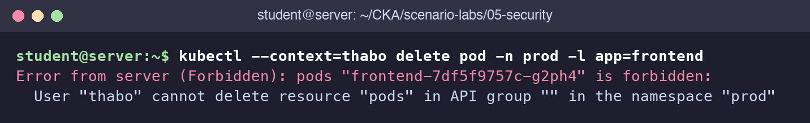

# Lab 5.2: Configuring TLS access to the API: a real login for Thabo

**The situation:** in Lab 5.1 you only **pretended** to be Thabo, with `--as=thabo`. Now Thabo needs a real login of his own, so that he can use `kubectl` from his own machine.

**Goal:** make a certificate for Thabo, have the cluster sign it, and use it to talk to the API server.

**Outline topic:** 5. Security: *Configuring TLS access to API*.

**What you learn:** how TLS protects the API, the cluster's certificate authority (CA), certificate signing requests, kubeconfig users and contexts.

📘 **More detail:** [Lab 5.2 explained](./lab-5.2-tls-access-to-the-api-explained.md): what happens in the cluster at each step, common mistakes and exam notes.

All traffic to the API server is encrypted with **TLS**. Both sides prove who they are with a **certificate**:

| Who | Proves it with | Signed by |
| --- | --- | --- |
| The API server | Its server certificate | The cluster's **CA** |
| You (a user) | A client certificate. The name in it (`CN`) is your user name. | The cluster's **CA** |

A certificate signed by the cluster's CA is trusted by the cluster. So a new user needs three things: a private key, a certificate signed by the CA, and a kubeconfig that uses them.

> **How to use this lab**
>
> - **📋 Copy and paste into your terminal:** copy the whole grey box (the copy button is in its top right corner), paste it into the terminal of your server, and press Enter.
> - **👀 You should see** *(do not paste)*: what the command prints. Names that end in random letters, IP addresses and ages are different on your server. That is normal.
> - **📖 Read only:** something to look at. Do not paste it.
> - **💡 Tip:** a shortcut or an extra. You do not need it to finish the lab.

## Before you start

Go to the folder of this module, and make `dev` your working namespace:

**📋 Copy and paste into your terminal:**

```bash
cd ~/CKA/scenario-labs/05-security
kubectl config set-context --current --namespace=dev
```

**What this does:**

- `cd ~/CKA/scenario-labs/05-security`: Goes to the folder `~/CKA/scenario-labs/05-security`.
- `kubectl config set-context --current --namespace=dev`: Makes `dev` your working namespace: commands without `-n` now work in `dev`.

**👀 You should see** *(do not paste)*:

```text
Context "minikube" modified.
```

💡 **Tip:** `kubens dev` does the same as the second line (see the shortcuts in [setup, Step 5](../00-setup.md)).

## Step 1: look at your own login

**📋 Copy and paste into your terminal:**

```bash
kubectl config view --minify
```

**What this does:** Shows the settings kubectl uses now: the cluster, the user and the context.

**👀 You should see** three parts: the cluster (with its CA and address), the user (with a client certificate and key), and the context that joins them. (Some extra `extensions` lines are left out here.)

```text
apiVersion: v1
clusters:
- cluster:
    certificate-authority: /home/ubuntu/.minikube/ca.crt
    server: https://192.168.49.2:8443
  name: minikube
contexts:
- context:
    cluster: minikube
    namespace: dev
    user: minikube
  name: minikube
current-context: minikube
kind: Config
users:
- name: minikube
  user:
    client-certificate: /home/ubuntu/.minikube/profiles/minikube/client.crt
    client-key: /home/ubuntu/.minikube/profiles/minikube/client.key
```

Read the name inside your own certificate:

**📋 Copy and paste into your terminal:**

```bash
openssl x509 -in ~/.minikube/profiles/minikube/client.crt -noout -subject -issuer
```

**What this does:** Shows who a certificate is for (subject) and who signed it (issuer).

**👀 You should see** *(do not paste)*:

```text
subject=O = system:masters, CN = minikube-user
issuer=CN = minikubeCA
```

`CN` is the user name, `O` is the group. That is where `kubectl auth whoami` got its answer in Lab 5.1. Thabo needs the same, with `CN=thabo`.

## Step 2: make a key and a certificate request

**📋 Copy and paste into your terminal:**

```bash
mkdir -p ~/thabo
openssl genrsa -out ~/thabo/thabo.key 2048
openssl req -new -key ~/thabo/thabo.key -out ~/thabo/thabo.csr -subj "/CN=thabo"
ls ~/thabo
```

**What this does:**

- `mkdir -p ~/thabo`: Makes the folder `~/thabo`.
- `openssl genrsa -out ~/thabo/thabo.key 2048`: Makes a new private key in `~/thabo/thabo.key`.
- `openssl req -new -key ...`: Makes a certificate request (`~/thabo/thabo.csr`) for the user name in `CN=`.
- `ls ~/thabo`: Lists the files in `~/thabo`.

**👀 You should see** *(do not paste)*:

```text
thabo.csr  thabo.key
```

`CN=thabo` is the user name Kubernetes will see.

## Step 3: send the request to the cluster

The file `developer-csr.yaml` in this folder is a CertificateSigningRequest with the word `REQUEST` where the request must go. The first line below puts Thabo's request in its place, and sends the result to the cluster.

**📋 Copy and paste into your terminal:**

```bash
sed "s/REQUEST/$(base64 -w0 ~/thabo/thabo.csr)/" developer-csr.yaml | kubectl apply -f -
kubectl get csr thabo
```

**What this does:**

- `sed "s/REQUEST/$(base64 -w0 ~/thabo/thabo.csr)/" ...`: Puts Thabo's request (encoded with `base64`) in the place of the word `REQUEST` in `developer-csr.yaml`, and sends the result straight to `kubectl apply`.
- `kubectl get csr thabo`: Lists the certificate signing request `thabo`.

**👀 You should see** *(do not paste)*:

```text
certificatesigningrequest.certificates.k8s.io/thabo created
NAME    AGE   SIGNERNAME                            REQUESTOR       REQUESTEDDURATION   CONDITION
thabo   0s    kubernetes.io/kube-apiserver-client   minikube-user   24h                 Pending
```

`Pending`: the request waits for an administrator.

## Step 4: approve it (you are the administrator)

**📋 Copy and paste into your terminal:**

```bash
kubectl certificate approve thabo
kubectl get csr thabo
```

**What this does:**

- `kubectl certificate approve thabo`: Approves (signs) the certificate request `thabo`.
- `kubectl get csr thabo`: Lists the certificate signing request `thabo`.

**👀 You should see** *(do not paste)*:

```text
certificatesigningrequest.certificates.k8s.io/thabo approved
NAME    AGE   SIGNERNAME                            REQUESTOR       REQUESTEDDURATION   CONDITION
thabo   5s    kubernetes.io/kube-apiserver-client   minikube-user   24h                 Approved,Issued
```

## Step 5: fetch the certificate and make the login

Three lines:

1. Save Thabo's signed certificate in the file `~/thabo/thabo.crt`.
2. Add a user `thabo` to your kubectl settings, with his key and certificate.
3. Add a context `thabo`: the cluster `minikube`, used as the user `thabo`.

**📋 Copy and paste into your terminal:**

```bash
kubectl get csr thabo -o jsonpath="{.status.certificate}" | base64 -d > ~/thabo/thabo.crt
kubectl config set-credentials thabo --client-key=$HOME/thabo/thabo.key --client-certificate=$HOME/thabo/thabo.crt --embed-certs=true
kubectl config set-context thabo --cluster=minikube --user=thabo
```

**What this does:**

- `kubectl get csr thabo ...`: Takes the signed certificate out of the request `thabo`, decodes it, and saves it in `~/thabo/thabo.crt`.
- `kubectl config set-credentials thabo ...`: Adds the user `thabo` to your kubectl settings, with its key and certificate.
- `kubectl config set-context thabo ...`: Makes a context called `thabo`: the cluster `minikube`, used as the user `thabo`.

**👀 You should see** *(do not paste)*:

```text
User "thabo" set.
Context "thabo" created.
```

## Step 6: work as Thabo

`--context=thabo` runs one command as Thabo. You stay the administrator for all other commands.

**📋 Copy and paste into your terminal:**

```bash
kubectl --context=thabo get pods -n dev
```

**What this does:** As the user of the context `thabo`: Lists the pods in the namespace `dev`.

**👀 You should see** the DEV pods *(do not paste)*:

```text
NAME                        READY   STATUS    RESTARTS   AGE
backend-c5d9479f-vcr7k      1/1     Running   0          4h39m
backend-c5d9479f-xqnqg      1/1     Running   0          4h39m
db-6df5dcf549-wqt4q         1/1     Running   0          6h30m
frontend-77994594d8-5s89x   1/1     Running   0          6h30m
frontend-77994594d8-n9nzj   1/1     Running   0          6h30m
```

Now Thabo tries to delete the PROD frontend pods:

**📋 Copy and paste into your terminal:**

```bash
kubectl --context=thabo delete pod -n prod -l app=frontend
```

**What this does:** As the user of the context `thabo`: Deletes the pod with the label `app=frontend` in the namespace `prod`.

**👀 You should see** *(do not paste)*:

```text
Error from server (Forbidden): pods "frontend-5fddf7f475-5248t" is forbidden: User "thabo" cannot delete resource "pods" in API group "" in the namespace "prod"
Error from server (Forbidden): pods "frontend-5fddf7f475-rwg72" is forbidden: User "thabo" cannot delete resource "pods" in API group "" in the namespace "prod"
```



And the nodes:

**📋 Copy and paste into your terminal:**

```bash
kubectl --context=thabo get nodes
```

**What this does:** As the user of the context `thabo`: Lists the nodes.

**👀 You should see** *(do not paste)*:

```text
Error from server (Forbidden): nodes is forbidden: User "thabo" cannot list resource "nodes" in API group "" at the cluster scope
```

`Forbidden` is the word to remember: the cluster knows **who** you are, but you are **not allowed**.

## Step 7: talk to the API without kubectl

`kubectl` is only a client. Anything that has the certificate can talk to the API over TLS. Ask the API for the DEV pods with `curl`, as Thabo:

**📋 Copy and paste into your terminal:**

```bash
curl -s --cacert ~/.minikube/ca.crt --cert ~/thabo/thabo.crt --key ~/thabo/thabo.key \
  https://$(minikube ip):8443/api/v1/namespaces/dev/pods | jq -r '.items[].metadata.name'
```

**What this does:** Asks the API server for the pods in `dev` without kubectl, logging in with Thabo's certificate and key. `$(minikube ip):8443` is the address of the API server. `| jq` keeps only the pod names from the JSON answer.

**👀 You should see** the names of the DEV pods *(do not paste)*:

```text
backend-ffd5f958c-l6xv2
backend-ffd5f958c-xbsl4
db-57cbf5fcc-xnjgs
frontend-f5766bb49-kcj9q
frontend-f5766bb49-sd5g2
```

`jq` only picks the pod names out of the long answer of the API.

And without a certificate?

**📋 Copy and paste into your terminal:**

```bash
curl -s --cacert ~/.minikube/ca.crt https://$(minikube ip):8443/api/v1/namespaces/dev/pods | grep -E '"message"|"code"'
```

**What this does:** Asks the same question without a certificate, so the API server does not know who you are. `| grep` keeps only the lines with `"message"` or `"code"`.

**👀 You should see** *(do not paste)*:

```text
  "message": "pods is forbidden: User \"system:anonymous\" cannot list resource \"pods\" in API group \"\" in the namespace \"dev\"",
  "code": 403
```

No certificate: the API server calls you `system:anonymous`, and RBAC gives that user nothing.

| Option | Meaning |
| --- | --- |
| `--cacert` | The cluster's CA: with it, `curl` checks that it really talks to your API server |
| `--cert`, `--key` | Thabo's certificate and key: with them, the API server knows it is Thabo |

💡 **Tip:** with `kubectx` ([setup, Step 5](../00-setup.md)) you can switch to Thabo for all commands: `kubectx thabo`. Then every `kubectl` command runs as Thabo. Switch back with `kubectx minikube`. Do not forget to switch back: as Thabo you cannot do the next labs.

💡 **Exam tip:** the exam gives you a `.csr` file and asks you to create the CertificateSigningRequest, approve it and bind a role. The signer name for users is always `kubernetes.io/kube-apiserver-client`, and the usage is `client auth`. Search the docs for "certificate signing requests" to copy the YAML.

✅ **Check:** `kubectl --context=thabo get pods -n dev` shows the DEV pods, and deleting a pod in `prod` as Thabo gives `Forbidden`.

## More practice

Thabo's login is done. The clean-up at the end removes everything these exercises create; Thabo's login stays.

### 🟡 Practice 1: how long is Thabo's certificate good for?

**📋 Copy and paste into your terminal:**

```bash
openssl x509 -in ~/thabo/thabo.crt -noout -subject -issuer -dates
kubectl config get-contexts
```

**What this does:**

- `openssl x509 ... -dates`: Shows who the certificate is for, who signed it, and from when until when it is valid.
- `kubectl config get-contexts`: Lists the contexts in your kubeconfig. The `*` marks the one you use now.

**👀 You should see** `subject=CN = thabo`, `issuer=CN = minikubeCA`, and a `notAfter` date one day after `notBefore`: `expirationSeconds: 86400` in `developer-csr.yaml` asked for 24 hours. Two contexts are listed: `minikube` (with the `*`) and `thabo`.

When the certificate runs out, Thabo gets `Unauthorized` (401): the cluster no longer knows **who** he is. That is a different error from `Forbidden` (403): known, but not allowed.

### 🟡 Practice 2: a new user who gets her rights from a group

Lerato joins the team. She gets no RoleBinding of her own: she is in the group `shop-devs`, and the group gets the rights. The group goes in the certificate, as `O=`.

**📋 Copy and paste into your terminal:**

```bash
mkdir -p ~/lerato
openssl genrsa -out ~/lerato/lerato.key 2048
openssl req -new -key ~/lerato/lerato.key -out ~/lerato/lerato.csr -subj "/CN=lerato/O=shop-devs"
kubectl delete csr lerato --ignore-not-found
sed -e "s/name: thabo/name: lerato/" -e "s/REQUEST/$(base64 -w0 ~/lerato/lerato.csr)/" developer-csr.yaml | kubectl apply -f -
kubectl certificate approve lerato
```

**What this does:**

- `mkdir -p ~/lerato`: Makes the folder `~/lerato`.
- `openssl genrsa ...`: Makes Lerato's private key.
- `openssl req ... -subj "/CN=lerato/O=shop-devs"`: Makes her certificate request: user `lerato`, group `shop-devs`.
- `kubectl delete csr lerato --ignore-not-found`: Removes an old request with this name, if there is one (from an earlier try). A request cannot be changed, only made again.
- `sed -e ... -e ... developer-csr.yaml | kubectl apply -f -`: Uses the same file as Step 3, with the name `lerato` instead of `thabo` and her request in the place of `REQUEST`, and sends it to the cluster.
- `kubectl certificate approve lerato`: Approves (signs) her request.

**👀 You should see** *(do not paste)*:

```text
certificatesigningrequest.certificates.k8s.io/lerato created
certificatesigningrequest.certificates.k8s.io/lerato approved
```

Now make her login, and bind the **group** (not Lerato) to `view` in `uat`:

**📋 Copy and paste into your terminal:**

```bash
kubectl get csr lerato -o jsonpath="{.status.certificate}" | base64 -d > ~/lerato/lerato.crt
kubectl config set-credentials lerato --client-key=$HOME/lerato/lerato.key --client-certificate=$HOME/lerato/lerato.crt --embed-certs=true
kubectl config set-context lerato --cluster=minikube --user=lerato
kubectl create rolebinding shop-devs-view -n uat --clusterrole=view --group=shop-devs
kubectl --context=lerato auth whoami
```

**What this does:**

- `kubectl get csr lerato ... > ~/lerato/lerato.crt`: Saves her signed certificate.
- `kubectl config set-credentials lerato ...`: Adds the user `lerato` to your kubectl settings.
- `kubectl config set-context lerato ...`: Makes a context `lerato`: the cluster `minikube`, used as the user `lerato`.
- `kubectl create rolebinding shop-devs-view ... --group=shop-devs`: Gives the group `shop-devs` the role `view` in `uat`.
- `kubectl --context=lerato auth whoami`: Shows who the cluster thinks Lerato is.

**👀 You should see** at the end *(do not paste)*:

```text
ATTRIBUTE   VALUE
Username    lerato
Groups      [shop-devs system:authenticated]
```

**📋 Copy and paste into your terminal:**

```bash
kubectl --context=lerato get pods -n uat
kubectl --context=lerato get pods -n prod
```

**What this does:** As Lerato: lists the pods in `uat`, then in `prod`.

**👀 You should see** the UAT pods, then `Forbidden` for `prod`. Her rights come only from her group.

### 🟡 Practice 3: check a request before you approve it

An administrator approves what is **in** the request, not what its name says. Someone sends a request named `mallory` that asks for the administrator group `system:masters`:

**📋 Copy and paste into your terminal:**

```bash
mkdir -p ~/mallory
openssl genrsa -out ~/mallory/mallory.key 2048
openssl req -new -key ~/mallory/mallory.key -out ~/mallory/mallory.csr -subj "/CN=mallory/O=system:masters"
sed -e "s/name: thabo/name: mallory/" -e "s/REQUEST/$(base64 -w0 ~/mallory/mallory.csr)/" developer-csr.yaml | kubectl apply -f -
```

**What this does:**

- The `mkdir` and `openssl` lines: Make a key and a request for the user `mallory` in the group `system:masters`.
- `sed ... | kubectl apply -f -`: Tries to send it to the cluster as a CertificateSigningRequest named `mallory`.

**👀 You should see** *(do not paste)*:

```text
Error from server (Forbidden): error when creating "STDIN": certificatesigningrequests.certificates.k8s.io "mallory" is forbidden: use of kubernetes.io/kube-apiserver-client signer with system:masters group is not allowed
```

`system:masters` may do **everything**, and RBAC cannot take that away. So the API server refuses such a request before anyone can approve it.

But `system:masters` is not the only powerful group. Look which groups have the role `cluster-admin`:

**📋 Copy and paste into your terminal:**

```bash
kubectl get clusterrolebindings -o wide | grep -E "^NAME|cluster-admin"
```

**What this does:** Lists the ClusterRoleBindings with their role, users and groups, and keeps the header and the lines with `cluster-admin`.

**👀 You should see** among others the binding `kubeadm:cluster-admins`, which gives `cluster-admin` to the **group** `kubeadm:cluster-admins`. kubeadm (and so minikube) makes it for the administrators' own certificates. The API server does **not** block that group. Try again with it:

**📋 Copy and paste into your terminal:**

```bash
openssl req -new -key ~/mallory/mallory.key -out ~/mallory/mallory.csr -subj "/CN=mallory/O=kubeadm:cluster-admins"
kubectl delete csr mallory --ignore-not-found
sed -e "s/name: thabo/name: mallory/" -e "s/REQUEST/$(base64 -w0 ~/mallory/mallory.csr)/" developer-csr.yaml | kubectl apply -f -
kubectl get csr mallory
```

**What this does:**

- `openssl req ... -subj "/CN=mallory/O=kubeadm:cluster-admins"`: Makes a new request: user `mallory`, in the group `kubeadm:cluster-admins`.
- `kubectl delete csr mallory --ignore-not-found`: Removes an old request `mallory`, if there is one (from an earlier try).
- `sed ... | kubectl apply -f -`: Sends it to the cluster as the CertificateSigningRequest `mallory`.
- `kubectl get csr mallory`: Shows it.

**👀 You should see** `mallory` as `Pending`. The name looks harmless. Look inside before you decide:

**📋 Copy and paste into your terminal:**

```bash
kubectl get csr mallory -o jsonpath="{.spec.request}" | base64 -d | openssl req -noout -subject
```

**What this does:** Takes the request out of the CertificateSigningRequest, decodes it, and shows the name and group in it.

**👀 You should see** *(do not paste)*:

```text
subject=CN = mallory, O = kubeadm:cluster-admins
```

If you approve this, Mallory can do everything in the cluster. Refuse it:

**📋 Copy and paste into your terminal:**

```bash
kubectl certificate deny mallory
kubectl get csr mallory
```

**What this does:**

- `kubectl certificate deny mallory`: Refuses the request `mallory`. No certificate is made.
- `kubectl get csr mallory`: Shows the request.

**👀 You should see** `Denied` in the column `CONDITION`. The rule: before `kubectl certificate approve`, always read the `O=` of the request, and check what that group may do.

### 🔵 Optional 4: a kubeconfig file to give to Thabo

Thabo works on his own machine. Give him one file with everything in it, and nothing of yours:

**📋 Copy and paste into your terminal:**

```bash
kubectl config view --minify --flatten --context=thabo > ~/thabo/thabo.kubeconfig
kubectl --kubeconfig ~/thabo/thabo.kubeconfig config use-context thabo
kubectl --kubeconfig ~/thabo/thabo.kubeconfig config get-contexts
kubectl --kubeconfig ~/thabo/thabo.kubeconfig get pods -n dev
```

**What this does:**

- `kubectl config view --minify --flatten --context=thabo > ...`: Writes only the parts of the context `thabo` (the cluster, the user `thabo`, the context) into a new file. `--flatten` puts the certificates **inside** the file instead of pointing to files.
- `kubectl --kubeconfig ... config use-context thabo`: Makes `thabo` the context of that file.
- `kubectl --kubeconfig ... config get-contexts`: Lists the contexts in that file.
- `kubectl --kubeconfig ... get pods -n dev`: Uses that file, so as Thabo, to list the DEV pods.

**👀 You should see** only the context `thabo` in the file, and the DEV pods.

⚠️ The file holds Thabo's private key. Treat it like a password: send it safely, and only to him.

### 🔵 Optional 5: the API server's own certificate

You trust the API server because its certificate is signed by the cluster's CA. Look at it:

**📋 Copy and paste into your terminal:**

```bash
openssl s_client -connect $(minikube ip):8443 </dev/null 2>/dev/null | openssl x509 -noout -subject -issuer -ext subjectAltName
```

**What this does:** Connects to the API server, takes the certificate it shows, and prints who it is for, who signed it, and the other names (`subjectAltName`) it is valid for.

**👀 You should see** the issuer `minikubeCA`, and a list of names and addresses such as `kubernetes`, `kubernetes.default.svc`, `localhost`, `10.96.0.1` and the address of `minikube ip`. A client that connects with another name gets a TLS error. That is why `curl` in Step 7 used `$(minikube ip)` and `--cacert`.

### 🔵 Optional 6: challenge

Without looking at the answer: a CI robot `ci-bot` needs a certificate that is valid for **one hour** only, and the role `edit` in `dev`. Make it, and check what it may do.

<details><summary>Show the answer</summary>

**📋 Copy and paste into your terminal:**

```bash
mkdir -p ~/ci-bot
openssl genrsa -out ~/ci-bot/ci-bot.key 2048
openssl req -new -key ~/ci-bot/ci-bot.key -out ~/ci-bot/ci-bot.csr -subj "/CN=ci-bot"
kubectl delete csr ci-bot --ignore-not-found
sed -e "s/name: thabo/name: ci-bot/" -e "s/86400/3600/" -e "s/REQUEST/$(base64 -w0 ~/ci-bot/ci-bot.csr)/" developer-csr.yaml | kubectl apply -f -
kubectl certificate approve ci-bot
kubectl get csr ci-bot -o jsonpath="{.status.certificate}" | base64 -d > ~/ci-bot/ci-bot.crt
openssl x509 -in ~/ci-bot/ci-bot.crt -noout -dates
kubectl create rolebinding ci-bot-edit -n dev --clusterrole=edit --user=ci-bot
kubectl auth can-i create deployments -n dev --as=ci-bot
kubectl auth can-i create deployments -n prod --as=ci-bot
```

**What this does:**

- The `mkdir` and `openssl` lines: Make a key and a request for the user `ci-bot`.
- `kubectl delete csr ci-bot --ignore-not-found`: Removes an old request with this name, if there is one (from an earlier try). A request cannot be changed, only made again.
- `sed ... -e "s/86400/3600/" ...`: Uses `developer-csr.yaml` with the name `ci-bot` and `expirationSeconds: 3600` (one hour), and sends it to the cluster.
- `kubectl certificate approve ci-bot`: Approves it.
- `kubectl get csr ci-bot ... > ~/ci-bot/ci-bot.crt`: Saves the signed certificate.
- `openssl x509 ... -dates`: Shows from when until when it is valid.
- `kubectl create rolebinding ci-bot-edit ...`: Gives `ci-bot` the role `edit` in `dev`.
- The two `kubectl auth can-i ...`: Ask: may `ci-bot` create Deployments in `dev`? In `prod`?

**👀 You should see** `notAfter` one hour after `notBefore`, then `yes` and `no`.

</details>

🧹 **Clean up the practice:**

**📋 Copy and paste into your terminal:**

```bash
kubectl delete csr lerato mallory ci-bot --ignore-not-found
kubectl delete rolebinding shop-devs-view -n uat --ignore-not-found
kubectl delete rolebinding ci-bot-edit -n dev --ignore-not-found
kubectl config delete-context lerato 2>/dev/null; kubectl config delete-user lerato 2>/dev/null; true
rm -rf ~/lerato ~/mallory ~/ci-bot ~/thabo/thabo.kubeconfig
kubectl config get-contexts
```

**What this does:**

- `kubectl delete csr lerato mallory ci-bot ...`: Deletes the certificate requests of this practice.
- `kubectl delete rolebinding ...`: Deletes the bindings of this practice.
- `kubectl config delete-context lerato` and `delete-user lerato`: Remove Lerato's login from your kubectl settings.
- `rm -rf ...`: Deletes the keys and certificates of this practice, and Thabo's kubeconfig file.
- `kubectl config get-contexts`: Lists the contexts left.

**👀 You should see** the contexts `minikube` (with the `*`) and `thabo`. Note: deleting a CertificateSigningRequest does not cancel a certificate that was already given out. A certificate is valid until its `notAfter` date. To lock someone out before that, remove their RoleBindings.

**Next:** [Lab 6.1: Application and system logs](../06-logging-monitoring/lab-6.1-application-and-system-logs.md)
