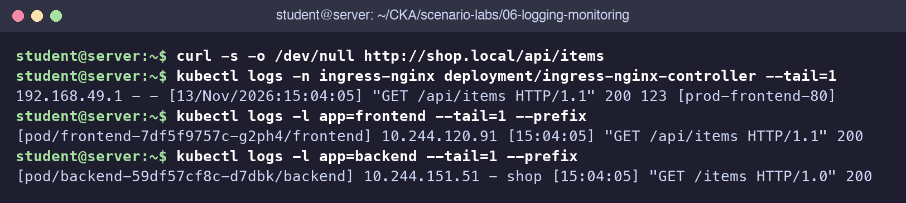

# Lab 6.1: Application and system components logging

**The situation:** a user phones: "the Shop is slow, and sometimes I get an error". You are the operations team. Where do you look?

**Goal:** read the logs of the Shop's own parts, follow one request through all of them, and read the logs of the cluster's own parts.

**Outline topic:** Logging / Monitoring: *Application and system components logging*.

**What you learn:** `kubectl logs` and its options, events, the logs of the control plane pods, the logs of the kubelet.

📘 **More detail:** [Lab 6.1 explained](./lab-6.1-application-and-system-logs-explained.md): what happens in the cluster at each step, common mistakes and exam notes.

| Where to look | What it tells you | Command |
| --- | --- | --- |
| **Application logs** | What your program says | `kubectl logs` |
| **Events** | What Kubernetes did with the pod | `kubectl get events`, `kubectl describe` |
| **System component logs** | What the cluster's own parts say | `kubectl logs -n kube-system`, `journalctl -u kubelet` |

> **How to use this lab**
>
> - **📋 Copy and paste into your terminal:** copy the whole grey box (the copy button is in its top right corner), paste it into the terminal of your server, and press Enter.
> - **👀 You should see** *(do not paste)*: what the command prints. Names that end in random letters, IP addresses and ages are different on your server. That is normal.
> - **📖 Read only:** something to look at. Do not paste it.
> - **💡 Tip:** a shortcut or an extra. You do not need it to finish the lab.

## Before you start

Go to the folder of this module, and make `dev` your working namespace:

**📋 Copy and paste into your terminal:**

```bash
cd ~/CKA/scenario-labs/06-logging-monitoring
kubectl config set-context --current --namespace=dev
```

**What this does:**

- `cd ~/CKA/scenario-labs/06-logging-monitoring`: Goes to the folder `~/CKA/scenario-labs/06-logging-monitoring`.
- `kubectl config set-context --current --namespace=dev`: Makes `dev` your working namespace: commands without `-n` now work in `dev`.

**👀 You should see** *(do not paste)*:

```text
Context "minikube" modified.
```

💡 **Tip:** `kubens dev` does the same as the second line (see the shortcuts in [setup, Step 5](../00-setup.md)).

## Part A: the logs of the Shop

### Step 1: read the logs of the backend

**📋 Copy and paste into your terminal:**

```bash
kubectl logs deployment/backend -n prod --tail=4
```

**What this does:** Shows the log (what the program printed) of one pod of the Deployment `backend` in the namespace `prod`: only the last 4 lines.

**👀 You should see** the last four log lines of one PROD backend pod, something like *(do not paste)*:

```text
Found 2 pods, using pod/backend-59df57cf8c-f4ssd
13/Nov/2026:15:03:42 +0000: Successfully connected to PostgreSQL 16.16 on aarch64-unknown-linux-musl, ...
13/Nov/2026:15:03:42 +0000: Config reloaded
13/Nov/2026:15:03:42 +0000: Schema cache queried in 5.7 milliseconds
13/Nov/2026:15:03:42 +0000: Schema cache loaded 1 Relations, 0 Relationships, 0 Functions, ...
```

Useful options:

| Option | Meaning |
| --- | --- |
| `--tail=20` | Only the last 20 lines |
| `-f` | Keep following (stop with Ctrl+C) |
| `--since=10m` | Only the last 10 minutes |
| `--previous` | The logs of the container **before** its last restart |
| `-l app=backend --prefix` | All pods with this label, with the pod name in front |

### Step 2: follow one request through all three parts

Send one request to the PROD Shop through its hostname (Lab 3.2), then look at the last log line of each part.

In this example the request arrived at 15:04:05. One frontend pod and one backend pod show it. The other two pods show an older line: the Service sent this request to their neighbour (load balancing, Lab 3.2).

**📋 Copy and paste into your terminal:**

```bash
curl -s -o /dev/null http://shop.local/api/items
sleep 2
kubectl logs -n ingress-nginx deployment/ingress-nginx-controller --tail=1
kubectl logs -n prod -l app=frontend --tail=1 --prefix
kubectl logs -n prod -l app=backend --tail=1 --prefix
```

**What this does:**

- `curl -s -o /dev/null http://shop.local/api/items`: Asks for `http://shop.local/api/items`, as a web browser would, and prints the answer.
- `sleep 2`: Waits 2 seconds, to give Kubernetes time.
- `kubectl logs -n ingress-nginx ...`: Shows the log (what the program printed) of one pod of the Deployment `ingress-nginx-controller` in the namespace `ingress-nginx`: only the last line.
- `kubectl logs -n prod -l app=frontend --tail=1 --prefix`: Shows the log (what the program printed) of all pods with the label `app=frontend` in the namespace `prod`: only the last line, with the pod name in front of each line.
- `kubectl logs -n prod -l app=backend --tail=1 --prefix`: Shows the log (what the program printed) of all pods with the label `app=backend` in the namespace `prod`: only the last line, with the pod name in front of each line.

**👀 You should see** the last line of the Ingress controller and of every frontend and backend pod. Find your request in them: `GET /api/items` at the Ingress and at one frontend pod, and `GET /items` at one backend pod, all at the same second *(do not paste)*:

```text
192.168.49.1 - - [13/Nov/2026:15:04:05 +0000] "GET /api/items HTTP/1.1" 200 123 "-" "curl/8.5.0" 82 0.072 [prod-frontend-80] ...
[pod/frontend-7df5f9757c-g2ph4/frontend] 10.244.120.91 - - [13/Nov/2026:15:04:05 +0000] "GET /api/items HTTP/1.1" 200 123 "-" "curl/8.5.0" ...
[pod/frontend-7df5f9757c-s2jrb/frontend] 10.244.120.91 - - [13/Nov/2026:15:02:32 +0000] "GET /api/items HTTP/1.1" 200 123 "-" "curl/8.5.0" ...
[pod/backend-59df57cf8c-d7dbk/backend] 10.244.151.51 - shop [13/Nov/2026:15:04:05 +0000] "GET /items HTTP/1.0" 200 - "" "curl/8.5.0"
[pod/backend-59df57cf8c-f4ssd/backend] 13/Nov/2026:15:03:42 +0000: Schema cache loaded 1 Relations, ...
```

If `curl` says it could not resolve `shop.local`, your server forgot the name. Add it again with the `echo` command of Lab 3.2, Step 8.



That is the path of every request: **Ingress → frontend → backend → database**. When the Shop is broken, you walk this path and find where the request stops.

### Step 3: read the events

**📋 Copy and paste into your terminal:**

```bash
kubectl get events -n prod --sort-by=.lastTimestamp | tail -5
```

**What this does:** Lists the events (what Kubernetes did, step by step) in the namespace `prod`, oldest first. `| tail` shows only the last 5 lines.

**👀 You should see** the last five things that happened in `prod`, something like *(do not paste)*:

```text
20s   Normal    Pulled              pod/backend-59df57cf8c-d7dbk   Container image "postgrest/postgrest:v12.2.3" already present on machine
13s   Normal    Killing             pod/backend-976f8c445-fssvd    Stopping container backend
13s   Normal    ScalingReplicaSet   deployment/backend             Scaled down replica set backend-976f8c445 from 1 to 0
13s   Normal    SuccessfulDelete    replicaset/backend-976f8c445   Deleted pod: backend-976f8c445-fssvd
12s   Warning   Unhealthy           pod/backend-976f8c445-fssvd    Readiness probe failed: ...
```

Events are kept for about one hour. `Normal` is information. `Warning` is where you look first.

## Part B: the logs of the cluster itself

### Step 4: the control plane pods

The parts of the control plane are pods too, so `kubectl logs` works on them:

**📋 Copy and paste into your terminal:**

```bash
kubectl logs -n kube-system kube-scheduler-minikube --tail=3
kubectl logs -n kube-system kube-controller-manager-minikube --tail=3
```

**What this does:**

- `kubectl logs -n kube-system kube-scheduler-minikube --tail=3`: Shows the log (what the program printed) of the pod `kube-scheduler-minikube` in the namespace `kube-system`: only the last 3 lines.
- `kubectl logs -n kube-system ...`: Shows the log (what the program printed) of the pod `kube-controller-manager-minikube` in the namespace `kube-system`: only the last 3 lines.

**👀 You should see** the last lines of the scheduler and the controller manager. When a pod stays `Pending` and the events say nothing, the scheduler's log is the place to look.

### Step 5: the kubelet

The **kubelet** is not a pod. It is a service on every node, so its log is on the node, in `journalctl`:

**📋 Copy and paste into your terminal:**

```bash
minikube ssh -n minikube-m02 -- sudo journalctl -u kubelet --no-pager -n 5
```

**What this does:** Shows the last 5 lines of the kubelet's log on the node `minikube-m02`. The kubelet is a service on the node, not a pod, so `kubectl logs` cannot show it: `journalctl` reads it on the node.

**👀 You should see** the last five log lines of the kubelet on `minikube-m02`. When a node is `NotReady`, this is the log to read.

### Step 6: when the API server itself is down

If the API server does not run, `kubectl logs` cannot work. Then you read the container's log on the node, with `crictl`:

**📋 Copy and paste into your terminal:**

```bash
minikube ssh -- "sudo crictl ps --name kube-apiserver -q | xargs sudo crictl logs --tail 3"
```

**What this does:** On the control plane node: finds the API server container with `crictl` and shows its last 3 log lines.

**👀 You should see** the last three log lines of the API server, read straight from the node.

## Where each log lives

| Part | It is | Read its log with |
| --- | --- | --- |
| Your application | A pod | `kubectl logs <pod>` |
| API server, scheduler, controller manager, etcd | Static pods in `kube-system` | `kubectl logs -n kube-system <pod>`, or `crictl logs` on the node |
| kubelet, container runtime | Services on the node | `journalctl -u kubelet`, `journalctl -u containerd` |

💡 **Tip:** add `-f` to follow a log live: `kubectl logs -n prod deployment/backend -f`. New lines appear as they come. Stop with **Ctrl+C**.

💡 **Exam tip:** a pod that keeps restarting has lost its logs. Use `kubectl logs <pod> --previous` to read what it said before it died.

✅ **Check:** you found the same request in the logs of the Ingress controller, the frontend and the backend, and you read the kubelet's log on a node.

**Next:** [Lab 6.2: Cluster-wide logging](./lab-6.2-cluster-wide-logging.md)
