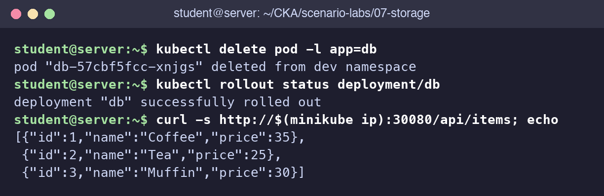

# Lab 7.1: Storage architecture: why the Shop keeps losing its Juice

**The situation:** three times now the Shop lost the items that were added: when the database stopped (Lab 1.7), when the cluster restarted (Lab 2.1) and when a node was drained (Lab 2.7). For a real shop that means lost orders.

**Goal:** see the problem one more time, on purpose, and understand the parts Kubernetes offers to solve it.

**Outline topic:** Storage: *Storage architecture*.

**What you learn:** container files, volumes, `emptyDir`, and the three storage objects: PersistentVolume, PersistentVolumeClaim, StorageClass.

> **How to use this lab**
>
> - **📋 Copy and paste into your terminal:** copy the whole grey box (the copy button is in its top right corner), paste it into the terminal of your server, and press Enter.
> - **👀 You should see** *(do not paste)*: what the command prints. Names that end in random letters, IP addresses and ages are different on your server. That is normal.
> - **📖 Read only:** something to look at. Do not paste it.
> - **💡 Tip:** a shortcut or an extra. You do not need it to finish the lab.

## Where can a pod keep files?

| Place | Lives as long as | Good for |
| --- | --- | --- |
| Inside the container | The container. A restart wipes it. | Nothing you want to keep |
| A volume of type `emptyDir` | The **pod**. A new pod gets a new, empty one. | Temporary files, caches |
| A **PersistentVolume** | You decide. It outlives pods. | Databases, uploads: data you must keep |

The Shop's database uses an `emptyDir` (Lab 1.6). That is the problem.

## Before you start

Go to the folder of this module, and make `dev` your working namespace:

**📋 Copy and paste into your terminal:**

```bash
cd ~/CKA/scenario-labs/07-storage
kubectl config set-context --current --namespace=dev
```

**What this does:**

- `cd ~/CKA/scenario-labs/07-storage`: Goes to the folder `~/CKA/scenario-labs/07-storage`.
- `kubectl config set-context --current --namespace=dev`: Makes `dev` your working namespace: commands without `-n` now work in `dev`.

**👀 You should see** *(do not paste)*:

```text
Context "minikube" modified.
```

💡 **Tip:** `kubens dev` does the same as the second line (see the shortcuts in [setup, Step 5](../00-setup.md)).

## Step 1: see the volume the database uses now

**📋 Copy and paste into your terminal:**

```bash
kubectl get deployment db -o jsonpath='{.spec.template.spec.volumes[0]}{"\n"}'
```

**What this does:** Reads the Deployment `db`, and prints only one value from it.

**👀 You should see** *(do not paste)*:

```text
{"emptyDir":{},"name":"data"}
```

## Step 2: add an item

**📋 Copy and paste into your terminal:**

```bash
curl -s -X POST http://$(minikube ip):30080/api/items \
  -H 'Content-Type: application/json' \
  -d '{"name":"Juice","price":20}' -w '%{http_code}\n'
curl -s http://$(minikube ip):30080/api/items; echo
```

**What this does:**

- `curl -s -X POST ...`: Adds a new item, Juice, to the Shop, as a customer filling in a form would (a POST request). `-w` prints only the answer code: `201` means it was created.
- `curl -s http://$(minikube ip):30080/api/items; echo`: Asks the Shop for its items, as a web browser would.

**👀 You should see** `201`, and then four items *(do not paste)*:

```text
201
[{"id":1,"name":"Coffee","price":35},
 {"id":2,"name":"Tea","price":25},
 {"id":3,"name":"Muffin","price":30},
 {"id":4,"name":"Juice","price":20}]
```

## Step 3: delete the database pod

A pod can be replaced at any time: a node is drained, a pod is evicted, someone deletes it. Do it yourself:

**📋 Copy and paste into your terminal:**

```bash
kubectl delete pod -l app=db
kubectl rollout status deployment/db
sleep 40
curl -s http://$(minikube ip):30080/api/items; echo
```

**What this does:**

- `kubectl delete pod -l app=db`: Deletes the pod with the label `app=db`.
- `kubectl rollout status deployment/db`: Waits until the new pods of the Deployment `db` are all ready, and says when it is done.
- `sleep 40`: Waits 40 seconds, to give the backend time to connect to the new database pod.
- `curl -s http://$(minikube ip):30080/api/items; echo`: Asks the Shop for its items, as a web browser would.

**👀 You should see** only three items *(do not paste)*:

```text
pod "db-5568b9454f-tqm8d" deleted from dev namespace
deployment "db" successfully rolled out
[{"id":1,"name":"Coffee","price":35},
 {"id":2,"name":"Tea","price":25},
 {"id":3,"name":"Muffin","price":30}]
```



The **Juice is gone**. The new pod got a new, empty `emptyDir`, and the database started from its first three items.

If you get an error instead of the list, the backend is still connecting to the new database. Wait 15 seconds and run `shop items` again.

## The solution: three objects

| Object | What it is | Who makes it | Like |
| --- | --- | --- | --- |
| **PersistentVolume (PV)** | A real piece of disk | The administrator | A parking space |
| **PersistentVolumeClaim (PVC)** | A request: "I need 1Gi of disk" | The application | A parking ticket |
| **StorageClass** | The **kind** of disk, and who makes it | The administrator | The type of car park |

A pod never names a disk. It names a **claim**. Kubernetes joins the claim to a volume that fits. That is called **binding**. When the pod is replaced, the new pod uses the same claim, and gets the same disk with the same data.

**📖 Read only (do not paste):**

```text
Pod  →  PersistentVolumeClaim  →  PersistentVolume  →  the real disk
        "I need 1Gi"               "here is 1Gi"        (a folder, NFS, a cloud disk)
```

## Step 4: see what storage the cluster has now

**📋 Copy and paste into your terminal:**

```bash
kubectl get storageclass
kubectl get pv
kubectl get pvc -A
```

**What this does:**

- `kubectl get storageclass`: Lists the storage classes.
- `kubectl get pv`: Lists the PersistentVolumes (disks).
- `kubectl get pvc -A`: Lists the PersistentVolumeClaims (requests for a disk) in all namespaces.

**👀 You should see** one storage class, and no volumes and no claims yet *(do not paste)*:

```text
NAME                 PROVISIONER                RECLAIMPOLICY   VOLUMEBINDINGMODE   ALLOWVOLUMEEXPANSION   AGE
standard (default)   k8s.io/minikube-hostpath   Delete          Immediate           false                  4m14s
No resources found
No resources found
```

In the next lab you make the first disk, and give it to the database.

💡 **Exam tip:** a PersistentVolume belongs to the **cluster** (no namespace). A PersistentVolumeClaim belongs to a **namespace**. That is why `kubectl get pv` needs no `-n`, and `kubectl get pvc` does.

✅ **Check:** you saw the Juice disappear, and you can name the three storage objects.

**Next:** [Lab 7.2: Storage backends](./lab-7.2-storage-backends.md)
