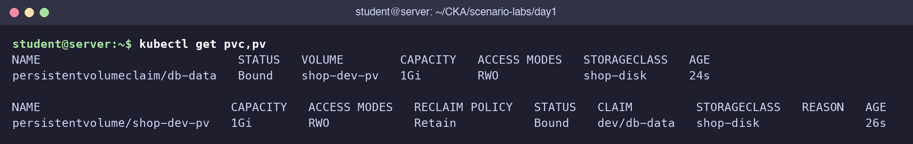

# Lab 7.2: Storage backends: a real disk for the database

**The situation:** the database needs a disk that stays when the pod goes.

**Goal:** make a disk on a node (a **local** backend), give it to the DEV database, and prove that the data survives. Then read what the same disk looks like on a network backend (NFS, GlusterFS).

**Outline topic:** Storage: *Storage backend in Kubernetes: local, NFS, GlusterFS*.

**What you learn:** PersistentVolume, PersistentVolumeClaim, access modes, reclaim policy, local and network storage backends.

A **storage backend** is where the bytes really are. The PersistentVolume hides it: the application only sees a claim.

| Backend | Where the data is | Can pods on different nodes share it? |
| --- | --- | --- |
| **Local** (`hostPath`, `local`) | A folder or disk on **one node** | No. The pod must run on that node. |
| **NFS** | A file server on the network | Yes |
| **GlusterFS**, Ceph | A storage cluster of several servers | Yes |
| Cloud disks | A disk of the cloud provider | Depends on the type |

Your cluster has no file server, so you use the local backend. The steps are the same for every backend. Only one part of the PersistentVolume is different.

> **How to use this lab**
>
> - **📋 Copy and paste into your terminal:** copy the whole grey box (the copy button is in its top right corner), paste it into the terminal of your server, and press Enter.
> - **👀 You should see** *(do not paste)*: what the command prints. Names that end in random letters, IP addresses and ages are different on your server. That is normal.
> - **📖 Read only:** something to look at. Do not paste it.
> - **💡 Tip:** a shortcut or an extra. You do not need it to finish the lab.

## Before you start

Go to the folder of this module, and make `dev` your working namespace:

**📋 Copy and paste into your terminal:**

```bash
cd ~/CKA/scenario-labs/07-storage
kubectl config set-context --current --namespace=dev
```

**What this does:**

- `cd ~/CKA/scenario-labs/07-storage`: Goes to the folder `~/CKA/scenario-labs/07-storage`.
- `kubectl config set-context --current --namespace=dev`: Makes `dev` your working namespace: commands without `-n` now work in `dev`.

**👀 You should see** *(do not paste)*:

```text
Context "minikube" modified.
```

💡 **Tip:** `kubens dev` does the same as the second line (see the shortcuts in [setup, Step 5](../00-setup.md)).

## Part A: a local disk for the DEV database

### Step 1: look at the disk (PersistentVolume)

**📋 Copy and paste into your terminal:**

```bash
cat db-pv-dev.yaml
```

**What this does:** Shows what is in the file `db-pv-dev.yaml`.

**👀 You should see** *(do not paste)*:

```yaml
apiVersion: v1
kind: PersistentVolume
metadata:
  name: shop-dev-pv
spec:
  capacity:
    storage: 1Gi
  accessModes:
  - ReadWriteOnce
  persistentVolumeReclaimPolicy: Retain      # keep the data when the claim is deleted
  storageClassName: shop-disk
  hostPath:
    path: /data/shop/dev                     # a folder on the node
    type: DirectoryOrCreate
  nodeAffinity:                              # the folder is on this node only
    required:
      nodeSelectorTerms:
      - matchExpressions:
        - key: kubernetes.io/hostname
          operator: In
          values:
          - minikube-m02
```

| Line | Meaning |
| --- | --- |
| `capacity: 1Gi` | The size of the disk |
| `accessModes: ReadWriteOnce` | One node at a time may read and write it |
| `persistentVolumeReclaimPolicy: Retain` | Keep the data, even when the claim is deleted |
| `hostPath` | **The backend**: the folder `/data/shop/dev` on a node |
| `nodeAffinity` | That folder is on `minikube-m02`, so the database pod must run there (you know this rule from Lab 4.2) |

The access modes:

| Mode | Short | Meaning |
| --- | --- | --- |
| `ReadWriteOnce` | RWO | Read and write, by one node |
| `ReadOnlyMany` | ROX | Read only, by many nodes |
| `ReadWriteMany` | RWX | Read and write, by many nodes (needs a network backend) |

### Step 2: create the storage class and the disk

**📋 Copy and paste into your terminal:**

```bash
kubectl apply -f db-storageclass.yaml -f db-pv-dev.yaml
kubectl get pv
```

**What this does:**

- `kubectl apply -f db-storageclass.yaml -f db-pv-dev.yaml`: Creates (or updates) what is described in `db-storageclass.yaml` and `db-pv-dev.yaml`.
- `kubectl get pv`: Lists the PersistentVolumes (disks).

**👀 You should see** *(do not paste)*:

```text
storageclass.storage.k8s.io/shop-disk created
persistentvolume/shop-dev-pv created
NAME          CAPACITY   ACCESS MODES   RECLAIM POLICY   STATUS      CLAIM   STORAGECLASS   VOLUMEATTRIBUTESCLASS   REASON   AGE
shop-dev-pv   1Gi        RWO            Retain           Available           shop-disk      <unset>                          0s
```

The disk is `Available`: nobody uses it yet. (The storage class `shop-disk` is explained in Lab 7.3.)

### Step 3: ask for the disk (PersistentVolumeClaim)

**📋 Copy and paste into your terminal:**

```bash
cat db-pvc.yaml
```

**What this does:** Shows what is in the file `db-pvc.yaml`.

**👀 You should see** *(do not paste)*:

```yaml
apiVersion: v1
kind: PersistentVolumeClaim
metadata:
  name: db-data
spec:
  storageClassName: shop-disk
  accessModes:
  - ReadWriteOnce
  resources:
    requests:
      storage: 1Gi
```

The claim says what it needs: 1Gi, `ReadWriteOnce`, of the class `shop-disk`. It does not say where.

**📋 Copy and paste into your terminal:**

```bash
kubectl apply -f db-pvc.yaml
kubectl get pvc
```

**What this does:**

- `kubectl apply -f db-pvc.yaml`: Creates (or updates) what is described in `db-pvc.yaml`.
- `kubectl get pvc`: Lists the PersistentVolumeClaims (requests for a disk).

**👀 You should see** *(do not paste)*:

```text
persistentvolumeclaim/db-data created
NAME      STATUS    VOLUME   CAPACITY   ACCESS MODES   STORAGECLASS   VOLUMEATTRIBUTESCLASS   AGE
db-data   Pending                                      shop-disk      <unset>                 0s
```

`Pending` is correct here: this storage class waits until a pod wants the disk.

### Step 4: give the disk to the database

This file is the database Deployment from Lab 1.6, with one change at the end: the `emptyDir` is replaced by the claim.

**📖 Read only (do not paste):**

```yaml
      volumes:
      - name: data
        persistentVolumeClaim:
          claimName: db-data
```

**📋 Copy and paste into your terminal:**

```bash
kubectl apply -f db-deployment-with-disk.yaml
kubectl rollout status deployment/db
```

**What this does:**

- `kubectl apply -f db-deployment-with-disk.yaml`: Creates (or updates) what is described in `db-deployment-with-disk.yaml`.
- `kubectl rollout status deployment/db`: Waits until the new pods of the Deployment `db` are all ready, and says when it is done.

**👀 You should see** *(do not paste)*:

```text
deployment.apps/db configured
deployment "db" successfully rolled out
```

### Step 5: see the claim and the disk joined

**📋 Copy and paste into your terminal:**

```bash
kubectl get pvc,pv
```

**What this does:** Lists the PersistentVolumeClaims and the PersistentVolumes.

**👀 You should see** *(do not paste)*:

```text
NAME                            STATUS   VOLUME        CAPACITY   ACCESS MODES   STORAGECLASS   VOLUMEATTRIBUTESCLASS   AGE
persistentvolumeclaim/db-data   Bound    shop-dev-pv   1Gi        RWO            shop-disk      <unset>                 24s

NAME                           CAPACITY   ACCESS MODES   RECLAIM POLICY   STATUS   CLAIM         STORAGECLASS   VOLUMEATTRIBUTESCLASS   REASON   AGE
persistentvolume/shop-dev-pv   1Gi        RWO            Retain           Bound    dev/db-data   shop-disk      <unset>                          26s
```



Both say `Bound`. And the database pod runs on `minikube-m02`, where the disk is:

**📋 Copy and paste into your terminal:**

```bash
kubectl get pods -l app=db -o wide
```

**What this does:** Lists the pods with the label `app=db`, with extra columns such as the IP address and the node.

**👀 You should see** one pod, `Running`, with `minikube-m02` in the `NODE` column.

### Step 6: the test: add the Juice, delete the pod

**📋 Copy and paste into your terminal:**

```bash
kubectl rollout restart deployment/backend
kubectl rollout status deployment/backend
sleep 10
curl -s -X POST http://$(minikube ip):30080/api/items \
  -H 'Content-Type: application/json' \
  -d '{"name":"Juice","price":20}' -w '%{http_code}\n'
```

**What this does:**

- `kubectl rollout restart deployment/backend`: Replaces the pods of the Deployment `backend` with new ones, one by one.
- `kubectl rollout status deployment/backend`: Waits until the new pods of the Deployment `backend` are all ready, and says when it is done.
- `sleep 10`: Waits 10 seconds, to give Kubernetes time.
- `curl -s -X POST ...`: Adds a new item, Juice, to the Shop, as a customer filling in a form would (a POST request). `-w` prints only the answer code: `201` means it was created.

**👀 You should see** (the last line) *(do not paste)*:

```text
201
```

Now delete the database pod, as in Lab 7.1:

**📋 Copy and paste into your terminal:**

```bash
kubectl delete pod -l app=db
kubectl rollout status deployment/db
sleep 40
curl -s http://$(minikube ip):30080/api/items; echo
```

**What this does:**

- `kubectl delete pod -l app=db`: Deletes the pod with the label `app=db`.
- `kubectl rollout status deployment/db`: Waits until the new pods of the Deployment `db` are all ready, and says when it is done.
- `sleep 40`: Waits 40 seconds, to give the backend time to connect to the new database pod.
- `curl -s http://$(minikube ip):30080/api/items; echo`: Asks the Shop for its items, as a web browser would.

**👀 You should see** *(do not paste)*:

```text
[{"id":1,"name":"Coffee","price":35},
 {"id":2,"name":"Tea","price":25},
 {"id":3,"name":"Muffin","price":30},
 {"id":4,"name":"Juice","price":20}]
```

🎉 The **Juice is still there**. The pod is new, the data is not: it is on the disk.

If you get an error instead of the list, wait 20 seconds and run the `curl` command again.

### Step 7: see the data on the node

**📋 Copy and paste into your terminal:**

```bash
minikube ssh -n minikube-m02 -- sudo ls /data/shop/dev/pgdata | head -5
```

**What this does:** Lists the files of the database on the node `minikube-m02`, in the folder of the PersistentVolume. `| head` shows only the first 5 lines.

**👀 You should see** the files of the database, in the folder the PersistentVolume names *(do not paste)*:

```text
PG_VERSION    pg_hba.conf    pg_replslot   pg_subtrans	postgresql.auto.conf
base	      pg_ident.conf  pg_serial	   pg_tblspc	postgresql.conf
global	      pg_logical     pg_snapshots  pg_twophase	postmaster.opts
pg_commit_ts  pg_multixact   pg_stat	   pg_wal	postmaster.pid
pg_dynshmem   pg_notify      pg_stat_tmp   pg_xact
```

## Part B: the same disk on a network backend

A local disk has one weak point: if the node `minikube-m02` is lost, the data is lost with it. A **network backend** keeps the data outside the nodes, so any node can use it.

### Step 8: read an NFS volume

**📋 Copy and paste into your terminal:**

```bash
cat nfs-pv-example.yaml
```

**What this does:** Shows what is in the file `nfs-pv-example.yaml`.

**👀 You should see** *(do not paste)*:

```yaml
# EXAMPLE ONLY: do not apply. There is no NFS server in the lab.
# This is what a disk on an NFS server looks like. Only the "nfs:" part is different.
apiVersion: v1
kind: PersistentVolume
metadata:
  name: shop-nfs-pv
spec:
  capacity:
    storage: 5Gi
  accessModes:
  - ReadWriteMany                   # NFS can be used by many nodes at the same time
  persistentVolumeReclaimPolicy: Retain
  storageClassName: nfs
  nfs:
    server: 10.0.0.50               # the NFS server
    path: /exports/shop             # the shared folder on it
```

Compare it with `db-pv-dev.yaml`:

| | Local (`db-pv-dev.yaml`) | NFS (`nfs-pv-example.yaml`) |
| --- | --- | --- |
| The backend part | `hostPath: path: /data/shop/dev` | `nfs: server: ... path: ...` |
| `nodeAffinity` | Needed: the folder is on one node | Not needed: every node can reach the server |
| Access mode | `ReadWriteOnce` | `ReadWriteMany` is possible |
| The claim and the Deployment | The same | **The same** |

That last line is the point of the whole design: the application's claim does not change when the backend changes.

### GlusterFS

**GlusterFS** is a storage cluster: several servers that together look like one big disk. Older Kubernetes versions had a built-in `glusterfs:` volume type, next to `nfs:`. It was removed in Kubernetes v1.26. Today GlusterFS, Ceph and cloud disks are connected through a **CSI driver**: a plugin from the storage vendor that you install in the cluster. For the application nothing changes: it still makes a claim.

💡 **Exam tip:** a claim stays `Pending` when no volume fits. Check four things: the **size** (the volume must be at least as big), the **access mode**, the **storage class name** (must be the same on both), and `kubectl describe pvc <name>` for the reason.

✅ **Check:** Step 6 shows four items, with the Juice, after the database pod was deleted.

**Next:** [Lab 7.3: Storage classes and dynamic provisioning](./lab-7.3-storage-classes-and-dynamic-provisioning.md)
