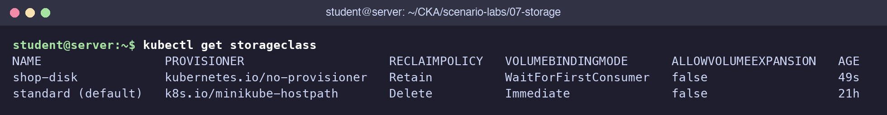

# Lab 7.3: Storage classes and dynamic storage provisioning

**The situation:** in Lab 7.2 the administrator (you) had to make a disk by hand before the database could ask for it. With a hundred applications that does not work. And UAT and PROD still have no disk at all.

**Goal:** let the cluster make a disk by itself when a claim asks for one, understand the two storage classes of your cluster, and give the UAT and PROD databases their disks.

**Outline topic:** Storage: *Storage classes and dynamic storage provisioning*.

**What you learn:** StorageClass, provisioners, static and dynamic provisioning, the default class, binding modes, reclaim policies.

| | Static provisioning (Lab 7.2) | Dynamic provisioning (this lab) |
| --- | --- | --- |
| Who makes the PersistentVolume | The administrator, before | The **StorageClass**, when a claim arrives |
| The application writes | A claim | A claim (the same) |

> **How to use this lab**
>
> - **📋 Copy and paste into your terminal:** copy the whole grey box (the copy button is in its top right corner), paste it into the terminal of your server, and press Enter.
> - **👀 You should see** *(do not paste)*: what the command prints. Names that end in random letters, IP addresses and ages are different on your server. That is normal.
> - **📖 Read only:** something to look at. Do not paste it.
> - **💡 Tip:** a shortcut or an extra. You do not need it to finish the lab.

## Before you start

Go to the folder of this module, and make `dev` your working namespace:

**📋 Copy and paste into your terminal:**

```bash
cd ~/CKA/scenario-labs/07-storage
kubectl config set-context --current --namespace=dev
```

**What this does:**

- `cd ~/CKA/scenario-labs/07-storage`: Goes to the folder `~/CKA/scenario-labs/07-storage`.
- `kubectl config set-context --current --namespace=dev`: Makes `dev` your working namespace: commands without `-n` now work in `dev`.

**👀 You should see** *(do not paste)*:

```text
Context "minikube" modified.
```

💡 **Tip:** `kubens dev` does the same as the second line (see the shortcuts in [setup, Step 5](../00-setup.md)).

## Part A: dynamic provisioning

### Step 1: look at the two storage classes

**📋 Copy and paste into your terminal:**

```bash
kubectl get storageclass
```

**What this does:** Lists the storage classes.

**👀 You should see** *(do not paste)*:

```text
NAME                 PROVISIONER                    RECLAIMPOLICY   VOLUMEBINDINGMODE      ALLOWVOLUMEEXPANSION   AGE
shop-disk            kubernetes.io/no-provisioner   Retain          WaitForFirstConsumer   false                  10m
standard (default)   k8s.io/minikube-hostpath       Delete          Immediate              false                  5h
```



| Column | `shop-disk` (yours) | `standard` (came with minikube) |
| --- | --- | --- |
| `PROVISIONER` | `no-provisioner`: nobody makes disks. You do. | `minikube-hostpath`: a program that **makes disks by itself** |
| `RECLAIMPOLICY` | `Retain`: keep the data when the claim is deleted | `Delete`: delete the disk with the claim |
| `VOLUMEBINDINGMODE` | `WaitForFirstConsumer`: wait for a pod | `Immediate`: bind at once |
| `(default)` | | Used when a claim names no class |

### Step 2: make a claim, and nothing else

The Shop wants a place for its monthly reports. Look at the claim:

**📋 Copy and paste into your terminal:**

```bash
cat dynamic-pvc.yaml
```

**What this does:** Shows what is in the file `dynamic-pvc.yaml`.

**👀 You should see** *(do not paste)*:

```yaml
apiVersion: v1
kind: PersistentVolumeClaim
metadata:
  name: reports
spec:
  storageClassName: standard        # this class makes the disk by itself
  accessModes:
  - ReadWriteOnce
  resources:
    requests:
      storage: 500Mi
```

There is no PersistentVolume for it. Apply only the claim:

**📋 Copy and paste into your terminal:**

```bash
kubectl apply -f dynamic-pvc.yaml
sleep 5
kubectl get pvc reports
kubectl get pv
```

**What this does:**

- `kubectl apply -f dynamic-pvc.yaml`: Creates (or updates) what is described in `dynamic-pvc.yaml`.
- `sleep 5`: Waits 5 seconds, to give Kubernetes time.
- `kubectl get pvc reports`: Lists the PersistentVolumeClaims (requests for a disk) `reports`.
- `kubectl get pv`: Lists the PersistentVolumes (disks).

**👀 You should see** the claim `Bound` at once, to a new volume with a generated name *(do not paste)*:

```text
persistentvolumeclaim/reports created
NAME      STATUS   VOLUME                                     CAPACITY   ACCESS MODES   STORAGECLASS   VOLUMEATTRIBUTESCLASS   AGE
reports   Bound    pvc-3f6c1e7a-52d4-4b0e-9a1f-7c8d2e5b9a10   500Mi      RWO            standard       <unset>                 5s
NAME                                       CAPACITY   ACCESS MODES   RECLAIM POLICY   STATUS   CLAIM         STORAGECLASS   VOLUMEATTRIBUTESCLASS   REASON   AGE
pvc-3f6c1e7a-52d4-4b0e-9a1f-7c8d2e5b9a10   500Mi      RWO            Delete           Bound    dev/reports   standard       <unset>                          5s
shop-dev-pv                                1Gi        RWO            Retain           Bound    dev/db-data   shop-disk      <unset>                          10m
```

You did not make that volume. The storage class did. That is **dynamic provisioning**.

### Step 3: delete the claim and watch the disk go

**📋 Copy and paste into your terminal:**

```bash
kubectl delete pvc reports
sleep 5
kubectl get pv
```

**What this does:**

- `kubectl delete pvc reports`: Deletes the PersistentVolumeClaims (requests for a disk) `reports`.
- `sleep 5`: Waits 5 seconds, to give Kubernetes time.
- `kubectl get pv`: Lists the PersistentVolumes (disks).

**👀 You should see** only the Shop's disk. The generated volume is gone *(do not paste)*:

```text
persistentvolumeclaim "reports" deleted from dev namespace
NAME          CAPACITY   ACCESS MODES   RECLAIM POLICY   STATUS   CLAIM         STORAGECLASS   VOLUMEATTRIBUTESCLASS   REASON   AGE
shop-dev-pv   1Gi        RWO            Retain           Bound    dev/db-data   shop-disk      <unset>                          10m
```

That is the reclaim policy `Delete`: handy for test data, dangerous for a database. The Shop's database uses `Retain` for that reason.

### Why the database does not use `standard`

On your three-node cluster, the `standard` class makes its folders on **one** node, but does not tell the scheduler which one. A database pod that starts on another node would find an empty folder. That is why the Shop's disks are made by hand, with a `nodeAffinity` that names the node (Lab 7.2). In a cloud, the storage class makes a real network disk that follows the pod, and dynamic provisioning is the normal way for databases too.

## Part B: disks for UAT and PROD

### Step 4: look at the storage class of the Shop

**📋 Copy and paste into your terminal:**

```bash
cat db-storageclass.yaml
```

**What this does:** Shows what is in the file `db-storageclass.yaml`.

**👀 You should see** *(do not paste)*:

```yaml
apiVersion: storage.k8s.io/v1
kind: StorageClass
metadata:
  name: shop-disk
provisioner: kubernetes.io/no-provisioner     # we create the disks (PVs) ourselves
volumeBindingMode: WaitForFirstConsumer       # wait for a pod before choosing a disk
reclaimPolicy: Retain
```

### Step 5: make the disks and move the databases onto them

One disk for each environment, the claim, and the database Deployment that uses the claim. First UAT:

**📋 Copy and paste into your terminal:**

```bash
kubectl apply -f db-pv-uat.yaml
kubectl apply -f db-pvc.yaml -f db-deployment-with-disk.yaml -n uat
kubectl rollout status deployment/db -n uat
```

**What this does:**

- `kubectl apply -f db-pv-uat.yaml`: Creates (or updates) what is described in `db-pv-uat.yaml`.
- `kubectl apply -f db-pvc.yaml ...`: Creates (or updates) what is described in `db-pvc.yaml` and `db-deployment-with-disk.yaml` in the namespace `uat`.
- `kubectl rollout status deployment/db -n uat`: Waits until the new pods of the Deployment `db` in the namespace `uat` are all ready, and says when it is done.

**👀 You should see** *(do not paste)*:

```text
persistentvolume/shop-uat-pv created
persistentvolumeclaim/db-data created
deployment.apps/db configured
deployment "db" successfully rolled out
```

Then PROD:

**📋 Copy and paste into your terminal:**

```bash
kubectl apply -f db-pv-prod.yaml
kubectl apply -f db-pvc.yaml -f db-deployment-with-disk.yaml -n prod
kubectl rollout status deployment/db -n prod
```

**What this does:**

- `kubectl apply -f db-pv-prod.yaml`: Creates (or updates) what is described in `db-pv-prod.yaml`.
- `kubectl apply -f db-pvc.yaml ...`: Creates (or updates) what is described in `db-pvc.yaml` and `db-deployment-with-disk.yaml` in the namespace `prod`.
- `kubectl rollout status deployment/db -n prod`: Waits until the new pods of the Deployment `db` in the namespace `prod` are all ready, and says when it is done.

**👀 You should see** *(do not paste)*:

```text
persistentvolume/shop-prod-pv created
persistentvolumeclaim/db-data created
deployment.apps/db configured
deployment "db" successfully rolled out
```

Restart the two backends, so that they connect to their databases at once:

**📋 Copy and paste into your terminal:**

```bash
kubectl rollout restart deployment/backend -n uat
kubectl rollout restart deployment/backend -n prod
kubectl rollout status deployment/backend -n prod
```

**What this does:**

- `kubectl rollout restart deployment/backend -n uat`: Replaces the pods of the Deployment `backend` in the namespace `uat` with new ones, one by one.
- `kubectl rollout restart deployment/backend -n prod`: Replaces the pods of the Deployment `backend` in the namespace `prod` with new ones, one by one.
- `kubectl rollout status deployment/backend -n prod`: Waits until the new pods of the Deployment `backend` in the namespace `prod` are all ready, and says when it is done.

**👀 You should see** `deployment.apps/backend restarted` twice, and at the end `deployment "backend" successfully rolled out`.

### Step 6: three environments, three disks

**📋 Copy and paste into your terminal:**

```bash
kubectl get pv
```

**What this does:** Lists the PersistentVolumes (disks).

**👀 You should see** each disk `Bound` to the claim of its own environment *(do not paste)*:

```text
NAME           CAPACITY   ACCESS MODES   RECLAIM POLICY   STATUS   CLAIM          STORAGECLASS   VOLUMEATTRIBUTESCLASS   REASON   AGE
shop-dev-pv    1Gi        RWO            Retain           Bound    dev/db-data    shop-disk      <unset>                          4m15s
shop-prod-pv   1Gi        RWO            Retain           Bound    prod/db-data   shop-disk      <unset>                          34s
shop-uat-pv    1Gi        RWO            Retain           Bound    uat/db-data    shop-disk      <unset>                          36s
```

### Step 7: check PROD

**📋 Copy and paste into your terminal:**

```bash
curl -s http://shop.local/api/items; echo
```

**What this does:** Asks for `http://shop.local/api/items`, as a web browser would, and prints the answer.

**👀 You should see** the PROD items *(do not paste)*:

```text
[{"id":1,"name":"Coffee","price":35},
 {"id":2,"name":"Tea","price":25},
 {"id":3,"name":"Muffin","price":30}]
```

If `curl` prints nothing, your server forgot the name `shop.local`. Add it again with the `echo` command of Lab 3.2, Step 8, and try once more.

From now on, PROD keeps what its users add.

💡 **Exam tip:** to make a class the default, it gets the annotation `storageclass.kubernetes.io/is-default-class: "true"`. A claim without `storageClassName` uses the default class.

✅ **Check:** `kubectl get pv` shows three volumes, all `Bound`.

**Next:** [Lab 7.4: Resource quotas](./lab-7.4-resource-quotas.md)
