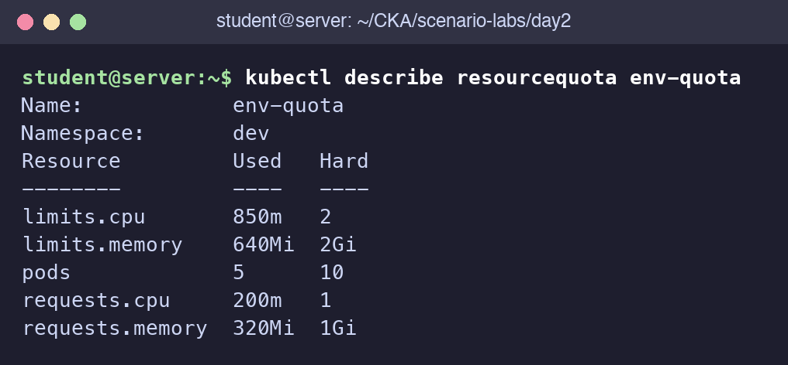

# Lab 7.4: Resource quotas: a budget for every environment

**The situation:** DEV, UAT and PROD share one cluster: the same CPUs, the same memory, the same disks. Nothing stops a test in DEV from taking everything, and then PROD has nothing left.

**Goal:** give every part of the Shop a fair share of CPU and memory, and give every environment a budget it cannot go over.

**Outline topic:** Storage: *Resource quotas*.

**What you learn:** requests and limits, QoS classes, LimitRange, ResourceQuota for pods, CPU, memory and storage.

📘 **More detail:** [Lab 7.4 explained](./lab-7.4-resource-quotas-explained.md): what happens in the cluster at each step, common mistakes and exam notes.

| Word | Meaning |
| --- | --- |
| **Request** | What the container needs for sure. The scheduler uses it to choose a node. |
| **Limit** | The most it may use. Over the memory limit: the container is killed. |
| **ResourceQuota** | The budget of a whole namespace: pods, CPU, memory, and also storage |
| **LimitRange** | The requests and limits a container gets when it sets none |

> **How to use this lab**
>
> - **📋 Copy and paste into your terminal:** copy the whole grey box (the copy button is in its top right corner), paste it into the terminal of your server, and press Enter.
> - **👀 You should see** *(do not paste)*: what the command prints. Names that end in random letters, IP addresses and ages are different on your server. That is normal.
> - **📖 Read only:** something to look at. Do not paste it.
> - **💡 Tip:** a shortcut or an extra. You do not need it to finish the lab.

## Before you start

Go to the folder of this module, and make `dev` your working namespace:

**📋 Copy and paste into your terminal:**

```bash
cd ~/CKA/scenario-labs/07-storage
kubectl config set-context --current --namespace=dev
```

**What this does:**

- `cd ~/CKA/scenario-labs/07-storage`: Goes to the folder `~/CKA/scenario-labs/07-storage`.
- `kubectl config set-context --current --namespace=dev`: Makes `dev` your working namespace: commands without `-n` now work in `dev`.

**👀 You should see** *(do not paste)*:

```text
Context "minikube" modified.
```

💡 **Tip:** `kubens dev` does the same as the second line (see the shortcuts in [setup, Step 5](../00-setup.md)).

## Part A: requests, limits and a quota in DEV

### Step 1: set them on the three parts

The backend got its request and limit in Lab 6.3. Now the other two parts get theirs.

**📋 Copy and paste into your terminal:**

```bash
kubectl set resources deployment frontend --requests=cpu=25m,memory=32Mi --limits=cpu=100m,memory=64Mi
kubectl set resources deployment db --requests=cpu=50m,memory=128Mi --limits=cpu=250m,memory=256Mi
```

**What this does:**

- `kubectl set resources deployment ...`: Sets the CPU and memory requests and limits of the Deployment `frontend`.
- `kubectl set resources deployment ...`: Sets the CPU and memory requests and limits of the Deployment `db`.

**👀 You should see** *(do not paste)*:

```text
deployment.apps/frontend resource requirements updated
deployment.apps/db resource requirements updated
```

`50m` means 50 millicores: one twentieth of one CPU. `64Mi` means 64 mebibytes of memory.

Wait until the new pods run:

**📋 Copy and paste into your terminal:**

```bash
kubectl rollout status deployment/frontend
kubectl rollout status deployment/db
```

**What this does:**

- `kubectl rollout status deployment/frontend`: Waits until the new pods of the Deployment `frontend` are all ready, and says when it is done.
- `kubectl rollout status deployment/db`: Waits until the new pods of the Deployment `db` are all ready, and says when it is done.

**👀 You should see** these two lines, maybe with some `Waiting for ...` lines before them *(do not paste)*:

```text
deployment "frontend" successfully rolled out
deployment "db" successfully rolled out
```

### Step 2: look at the QoS class

**📋 Copy and paste into your terminal:**

```bash
kubectl get pods -o custom-columns=NAME:.metadata.name,QOS:.status.qosClass
```

**What this does:** Lists the pods, showing only the columns named in the command.

**👀 You should see** *(do not paste)*:

```text
NAME                        QOS
backend-c5d9479f-j422x      Burstable
backend-c5d9479f-rslxf      Burstable
db-6df5dcf549-wqt4q         Burstable
frontend-77994594d8-5s89x   Burstable
frontend-77994594d8-n9nzj   Burstable
```

| QoS class | When | If the node runs out of memory |
| --- | --- | --- |
| `Guaranteed` | requests = limits | Killed last |
| `Burstable` | requests lower than limits | Killed in the middle |
| `BestEffort` | no requests, no limits | Killed first |

### Step 3: give DEV a budget

**⌨️ Command line option** *(read only: the same as the YAML below, made with a command)*:

```bash
kubectl create quota env-quota --hard=pods=10,requests.cpu=1,requests.memory=1Gi,limits.cpu=2,limits.memory=2Gi,persistentvolumeclaims=2,requests.storage=2Gi
```

**What this does:**

- `kubectl create quota env-quota --hard=...`: Creates the quota `env-quota` in your working namespace. Each `name=value` after `--hard` becomes one line of the budget.

💡 Add `--dry-run=client -o yaml` to print the YAML without creating anything. With `> file.yaml` at the end, that is the fastest way to start a YAML file in the exam.

**📋 Copy and paste into your terminal:**

```bash
cat quota.yaml
```

**What this does:** Shows what is in the file `quota.yaml`.

**👀 You should see** *(do not paste)*:

```yaml
apiVersion: v1
kind: ResourceQuota
metadata:
  name: env-quota
spec:
  hard:
    pods: "10"
    requests.cpu: "1"
    requests.memory: 1Gi
    limits.cpu: "2"
    limits.memory: 2Gi
    persistentvolumeclaims: "2"
    requests.storage: 2Gi
```

The last two lines are the **storage** budget: at most 2 claims, and at most 2Gi of disk in total.

**📋 Copy and paste into your terminal:**

```bash
kubectl apply -f limitrange.yaml -f quota.yaml
sleep 3
kubectl describe resourcequota env-quota
```

**What this does:**

- `kubectl apply -f limitrange.yaml -f quota.yaml`: Creates (or updates) what is described in `limitrange.yaml` and `quota.yaml`.
- `sleep 3`: Waits 3 seconds, to give Kubernetes time.
- `kubectl describe resourcequota env-quota`: Shows all the details of the quota `env-quota`. The events at the bottom say what happened to it.

**👀 You should see** (your `Used` numbers can differ a little) *(do not paste)*:

```text
limitrange/default-limits created
resourcequota/env-quota created
Name:            env-quota
Namespace:       dev
Resource                Used   Hard
--------                ----   ----
limits.cpu              850m   2
limits.memory           640Mi  2Gi
persistentvolumeclaims  1      2
pods                    5      10
requests.cpu            200m   1
requests.memory         320Mi  1Gi
requests.storage        1Gi    2Gi
```



`Used` is what the Shop takes now. `Hard` is the most the namespace may take. The database's claim of 1Gi (Lab 7.2) is counted too.

## Part B: the same budget for UAT and PROD

### Step 4: apply both files in the other two environments

**📋 Copy and paste into your terminal:**

```bash
kubectl apply -f limitrange.yaml -f quota.yaml -n uat
kubectl apply -f limitrange.yaml -f quota.yaml -n prod
kubectl get resourcequota -A -o custom-columns=NAMESPACE:.metadata.namespace,NAME:.metadata.name,PODS:.status.used.pods,CLAIMS:.status.used.persistentvolumeclaims
```

**What this does:**

- `kubectl apply -f limitrange.yaml -f quota.yaml -n uat`: Creates (or updates) what is described in `limitrange.yaml` and `quota.yaml` in the namespace `uat`.
- `kubectl apply -f limitrange.yaml -f quota.yaml -n prod`: Creates (or updates) what is described in `limitrange.yaml` and `quota.yaml` in the namespace `prod`.
- `kubectl get resourcequota -A ...`: Lists the quotas in all namespaces, showing only the columns named in the command.

**👀 You should see** one quota in each environment *(do not paste)*:

```text
limitrange/default-limits created
resourcequota/env-quota created
limitrange/default-limits created
resourcequota/env-quota created
NAMESPACE   NAME        PODS   CLAIMS
dev         env-quota   5      1
prod        env-quota   5      1
uat         env-quota   5      1
```

Each environment has 5 pods and 1 claim (the database's disk), and the same budget.

## Part C: the quota at work

### Step 5: ask for too many pods

UAT may have 10 pods. It has 5. Ask for 12 frontends:

**📋 Copy and paste into your terminal:**

```bash
kubectl scale deployment frontend -n uat --replicas=12
sleep 6
kubectl get deployment frontend -n uat
```

**What this does:**

- `kubectl scale deployment frontend -n uat --replicas=12`: Changes the number of pods of the Deployment `frontend` in the namespace `uat` to 12.
- `sleep 6`: Waits 6 seconds, to give Kubernetes time.
- `kubectl get deployment frontend -n uat`: Lists the Deployment `frontend` in the namespace `uat`.

**👀 You should see** fewer than 12 (the number can differ a little) *(do not paste)*:

```text
deployment.apps/frontend scaled
NAME       READY   UP-TO-DATE   AVAILABLE   AGE
frontend   3/12    7            3           42s
```

The Deployment wants 12, but the quota stops it at 10 pods in the namespace. See the reason:

**📋 Copy and paste into your terminal:**

```bash
kubectl get events -n uat --field-selector reason=FailedCreate | tail -1
```

**What this does:** Lists the events (what Kubernetes did, step by step) in the namespace `uat`, only those with the reason `FailedCreate`. `| tail` shows only the last line.

**👀 You should see** (one long line that says) *(do not paste)*:

```text
... Error creating: pods "frontend-5f69b684d8-sgz8q" is forbidden: exceeded quota: env-quota, requested: pods=1, used: pods=10, limited: pods=10
```

### Step 6: go back to 2

**📋 Copy and paste into your terminal:**

```bash
kubectl scale deployment frontend -n uat --replicas=2
```

**What this does:** Changes the number of pods of the Deployment `frontend` in the namespace `uat` to 2.

**👀 You should see** *(do not paste)*:

```text
deployment.apps/frontend scaled
```

### Step 7: ask for too much storage

The storage budget of DEV is 2Gi, and the database uses 1Gi. Ask for 5Gi more:

**⌨️ Command line option:** none. kubectl has no command that creates a PersistentVolumeClaim, so the YAML is the only way. In the exam, copy an example from the Kubernetes documentation and change it.

**📋 Copy and paste into your terminal:**

```bash
kubectl create -n dev -f - <<'YAML'
apiVersion: v1
kind: PersistentVolumeClaim
metadata:
  name: too-big
spec:
  storageClassName: standard
  accessModes:
  - ReadWriteOnce
  resources:
    requests:
      storage: 5Gi
YAML
```

**What this does:** Creates what is in the YAML between the two `YAML` lines, in the namespace `dev`.

**👀 You should see** *(do not paste)*:

```text
Error from server (Forbidden): error when creating "STDIN": persistentvolumeclaims "too-big" is forbidden: exceeded quota: env-quota, requested: requests.storage=5Gi, used: requests.storage=1Gi, limited: requests.storage=2Gi
```

The claim is refused at once. Nothing was created.

💡 **Exam tip:** when a Deployment does not reach its number of pods and the pods are not even listed, look at the events of the namespace: `kubectl get events -n <namespace>`. A quota is a common cause.

✅ **Check:** `kubectl get resourcequota -A` shows `env-quota` in `dev`, `uat` and `prod`.

## More practice

The Shop part of the lab is done. Practices 1 to 3 use test pods in `dev` (the DEV budget has room for them). Practices 4 and 5 use a new namespace `sandbox`, so the budgets of the Shop do not change. The clean-up at the end removes it all.

### 🟡 Practice 1: the LimitRange fills in what you leave out

**📋 Copy and paste into your terminal:**

```bash
kubectl run no-resources -n dev --image=busybox:1.36 -- sleep 3600
kubectl get pod no-resources -n dev -o jsonpath='{.spec.containers[0].resources}{"\n"}'
kubectl get pod no-resources -n dev -o jsonpath='{.status.qosClass}{"\n"}'
```

**What this does:**

- `kubectl run no-resources ...`: Starts a pod with **no** requests or limits.
- `kubectl get pod ... -o jsonpath='{.spec.containers[0].resources}'`: Prints the requests and limits the pod has now.
- `kubectl get pod ... -o jsonpath='{.status.qosClass}'`: Prints its QoS class.

**👀 You should see** *(do not paste)*:

```text
{"limits":{"cpu":"100m","memory":"64Mi"},"requests":{"cpu":"25m","memory":"32Mi"}}
Burstable
```

You asked for nothing, and got the values of `limitrange.yaml`. Without them, the quota would have refused the pod: a quota on `requests.cpu` needs every pod to say how much it requests.

### 🟡 Practice 2: make a pod `Guaranteed`

When a node runs out of memory, Kubernetes removes `BestEffort` pods first, then `Burstable`, and `Guaranteed` last. A pod is `Guaranteed` when requests and limits are **the same**.

**📋 Copy and paste into your terminal:**

```bash
kubectl run vip -n dev --image=busybox:1.36 --dry-run=client -o yaml -- sleep 3600 > vip.yaml
kubectl set resources -f vip.yaml --local --requests=cpu=50m,memory=64Mi --limits=cpu=50m,memory=64Mi -o yaml | kubectl apply -f -
kubectl get pod vip -n dev -o jsonpath='{.status.qosClass}{"\n"}'
```

**What this does:**

- `kubectl run vip ... --dry-run=client -o yaml ... > vip.yaml`: Writes the YAML of a pod into `vip.yaml`, without creating it.
- `kubectl set resources -f vip.yaml --local ... | kubectl apply -f -`: Sets requests and limits to the same values in that YAML, and creates the pod.
- `kubectl get pod vip ... qosClass`: Prints its QoS class.

**👀 You should see** `Guaranteed`. (The PROD database is a good candidate for this in a real cluster.)

### 🟡 Practice 3: one pod that is too big for the budget

**📋 Copy and paste into your terminal:**

```bash
kubectl run greedy -n dev --image=busybox:1.36 --dry-run=client -o yaml -- sleep 3600 > greedy.yaml
kubectl set resources -f greedy.yaml --local --requests=cpu=2 --limits=cpu=2 -o yaml | kubectl apply -f -
```

**What this does:**

- `kubectl run greedy ... > greedy.yaml`: Writes the YAML of a pod into `greedy.yaml`.
- `kubectl set resources ... | kubectl apply -f -`: Asks for 2 whole CPUs for it, and tries to create it.

**👀 You should see** an error at once: `exceeded quota: env-quota, requested: limits.cpu=2,requests.cpu=2, ...`. A **pod** you create yourself gets the error straight away. A **Deployment** is created without complaint, and its pods are refused later, quietly, in the events (Step 5). That is why missing pods are often a quota problem.

### 🔵 Optional 4: a LimitRange that also sets a maximum

**⌨️ Command line option:** none for the LimitRange: kubectl has no `create limitrange`.

**📋 Copy and paste into your terminal:**

```bash
kubectl create namespace sandbox
kubectl apply -n sandbox -f - <<'YAML'
apiVersion: v1
kind: LimitRange
metadata:
  name: max-size
spec:
  limits:
  - type: Container
    max:                     # no container may ask for more than this
      cpu: 200m
      memory: 128Mi
YAML
kubectl run big -n sandbox --image=busybox:1.36 --dry-run=client -o yaml -- sleep 3600 > big.yaml
kubectl set resources -f big.yaml --local --limits=cpu=500m,memory=64Mi -o yaml | kubectl apply -f -
```

**What this does:**

- `kubectl create namespace sandbox`: Makes a new namespace for the practice.
- `kubectl apply -n sandbox -f - <<'YAML' ...`: Creates a LimitRange `max-size` in `sandbox`: at most 200m CPU and 128Mi memory per container.
- `kubectl run big ... > big.yaml`: Writes the YAML of a pod into `big.yaml`.
- `kubectl set resources ... | kubectl apply -f -`: Gives it a CPU limit of 500m, and tries to create it.

**👀 You should see** an error with `maximum cpu usage per Container is 200m, but limit is 500m`. A quota limits the **namespace** in total; a LimitRange limits **each container**.

### 🔵 Optional 5: count objects, not only CPU

A quota can also count objects: ConfigMaps, Secrets, Services and more.

**📋 Copy and paste into your terminal:**

```bash
kubectl create quota objects -n sandbox --hard=configmaps=3,services=1
kubectl describe quota objects -n sandbox | tail -3
for i in 1 2 3; do kubectl create configmap cm-$i -n sandbox --from-literal=n=$i; done
```

**What this does:**

- `kubectl create quota objects -n sandbox --hard=configmaps=3,services=1`: Allows at most 3 ConfigMaps and 1 Service in `sandbox`.
- `kubectl describe quota objects -n sandbox | tail -3`: Shows what is used now.
- `for i in 1 2 3; do ... done`: Tries to create three ConfigMaps, `cm-1` to `cm-3`.

**👀 You should see** `configmaps 1 3` already **before** you made any: every namespace gets the ConfigMap `kube-root-ca.crt` by itself. So `cm-1` and `cm-2` are created, and `cm-3` is refused with `exceeded quota: objects`.

### 🔵 Optional 6: challenge

Without looking at the answer: make a namespace `budget` with a quota `cpu-budget` of `requests.cpu=500m`, and nothing else. Then `kubectl run test -n budget --image=busybox:1.36 -- sleep 3600`. Why is it refused? Fix it **without** changing the `kubectl run` command.

<details><summary>Show the answer</summary>

**📋 Copy and paste into your terminal:**

```bash
kubectl create namespace budget
kubectl create quota cpu-budget -n budget --hard=requests.cpu=500m
kubectl run test -n budget --image=busybox:1.36 -- sleep 3600
```

**What this does:** Creates the namespace and the quota, then tries to start a pod with no requests.

**👀 You should see** `must specify requests.cpu`: with a quota on `requests.cpu`, every pod must say what it requests, and this one does not. Add a LimitRange that gives a default:

**📋 Copy and paste into your terminal:**

```bash
kubectl apply -n budget -f - <<'YAML'
apiVersion: v1
kind: LimitRange
metadata:
  name: defaults
spec:
  limits:
  - type: Container
    defaultRequest:
      cpu: 50m
YAML
kubectl run test -n budget --image=busybox:1.36 -- sleep 3600
kubectl describe quota cpu-budget -n budget | tail -1
```

**What this does:**

- `kubectl apply ...`: Creates a LimitRange `defaults` that gives every container a CPU request of 50m when it has none.
- `kubectl run test ...`: Tries the same command again.
- `kubectl describe quota cpu-budget ... | tail -1`: Shows how much of the budget is used.

**👀 You should see** `pod/test created`, and `requests.cpu  50m  500m`. This is the reason the Shop has `limitrange.yaml` next to `quota.yaml`.

Why a new namespace? In `sandbox` the same command works at once: the LimitRange `max-size` of Optional 4 sets only a `max`, and a LimitRange with only a `max` also fills in the **default** limit (the max) and the default request (the same). Check it: `kubectl get limitrange max-size -n sandbox -o yaml | grep -A3 default`.

</details>

🧹 **Clean up the practice:**

**📋 Copy and paste into your terminal:**

```bash
kubectl delete pod no-resources vip greedy -n dev --now --ignore-not-found
kubectl delete namespace sandbox budget --ignore-not-found
rm -f vip.yaml greedy.yaml big.yaml
```

**What this does:**

- `kubectl delete pod ...`: Deletes the test pods in `dev`, at once.
- `kubectl delete namespace sandbox budget`: Deletes the namespaces `sandbox` and `budget` and everything in them.
- `rm -f ...`: Deletes the YAML files of this practice.

**The Shop now:** it runs in three environments. PROD has its own node, a hostname, a firewall, access rules, a disk that keeps its data and a budget. One module is left: what to do when it breaks.

**Next:** [Lab 8.1: Break and fix](../08-troubleshooting/lab-8.1-break-and-fix.md)
