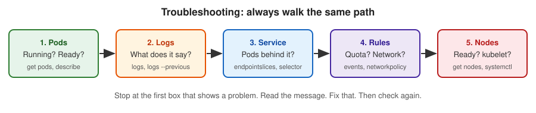

# Lab 8.1: Troubleshooting: six faults to find and fix

**The situation:** it is Monday morning, and the Shop in `dev` does not work. Nobody knows what changed. This happens six times.

**Goal:** a script breaks the Shop in `dev`, one fault at a time. You find the fault, fix it, and explain it.

**Outline topic:** 6. Troubleshooting.

**What you learn:** a fixed way to troubleshoot, and the six most common faults. Each fault comes from a module you did: workloads, Services, configuration, quotas, networking, nodes.

Troubleshooting is 30% of the exam. Do not guess. Walk the same path every time.

> **How to use this lab**
>
> - **📋 Copy and paste into your terminal:** copy the whole grey box (the copy button is in its top right corner), paste it into the terminal of your server, and press Enter.
> - **👀 You should see** *(do not paste)*: what the command prints. Names that end in random letters, IP addresses and ages are different on your server. That is normal.
> - **📖 Read only:** something to look at. Do not paste it.
> - **💡 Tip:** a shortcut or an extra. You do not need it to finish the lab.

## The method: walk the path of a request



| Step | Question | Command |
| --- | --- | --- |
| 1 | Are all pods `Running` and `READY 1/1`? | `kubectl get pods -o wide` |
| 2 | A pod is not: **why**? Read the `Events` at the bottom. | `kubectl describe pod <pod>` |
| 3 | The pod runs but does not work: what does it say? | `kubectl logs <pod>` (add `--previous` after a restart) |
| 4 | Does the Service have pods behind it? | `kubectl get endpointslices` and `kubectl describe service <service>` |
| 5 | Pods are missing and not even listed? | `kubectl get events --sort-by=.lastTimestamp` |
| 6 | Is the network allowed? | `kubectl get networkpolicy` and `kubectl describe networkpolicy <name>` |
| 7 | Are the nodes healthy? | `kubectl get nodes` and `kubectl describe node <node>` |

## Before you start

Work in `dev`, and make sure the Shop works:

**📋 Copy and paste into your terminal:**

```bash
cd ~/CKA/scenario-labs/scripts
kubectl config set-context --current --namespace=dev
./check-shop.sh dev
```

**What this does:**

- `cd ~/CKA/scenario-labs/scripts`: Goes to the folder `~/CKA/scenario-labs/scripts`.
- `kubectl config set-context --current --namespace=dev`: Makes `dev` your working namespace: commands without `-n` now work in `dev`.
- `./check-shop.sh dev`: Runs the course script that checks every part of the Shop in `dev` and prints OK or FAIL for each check.

**👀 You should see** *(do not paste)*:

```text
Context "minikube" modified.
Checking the Shop in namespace dev
  OK    all nodes are Ready
  OK    deployment db: 1/1 ready
  OK    deployment backend: 2/2 ready
  OK    deployment frontend: 2/2 ready
  OK    service db has 1 ready pod(s) behind it
  OK    service backend has 2 ready pod(s) behind it
  OK    service frontend has 2 ready pod(s) behind it
  OK    frontend -> backend -> database returns the items

All 8 checks passed. The Shop works.
```

If a check fails before you start, tell the trainer, or rebuild DEV with `./deploy-shop.sh dev`.

💡 **Tip:** `kubens dev` does the same as the second line (see the shortcuts in [setup, Step 5](../00-setup.md)).

## How every round works

1. Put the fault in: `./break.sh 1` (then `2`, `3`, ... up to `6`).
2. See that something is wrong: `./check-shop.sh dev`.
3. **Find it** with the method above. Try for 10 minutes before you open the hint.
4. **Fix it.**
5. Check: `./check-shop.sh dev` must end with `The Shop works.` If only the last check fails right after your fix, wait 30 seconds and check again: the backend needs a moment to reconnect.
6. Say in one sentence what was wrong.

---

## Fault 1

**📋 Copy and paste into your terminal:**

```bash
./break.sh 1
./check-shop.sh dev
```

**What this does:**

- `./break.sh 1`: Runs the course script that puts fault number 1 into the Shop in `dev`.
- `./check-shop.sh dev`: Runs the course script that checks every part of the Shop in `dev` and prints OK or FAIL for each check.

<details><summary>Hint</summary>

Start with step 1 of the method. One pod has a `STATUS` that is not `Running`. Describe it and read the events.

</details>

<details><summary>Answer</summary>

**Find** (📋 copy and paste into your terminal):

```bash
kubectl get pods
kubectl describe pod -l app=frontend | grep -E "Image:|Failed"
```

**What this does:**

- `kubectl get pods`: Lists the pods.
- `kubectl describe pod -l ...`: Shows all the details of the pod with the label `app=frontend`. The events at the bottom say what happened to it. `| grep` keeps only the lines with `Image:` or `Failed`.

A new frontend pod shows `ImagePullBackOff`. The image name is wrong: `nginx:1.27-alpnie` (a typing mistake in `alpine`).

**Fix** (📋 copy and paste into your terminal):

```bash
kubectl set image deployment/frontend frontend=nginx:1.27-alpine
kubectl rollout status deployment/frontend
```

**What this does:**

- `kubectl set image deployment/frontend ...`: Changes the image of the container `frontend` in the Deployment `frontend` to `nginx:1.27-alpine`. This starts a rolling update.
- `kubectl rollout status deployment/frontend`: Waits until the new pods of the Deployment `frontend` are all ready, and says when it is done.

**👀 You should see** (the last line) *(do not paste)*:

```text
deployment "frontend" successfully rolled out
```

**In one sentence:** the Deployment asked for an image that does not exist.

</details>

---

## Fault 2

**📋 Copy and paste into your terminal:**

```bash
./break.sh 2
./check-shop.sh dev
```

**What this does:**

- `./break.sh 2`: Runs the course script that puts fault number 2 into the Shop in `dev`.
- `./check-shop.sh dev`: Runs the course script that checks every part of the Shop in `dev` and prints OK or FAIL for each check.

<details><summary>Hint</summary>

All pods are `Running` and ready. So go to step 4: does every Service have pods behind it? Compare the Service's `Selector` with the labels of the pods.

</details>

<details><summary>Answer</summary>

**Find** (📋 copy and paste into your terminal):

```bash
kubectl get endpointslices
kubectl describe service backend | grep -E "Selector|Endpoints"
kubectl get pods -l app=backend --show-labels
```

**What this does:**

- `kubectl get endpointslices`: Lists the EndpointSlices (the addresses of the pods behind each Service).
- `kubectl describe service backend ...`: Shows all the details of the Service `backend`. The events at the bottom say what happened to it. `| grep` keeps only the lines with `Selector` or `Endpoints`.
- `kubectl get pods -l app=backend --show-labels`: Lists the pods with the label `app=backend`, with their labels.

The `backend` Service has **no endpoints**. Its selector is `app=backend-api`, but the pods have the label `app=backend`.

**Fix** (📋 copy and paste into your terminal):

```bash
kubectl patch service backend -p '{"spec":{"selector":{"app":"backend"}}}'
```

**What this does:** Changes the Service `backend`: only the part given after `-p`.

**👀 You should see** *(do not paste)*:

```text
service/backend patched
```

**In one sentence:** the Service's selector did not match the labels of the pods, so it had no pods to send traffic to.

</details>

---

## Fault 3

**📋 Copy and paste into your terminal:**

```bash
./break.sh 3
./check-shop.sh dev
```

**What this does:**

- `./break.sh 3`: Runs the course script that puts fault number 3 into the Shop in `dev`.
- `./check-shop.sh dev`: Runs the course script that checks every part of the Shop in `dev` and prints OK or FAIL for each check.

<details><summary>Hint</summary>

Step 1 and 2. A new backend pod has a strange `STATUS`. Describe it and read the last event carefully: it names something that cannot be found.

</details>

<details><summary>Answer</summary>

**Find** (📋 copy and paste into your terminal):

```bash
kubectl get pods -l app=backend
kubectl describe pod -l app=backend | grep -E "Warning|not found"
kubectl get secrets
```

**What this does:**

- `kubectl get pods -l app=backend`: Lists the pods with the label `app=backend`.
- `kubectl describe pod -l ...`: Shows all the details of the pod with the label `app=backend`. The events at the bottom say what happened to it. `| grep` keeps only the lines with `Warning` or `not found`.
- `kubectl get secrets`: Lists the Secrets.

A new backend pod shows `CreateContainerConfigError`. The event says: `secret "db-secrets" not found`. The Secret is called `db-secret`.

**Fix** (📋 copy and paste into your terminal):

```bash
kubectl patch deployment backend --type=json -p '[{"op":"replace","path":"/spec/template/spec/containers/0/env/0/valueFrom/secretKeyRef/name","value":"db-secret"}]'
kubectl rollout status deployment/backend
```

**What this does:**

- `kubectl patch deployment backend ...`: Changes the Deployment `backend`: only the part given after `-p`.
- `kubectl rollout status deployment/backend`: Waits until the new pods of the Deployment `backend` are all ready, and says when it is done.

**👀 You should see** (the last line) *(do not paste)*:

```text
deployment "backend" successfully rolled out
```

`kubectl edit deployment backend` also works: change `db-secrets` to `db-secret`, save and quit.

**In one sentence:** the Deployment pointed to a Secret that does not exist, so the container could not be created.

</details>

---

## Fault 4

**📋 Copy and paste into your terminal:**

```bash
./break.sh 4
./check-shop.sh dev
```

**What this does:**

- `./break.sh 4`: Runs the course script that puts fault number 4 into the Shop in `dev`.
- `./check-shop.sh dev`: Runs the course script that checks every part of the Shop in `dev` and prints OK or FAIL for each check.

<details><summary>Hint</summary>

Count the frontend pods. There are too few, and no pod is in an error state. Go to step 5: read the events of the namespace.

</details>

<details><summary>Answer</summary>

**Find** (📋 copy and paste into your terminal):

```bash
kubectl get deployments
kubectl get events --sort-by=.lastTimestamp | tail -5
kubectl describe resourcequota env-quota
```

**What this does:**

- `kubectl get deployments`: Lists the Deployments.
- `kubectl get events --sort-by=.lastTimestamp | tail -5`: Lists the events (what Kubernetes did, step by step), oldest first. `| tail` shows only the last 5 lines.
- `kubectl describe resourcequota env-quota`: Shows all the details of the quota `env-quota`. The events at the bottom say what happened to it.

The frontend Deployment has fewer pods than it wants. The events say: `exceeded quota: env-quota ... limited: pods=2`. Someone set the pod quota to 2.

**Fix** (📋 copy and paste into your terminal):

```bash
kubectl patch resourcequota env-quota -p '{"spec":{"hard":{"pods":"10"}}}'
kubectl rollout restart deployment/frontend
kubectl rollout status deployment/frontend
```

**What this does:**

- `kubectl patch resourcequota env-quota ...`: Changes the quota `env-quota`: only the part given after `-p`.
- `kubectl rollout restart deployment/frontend`: Replaces the pods of the Deployment `frontend` with new ones, one by one.
- `kubectl rollout status deployment/frontend`: Waits until the new pods of the Deployment `frontend` are all ready, and says when it is done.

**👀 You should see** (the last line) *(do not paste)*:

```text
deployment "frontend" successfully rolled out
```

**In one sentence:** the namespace quota allowed only 2 pods, so the ReplicaSet could not create the missing pods.

</details>

---

## Fault 5

**📋 Copy and paste into your terminal:**

```bash
./break.sh 5
sleep 30
./check-shop.sh dev
```

**What this does:**

- `./break.sh 5`: Runs the course script that puts fault number 5 into the Shop in `dev`.
- `sleep 30`: Waits 30 seconds, to give Kubernetes time.
- `./check-shop.sh dev`: Runs the course script that checks every part of the Shop in `dev` and prints OK or FAIL for each check.

<details><summary>Hint</summary>

The backend pods are `Running` but `READY 0/1`. The readiness probe fails, which means the backend cannot reach the database. The database itself is fine. So what is between them? Step 6.

</details>

<details><summary>Answer</summary>

**Find** (📋 copy and paste into your terminal):

```bash
kubectl get pods
kubectl logs -l app=backend --tail=3
kubectl describe networkpolicy allow-backend-to-db
```

**What this does:**

- `kubectl get pods`: Lists the pods.
- `kubectl logs -l app=backend --tail=3`: Shows the log (what the program printed) of all pods with the label `app=backend`: only the last 3 lines.
- `kubectl describe networkpolicy allow-backend-to-db`: Shows all the details of the network policy `allow-backend-to-db`. The events at the bottom say what happened to it.

The backend pods are not ready, and their logs say they cannot connect to the database. The policy `allow-backend-to-db` allows port **5433**. The database listens on **5432**.

**Fix** (📋 copy and paste into your terminal):

```bash
kubectl apply -f ../03-networking/netpol-allow-app.yaml
kubectl rollout restart deployment/backend
kubectl rollout status deployment/backend
```

**What this does:**

- `kubectl apply -f ../03-networking/netpol-allow-app.yaml`: Creates (or updates) what is described in `../03-networking/netpol-allow-app.yaml`.
- `kubectl rollout restart deployment/backend`: Replaces the pods of the Deployment `backend` with new ones, one by one.
- `kubectl rollout status deployment/backend`: Waits until the new pods of the Deployment `backend` are all ready, and says when it is done.

**👀 You should see** (the last line) *(do not paste)*:

```text
deployment "backend" successfully rolled out
```

**In one sentence:** the network policy allowed the wrong port, so the backend was blocked from the database.

</details>

---

## Fault 6

**📋 Copy and paste into your terminal:**

```bash
./break.sh 6
sleep 60
./check-shop.sh dev
```

**What this does:**

- `./break.sh 6`: Runs the course script that puts fault number 6 into the Shop in `dev`.
- `sleep 60`: Waits 60 seconds, to give Kubernetes time.
- `./check-shop.sh dev`: Runs the course script that checks every part of the Shop in `dev` and prints OK or FAIL for each check.

<details><summary>Hint</summary>

Step 7. One node is not `Ready`. Describe it. Then go to the node (`minikube ssh -n <node>`) and look at the service that runs the pods there: the kubelet.

</details>

<details><summary>Answer</summary>

**Find** (📋 copy and paste into your terminal):

```bash
kubectl get nodes
kubectl describe node minikube-m03 | grep -A6 "Conditions"
minikube ssh -n minikube-m03 -- sudo systemctl status kubelet | head -5
```

**What this does:**

- `kubectl get nodes`: Lists the nodes.
- `kubectl describe node minikube-m03 | grep -A6 "Conditions"`: Shows the conditions of the node `minikube-m03`: whether it is `Ready` and, if not, why. `| grep` shows the line with `Conditions` and the 6 lines after it.
- `minikube ssh -n minikube-m03 ...`: Asks the node `minikube-m03` whether its kubelet (the agent that runs the pods) is running: look at the line `Active:`. `| head` shows only the first 5 lines.

`minikube-m03` is `NotReady`. On the node, the kubelet is `inactive (dead)`: it was stopped.

**Fix** (📋 copy and paste into your terminal):

```bash
minikube ssh -n minikube-m03 -- sudo systemctl start kubelet
sleep 30
kubectl get nodes
```

**What this does:**

- `minikube ssh -n minikube-m03 -- sudo systemctl start kubelet`: Starts the kubelet again on the node `minikube-m03`.
- `sleep 30`: Waits 30 seconds, to give Kubernetes time.
- `kubectl get nodes`: Lists the nodes.

**👀 You should see** all three nodes `Ready` again.

**In one sentence:** the kubelet on the node was stopped, so the node could not report to the control plane.

</details>

---

## After the last fault

**📋 Copy and paste into your terminal:**

```bash
./check-shop.sh dev
```

**What this does:** Runs the course script that checks every part of the Shop in `dev` and prints OK or FAIL for each check.

**👀 You should see** *(do not paste)*:

```text
All 8 checks passed. The Shop works.
```

## What to take to the exam

| What you see | Look at | Often the cause |
| --- | --- | --- |
| `ImagePullBackOff`, `ErrImagePull` | `kubectl describe pod` | Wrong image name or tag |
| `CreateContainerConfigError` | `kubectl describe pod` | A ConfigMap or Secret that does not exist |
| `CrashLoopBackOff` | `kubectl logs --previous` | The program fails at start: wrong command or settings |
| `Pending` | `kubectl describe pod` | No node fits: resources, taints, node selector, unbound PVC |
| `Running` but `0/1` | `kubectl describe pod`, `kubectl logs` | The readiness probe fails |
| Service gives no answer | `kubectl get endpointslices` | Selector does not match the pod labels, or wrong port |
| Fewer pods than asked, none in error | `kubectl get events` | Quota |
| Timeouts between pods | `kubectl get networkpolicy` | A network policy blocks it |
| Node `NotReady` | `systemctl status kubelet` on the node | The kubelet is stopped or misconfigured |

✅ **Check:** all six faults are fixed and `./check-shop.sh dev` ends with `The Shop works.`

**That is the end of the course.** You built the Shop, looked after the cluster under it, connected it, placed it, secured it, watched it, gave it storage, and repaired it. Every topic of the outline was part of it.
