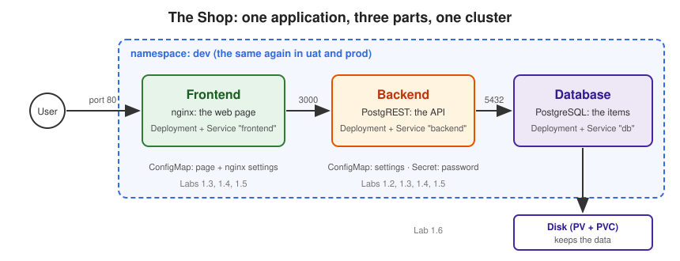
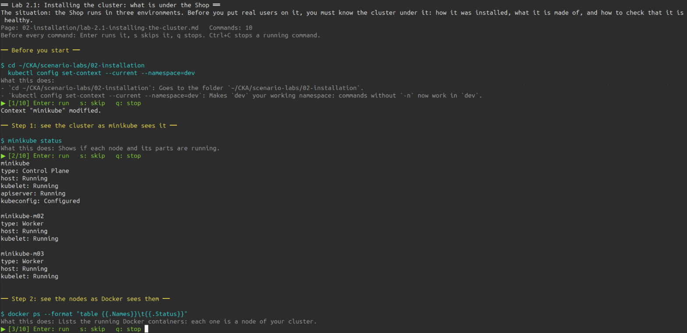

# Scenario labs: build, secure and run the Shop

In these labs you build **one real application**, step by step, over the whole course. Every Kubernetes topic is introduced at the moment the application needs it. The trainer explains a topic, shows it on the Shop, and then you do the same on your own cluster, together.



| Part | What it is | Image |
| --- | --- | --- |
| **Frontend** | The web page users see (nginx) | `nginx:1.27-alpine` |
| **Backend** | The API the web page calls (PostgREST) | `postgrest/postgrest:v12.2.3` |
| **Database** | Where the items are stored (PostgreSQL) | `postgres:16-alpine` |
| **Services** | The names and addresses that connect the three parts | |

Everything runs on **one Ubuntu server** (24.04 or newer), on **one Kubernetes cluster** made with **minikube**. DEV, UAT and PROD are three **namespaces** on that cluster: `dev`, `uat` and `prod`. There is no pipeline: you move the application yourself with `kubectl`.

The labs follow the [course outline](https://hr.nobleprog.com/cc/cka), section by section, in the same order.

## How to read a lab

Every step looks the same:

> **📋 Copy and paste into your terminal:**
>
> ```bash
> kubectl get nodes
> ```
>
> **What this does:** Lists the nodes.
>
> **👀 You should see** *(do not paste)*:
>
> ```text
> NAME           STATUS   ROLES           AGE   VERSION
> minikube       Ready    control-plane   10m   v1.36.5
> ```

| Mark | What to do with it |
| --- | --- |
| **📋 Copy and paste into your terminal** | Copy the whole grey box (the copy button is in its top right corner), paste it into the terminal of your server, press Enter. A box with several lines is pasted in one go. |
| **📋 ... then change `X`** | Paste it, but replace `X` with your own value before you press Enter. The step says where to find the value. |
| **What this does** | Explains every command of the box above, in plain words. Read it before you paste. |
| **👀 You should see** *(do not paste)* | What the command prints. Do not paste it. Names that end in random letters (like `backend-7d9f8c6b5-x2kqp`), IP addresses and ages are different on your server. That is normal. |
| **📖 Read only** | A file, a piece of YAML or an example to look at. Do not paste it. |
| **💡 Tip** | A shortcut or an extra. You do not need it to finish the lab. |
| **The situation** | At the top of a lab: what the Shop needs now, and why this topic comes now. |
| **✅ Check** | At the end of a lab: what must work before you go on. |
| **🧹** | Clean up. |
| **📘 More detail** | At the top of a lab: a link to its "explained" page (see below). |

Every lab starts the same way: **Before you start** takes you to the folder of the module and makes `dev` your working namespace. Commands for `uat` or `prod` always say so with `-n uat` or `-n prod`.

Run every command **on your server, as your own user** (not root), unless the step says something else.

### Two pages for every lab: the lab, and the lab explained

Every lab has a companion page next to it, with the same name and `-explained` at the end (for example `lab-1.3-deployments-explained.md`). The lab page is short: the steps, a line on what each command does, and what you should see. The **explained** page goes through the same steps in more depth: what happens inside the cluster, why the Shop needs it, common mistakes, exam notes and a few questions to check yourself. It has no commands to paste: the commands are only on the lab page. Setup and the four workshops have one too ([Setup explained](./00-setup-explained.md)).

### Shortcuts (recommended)

The labs always show the full `kubectl` command. These shortcuts save typing. `setup.sh` installs them, and [setup, Step 5](./00-setup.md) shows how to use them:

| Shortcut | Instead of |
| --- | --- |
| `kubens dev` | `kubectl config set-context --current --namespace=dev` |
| `kubectx thabo` | `kubectl config use-context thabo` |
| `k get pods` | `kubectl get pods` |
| **Tab** while typing | Typing full names |
| `kubectl get pods -w` | Running `kubectl get pods` again and again |

## The labs

Start with [00-setup.md](./00-setup.md), once.

### 1. Core concepts and Kubernetes architecture

*The Shop is built, piece by piece, and put in three environments.*

| Lab | Outline topic | What happens to the Shop |
| --- | --- | --- |
| [1.1](./01-core-concepts/lab-1.1-architecture-and-namespaces.md) | Kubernetes architecture and its main components; Namespaces | You meet the cluster and create `dev`, `uat` and `prod` |
| [1.2](./01-core-concepts/lab-1.2-pods-labels-selectors.md) | Pods, Labels, Selectors | The backend runs for the first time, as one pod |
| [1.3](./01-core-concepts/lab-1.3-deployments.md) | Deployments | Backend and frontend with 2 copies each, that heal themselves |
| [1.4](./01-core-concepts/lab-1.4-services.md) | Services | The frontend finds the backend by name |
| [1.5](./01-core-concepts/lab-1.5-configmaps-and-secrets.md) | Application lifecycle management: configuration | Settings, the web page and the database password |
| [1.6](./01-core-concepts/lab-1.6-the-database.md) | Deployment of applications and services | The database: the Shop is complete |
| [1.7](./01-core-concepts/lab-1.7-health-checks.md) | Application lifecycle management: self-healing | Kubernetes notices a backend that cannot work |
| [1.8](./01-core-concepts/lab-1.8-releases-and-rollbacks.md) | Application lifecycle management: updates and rollbacks | A bad release, rolled back while the Shop stays open |
| [1.9](./01-core-concepts/lab-1.9-uat-and-prod.md) | Namespaces; Deployment of applications and services | The same Shop in `uat` and `prod` |

### 2. Installation, Configuration & Validation

*You look after the cluster under the Shop.*

| Lab | Outline topic | What happens to the Shop |
| --- | --- | --- |
| [2.1](./02-installation/lab-2.1-installing-the-cluster.md) | Kubernetes installation (with minikube) | How the cluster was built, and how to check it is healthy |
| [2.2](./02-installation/lab-2.2-growing-the-cluster.md) | Growing the cluster | A fourth node for a busier Shop |
| [2.3](./02-installation/lab-2.3-standalone-pods.md) | Standalone pods | A toolbox pod next to the Shop, and a static pod |
| [2.4](./02-installation/lab-2.4-control-plane-high-availability.md) | Control Plane High Availability | The control plane stops: does the Shop stay open? |
| [2.5](./02-installation/lab-2.5-cluster-maintenance-etcd-backup.md) | Cluster maintenance | PROD is deleted by accident, and restored from a backup |
| [2.6](./02-installation/lab-2.6-upgrade.md) | Upgrade to a new version | The rules for upgrading without closing the Shop |
| [2.7](./02-installation/lab-2.7-cordon-and-drain.md) | Cordoning and draining nodes | A node is emptied while the Shop stays open |

### 3. Networking

*The Shop is connected: inside, and to its users.*

| Lab | Outline topic | What happens to the Shop |
| --- | --- | --- |
| [3.1](./03-networking/lab-3.1-network-model.md) | Containers network model in Kubernetes | Only frontend → backend → database is allowed |
| [3.2](./03-networking/lab-3.2-service-discovery-scaling-load-balancing.md) | Service discovery, scaling and load balancing | Requests are spread over more pods; PROD gets a hostname |
| [3.3](./03-networking/lab-3.3-dns.md) | DNS for service discovery | Why `db` means a different database in each environment |

### 4. Scheduling

*PROD gets its own node.*

| Lab | Outline topic | What happens to the Shop |
| --- | --- | --- |
| [4.1](./04-scheduling/lab-4.1-node-selectors.md) | Node selectors | The PROD frontend runs only on the PROD node |
| [4.2](./04-scheduling/lab-4.2-affinity-and-anti-affinity.md) | Affinity and anti-affinity rules | PROD prefers its node; the backend pods stay apart |
| [4.3](./04-scheduling/lab-4.3-taints-and-tolerations.md) | Taints and tolerations | DEV and UAT are kept off the PROD node |

### 5. Security

*Not everyone may do everything.*

| Lab | Outline topic | What happens to the Shop |
| --- | --- | --- |
| [5.1](./05-security/lab-5.1-authentication-authorization-rbac.md) | Authentication, Authorization and RBAC | A developer: everything in `dev`, read-only in `prod` |
| [5.2](./05-security/lab-5.2-tls-access-to-the-api.md) | Configuring TLS access to API | The developer gets a real login with a certificate |

### Logging / Monitoring

*You watch the Shop.*

| Lab | Outline topic | What happens to the Shop |
| --- | --- | --- |
| [6.1](./06-logging-monitoring/lab-6.1-application-and-system-logs.md) | Application and system components logging | One request is followed through all the parts |
| [6.2](./06-logging-monitoring/lab-6.2-cluster-wide-logging.md) | Cluster wide logging architecture | Where the Shop's logs live, and why they get lost |
| [6.3](./06-logging-monitoring/lab-6.3-metrics-server.md) | Metrics Server | The Shop is measured, and the backend grows under load |
| [6.4](./06-logging-monitoring/lab-6.4-prometheus.md) | Prometheus | Numbers with a history |

### Storage

*The Shop stops losing its data.*

| Lab | Outline topic | What happens to the Shop |
| --- | --- | --- |
| [7.1](./07-storage/lab-7.1-storage-architecture.md) | Storage architecture | Why the database keeps losing items |
| [7.2](./07-storage/lab-7.2-storage-backends.md) | Storage backend in Kubernetes: local, NFS, GlusterFS | The database gets a real disk |
| [7.3](./07-storage/lab-7.3-storage-classes-and-dynamic-provisioning.md) | Storage classes and dynamic storage provisioning | Disks made on request; disks for UAT and PROD |
| [7.4](./07-storage/lab-7.4-resource-quotas.md) | Resource quotas | A budget for every environment |

### 6. Troubleshooting

*The Shop breaks, and you repair it.*

| Lab | Outline topic | What happens to the Shop |
| --- | --- | --- |
| [8.1](./08-troubleshooting/lab-8.1-break-and-fix.md) | Troubleshooting | Six faults to find and fix |

## The three days

| Day | Sections | The Shop at the end of the day |
| --- | --- | --- |
| 1 | 1. Core concepts; 2. Installation (Labs 2.1 to 2.3) | Complete, and running in `dev`, `uat` and `prod` |
| 2 | 2. Installation (Labs 2.4 to 2.7); 3. Networking; 4. Scheduling; 5. Security | PROD is backed up, has a hostname, a firewall, its own node and access rules |
| 3 | Logging / Monitoring; Storage; 6. Troubleshooting | Watched, with data that is kept, and repaired six times |

## Day 4: joint practical workshop

| Lab | What you do |
| --- | --- |
| [Workshop 1](./workshop/lab-w1-start.md) | Start: the whole Shop in one command |
| [Workshop 2](./workshop/lab-w2-challenge-rounds.md) | Three challenge rounds, in pairs |
| [Workshop 3](./workshop/lab-w3-break-and-fix.md) | Break-and-fix: five faults at once |
| [Workshop 4](./workshop/lab-w4-mock-exam.md) | Mock exam (90 minutes) |

## Helper scripts

The jobs that are not the lesson are done by scripts, in `~/CKA/scenario-labs/scripts/`:

| Script | When | What it does |
| --- | --- | --- |
| `check-ready.sh` | At the start of every day, and when something looks wrong | Checks the server, the tools, the cluster and the Shop. Every problem comes with its fix. It changes nothing. |
| `run-lab.sh 1.3` | The trainer shows a lab | Runs a lab step by step: shows each command and what it does, waits for Enter, runs it, shows the result |
| `run-lab.sh 1.3 --all` | You fell behind | Runs all the commands of a lab, without stopping |
| `deploy-shop.sh dev` | You fell behind, or the Shop is broken | Builds the whole Shop in one environment, with everything from the course |
| `check-shop.sh dev` | After a change to the Shop | Checks that the Shop works |
| `break.sh 1` | Lab 8.1 and Workshop 3 | Puts a fault into the Shop |
| `test/run-all.sh` | Before a course, on a test server (trainer only) | Runs every command of every lab on a fresh cluster and compares the output with the pages. See [Testing the labs](./scripts/test/README.md) |

### Is everything ready?

**📋 Copy and paste:**

```bash
~/CKA/scenario-labs/scripts/check-ready.sh
```

**What this does:** Checks the server, the tools, the cluster and the Shop. Every `FAIL` line says what to do. [Setup, Step 6](./00-setup.md) shows the output.

### Show a lab step by step (for the trainer)

**📋 Copy and paste, then change `1.3` to the lab you show:**

```bash
~/CKA/scenario-labs/scripts/run-lab.sh 1.3
```

**What this does:** Runs Lab 1.3 from its own page, one command at a time. Before every command it shows the command and what it does. **Enter** runs it, **s** skips it, **q** stops. **Ctrl+C** stops a command that runs too long. `run-lab.sh` alone lists the labs.

**👀 You should see**, for example with `run-lab.sh 2.1` after pressing Enter twice *(do not paste)*:

```text
══ Lab 2.1: Installing the cluster: what is under the Shop ══
The situation: the Shop runs in three environments. Before you put real users on it, ...
Page: 02-installation/lab-2.1-installing-the-cluster.md   Commands: 10
Before every command: Enter runs it, s skips it, q stops. Ctrl+C stops a running command.

── Before you start ──

$ cd ~/CKA/scenario-labs/02-installation
  kubectl config set-context --current --namespace=dev
What this does:
- `cd ~/CKA/scenario-labs/02-installation`: Goes to the folder `~/CKA/scenario-labs/02-installation`.
- `kubectl config set-context --current --namespace=dev`: Makes `dev` your working namespace: ...
▶ [1/10] Enter: run   s: skip   q: stop
Context "minikube" modified.

── Step 1: see the cluster as minikube sees it ──

$ minikube status
What this does: Shows if each node and its parts are running.
▶ [2/10] Enter: run   s: skip   q: stop
```



The participants then do the same steps themselves, from the lab page.

### Fell behind?

Run the lab you missed. Press **s** to skip the commands you already did:

**📋 Copy and paste, then change `1.3` to the lab you missed:**

```bash
~/CKA/scenario-labs/scripts/run-lab.sh 1.3
```

To run every command without stopping, add `--all` at the end: `run-lab.sh 1.3 --all`.

Or build the whole Shop in one environment at once, with everything from the course:

**📋 Copy and paste:**

```bash
~/CKA/scenario-labs/scripts/deploy-shop.sh dev
```

And check that the Shop works:

**📋 Copy and paste:**

```bash
~/CKA/scenario-labs/scripts/check-shop.sh dev
```

### Test the whole course before it starts (trainer only)

`scripts/test/run-all.sh` runs every command of every lab, in course order, on a fresh cluster, and lists every output that differs from the page. It deletes the cluster first, so run it on a test server, not on a participant's. [Testing the labs](./scripts/test/README.md) says how, and [TEST-REPORT.md](./TEST-REPORT.md) has the last result.
