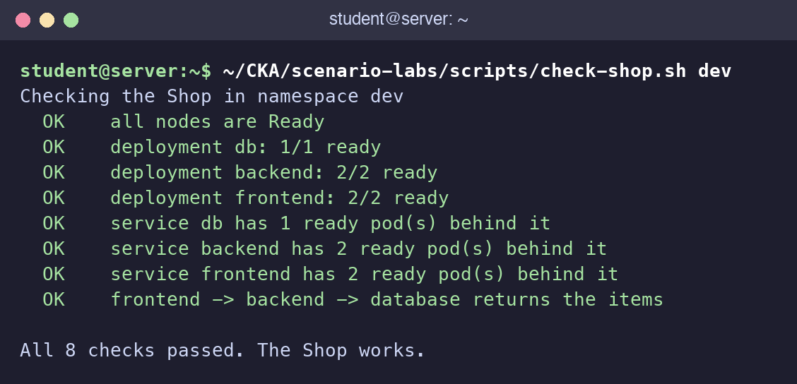

# Workshop 1: Start: the whole Shop in one command

**Goal:** everyone starts the workshop day with the same working Shop in the `dev` namespace.

📘 **More detail:** [Workshop 1 explained](./lab-w1-start-explained.md): what happens in the cluster at each step, common mistakes and exam notes.

- If you did the course labs on this server, your Shop is already there. Do **Step 2** only.
- If you are new on this server (the first group), do **Step 1** and **Step 2**.

> **How to use this lab**
>
> - **📋 Copy and paste into your terminal:** copy the whole grey box (the copy button is in its top right corner), paste it into the terminal of your server, and press Enter.
> - **👀 You should see** *(do not paste)*: what the command prints. Names that end in random letters, IP addresses and ages are different on your server. That is normal.
> - **📖 Read only:** something to look at. Do not paste it.
> - **💡 Tip:** a shortcut or an extra. You do not need it to finish the lab.

## Before you start

**📋 Copy and paste into your terminal:**

```bash
cd ~/CKA/scenario-labs/workshop
kubectl config set-context --current --namespace=dev
```

**What this does:**

- `cd ~/CKA/scenario-labs/workshop`: Goes to the folder `~/CKA/scenario-labs/workshop`.
- `kubectl config set-context --current --namespace=dev`: Makes `dev` your working namespace: commands without `-n` now work in `dev`.

**👀 You should see** *(do not paste)*:

```text
Context "minikube" modified.
```

💡 **Tip:** `kubens dev` does the same as the second line (see the shortcuts in [setup, Step 5](../00-setup.md)).

## Step 1: build the Shop

Your server must have the cluster running first. If it has not, do [00-setup.md](../00-setup.md).

**📋 Copy and paste into your terminal:**

```bash
~/CKA/scenario-labs/scripts/deploy-shop.sh dev
```

**What this does:** Runs the course script that builds the whole Shop in `dev` in one go (namespace, password, disk, quota, the three parts, network policies).

It takes about two minutes. It creates, in this order: the namespace, the database password, the disk, the limits and quota, the three parts of the Shop, and the network policies.

**👀 You should see** (the last lines) *(do not paste)*:

```text
deployment "frontend" successfully rolled out

NAME                        READY   STATUS    RESTARTS   AGE
backend-5fd8c7d84f-fckkg    1/1     Running   0          49s
backend-5fd8c7d84f-hzlqj    1/1     Running   0          40s
db-56d76b79f9-tgcbl         1/1     Running   0          5s
frontend-7765699df4-5xd8p   1/1     Running   0          6s
frontend-7765699df4-6gnr2   1/1     Running   0          3s

Done. Test it:  /home/ubuntu/CKA/scenario-labs/scripts/check-shop.sh dev
```

## Step 2: check the Shop

**📋 Copy and paste into your terminal:**

```bash
~/CKA/scenario-labs/scripts/check-shop.sh dev
```

**What this does:** Runs the course script that checks every part of the Shop in `dev` and prints OK or FAIL for each check.

**👀 You should see** *(do not paste)*:

```text
Checking the Shop in namespace dev
  OK    all nodes are Ready
  OK    deployment db: 1/1 ready
  OK    deployment backend: 2/2 ready
  OK    deployment frontend: 2/2 ready
  OK    service db has 1 ready pod(s) behind it
  OK    service backend has 2 ready pod(s) behind it
  OK    service frontend has 2 ready pod(s) behind it
  OK    frontend -> backend -> database returns the items

All 8 checks passed. The Shop works.
```



## Step 3: look at what you have

Walk through the Shop with your partner. The person from the new group explains each line to the person from the first group.

**📋 Copy and paste into your terminal:**

```bash
kubectl get deployments,services,pvc,networkpolicies,resourcequota -n dev
```

**What this does:** Lists the Deployments, Services, disk claims, network policies and quotas in the namespace `dev`.

**👀 You should see** the Deployments `db`, `backend` and `frontend`, their Services, the database's disk claim, the network policies and the quota.

Answer these together:

1. Which three Deployments make up the Shop, and how many pods does each have?
2. Which Service does a user reach first?
3. Where does the database keep its data?
4. Who is allowed to talk to the database?

## Step 4: open the Shop

**📋 Copy and paste into your terminal:**

```bash
kubectl port-forward service/frontend 8080:80 -n dev > /dev/null 2>&1 &
sleep 2
curl -s http://localhost:8080/api/items
```

**What this does:**

- `kubectl port-forward service/frontend 8080:80 ...`: Connects port 8080 of your server (`localhost:8080`) to the Service `frontend` in `dev`. The `&` at the end keeps it running in the background.
- `sleep 2`: Waits 2 seconds, to give Kubernetes time.
- `curl -s http://localhost:8080/api/items`: Asks for `http://localhost:8080/api/items`, as a web browser would, and prints the answer.

**👀 You should see** *(do not paste)*:

```text
[{"id":1,"name":"Coffee","price":35},
 {"id":2,"name":"Tea","price":25},
 {"id":3,"name":"Muffin","price":30}]
```

Stop the port-forward again:

**📋 Copy and paste into your terminal:**

```bash
kill %1
```

**What this does:** Stops the command that runs in the background (the port-forward).

✅ **Check:** `check-shop.sh dev` ends with `The Shop works.` Now go to [Workshop 2](./lab-w2-challenge-rounds.md).
