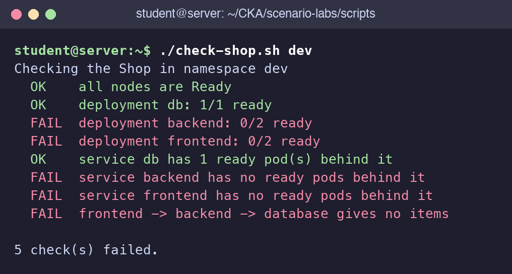

# Workshop 3: Break-and-fix in pairs

**Goal:** the Shop in `dev` gets **five faults at the same time**. As a pair, find and fix all five, and explain each one.

This is the hardest kind of troubleshooting: one fault can hide another. Fix one, check, and go on.

> **How to use this lab**
>
> - **📋 Copy and paste into your terminal:** copy the whole grey box (the copy button is in its top right corner), paste it into the terminal of your server, and press Enter.
> - **👀 You should see** *(do not paste)*: what the command prints. Names that end in random letters, IP addresses and ages are different on your server. That is normal.
> - **📖 Read only:** something to look at. Do not paste it.
> - **💡 Tip:** a shortcut or an extra. You do not need it to finish the lab.

## The rules

- Work in **pairs**. One person types, the other reads the method and keeps notes. Swap after each fault you fix.
- Use the method from [Lab 8.1](../08-troubleshooting/lab-8.1-break-and-fix.md): pods → logs → Service → rules (quota, network) → nodes.
- Write down, for each fault: **what you saw**, **what was wrong**, **how you fixed it**. The trainer asks pairs to explain.
- You have 60 minutes.

## Step 1: make sure the Shop works

**📋 Copy and paste into your terminal:**

```bash
cd ~/CKA/scenario-labs/scripts
kubectl config set-context --current --namespace=dev
./check-shop.sh dev
```

**What this does:**

- `cd ~/CKA/scenario-labs/scripts`: Goes to the folder `~/CKA/scenario-labs/scripts`.
- `kubectl config set-context --current --namespace=dev`: Makes `dev` your working namespace: commands without `-n` now work in `dev`.
- `./check-shop.sh dev`: Runs the course script that checks every part of the Shop in `dev` and prints OK or FAIL for each check.

**👀 You should see** *(do not paste)*:

```text
Context "minikube" modified.
```

**👀 You should see** (last line) *(do not paste)*:

```text
All 8 checks passed. The Shop works.
```

## Step 2: break it

**📋 Copy and paste into your terminal:**

```bash
./break.sh all
```

**What this does:** Runs the course script that puts faults 1 to 5 into the Shop in `dev`, all at once.

**👀 You should see** *(do not paste)*:

```text
Five faults are now in the Shop (namespace dev). Find and fix them all.
Check your work with:  ./check-shop.sh dev
```

## Step 3: find and fix

Run the check as often as you like. It tells you what does not work, not why. Right after a fix, give it 30 seconds: the backend needs a moment to reconnect.

**📋 Copy and paste into your terminal:**

```bash
./check-shop.sh dev
```

**What this does:** Runs the course script that checks every part of the Shop in `dev` and prints OK or FAIL for each check.

**👀 You should see** several lines with `FAIL` *(do not paste)*:



Your notes:

| # | What we saw | What was wrong | How we fixed it |
| --- | --- | --- | --- |
| 1 | | | |
| 2 | | | |
| 3 | | | |
| 4 | | | |
| 5 | | | |

<details><summary>Hint 1: where to start</summary>

Start with `kubectl get pods`. Fix what you see there first. Then run the check again.

</details>

<details><summary>Hint 2: the five areas</summary>

One fault each in: an **image**, a **Service selector**, a **Secret name**, the **quota**, a **network policy**.

</details>

<details><summary>All five answers</summary>

They are faults 1 to 5 of [Lab 8.1](../08-troubleshooting/lab-8.1-break-and-fix.md). A good order to fix them in (📋 copy and paste into your terminal, one block):

```bash
# quota first: nothing new can start while it is too low
kubectl patch resourcequota env-quota -p '{"spec":{"hard":{"pods":"10"}}}'
# the frontend image
kubectl set image deployment/frontend frontend=nginx:1.27-alpine
# the backend's Secret name
kubectl patch deployment backend --type=json -p '[{"op":"replace","path":"/spec/template/spec/containers/0/env/0/valueFrom/secretKeyRef/name","value":"db-secret"}]'
# the backend Service selector
kubectl patch service backend -p '{"spec":{"selector":{"app":"backend"}}}'
# the network policy port
kubectl apply -f ../03-networking/netpol-allow-app.yaml
# start fresh pods and wait
kubectl rollout restart deployment/frontend deployment/backend
kubectl rollout status deployment/frontend
kubectl rollout status deployment/backend
```

**What this does:**

- `kubectl patch resourcequota env-quota ...`: Changes the quota `env-quota`: only the part given after `-p`.
- `kubectl set image deployment/frontend ...`: Changes the image of the container `frontend` in the Deployment `frontend` to `nginx:1.27-alpine`. This starts a rolling update.
- `kubectl patch deployment backend ...`: Changes the Deployment `backend`: only the part given after `-p`.
- `kubectl patch service backend ...`: Changes the Service `backend`: only the part given after `-p`.
- `kubectl apply -f ../03-networking/netpol-allow-app.yaml`: Creates (or updates) what is described in `../03-networking/netpol-allow-app.yaml`.
- `kubectl rollout restart deployment/frontend ...`: Replaces the pods of the Deployments `frontend` and `backend` with new ones, one by one.
- `kubectl rollout status deployment/frontend`: Waits until the new pods of the Deployment `frontend` are all ready, and says when it is done.
- `kubectl rollout status deployment/backend`: Waits until the new pods of the Deployment `backend` are all ready, and says when it is done.

**👀 You should see** (the last line) *(do not paste)*:

```text
deployment "backend" successfully rolled out
```

</details>

## Step 4: done

**📋 Copy and paste into your terminal:**

```bash
./check-shop.sh dev
```

**What this does:** Runs the course script that checks every part of the Shop in `dev` and prints OK or FAIL for each check.

**👀 You should see** *(do not paste)*:

```text
All 8 checks passed. The Shop works.
```

## Step 5: explain

Each pair explains one fault to the group: what you saw first, which command showed the cause, and the fix.

✅ **Check:** the check script passes, and your notes table has five rows filled in.

**Next:** [Workshop 4: Mock exam](./lab-w4-mock-exam.md)
